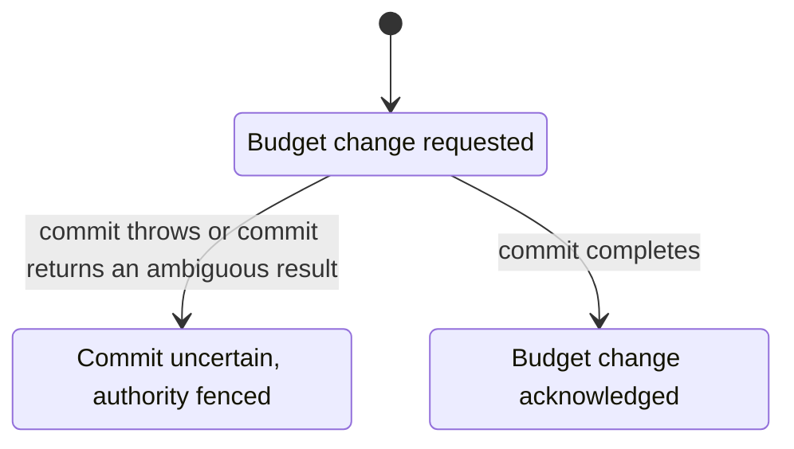

# Broker hosting budget authority

**Properties:** Admission counts the complete liability bound and existing outside exposure; claimed or uncertain execution retains its hold; journal callbacks cannot re-enter a mutation; a failed callback leaves no acknowledged state change or definitive denial; exceptions and ambiguous callback results fence subsequent use; live entitlement claims retain their unit and period; evidence-backed settlement is idempotent.

**Why:** A missing hold or lost journal entry can fund multiple provider operations with the same money, while a premature release can leave running work unaccounted for.

**Review baseline:** commit `3e7526f7b`. PASS for the stated generated cases, bounded models, and Z3 abstractions under the assumptions below.

## Covered code

- `packages/broker/src/budget-authority.ts`: `createBudgetAdmissionAuthority`, especially `reserve`, `claimExecution`, `uncertain`, `release`, `settle`, `save`, and journal replay.
- `packages/broker/test/budget-authority.property.test.ts`: generated actual-code cases.
- `packages/broker/test/budget-admission-denial.test.ts`: definitive denial and uncertain commit classification.
- `packages/broker/src/budget-fence-settlement.ts` and `packages/broker/test/fenced-budget-settlement.test.ts`: receiver- and finance-signed settlement verification, with generated adversarial histories.
- `packages/hobo/src/hosting-budget-authority.ts` and `packages/hobo/test/hosting-budget-authority.test.ts`: existing SQLite-backed composition examples exercise the bridge from cloud planning and transitions to the broker authority.
- `packages/broker/src/budget-sqlite.ts` and `budget-postgres.ts` implement external persistence but are not themselves proven by these checks.
- `packages/broker/src/yard-placement/deploy.ts` consumes this authority; its whole execution and provider effects are not proven here.

## Run

From the repository root after installing workspace dependencies:

```sh
bash scripts/verify-state-machine.sh .agents/skills/verify-broker-budget-authority
```

This runs fast-check, signed-settlement cases, the HoBo hosting bridge's existing integration tests, deliberately broken models and implementations, TLC 1.7.4, and Z3 4.15.4 induction proofs. Set `TLA2TOOLS` to the checksum-pinned jar or let the shared runner download it. Set `BUDGET_Z3_PYTHONPATH` to an existing `z3-solver==4.15.4.0` installation or let the test install that hash-pinned wheel into a temporary directory. Every pre-provisioned, ambient, and installed import is version-checked; a mismatch is replaced from pinned hashes, while an unsupported platform or failed verification fails closed. `tests/z3-version.mts` proves the guard replaces a wrong ambient import and still fails closed when the replacement is wrong. Java 11+, Python with pip, Node with the repo's `tsx`, Vitest, fast-check, and built workspace dependencies for the composition tests are required. Use `/statechart` to read the TLA+ result and its view.

## Scope and evidence

The generated tests use seed 614440 and 350 examples per original property, seed 614441 and 100 re-entry histories, seed 614442 and 100 zero-unit entitlement-scope histories, and seed 614454 and 50 commit-error classifications. They vary spend, unresolved liability, recovery reserves, outside commitments, request bounds and repeated holds; independently check provider-account and entitlement limits and reserved projections; check uncertain and claimed execution, journal replay and evidence-backed idempotent settlement; inject a journal callback failure before and after append into reserve, claim, uncertain, release and settle; attempt nested admissions from the commit callback; and vary active scope changes across held, uncertain, and claimed reservations. Denial-shaped failures and proxy-wrapped failures must remain uncertain without invoking proxy traps. They exercise the synchronous authority with an in-memory journal and check recovery from the actual recorded events. The separate existing HoBo composition tests exercise concrete examples of SQLite authority connections, shared credits, reservation adoption, crash recovery and final settlement; they are not generated tests. Neither check proves the SQLite or PostgreSQL adapters, and the generated tests do not cover competing processes, provider effects, or overrun settlement.

TLC explores 81 distinct states for two requests, one unit of budget, and one-unit holds. Atomic reserve, claim, uncertainty, evidence, release, and settlement actions model the synchronous authority. A request cannot be released after claim, settlement requires final evidence, and release requires unused-execution evidence. Actual cost may be zero, one, or two units; spent plus held remains within the cap until a provider overrun. The model abstracts observation contents, persistent storage, CAS, outside commitments, policy changes, retries, and account and entitlement dimensions. The chart follows the first request and hides the other request's same-label steps; release is possible only if execution was never claimed.

BrokerFence explores 40 distinct states for one reservation, a claimed or unclaimed hold, up to three evidence offers, and both release and settlement. Its invariants require both authentic, correctly bound proofs and a claim before settlement, and retain a claimed hold until settlement. The model treats signature verification, binding checks, trust enrollment, and persistence as correct atomic predicates; it does not prove cryptography, storage, concurrency, or the external receiver and finance authorities. The `/statechart` view distinguishes unclaimed holds, unused-work confirmation, claimed holds, and terminal states.

BrokerCommit explores 5 distinct states. It models a journal callback attempting a nested admission and requires at most one acknowledged admission and sequence write; aborting a rejected nested mutation leaves neither. It abstracts the adapter's physical append and assumes a single JavaScript authority instance.

BrokerCommitResult explores 17 states for primitive synchronous results, ambiguous object results, and exceptions raised before or after a write completes, including denial-shaped exceptions. Pending writes can complete after the authority is fenced. It refuses ambiguous object results, prevents reuse after uncertainty or an exception, and does not report a commit failure as a definitive denial; weakened guards produce counterexamples for each rule. Generated actual-code cases cover cross-realm and local promises, a thenable with an accessor that must not run, ordinary objects and functions, and all public operations after the refusal. A synchronous callback must still actually persist the event before returning: no return-value check can detect a host that starts asynchronous work and returns a primitive. The host must reconcile any possibly pending write before reopening.

The baseline three-state projection hides internal durability transitions, including completion of a pending write:



BrokerEntitlement explores 69 distinct states. It follows a zero-unit claim through reserve, claim, uncertainty, configuration, replay, release, and settlement. Its invariants keep unit and period stable while the claim is active and reject mismatched replay. The `/statechart` view separates active, refused-scope, replay-rejected, and terminal claims. It abstracts bucket quantities and durable adapter concurrency.

The signed-settlement property uses seed 614450 and 120 generated histories. It varies final usage including overruns, uncertainty, and sequences of forged receiver signatures, forged finance signatures, changed charges, evidence references, account usage, and receipt scopes. The receiver forgery is accompanied by an otherwise valid finance signature. Every rejection must retain the hold and produce no event; after valid settlement, repeated settlement and journal replay preserve the result. A PostgreSQL integration case is skipped without its configured database.

The budget Z3 induction proves that arbitrarily many exact-real reserve, release, and settlement steps preserve `spent + held + unresolved + recovery + external <= cap`, assuming a safe initial state, fixed nonnegative outside exposures, an admission guard counting the full quote, and final usage no larger than its released hold. Claims and uncertain outcomes retain the same aggregate. The scope induction proves an equality-only abstraction in which active claims preserve their unit and period through configuration and replay, while terminal claims leave the active projection. These are unbounded mathematical proofs of abstractions, not proofs of TypeScript refinement, durable CAS, provider bills, or behavior when outside exposure changes. The budget proof also demonstrates that an actual overrun can exceed the cap; the implementation records overruns rather than pretending they cannot occur.

In scratch copies, 15 implementation mutations are detected: missing unresolved, account, or entitlement exposure; release after claim; state publication before a failing commit; commit re-entry, reuse after uncertainty, or misclassification of commit errors; zero-unit scope changes in configuration or replay; and omitted receiver or finance signature verification. Eleven weakened-model cases violate independently stated invariants for evidence, signatures, claimed holds, commit handling, and live entitlement scope. Three weakened Z3 obligations produce counterexamples when unresolved liability, claim unit, or claim period is omitted. The mutation runner restores the unmodified implementation and reruns the generated suites before passing. It fails closed when a case is not killed: a property case must report `Property failed after`, while a denial-suite assertion must report `AssertionError` or `Property failed after`.

## Keep in sync

Inspect changes to the covered files since the sync commit, including uncommitted changes. Update the model and generated checks for intended behavior, replay model counterexamples against real code, rerun the check and deliberately broken scratch variants, then advance the sync commit only after confirming correspondence. Use `/maintain-formal-verification-skill`.
