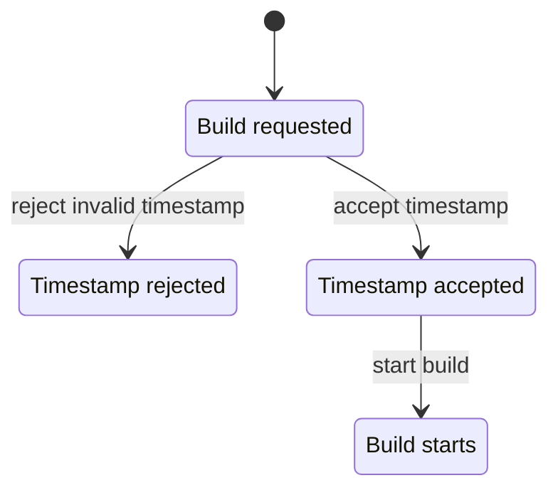

# Build timestamp validation

**Property:** Component and container build requests reject ambiguous, invalid, negative or out-of-range timestamps before invoking a builder. Accepted numeric seconds and explicit-zone timestamps yield the intended whole Unix second for the real component and container toolchains.

**Why:** A build whose timestamp depends on the host time zone, silently rolls to another date or loses numeric precision cannot reliably reproduce its declared inputs.

**Review baseline:** `e296f203a36afa4b63be7c043a34f3e4475a70b7`.

## Covered code and checks

- `packages/componentize/src/source-date-epoch.ts` parses and normalizes the timestamp; `src/componentize.ts` and `src/real-componentize.ts` call it before building. `src/index.ts` exports the shared normalizer.
- `packages/cli/src/build/container-build.ts` uses that normalizer for both Docker and BuildKit.
- `packages/componentize/test/source-date-epoch.test.ts` exercises invalid inputs, both component paths, and 600 deterministically generated numeric and ISO cases. `packages/cli/test/container-build.test.ts` checks rejection before a fake executable runs and checks the seconds passed to both fake container builders.

From the repository root with dependencies installed, run:

```sh
bash scripts/verify-state-machine.sh .agents/skills/verify-build-epoch
```

The runner checks the pinned TLC 1.7.4 jar and uses Z3 4.15.4. Set `TLA2TOOLS` and `BUDGET_Z3_PYTHONPATH` to existing installations for offline runs. Java 11+, Python, Node and repository dependencies are required. This separate command tests seven deliberately broken scratch implementations and reruns the restored skill:

```sh
python3 .agents/skills/verify-build-epoch/mutations/full.py
```

## Model and evidence

`BuildEpoch` checks 56 states for one request: four builder lanes, two valid input categories and four invalid categories. It requires rejection before starting an invalid build and the correct abstract second at toolchain invocation. Its eventual-decision property assumes weak fairness for the check; it does not assert a successful build. Five weakened configurations yield counterexamples. Read every TLC result with `/statechart`; the maintained view supplies the projection. The following chart merges builder lanes and input categories; 24 same-label steps are hidden.



Before the fix, a local timestamp could be interpreted in the host time zone, an impossible date could roll forward, and large numeric seconds could lose precision or become infinite. Component regression tests reproduce the old acceptance and the CLI test uses a fake builder to show the gate is before execution. The scratch mutations remove each guard, change rounding, or restore the independent CLI parser. Z3 proves integer bounds and division properties for the modeled range; it also finds an overflow witness without a bound.

The model abstracts timestamp parsing into input categories and one representative second. It assumes correctly classified input, terminating validation, a trustworthy JavaScript `Date` implementation and correctly executed toolchains. It does not prove that the TypeScript parser refines the model, check every ISO string, prove IEEE floating-point operations, model external toolchain failures, or establish byte-for-byte reproducibility of the real component toolchain. Real component output has known upstream nondeterminism. The CLI test invokes fake executables, and the component test injects a fake compiler. The 600 generated examples are deterministic and do not shrink failing inputs.

## Keep in sync

Inspect changes to covered code, input formats, toolchain behavior and tests since the baseline, including uncommitted changes. Replay counterexamples against real code, rerun verification and mutations, and advance the baseline only after the model and implementation agree. Use `/maintain-formal-verification-skill` for that review.
