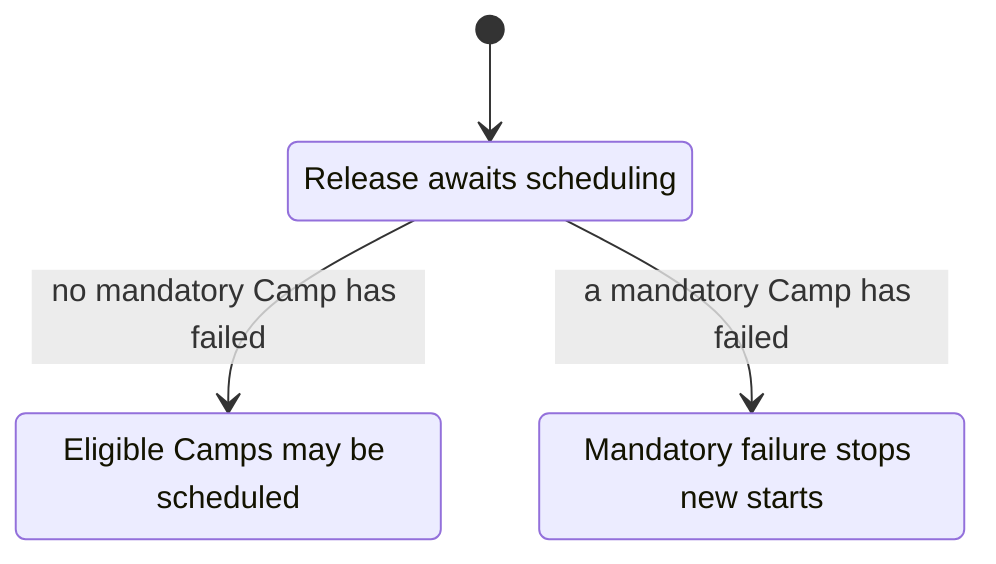

# CD release fan-out

**Property:** A halted fan-out or a failed mandatory Camp schedules no new work; production waits for the mandatory pilot, including during catch-up; and a missing slot is pending rather than complete.

**Why:** A halted or unsafe release can spread to additional environments.

**Review baseline:** `a005bbb5b` plus the mandatory-failure changes in this skill's commit. PASS within the stated model bounds and for the parameterized abstraction under its assumptions.

## Covered code

- `packages/cd/src/fanout/schedule.ts`
- `packages/cd/src/fanout/controller.ts`
- `packages/cd/src/fanout/state.ts`
- `packages/cd/test/fanout/schedule.property.test.ts`

## Run

From the repository root:

```sh
bash scripts/verify-state-machine.sh .agents/skills/verify-cd-fanout
```

The command runs the real-code examples, fast-check properties, a Z3 4.15.4 induction proof, and TLC 1.7.4 with the pinned checksum. It uses `TLA2TOOLS` if set; otherwise it downloads the jar into a temporary directory. Set `BUDGET_Z3_PYTHONPATH` to an existing `z3-solver==4.15.4.0` installation or let the check install it temporarily. Java 11+, Python with pip, Node with the repo's `tsx`, Vitest and fast-check, `curl`, and `sha256sum` are required. A nonzero exit is a failure, including a currently recorded finding. Read each TLA+ result with `/statechart`; it can draw the model using the view in `models/`.

## Scope and evidence

The model has one mandatory pilot and one production Camp, one free slot, no catch-up mode; existing in-flight work may finish while halted. The real-code property test generates up to five pilot and five production Camps, all five slot states, three strategies, and 500 cases with seed 614437. It checks the mandatory gate, halt, available slots, and candidate membership, with catch-up disabled. A second property uses seed 614452 and 500 examples with missing slots and both normal and catch-up modes. It checks mandatory gating, halt, and completion against an independent missing-as-pending expectation. Seed 614453 generates failed and deferred Camps across two mandatory groups and both modes, requiring no new candidates after a mandatory failure. The normal journal fold initializes every slot, so missing-slot cases exercise the public scheduler with incomplete input. Async controller races, windows, retries, and failure budgets are outside the models.

FanoutCatchup explores 256 states and 256 steps with one pilot and one production Camp, missing, deferred, succeeded, or failed slots, both modes, halt, and free capacity. Independent invariants prevent production before mandatory success, prevent completion when a slot is missing, prevent scheduling while halted, and require eligible deferred pilots to remain schedulable. It abstracts the journal, in-flight states, windows, controller concurrency, and effects. The `/statechart` projection has five states, four arrows, and hides 128 same-label steps.

FanoutMandatoryFailure explores 108 states and 108 steps across two mandatory groups and a production Camp, deferred or terminal slots, and both scheduling modes. Its independent invariant requires no new candidates after any mandatory failure. It abstracts pending and in-flight work, capacity, the journal, concurrency, windows and external effects; already in-flight work may still finish. The `/statechart` projection hides 54 same-label steps:



The Z3 induction proves a count-based abstraction for any number of mandatory Camps and starts: production starts only once every mandatory Camp has succeeded, and a halt or mandatory failure prevents a new start. The proof includes a separate catch-up start obligation and assumes an atomic scheduler, accurate failure counts, monotone mandatory successes during one run, and the guards in both modes. The proof does not establish TypeScript refinement, controller concurrency, retries, or behavior when state is reset.

Mutation evidence: The executable mutation harness checks five isolated implementation mutations: removing the halt guard, allowing starts after mandatory failure during catch-up, removing the normal mandatory-group scope, bypassing the catch-up mandatory gate, and ignoring missing slots during completion. Each generated property produces a counterexample, and the restored implementation passes. Five corresponding TLA+ mutations violate their independent invariants. Four weakened Z3 guards, including mandatory-failure fencing, produce counterexamples.

A TLC pass checks this model, not the entire implementation. The tests exercise the stated real-code cases, not all possible implementations or production integrations. See `docs/state-machines.md` for the inventory and user-facing charts.

## Keep in sync

Before trusting a result, inspect changes to the covered files since the review baseline, including uncommitted changes. If behavior changed, update the model and real-code checks; distinguish a real counterexample from a model mismatch by replaying it against the code. Run the check, reproduce a deliberately broken variant in a scratch copy, then move the review baseline forward only after confirming the model still describes the code. Use `/maintain-formal-verification-skill` for that update.
