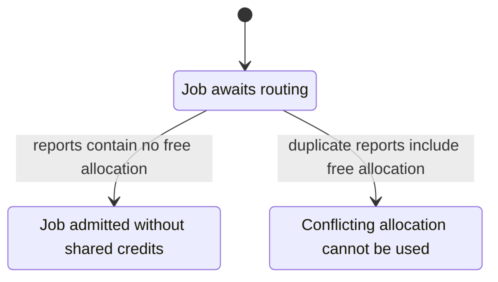

# CI account-budget routing

**Property:** CI may select a runner only if its new cost plus account spending, active holds, and locally completed usage not covered by an observation fit the account budget. For offers sharing a provider account, both the offer budget and shared policy count the greatest reported account exposure, independent of offer order; duplicated account reports cannot authorize free allocation.

**Why:** Overlooking a hold or completion can admit a runner using budget already committed elsewhere.

**Result at sync commit `719f8cbe6cf9a5cb9635f6d0055dd66ae2393604`:** PASS for the stated bounds and generated real-code scenarios.
**Review baseline:** `12927757cdc1a3ed5bd7b3990f26ef067cdd564e` plus the duplicate-allocation changes in this skill's commit. PASS for the stated bounds, generated real-code scenarios, and deliberately weakened variants.

## Covered code

- `packages/ci/src/routing.ts` (`route`, `shouldCountLocalUsage`)
- `packages/ci/test/budget-routing.property.test.ts` and `routing.test.ts`
- `packages/ci/test/sandbox-pricing.test.ts`
- `packages/ci/src/accounting.ts` and `packages/pricing/src/legacy/accounting.ts` (allocation inputs)

## Run

From the repository root after installing workspace dependencies:

```sh
bash scripts/verify-state-machine.sh .agents/skills/verify-ci-budget-routing
```

The command runs fast-check against the actual CI route, TLC 1.7.4, a Z3 4.15.4 induction proof, and deliberately weakened models, proof, and scratch implementations. Set `BUDGET_Z3_PYTHONPATH` to the pinned Python solver or let the check install it in a temporary directory. Set `TLA2TOOLS` to the pinned jar or let the shared runner download it. Java 11+, Node with the repo's `tsx`, Vitest and fast-check are required. Use `/statechart` to read the TLA+ result and draw its view.

## Scope and evidence

The generated tests use seed 614436 and 400 examples per original property. They generate account caps, spending, runner prices, and active, completed, or released leases, and compare admission with independent integer-microcurrency arithmetic. They also generate completion times around an observation and require equality to remain counted. The router tests use seed 614513 and 500 fractional runtime-coverage pairs; exact financial time is modeled separately by `verify-ci-financial-time`. The account-budget property exercises one non-sandbox offer. A second generated property uses seed 614451 and 400 examples to vary two observations, prices, provider budget limits, shared-policy limits, and offer order; it requires both budget guards to count the higher exposure. With seed 614452, 100 generated cases reject contradictory duplicate runner-minute reports in either order while allowing an unrelated provider; concrete cases also cover repeated object references and sandbox allowances. Unknown observation timestamps retain completed local usage. The configuration parser rejects duplicate provider-account offers, so these multi-offer checks protect direct router calls with unvalidated data rather than a valid parsed configuration. They do not prove database concurrency or external billing.

A Z3 induction proves that taking the maximum of any number of nonnegative exact-real observations covers each observation, and that admission below a cap covers them all. A separate flag induction proves that, if the flag represents every prior report, denying duplicate reports whenever any report contains free allocation admits no reported free amount. These proofs assume truthful, comparable observations and exact arithmetic; they are not TypeScript refinement proofs and do not establish provider bills or concurrency. Executable proof mutations remove the maximum and the duplicate-allocation guard and require counterexamples.

CiProviderSnapshots checks two cash-only offers for one provider account, both orders, report values 0–2, a one-unit cost, and a two-unit cap (36 distinct states). Its independent invariants require the measured exposure to cover both reports and any admission to fit every report. It abstracts observation accuracy, usage and concurrency outside those reported values, and storage. Replacing the maximum with the first offer violates the model and generated implementation property. The `/statechart` projection draws three states and two arrows and hides 18 same-label steps.

CiProviderAllocation checks two duplicate reports, either choice, and one unit of a shared free allocation (16 states and 16 steps). An admitted claim may not exceed either report; refusing duplicate reports containing allocation enforces that rule. The model abstracts other providers, billing, observation authenticity, and multidimensional sandbox pricing; the implementation also refuses duplicate groups with any sandbox allowance. The `/statechart` projection hides eight steps within a displayed state:



The CiBudget model has a budget of two units, one new job, and existing unit holds. A completed hold becomes local unobserved spend; a strictly newer provider observation transfers it into observed spend. A same-time observation does not remove it. A route decision is atomic, and the model assumes provider observations are accurate; it does not prove that a later reservation is atomic or that providers obey the budget.

The mutation runner requires three model counterexamples, two proof counterexamples, and four real-code failures: allowing duplicate allocation, choosing the first provider observation, dropping unknown observation times, and omitting active holds. It then restores the unmodified routing implementation and reruns all generated properties before passing.

## Keep in sync

Inspect changes to the covered files since the sync commit, including uncommitted changes. Update the model and generated checks for intentional behavior changes, replay model counterexamples against real code, rerun the check and a deliberately broken scratch variant, and advance the sync commit only after confirming correspondence. Use `/maintain-formal-verification-skill`.
