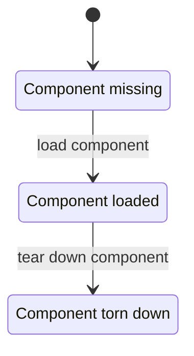
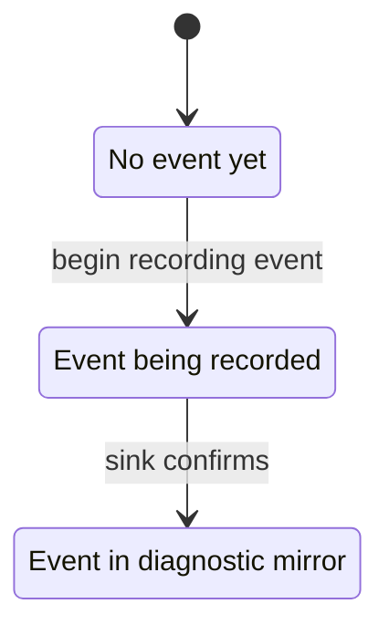

# Local component host diagnostic snapshots

**Property:** Editing a returned lifecycle record, a sink-owned event, or a returned event array or record does not change the host's retained lifecycle state or event mirror.

**Why:** Diagnostics should change when the host carries out a component operation, not when a reader or event sink edits an object it received.

**Review baseline:** `d877cf7fead4a68b2ccc45e755519615a60b4d66`.

## Covered code and checks

- `packages/runtimes/runtime-local/src/component-host.ts` copies lifecycle records on read, captures each mirror event before passing the original to the sink, and copies the mirror array and its records on read. `packages/core/src/ports/component-host.ts` defines event fields, which are primitive strings today.
- `packages/runtimes/runtime-local/test/component-host-diagnostics.test.ts` exercises edits during and after sink callbacks, lifecycle records before and after teardown, and edits to returned event records and arrays. A deterministic generator with seed `0x45312a7b` runs 60 sequences of 24 edit or teardown actions against the real host.
- The related [component-load skill](../verify-component-load-lifecycle/SKILL.md) checks exclusive, identity-bound loads. The [host failure skill](../verify-component-host-failure/SKILL.md) checks sink uncertainty and active-call teardown fencing.

From the repository root with dependencies installed, run:

```sh
bash scripts/verify-state-machine.sh .agents/skills/verify-component-host-diagnostics
```

The runner checks the pinned TLC 1.7.4 jar and uses Z3 4.15.4. Set `TLA2TOOLS` and `BUDGET_Z3_PYTHONPATH` to existing installations for offline runs. Java 11+, Python, Node and the repository dependencies are required. This separate command runs four deliberately broken scratch implementations through the full skill and reruns the restored code:

```sh
python3 .agents/skills/verify-component-host-diagnostics/mutations/full.py
```

## Model and evidence

`ComponentLifecycleSnapshot` checks nine states and 18 steps for one component, one lifecycle read and edit, load and teardown. A read before teardown may be edited after teardown; the model tracks whether it still references the current record. Its three-state projection has two arrows and hides 14 same-label steps, including reads and edits. Read every TLC result with `/statechart`; the maintained views supply the projections.



`ComponentEventSnapshot` checks 13 states and 32 steps for one event, one sink edit before or after it is recorded, and one reader that can edit a record and clear the array. Its three-state projection has two arrows and hides 29 same-label steps, including sink and reader edits.



Before the fix, reading a lifecycle and changing its state changed subsequent reads; mutating an event during or after the sink callback changed the mirror; and changing a returned array or record changed later mirror reads. The real-code tests replay these cases. Four weakened TLC configurations yield counterexamples, and four corresponding real-code mutations fail assertions. Z3 proves that writing a distinct abstract mutable cell cannot change the owner cell; it also shows that distinct arrays can still contain an aliased record. These are mathematical abstraction results, not a proof of TypeScript refinement.

The models abstract one lifecycle and one representative event rather than multiple components, repeated reads, arbitrary callbacks, failed sinks or every event type. The JavaScript implementation checks generated multi-step sequences as well as the focused cases. Snapshot copies are shallow and rely on the current primitive event and lifecycle fields; nested mutable fields would require a stronger copy and new checks. The sink can change what it writes, so the mirror is not proof that the external event log contains the same value. Engine objects, persistence and JavaScript intrinsics remain trusted.

## Keep in sync

Inspect changes to covered code, event field types and tests since the baseline, including uncommitted changes. Replay counterexamples against real code, rerun verification and mutations, and advance the baseline only after the model and implementation agree. Use `/maintain-formal-verification-skill` for that review.
