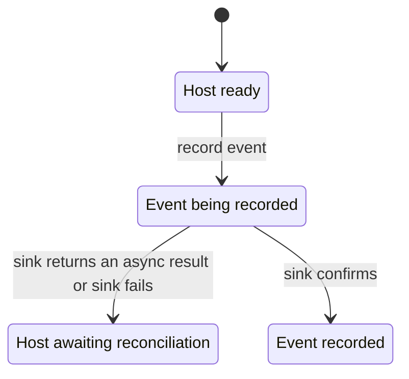
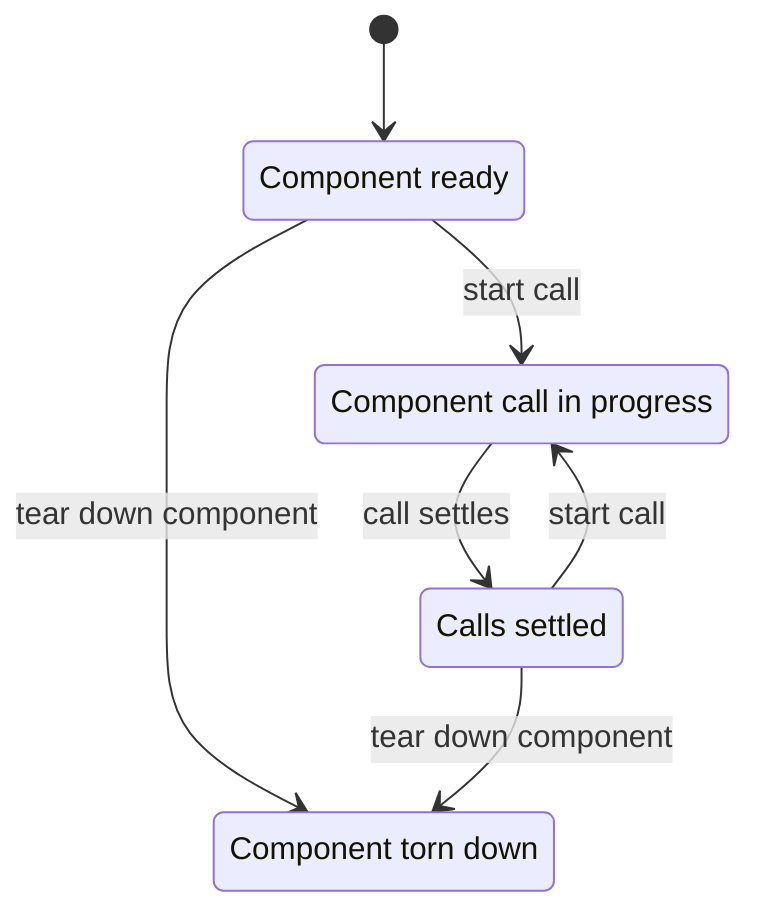

# Local component host failure and call lifetime

**Property:** When the synchronous event sink throws or returns a promise or thenable, the host reports an uncertain outcome and refuses subsequent effectful operations. A sink callback cannot reenter those operations, and an uncertain completion is not recorded as a component trap. Teardown refuses while a tracked linked or HTTP call is active and becomes available after the call settles.

**Why:** An event may have been written before the sink fails; continuing can make local state diverge further. Tearing down a component while one of its calls is still running can release its tracked state before the call finishes.

**Review baseline:** `d877cf7fead4a68b2ccc45e755519615a60b4d66`.

## Covered code and checks

- `packages/runtimes/runtime-local/src/component-host.ts` handles sink uncertainty and reentry, tracks in-flight calls and fences teardown. `src/errors.ts` defines the named refusals.
- `packages/runtimes/runtime-local/test/component-host-failure.test.ts` checks failure before and after a sink write, promises and thenables, all effectful entry points, callback reentry, completion versus trap handling, overlapping linked and HTTP calls, and release after provider failure. Forty generated identities cover both sink outcomes.
- The related [component-load skill](../verify-component-load-lifecycle/SKILL.md) checks exclusive and identity-bound loading.

The related [diagnostic snapshot skill](../verify-component-host-diagnostics/SKILL.md) checks lifecycle and event mirror isolation.

From the repository root with dependencies installed, run:

```sh
bash scripts/verify-state-machine.sh .agents/skills/verify-component-host-failure
```

The runner checks the pinned TLC 1.7.4 jar and uses Z3 4.15.4. Set `TLA2TOOLS` and `BUDGET_Z3_PYTHONPATH` to existing installations for offline runs. Java 11+, Python, Node and the repository dependencies are required. This separate command runs nineteen deliberately broken scratch implementations through the full skill and reruns the restored code:

```sh
python3 .agents/skills/verify-component-host-failure/mutations/full.py
```

## Model and evidence

`ComponentSink` checks 66 states and 106 steps for five abstract operations, both possible sink commit outcomes, callback reentry and asynchronous returns. It requires refusal after failure, refusal of reentrant effects, no extra trap after uncertain completion and no acceptance of an asynchronous sink. Its four-state projection has three arrows and hides 56 same-label steps. Read each TLC result with `/statechart`; the maintained views supply the projections.



`ComponentCalls` checks 18 states and 26 steps for up to two linked or HTTP calls, settlement and teardown. It requires no teardown during a call and a modeled fence count equal to the number of pending calls. Its four-state projection has five arrows and hides 12 same-label steps.



Previously, a sink failure could leave the host accepting further work, a callback could reenter the host, and teardown could release a component during an active call. Real-code tests cover these cases. Seven weakened TLC configurations and three weakened Z3 assumptions yield counterexamples. The uncertain-completion mutation removes both the direct propagation check and the independent append guard; either alone still refuses a second event. Z3 proves the stated boolean and integer-count implications, not TypeScript refinement.

The models bound the host to one modeled event and up to two calls of one modeled kind and abstract the engine, persistence, multiple processes and arbitrary callback behavior. A sink failure remains ambiguous: the host stops new work but cannot undo state changes or cancel already-started effects, and it has no automatic reconciliation or replay. A never-settling call keeps teardown fenced. Sinks must be synchronous; a returned thenable may already have started work before it is refused. The sink and JavaScript intrinsics remain trusted, including access to a returned object's `then` property.

## Keep in sync

Inspect changes to covered code and tests since the baseline, including uncommitted changes. Replay counterexamples against real code, rerun verification and mutations, and advance the baseline only after the model and implementation agree. Use `/maintain-formal-verification-skill` for that review.
