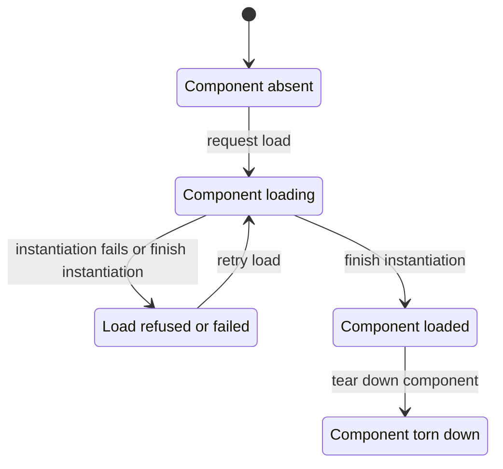

# Local component loading

**Property:** A component ID already loaded or being instantiated cannot be loaded again until teardown or a failed instantiation releases its claim. A successfully installed instance has the requested ID and the leases captured before instantiation.

**Why:** Replacing tracked state during a second or reentrant load can lose the first instance's leases and retain state associated with a different instance.

**Review baseline:** `08f10bdd76ae758b1130a0714807bce69f7ab5c8`.

## Covered code and checks

- `packages/runtimes/runtime-local/src/component-host.ts` claims IDs during instantiation, checks duplicate loads and returned IDs, and captures leases; `src/errors.ts` defines the named refusals.
- `packages/runtimes/runtime-local/test/component-load-lifecycle.test.ts` checks duplicate and reentrant loads, teardown and reload, failed instantiation followed by retry, identity mismatch and mutation of the input leases. Seed 614620 generates 60 component and lease identities.

- The related [host failure skill](../verify-component-host-failure/SKILL.md) checks sink uncertainty, callback reentry and active-call teardown fencing.

From the repository root with dependencies installed, run:

```sh
bash scripts/verify-state-machine.sh .agents/skills/verify-component-load-lifecycle
```

The runner checks the pinned TLC 1.7.4 jar and uses Z3 4.15.4. Set `TLA2TOOLS` and `BUDGET_Z3_PYTHONPATH` to existing installations for offline runs. Java 11+, Python, Node and the repository dependencies are required. This separate command runs six deliberately broken scratch implementations through the full skill and reruns the restored code:

```sh
python3 .agents/skills/verify-component-load-lifecycle/mutations/full.py
```

## Model and evidence

`ComponentLoad` checks 78 states and 138 steps for one component identity, an optional reentrant load, a duplicate load, a changing lease list, a matching or mismatched engine result, a failure, retry and teardown. It checks exclusivity, installed identity, captured leases and claim release on modeled instantiation failure. The five-state projection has five arrows and hides 68 same-label steps. Read each TLC result with `/statechart`; the maintained view supplies the projection.



Previously, a second load silently replaced the first component's tracked leases, a reentrant load could begin before the first completed, and a mismatched engine result was accepted. Real-code checks reproduce each case. Five weakened TLC configurations and two weakened Z3 assumptions yield counterexamples. Z3 proves boolean implications of the abstract guards and identity check, not TypeScript refinement.

The model covers one ID and abstracts engine allocation, links, invocations, callback behavior and teardown races. The engine, descriptor and returned instance remain trusted; mutable instance contents can change after installation. A sink failure after state mutation remains ambiguous; the host refuses further effectful operations pending reconciliation. Teardown refuses while tracked calls are active, but cannot cancel already-started effects. An engine that allocates resources before failing or returning a mismatched ID must clean them up itself. The claim is process-local, and refusing duplicate loads changes previous replacement behavior.

## Keep in sync

Inspect changes to covered code and tests since the baseline, including uncommitted changes. Replay counterexamples against real code, rerun verification and mutations, and advance the baseline only after the model and implementation agree. Use `/maintain-formal-verification-skill` for that review.
