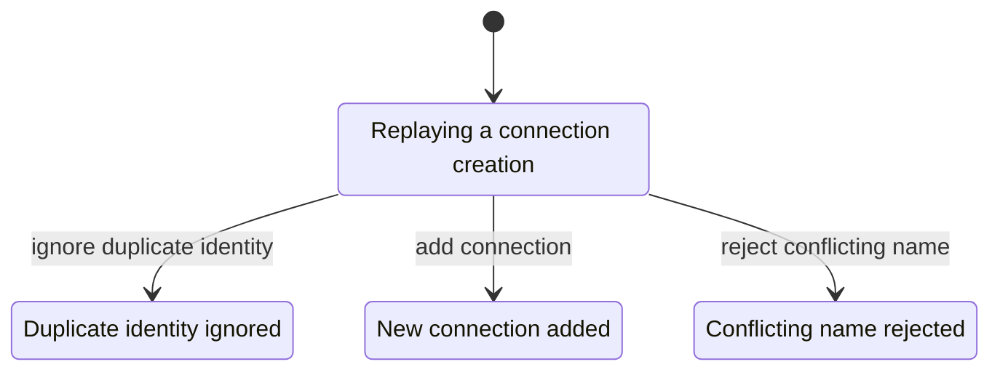

# Provider connection authorization and revocation

**Properties:** Revocation is terminal: a revoked connection must not later resolve for token use. The checked creation and replay paths refuse names that would bind an existing ID or alias to a different connection.

**Why:** A connection presented as revoked can become usable again, or an ambiguous name can identify a different connection after replay.

**Review basis:** commit `9083fd8a1c1896a7f0e3433253bc52d34816d93b`. The prior implementation allowed reauthorization after revocation. Existing token guard tests and create-new remediation establish terminal revocation; the corrected command and replay checks pass.

## Covered code

- `packages/identity/src/connection.ts`
- `packages/identity/src/connection-events.ts`
- `packages/identity/src/token-broker.ts`
- `packages/identity/test/connection-lifecycle.property.test.ts` and `connection-replay-alias.test.ts`

## Run

From the repository root:

```sh
bash scripts/verify-state-machine.sh .agents/skills/verify-connection-lifecycle
```

The command runs the real-code checks, fast-check histories, TLC 1.7.4 with the pinned checksum, weakened models, and an abstract Z3 4.15.4 proof. It uses `TLA2TOOLS` if set; otherwise it downloads the jar into a temporary directory. Java 11+, Python, Node with the repo's `tsx`, `curl`, and `sha256sum` are required. Set `BUDGET_Z3_PYTHONPATH` to an existing Z3 4.15.4 installation for offline use. Read each TLA+ result with `/statechart`; it can draw the model using the view in `models/`.

## Scope and evidence

One connection and one authorized subject; create, authorization, reauthorization, rotation, revocation, late facts, and token resolution are modeled. TLC reaches five states. The generated real-code check runs 200 histories (seed 614447), mixing authorization, rotation, reauthentication, repeated revocation, and late creation, authorization, health, reauthentication, and rotation facts. It checks that revocation remains terminal and rejected commands emit no events. The projection ignores facts that would revive a revoked connection.

`ConnectionAlias` explores 24 states and 36 generated states for one existing connection, one candidate creation, duplicate IDs, and three kinds of namespace collision. It checks that the old alias is not rebound and accepted names do not overlap. The chart merges name values and hides 12 same-label steps.



The real-code suite checks the collision cases and 100 generated name sets, including unique creations that must remain accepted and rejection without appending an event. Four weakened models expose late reauthorization and the three namespace conflicts. Z3 proves an abstract map update preserves existing lookups and the new ID under the stated distinctness guards; without the guards it finds counterexamples. The proof is not a TypeScript refinement proof.

Six scratch implementation mutations exercise revocation and the replay and creation name guards, then rerun the restored skill:

```sh
python3 .agents/skills/verify-connection-lifecycle/mutations/full.py
```

A TLC pass checks this model, not the entire implementation. The alias model assumes the existing ID and alias are distinct and explores one candidate creation. The tests exercise the stated real-code cases, not all possible implementations or production integrations. The generated-ID collision check is not directly forced by the tests. Existing logs with conflicting names now refuse replay and require reconciliation; the checks do not authenticate event history or cover arbitrary runtime mutation of service internals. See the identity README for the user-facing chart.

## Keep in sync

Before trusting a result, inspect changes to the covered files since `9083fd8a1c1896a7f0e3433253bc52d34816d93b`, including uncommitted changes. If behavior changed, update the model and real-code checks; distinguish a real counterexample from a model mismatch by replaying it against the code. Run the check, reproduce a deliberately broken variant in a scratch copy, then move this sync commit forward only after confirming the model still describes the code. Use `/maintain-formal-verification-skill` for that update.
