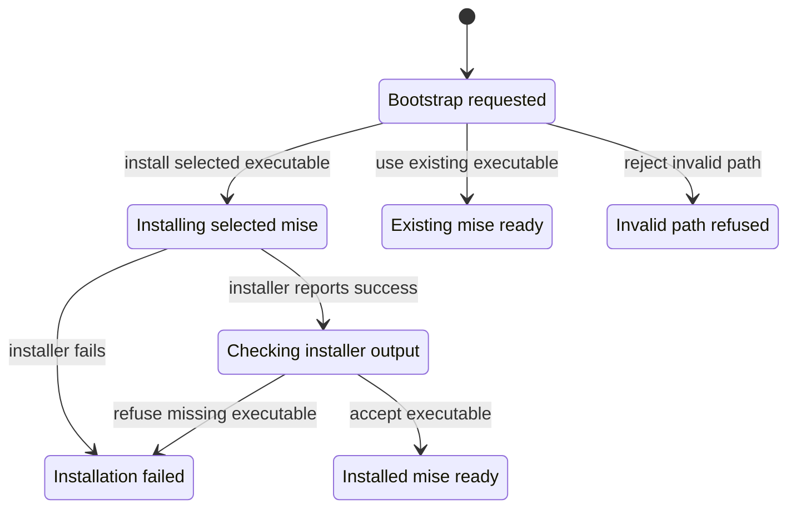

# Development bootstrap

**Properties:** Bootstrap refuses a relative install path, uses an explicit executable instead of a different system installation, reuses an existing executable, and does not report readiness after a failed installer or a successful installer that produced no executable.

**Why:** Selecting the wrong executable or accepting a failed installation can leave the development toolchain unavailable or inconsistent.

**Review baseline:** `6f3a8fd8ef03ef4498e0c92b4b1b4e40c8d66483`.

## Covered code

- `scripts/lib/mise-path.sh` selects and checks the executable and retries the installer. `scripts/bootstrap-dev.sh` installs project tools and activates the selected executable.
- `scripts/test/dev-env-bootstrap.test.ts` and `scripts/test/mise-install-retry.test.ts` exercise isolated installation, reuse, invalid paths, failed installers and retries with local fixtures.
- `tests/properties.mts` generates existing or missing targets, existing or missing system executables, and default or custom paths against the real bootstrap. It uses seed 614781 and 40 cases, each run twice to check reuse.

## Run

From the repository root with workspace dependencies installed:

```sh
bash scripts/verify-state-machine.sh .agents/skills/verify-dev-bootstrap
python3 .agents/skills/verify-dev-bootstrap/mutations/full.py
```

The first command runs the real-code tests, generated cases, TLC 1.7.4 with its pinned checksum, and Z3 4.15.4. The second runs the full skill against five broken scratch implementations and then reruns the restored skill. The runner uses `TLA2TOOLS` and `BUDGET_Z3_PYTHONPATH` if set; otherwise it downloads the jar and installs Z3 in temporary directories. Java 11+, Python, Node with the workspace's `tsx` and `@hobo/runtime` fast-check dependency, `curl`, and `sha256sum` are required. Read the TLC result with `/statechart` and the view in `models/`.

## Scope and evidence

DevBootstrap checks 60 states and 120 steps for default, explicit and relative paths; existing or missing target and system executables; and up to two installer attempts. It checks path refusal, override selection, failure propagation, output presence and reuse. Its seven-state chart hides 66 same-label steps, including retry transitions. Five weakened model variants yield counterexamples. Z3 proves the abstract retry-count bound for arbitrary positive limits and finds a counterexample without the bound.



Without override selection, `/statechart` reaches a system executable instead of the requested one. The isolated bootstrap tests reproduce that path with a fake system executable. The model treats an installer attempt and each filesystem check as atomic, assumes positive retry limits and truthful file predicates, and does not prove shell refinement, binary authenticity, concurrent invocations or liveness. A failed installer can leave an executable at the selected path; inspect or remove it before a later independent retry. A successful installer remains responsible for the contents it produced.

## Keep in sync

Inspect changes to the covered files since the review baseline, including uncommitted changes. Update the model and real-code checks when behavior changes, replay counterexamples against the code, rerun the full skill and broken variants, and advance the baseline only after confirming correspondence. Use `/maintain-formal-verification-skill` for that update.
