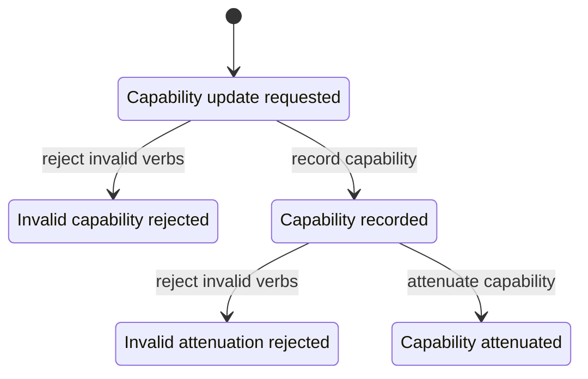

# Fuzz oracle capability inputs

**Property:** Capability additions and attenuations reject unsupported verb lists before changing state or history. Accepted lists are captured, attenuation cannot add verbs, and replay agrees after a caller edits the supplied arrays.

**Why:** An unsupported verb used to appear in live state but disappear on replay; caller-owned arrays could also change live state without an event. Both cases produce false fuzz-oracle divergences.

**Review baseline:** `4c6134326070891e2f4ffe0dea77ca4615da31f4`.

## Covered code and checks

- `packages/fuzz/src/model.ts` captures and validates capability verb lists, records events, attenuates against the prior verbs and replays history.
- `packages/fuzz/test/property/model-replay.test.ts` checks invalid inputs without mutation and 100 generated pairs of verb lists, including order and duplicates. `test/property/control-model.test.ts` checks generated command histories and attenuation.
- Related [snapshot clock](../verify-fuzz-snapshot-clock/SKILL.md) and [restore and replay](../verify-fuzz-restore/SKILL.md) skills cover adjacent parts of the same oracle.

From the repository root with dependencies installed, run:

```sh
bash scripts/verify-state-machine.sh .agents/skills/verify-fuzz-capability-input
```

The runner checks the pinned TLC 1.7.4 jar and uses Z3 4.15.4. Set `TLA2TOOLS` and `BUDGET_Z3_PYTHONPATH` to existing installations for offline runs. Java 11+, Python, Node and repository dependencies are required. This separate command tests eight deliberately broken scratch implementations and reruns the restored skill:

```sh
python3 .agents/skills/verify-fuzz-capability-input/mutations/full.py
```

## Model and evidence

`FuzzCapabilityInput` checks 72 states and 96 generated steps for one existing capability, a valid or invalid addition, caller edits, and a valid or invalid attenuation over two supported verbs and one unsupported verb. It checks valid live state, replay agreement, rejection without a write and attenuation without widening. Read every TLC result with `/statechart`; the maintained view supplies the projection. The chart merges input and verb sets and hides 36 same-label steps, including caller edits that correctly leave captured state unchanged.



The pre-fix regression accepted an unsupported verb that replay dropped; a caller edit also changed live state without changing history. Real-code tests reproduce both. Four weakened models yield counterexamples for invalid additions, invalid attenuation, retained input and widened attenuation. Eight scratch implementation mutations exercise the guards, event data, copy, attenuation and validation ordering; the restored full skill passes. Z3 proves abstract set-intersection properties and finds a widening counterexample if the prior set is ignored.

The model represents verbs as sets, bounds the vocabulary and checks one add followed by one attenuation. It does not model list order or duplicates, which are checked by generated tests, nor prove TypeScript refinement, arbitrary clock changes, arbitrary reentrant getters, event persistence or production authorization. Previously recorded histories containing unsupported verbs can still diverge and may need regeneration. This is an in-memory fuzz oracle.

The related [event history model](../verify-fuzz-event-history/SKILL.md) checks event ownership and ordered public appends.

The related [state-view model](../verify-fuzz-state-views/SKILL.md) checks detached read results and checkpoints.

The related [public clock model](../verify-fuzz-clock-replay/SKILL.md) checks direct clock changes and replay.

## Keep in sync

Inspect changes to the covered code, verb vocabulary, event format and tests since the baseline, including uncommitted changes. Replay counterexamples against real code, rerun verification and mutations, and advance the baseline only after the model and implementation agree. Use `/maintain-formal-verification-skill` for that review.
