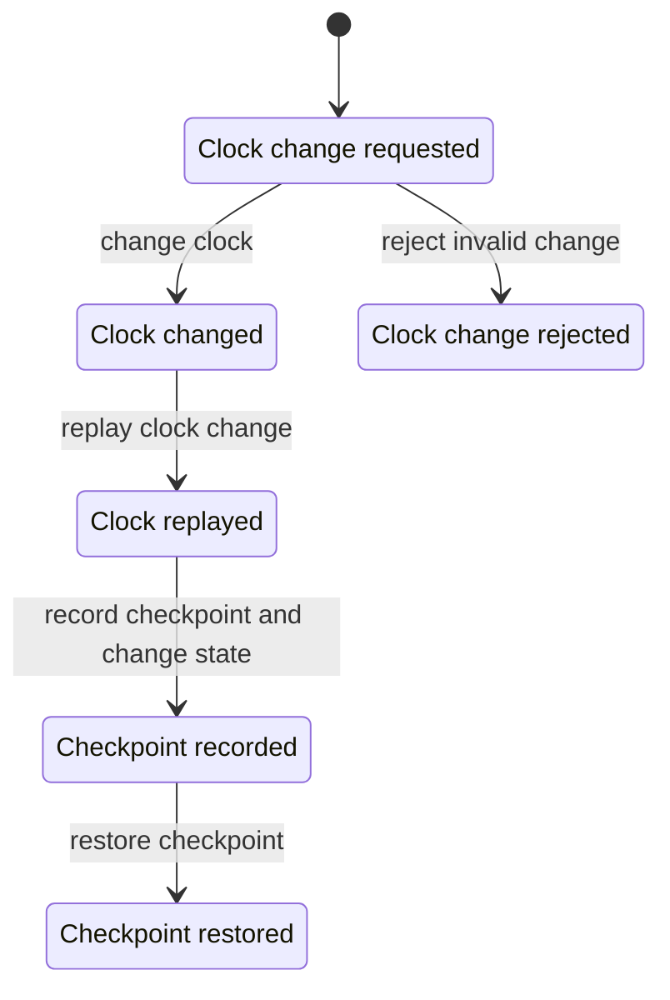

# Fuzz oracle public clock replay

**Property:** Public ticks and forward clock assignments are recorded and replayed before later checkpoints. Invalid or backward assignments and exhausted ticks leave the clock and history unchanged.

**Why:** An unrecorded direct clock change makes replay take a snapshot at a different revision, so a later rollback can restore a different state.

**Review baseline:** `4c6134326070891e2f4ffe0dea77ca4615da31f4`.

## Covered code and checks

- `packages/fuzz/src/model.ts` owns the clock, validates public assignments, records direct changes, keeps internal advances separate, reserves clock event names and replays those events.
- `packages/fuzz/test/property/model-replay.test.ts` checks direct assignments, 100 generated mixed clock and rollback histories, invalid assignments and reserved names. `test/property/control-model.test.ts` checks exhausted clocks and operation ordering.
- Related skills cover [snapshot clocks](../verify-fuzz-snapshot-clock/SKILL.md), [restore and replay](../verify-fuzz-restore/SKILL.md), [capability inputs](../verify-fuzz-capability-input/SKILL.md), [event history](../verify-fuzz-event-history/SKILL.md), and [state views](../verify-fuzz-state-views/SKILL.md).

From the repository root with dependencies installed, run:

```sh
bash scripts/verify-state-machine.sh .agents/skills/verify-fuzz-clock-replay
```

The runner checks the pinned TLC 1.7.4 jar and uses Z3 4.15.4. Set `TLA2TOOLS` and `BUDGET_Z3_PYTHONPATH` to existing installations for offline runs. Java 11+, Python, Node and repository dependencies are required. This separate command tests eleven deliberately broken scratch implementations and reruns the restored skill:

```sh
python3 .agents/skills/verify-fuzz-clock-replay/mutations/full.py
```

## Model and evidence

`FuzzClockReplay` checks 12 states and 15 generated steps for one public tick, forward assignment or invalid assignment, followed by replay, a checkpoint and rollback. It checks that invalid changes are refused, the clock does not rewind, replay sees the same revision and rollback agrees. Read every TLC result with `/statechart`; the maintained view supplies the projection. The chart merges the two valid change types and hides three same-label terminal steps.



Before the fix, `tick()`, snapshot, create and rollback could leave replay with a resource that live state removed. A generated real-code test reproduces the sequence; a separate test covers forward assignment. Five weakened models yield counterexamples for assignment guards, recording and replaying each clock change. Eleven scratch implementation mutations exercise event recording, replay, validation, exhaustion ordering and reserved names; the restored full skill passes. Z3 checks abstract integer assignment bounds and provides a rewind witness without a guard.

The model uses one clock change and one abstract resource, and treats event recording and replay as atomic. It does not prove TypeScript refinement, model arbitrary reflection or reentrant getters, allocation failure, concurrency, or persistence. Safe-integer exhaustion and internal retry/rollback clocks are covered separately by the snapshot-clock skill. Histories created before this change did not record direct clock operations and may need regeneration. This is an in-memory testing oracle, not production persistence.

## Keep in sync

Inspect changes to public clock access, replay event names, checkpoint and rollback behavior, and tests since the baseline, including uncommitted changes. Replay counterexamples against real code, rerun verification and mutations, and advance the baseline only after the model and implementation agree. Use `/maintain-formal-verification-skill` for that review.
