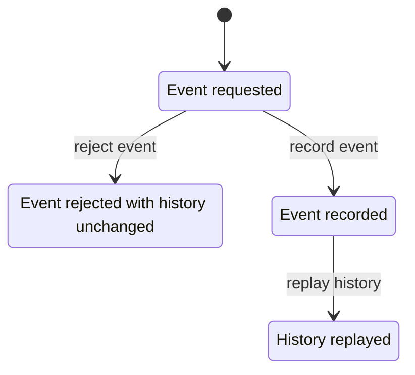

# Fuzz oracle event history

**Property:** Free-form events reject replay-owned kinds and non-string payloads before a write. Accepted public appends advance the clock, and later edits to supplied payloads or returned history views cannot alter the stored event.

**Why:** Mutable event references, an uncounted append or a note that impersonates a replay-owned event can make the oracle reconstruct a different history from the one it recorded.

**Review baseline:** `8e7a9ed158f6385ba75af64cacb1b9404fd5ef69`.

## Covered code and checks

- `packages/fuzz/src/model.ts` owns the event log, captures and validates note payloads, reserves replay-owned names, orders public appends and folds history on replay.
- `packages/fuzz/test/property/model-replay.test.ts` exercises 100 generated payloads, detached history reads, invalid payloads and names, and a public append followed by snapshot and rollback. `test/property/control-model.test.ts` checks generated command histories.
- Related skills cover [snapshot clocks](../verify-fuzz-snapshot-clock/SKILL.md), [restore and replay](../verify-fuzz-restore/SKILL.md), and [capability inputs](../verify-fuzz-capability-input/SKILL.md).

From the repository root with dependencies installed, run:

```sh
bash scripts/verify-state-machine.sh .agents/skills/verify-fuzz-event-history
```

The runner checks the pinned TLC 1.7.4 jar and uses Z3 4.15.4. Set `TLA2TOOLS` and `BUDGET_Z3_PYTHONPATH` to existing installations for offline runs. Java 11+, Python, Node and repository dependencies are required. This separate command tests eight deliberately broken scratch implementations and reruns the restored skill:

```sh
python3 .agents/skills/verify-fuzz-event-history/mutations/full.py
```

## Model and evidence

`FuzzEventHistory` checks 11 states and 15 generated steps for one public append, an allowed or replay-owned kind, valid or invalid payload, caller and reader edits, and replay. It checks refusal without writing, retained payload stability and matching replay state and revision. The eventual-decision property assumes weak fairness for the append attempt. Read every TLC result with `/statechart`; the maintained view supplies the projection. The chart hides six same-label steps, including edits that correctly leave the recorded event unchanged.



Before the fix, changing the supplied payload or returned history changed the stored event; a direct append could desynchronize snapshot clocks, and a free-form replay-owned event could make replay change state. Real-code regressions reproduce these failures. Five weakened models yield counterexamples for kind and payload guards, input and view copies, and append ordering. Eight scratch implementation mutations exercise the corresponding checks; the restored full skill passes. Z3 checks abstract revision accounting and finds a mismatch when one live tick is omitted.

The model covers one event and represents its payload as a bit. It does not prove TypeScript refinement, cover every replay event, model direct mutation of the other public model maps, arbitrary reentrant getters, concurrent access, process failure or persistent stores. The replay-owned name set must stay synchronized with the replay dispatcher. Public appends now advance the clock, reject replay-owned names and require plain string-valued payloads; edits to a returned history snapshot no longer edit the model. This is an in-memory testing oracle, not the production event store.

## Keep in sync

Inspect changes to event ownership, the reserved name set, replay dispatch, clock and tests since the baseline, including uncommitted changes. Replay counterexamples against real code, rerun verification and mutations, and advance the baseline only after the model and implementation agree. Use `/maintain-formal-verification-skill` for that review.
