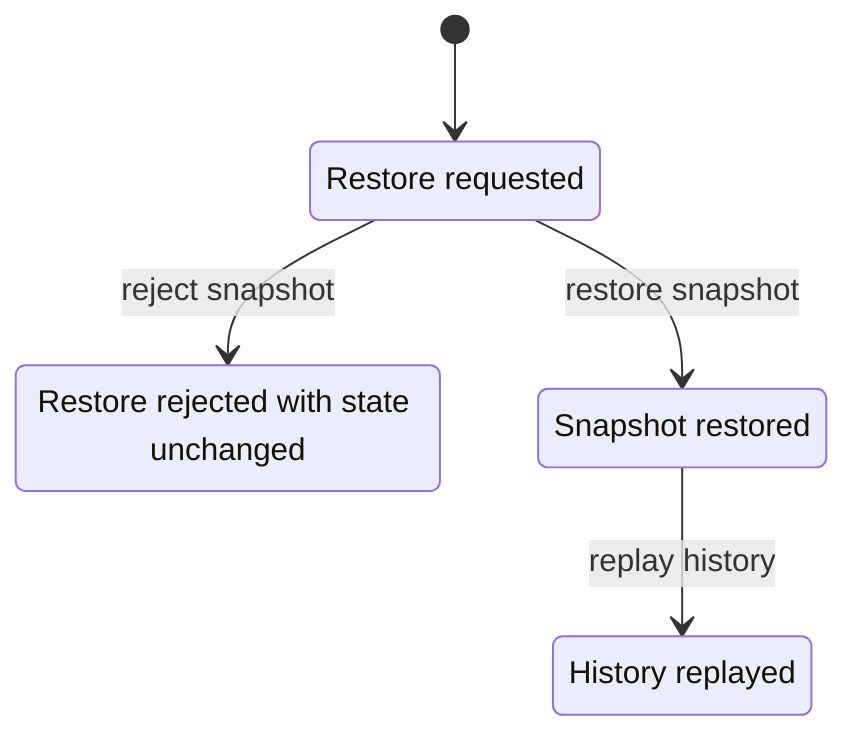
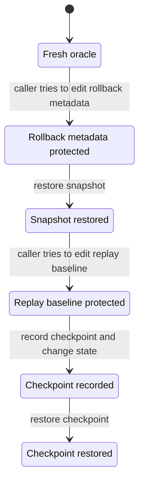

# Fuzz oracle restore and replay

**Property:** A valid snapshot restored into a fresh model becomes its replay baseline. Restoring into an existing model records the replacement at a clock later than both histories. Invalid snapshots or exhausted replacement clocks leave the existing model unchanged. Callers cannot replace the rollback target or replay baseline used to classify and replay a restore.

**Why:** Replaying from an empty baseline or reusing an old clock can make a correct restored state look divergent or overwrite a checkpoint. Partially applying malformed input can corrupt the oracle itself. Caller edits to restore metadata can make live execution and replay disagree.

**Review baseline:** `67ce51ab28e9263259f5e8f5e40f5997f2fa43ff`.

## Covered code and checks

- `packages/fuzz/src/model.ts` parses the serialized snapshot, checks its projected fingerprint, restores detached rows, retains a runtime-private fresh baseline, exposes the rollback target read-only, records later replacements and replays them.
- `packages/fuzz/test/property/model-replay.test.ts` checks fresh and existing restores, 100 generated histories, rollback across the replacement, malformed snapshots, clock exhaustion and attempted caller edits of restore metadata. `test/property/control-model.test.ts` checks checkpoint and retry behavior. [verify-fuzz-snapshot-clock](../verify-fuzz-snapshot-clock/SKILL.md) covers the related clock transitions.

From the repository root with dependencies installed, run:

```sh
bash scripts/verify-state-machine.sh .agents/skills/verify-fuzz-restore
```

The runner checks the pinned TLC 1.7.4 jar and uses Z3 4.15.4. Set `TLA2TOOLS` and `BUDGET_Z3_PYTHONPATH` to existing installations for offline runs. Java 11+, Python, Node and repository dependencies are required. This separate command tests fourteen deliberately broken scratch implementations and reruns the restored skill:

```sh
python3 .agents/skills/verify-fuzz-restore/mutations/full.py
```

## Model and evidence

`FuzzRestore` checks 86 states and 122 generated steps for one restore into either a fresh or an existing model, valid and invalid inputs, two abstract values, clocks from 0 through 2 and subsequent replay. It checks refusal without a state change, acceptance only of valid inputs, clock advancement for replacement, and replay agreement. The eventual-decision property assumes weak fairness for the restore attempt. Read every TLC result with `/statechart`; the maintained view supplies the projection. The chart merges clock and input values and hides 36 same-label steps.



Before the fix, a fresh restore replayed from empty state; an existing restore could rewind the clock, and a malformed snapshot could clear part of the model before throwing. Real-code regression tests reproduce each path. Five weakened models produce counterexamples for the baseline, replacement event, clock, validation and atomic refusal. Fourteen scratch implementation mutations test those paths, individual snapshot checks and both metadata protections; the restored full skill passes. Z3 proves abstract integer bounds for `max(current, imported) + 1` and finds an exhaustion witness without the guard.

`FuzzRestoreMetadata` checks six states and seven generated steps for a fresh restore, attempted caller edits to the rollback target and replay baseline, and a checkpoint followed by rollback. It checks protected metadata, matching restore clocks and matching rolled-back state. The chart hides one terminal same-label step. Two weakened configurations show that editing the target can produce a restore-clock mismatch, while editing the baseline can produce a later replay mismatch. Real-code tests exercise both paths.



The metadata model follows one fixed sequence with abstract values; it does not explore arbitrary reflective operations or reentrant getters.

The model abstracts the parser to a valid/invalid flag, the snapshot to one bit, and the history to one replacement. It does not prove that TypeScript refines the model, cover all parser inputs or event kinds, model concurrent mutation, allocation failure or persistence, or establish authenticity. The fingerprint is a deterministic projection: it omits fields and is not a cryptographic integrity guarantee. Legacy snapshots with malformed rows, unsupported verbs or inconsistent fingerprints are now rejected; overwritten checkpoints from earlier versions cannot be recovered by this change. This is an in-memory testing oracle, not a proof of the production control plane.

The related [capability input model](../verify-fuzz-capability-input/SKILL.md) checks verb capture and replay.

The related [event history model](../verify-fuzz-event-history/SKILL.md) checks event ownership and ordered public appends.

The related [state-view model](../verify-fuzz-state-views/SKILL.md) checks detached read results and checkpoints.

The related [public clock model](../verify-fuzz-clock-replay/SKILL.md) checks direct clock changes and replay.

## Keep in sync

Inspect changes to the covered code, serialized format, replay, clock and tests since the baseline, including uncommitted changes. Replay counterexamples against real code, rerun verification and mutations, and advance the baseline only after the model and implementation agree. Use `/maintain-formal-verification-skill` for that review.
