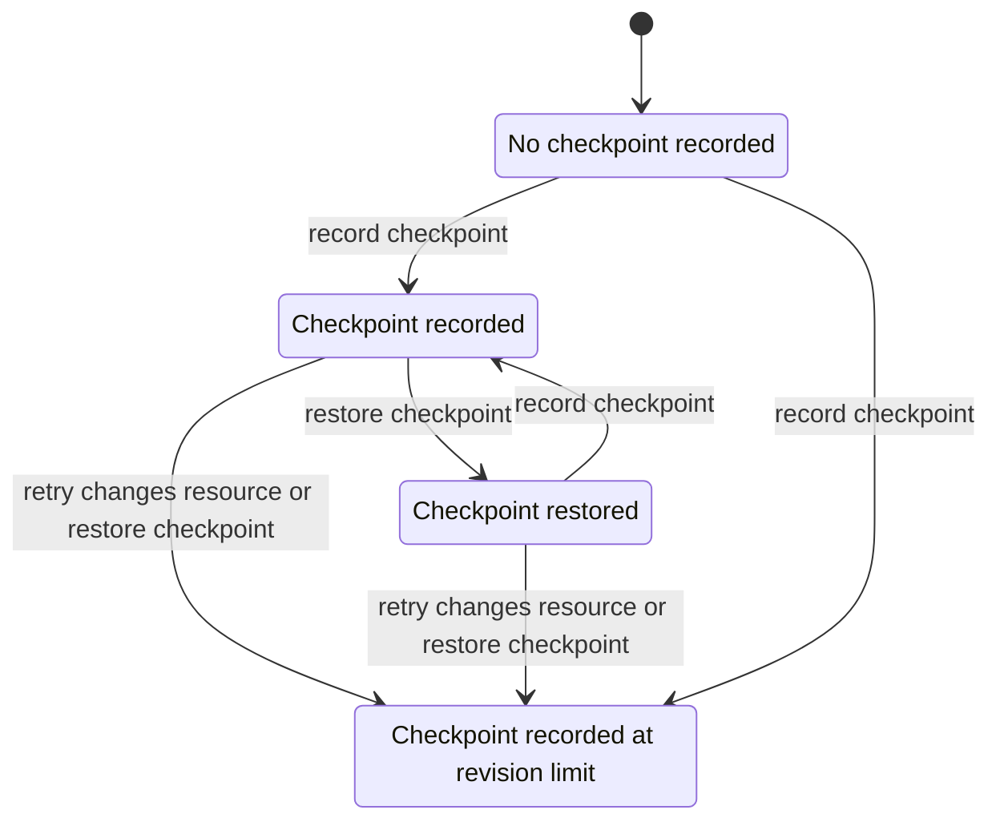

# Fuzz oracle snapshot clock

**Property:** Each retry and successful rollback gets a new exact clock before changing resources. Snapshots taken after these operations do not overwrite earlier checkpoints. An invalid or exhausted clock refuses the operation before resource state changes.

**Why:** A reused clock can replace a saved checkpoint and make the fuzz oracle report a successful rollback to the wrong historical state.

**Review baseline:** `8e7a9ed158f6385ba75af64cacb1b9404fd5ef69`.

## Covered code and checks

- `packages/fuzz/src/model.ts` advances and validates the clock, records snapshots by clock, retries resource applications, restores tenant snapshots and replays events.
- `packages/fuzz/test/property/control-model.test.ts` generates retry histories, revisits each checkpoint and checks resource status, apply count and replay. It also tests post-rollback checkpoints and fail-closed clock exhaustion. `test/property/model-replay.test.ts` checks replay and restore examples.

From the repository root with dependencies installed, run:

```sh
bash scripts/verify-state-machine.sh .agents/skills/verify-fuzz-snapshot-clock
```

The runner checks the pinned TLC 1.7.4 jar and uses Z3 4.15.4. Set `TLA2TOOLS` and `BUDGET_Z3_PYTHONPATH` to existing installations for offline runs. Java 11+, Python, Node and repository dependencies are required. This separate command tests seven deliberately broken scratch implementations and reruns the restored skill:

```sh
python3 .agents/skills/verify-fuzz-snapshot-clock/mutations/full.py
```

## Model and evidence

`FuzzSnapshotClock` checks 29 states and 75 generated steps with clock values 0 through 2, two abstract resource values, snapshots, retries, rollback to any saved clock and saturation at the bound. It checks that saved values stay unchanged, mutations advance the clock, and rollback restores the selected value. The bound represents the production safe-integer limit; blocked transitions abstract the thrown exception. Read every TLC result with `/statechart`; the maintained view supplies the projection. The chart merges resource values and clock positions and hides 57 same-label steps.



With the retry tick removed, a checkpoint, retry and second checkpoint replace the first value. With the rollback tick removed, two checkpoints followed by rollback and another checkpoint replace the later value. With the limit guard removed, a mutation can reuse the maximum clock. Regression tests reproduce both historical overwrites and the exhaustion failure on real code. Seven scratch mutations exercise missing or delayed ticks and the clock guards; the restored full skill passes. Z3 proves the abstract integer bounds and finds a witness without the limit guard.

The model covers one resource and one tenant, treats stored payloads as a single bit, assumes API-managed snapshots and does not model all event kinds, direct mutation of public maps, arbitrary `restore()` calls, concurrency or persistence. The separate [restore model](../verify-fuzz-restore/SKILL.md) covers the replay baseline and clock advancement for restoring serialized state. The proof is over mathematical integers, not TypeScript refinement or every JavaScript floating-point behavior. Replay and multi-tenant examples are executable tests rather than model-checked claims. This is a testing oracle, not the production control plane.

The related [capability input model](../verify-fuzz-capability-input/SKILL.md) checks verb capture and replay.

The related [event history model](../verify-fuzz-event-history/SKILL.md) checks event ownership and ordered public appends.

## Keep in sync

Inspect changes to the covered code, snapshot format, replay and tests since the baseline, including uncommitted changes. Replay counterexamples against real code, rerun verification and mutations, and advance the baseline only after the model and implementation agree. Use `/maintain-formal-verification-skill` for that review.
