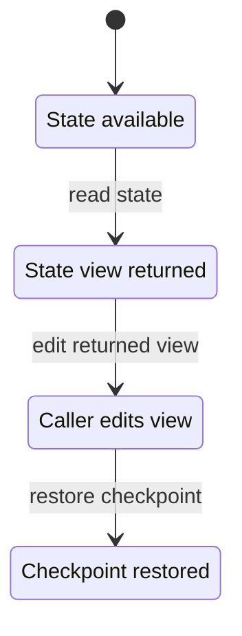

# Fuzz oracle state views

**Property:** Editing a returned bindle, capability, resource or checkpoint view, or a resource returned by apply or lookup, cannot change stored model state or a later rollback target. Tenant restoration is an internal operation.

**Why:** A live reference lets a reader alter state without an event, or corrupt a checkpoint before rollback, making the fuzz oracle disagree with its own history.

**Review baseline:** `67ce51ab28e9263259f5e8f5e40f5997f2fa43ff`.

## Covered code and checks

- `packages/fuzz/src/model.ts` owns the backing maps, returns detached views and resource records, keeps tenant restore internal, and performs rollback and replay.
- `packages/fuzz/test/property/model-replay.test.ts` generates 100 verb-list and outcome combinations, mutates every public view and returned resource, and checks the original checkpoint and replay. `test/property/control-model.test.ts` exercises normal retries, interrupts and rollbacks.
- Related skills cover [snapshot clocks](../verify-fuzz-snapshot-clock/SKILL.md), [restore and replay](../verify-fuzz-restore/SKILL.md), [capability inputs](../verify-fuzz-capability-input/SKILL.md), and [event history](../verify-fuzz-event-history/SKILL.md).

From the repository root with dependencies installed, run:

```sh
bash scripts/verify-state-machine.sh .agents/skills/verify-fuzz-state-views
```

The runner checks the pinned TLC 1.7.4 jar and uses Z3 4.15.4. Set `TLA2TOOLS` and `BUDGET_Z3_PYTHONPATH` to existing installations for offline runs. Java 11+, Python, Node and repository dependencies are required. This separate command tests twelve deliberately broken scratch implementations and reruns the restored skill:

```sh
python3 .agents/skills/verify-fuzz-state-views/mutations/full.py
```

## Model and evidence

`FuzzStateViews` checks 24 states and 30 generated steps for one read from each of six public paths, an edit, and a subsequent rollback. It checks that stored state and the checkpoint stay unchanged and rollback agrees with history. Read every TLC result with `/statechart`; the maintained view supplies the projection. The chart merges the six read paths and hides six same-label terminal steps.



Before the fix, callers could clear live maps, edit their rows or overwrite a checkpoint. Real-code property tests reproduce these failures. Six weakened models yield counterexamples for the read paths. Twelve scratch implementation mutations exercise map and nested-record copies, fresh and retry results, lookup, internal tenant restore and interrupt behavior; the restored full skill passes. Z3 proves the abstract detached-view update obligation and finds a counterexample for an aliased view.

The model uses one bit for state and checkpoint content, assumes an apply has completed before its result is read, and does not prove TypeScript refinement, model arbitrary reentrant getters, concurrency or persistence. Public clock changes are covered separately by the [clock replay model](../verify-fuzz-clock-replay/SKILL.md). Returning map snapshots allocates in proportion to their size. This is an in-memory testing oracle, not production storage.

The related [public clock model](../verify-fuzz-clock-replay/SKILL.md) checks direct clock changes and replay.

The [restore metadata model](../verify-fuzz-restore/SKILL.md) checks that callers cannot change the rollback target or replay baseline used by restoration.

## Keep in sync

Inspect changes to public state reads, backing maps, rollback, event recording and tests since the baseline, including uncommitted changes. Replay counterexamples against real code, rerun verification and mutations, and advance the baseline only after the model and implementation agree. Use `/maintain-formal-verification-skill` for that review.
