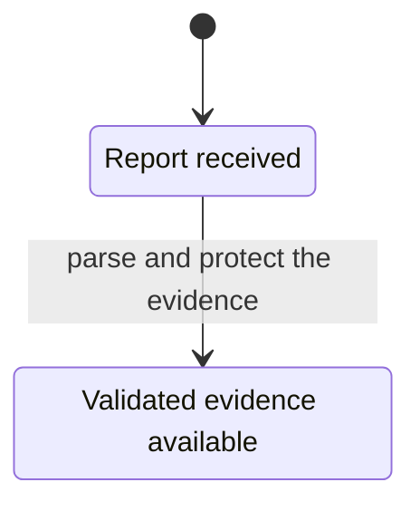

# Replay evidence integrity

**Property:** Parsed and newly produced replay reports retain their validated positions and version; divergence records retain their captured event orders despite later caller edits.

**Why:** Mutable evidence can describe different replay boundaries or event orders after it has already been checked.

**Review baseline:** `341aec477b2a62d49678fa1df7a89de00e17a87c`.

## Covered code and checks

- `packages/runtime/src/replay/parse.ts` copies and freezes parsed vectors, entries and divergence orders. `equivalence.ts` and `replayer.ts` return frozen reports; `divergence.ts` detaches and freezes the divergence record's order arrays. `types.ts` exposes readonly evidence fields.
- `packages/runtime/src/replay/proto.ts` uses the same domain parser for protobuf JSON and binary reports.
- `packages/runtime/test/replay/evidence-immutability.test.ts` checks direct, protobuf, harness and workflow report entry points and divergence records. It attempts to edit the input, report, vector, entries and orders. Seed 614616 generates 100 stream/position cases.

- The related [stream identity skill](../verify-replay-stream-identity/SKILL.md) checks primitive identities and binds captured journal events to their requested stream.

- The related [journal history skill](../verify-workflow-journal-history/SKILL.md) checks visible sequence, start and terminal structure before resume and replay.

From the repository root with dependencies installed, run:

```sh
bash scripts/verify-state-machine.sh .agents/skills/verify-replay-evidence
```

The runner checks the pinned TLC 1.7.4 jar and uses Z3 4.15.4. Set `TLA2TOOLS` and `BUDGET_Z3_PYTHONPATH` to existing installations for offline runs. Java 11+, Python, Node and the repository dependencies are required. This separate command checks fifteen deliberately broken scratch implementations with the full skill, then reruns the restored code:

```sh
python3 .agents/skills/verify-replay-evidence/mutations/full.py
```

## Model and evidence

`ReplayEvidence` explores three states and four non-stuttering steps for one valid parsed report and a caller edit. It requires the checked position, vector and marker to remain intact. Its two-state projection has one arrow and hides three same-label steps, including input edits. Read each TLC result with `/statechart`; the maintained view supplies the projection.



Without a frozen vector, a caller replaces an accepted sequence entry after parsing; this failure is reproduced against the real parser and both protobuf adapters. Without a detached entry, an edit to the input changes the recorded position; without frozen entries or a frozen report, callers can edit a position or its marker. Four weakened TLC configurations and four weakened Z3 assumptions produce counterexamples. The model abstracts one parsed report; real-code tests additionally cover the harness, workflow and divergence producers.

The model assumes faithful cloning and JavaScript property freezing, with one modeled position and marker. The Z3 obligations prove abstract equality implications; neither tool proves TypeScript refinement, authentication, cryptographic integrity, arbitrary external mutation of host intrinsics or liveness. The error object's diagnostic `liveOrder` and `replayOrder` fields are separate mutable copies; its `divergence` evidence has its own frozen order arrays. Callers that previously mutated returned reports or records must create a new object instead.

## Keep in sync

Inspect changes to covered code and tests since the baseline, including uncommitted changes. Replay counterexamples against real code, rerun verification and mutations, and advance the baseline only after the model and implementation agree. Use `/maintain-formal-verification-skill` for that review.
