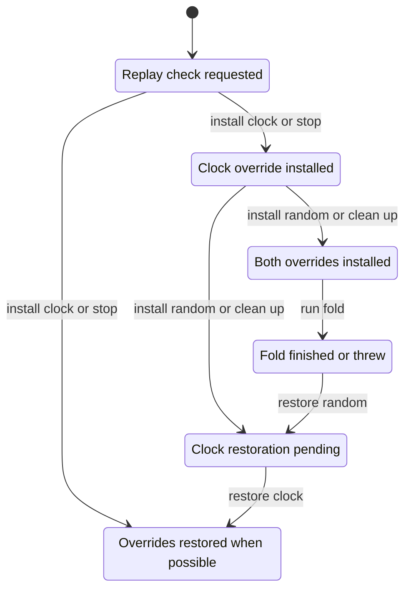
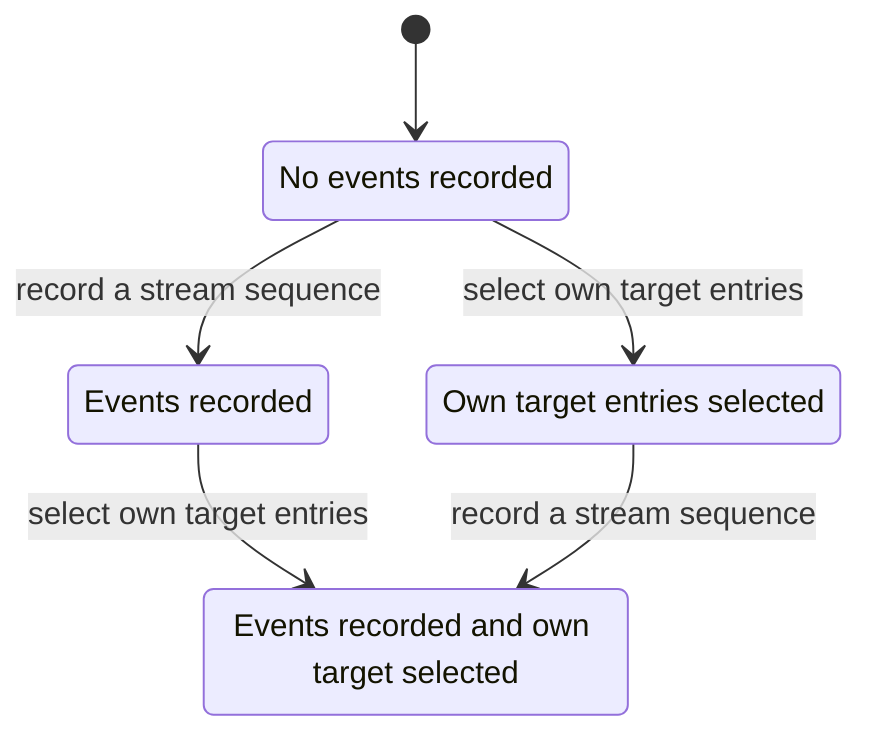
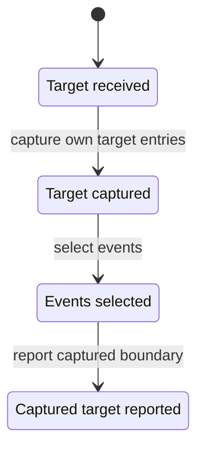
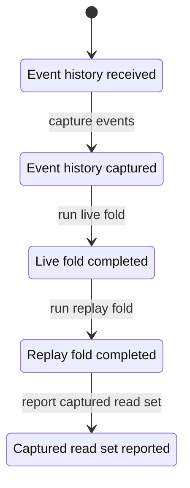
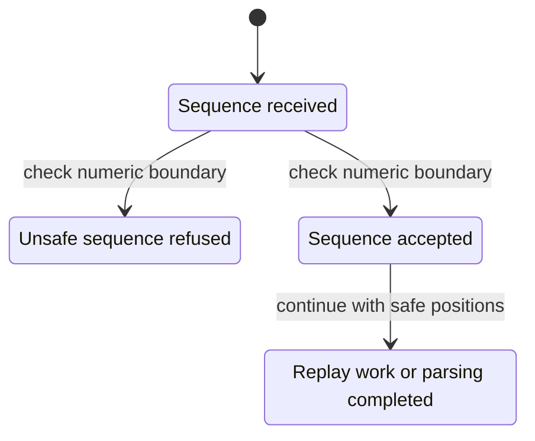

# Replay equivalence harness

**Property:** Once the synchronous replay check finishes or throws, every installed clock or random override whose original descriptor can be restored is restored; failure to restore random does not prevent the clock restoration attempt. Sequence vectors retain each stream’s maximum, including prototype-like names, explicit target vectors include only their own entries, both folds and the report use captured event and target inputs, and event sequences, target limits and parsed positions must be non-negative safe integers.

**Why:** A failed verification must not change later code’s clock or randomness; an incomplete, changing or imprecise input must not silently omit events or misstate the boundary of a replay check.

**Review baseline:** `341aec477b2a62d49678fa1df7a89de00e17a87c`.

## Covered code and checks

- `packages/runtime/src/replay/equivalence.ts` installs and restores temporary globals and computes sequence vectors and target boundaries used by `assertReplayEqualsLive`; `replayer.ts` checks journal positions before callbacks and `parse.ts` validates report positions.
- `packages/runtime/test/replay/equivalence-cleanup.test.ts` checks nonwritable setup, accessor refusal, callback exceptions and changed descriptors. Seed 614609 generates 80 setup and callback-failure combinations. A child process deliberately makes the random descriptor unrestorable and checks the independent clock cleanup without permanently modifying the test process.
- `packages/runtime/test/replay/sequence-safety.test.ts` checks unsafe events, target limits, report positions, and legacy replay before callbacks; seeds 614612 and 614613 each generate 100 safe or unsafe positions.
- `packages/runtime/test/replay/target-snapshot.test.ts` checks hidden own targets, getters, and caller edits to targets and events; seed 614611 generates 100 target edits.
- `packages/runtime/test/replay/sequence-vector.test.ts` checks special property names, inherited target entries including the captured target’s prototype, and 150 generated event histories (seed 614610).
- `packages/runtime/test/replay/equivalence.test.ts` exercises the existing deterministic-fold and divergence checks.
- The related [ordering skill](../verify-replay-ordering/SKILL.md) checks versioned canonical order and report markers.
- The related [evidence skill](../verify-replay-evidence/SKILL.md) checks that returned reports remain immutable.

- The related [stream identity skill](../verify-replay-stream-identity/SKILL.md) checks primitive identities and binds captured journal events to their requested stream.

- The related [journal history skill](../verify-workflow-journal-history/SKILL.md) checks visible sequence, start and terminal structure before resume and replay.

From the repository root with dependencies installed, run:

```sh
bash scripts/verify-state-machine.sh .agents/skills/verify-replay-harness
python3 .agents/skills/verify-replay-harness/mutations/full.py
python3 .agents/skills/verify-replay-harness/mutations/vector.py
python3 .agents/skills/verify-replay-harness/mutations/snapshot.py
python3 .agents/skills/verify-replay-harness/mutations/safety.py
```

The runner checks the pinned TLC 1.7.4 jar and uses Z3 4.15.4. Set `TLA2TOOLS` and `BUDGET_Z3_PYTHONPATH` to existing installations for offline runs. The mutation commands check five cleanup, two vector, six snapshot and five numeric-safety broken scratch implementations with the full skill and rerun the restored code. The replay-before-callback variant removes both independent early sequence checks; removing either alone remains guarded by the other. Java 11+, Python, Node, and the repository dependencies are required.

## Model and evidence

`ReplayHarnessCleanup` explores 118 states and 234 steps for writable or nonwritable clock and random properties, a returning or throwing callback, changed descriptors, and independently successful or failed restoration. It checks that each restorable global is restored at exit, including after setup fails and after restoration of the other global fails. Its six-state projection has seven arrows and hides 118 same-state steps. Read each TLC result with `/statechart`; the model-specific views under `models/` supply the maintained projections.



Without setup cleanup, the shortest counterexample installs the clock override, fails to install random, and exits with the override still active. Without the independent cleanup, a failed random restoration skips clock restoration. Four weakened TLC checks and four weakened Z3 assumptions produce counterexamples. Z3 proves the abstract implications from a completed cleanup attempt and a restorable descriptor to a restored value; it does not verify the TypeScript implementation.

`ReplaySequenceVector` explores 336 states and 824 steps for two stream names, up to two events, sequences one or two, and an optional inherited special name. It checks each stream maximum and requires selected target entries to be owned. The four-state projection has four arrows and hides 592 same-state steps. Removing safe-key handling or own-entry selection yields a TLC counterexample; corresponding broken implementations fail real-code tests. Z3 proves abstract maximum and own-selection implications over arbitrary integers and booleans, with two weakened-assumption counterexamples. The model treats a prototype collision as an abstract dropped update, assumes faithful maps and numeric comparisons, and abstracts numeric classification and does not validate target objects or TypeScript refinement.



`ReplayTargetSnapshot` explores 12 states and 22 steps for an own target entry, including a hidden entry and a caller edit. It requires inclusion of that entry and equality between the selected and reported boundary; its four-state projection hides 14 same-state steps. `ReplayEventSnapshot` explores eight states and 15 steps for one event and an edit between folds, requiring the replay and read-set observations to match the live capture; its five-state projection hides nine same-state steps. Weakening either capture or either report guard yields four TLC counterexamples; Z3 checks the corresponding abstract equalities over arbitrary strings and four weakened-guard counterexamples. The event model abstracts a changed read-set identity, not a cryptographic proof: the read-set hash covers stream names, not event contents. Both models assume faithful synchronous snapshots and do not establish TypeScript refinement, accessor behavior during capture, callback purity or liveness.





`ReplaySequenceSafety` explores 174 states and 273 steps for fold, legacy replay and report parsing with zero, maximum, negative, fractional and unsafe position classes. It requires safe event and target values before callbacks and safe parsed positions. Its four-state projection hides 174 same-state steps. Removing any of three checks yields a TLC counterexample; Z3 proves the stated integer-bound implication and finds counterexamples when either bound is removed. The model assumes JavaScript's safe-integer classification is faithful; it does not establish TypeScript refinement, stream authenticity, journal ordering or values beyond the modeled classes.



The model assumes ordinary data-property intrinsics, indivisible installation and restoration steps, and truthful classifications of whether each descriptor can be restored. A callback that makes a property nonconfigurable can prevent its restoration; the other cleanup is still attempted. The harness temporarily changes process-global functions while synchronous callbacks run. It tests only selected ambient nondeterminism and does not detect every source, such as `new Date()` or external state. The model does not establish implementation refinement, callback purity, other workers' behavior or liveness.

## Keep in sync

Inspect changes to the covered code and tests since the baseline, including uncommitted changes. Replay counterexamples against the real code, rerun the verification and all mutation commands, and advance the baseline only after the model and implementation agree. Use `/maintain-formal-verification-skill` for that review.
