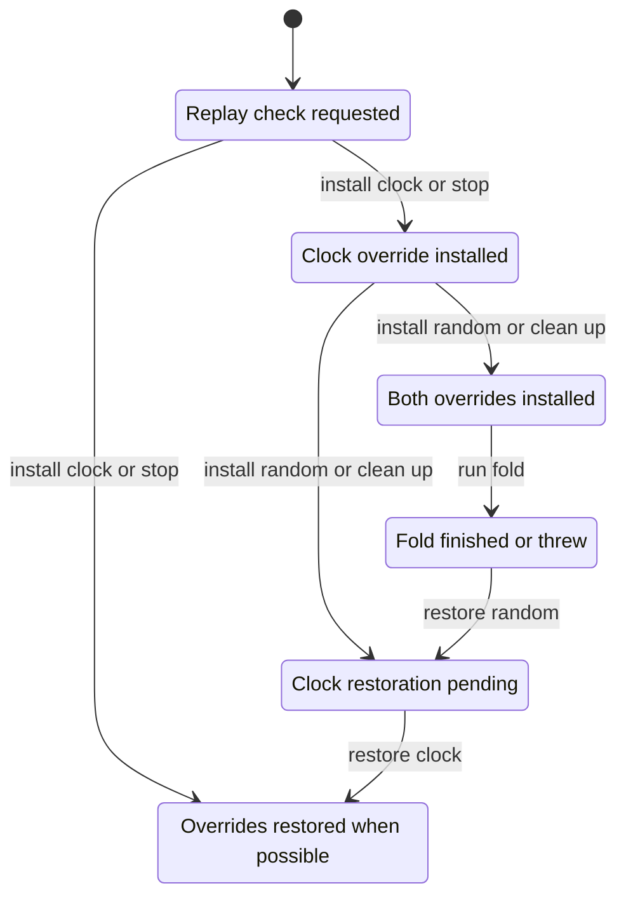
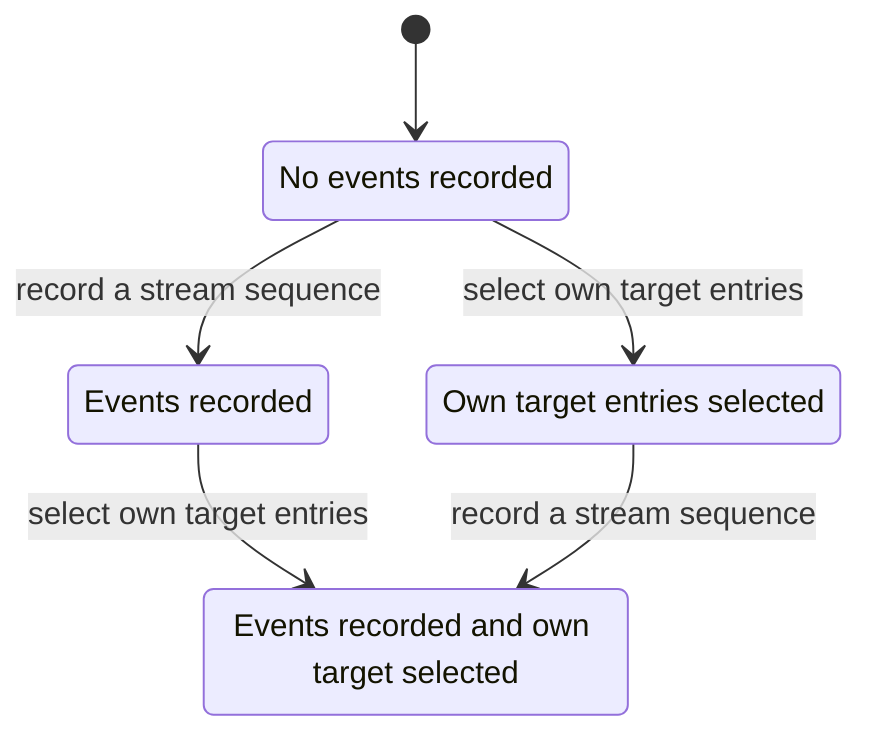

# Replay equivalence harness

**Property:** Once the synchronous replay check finishes or throws, every installed clock or random override whose original descriptor can be restored is restored; failure to restore random does not prevent the clock restoration attempt. Sequence vectors retain each stream’s maximum, including prototype-like names, and explicit target vectors include only their own entries.

**Why:** A failed verification must not change later code’s clock or randomness; an incomplete sequence vector must not silently omit events from a replay check.

**Review baseline:** `1a195ec9f7b9c5d7f85ebf37dced34f3931edeb9`.

## Covered code and checks

- `packages/runtime/src/replay/equivalence.ts` installs and restores temporary globals and computes sequence vectors and target boundaries used by `assertReplayEqualsLive`.
- `packages/runtime/test/replay/equivalence-cleanup.test.ts` checks nonwritable setup, accessor refusal, callback exceptions and changed descriptors. Seed 614609 generates 80 setup and callback-failure combinations. A child process deliberately makes the random descriptor unrestorable and checks the independent clock cleanup without permanently modifying the test process.
- `packages/runtime/test/replay/sequence-vector.test.ts` checks special property names, inherited target entries and 150 generated event histories (seed 614610).
- `packages/runtime/test/replay/equivalence.test.ts` exercises the existing deterministic-fold and divergence checks.

From the repository root with dependencies installed, run:

```sh
bash scripts/verify-state-machine.sh .agents/skills/verify-replay-harness
python3 .agents/skills/verify-replay-harness/mutations/full.py
python3 .agents/skills/verify-replay-harness/mutations/vector.py
```

The runner checks the pinned TLC 1.7.4 jar and uses Z3 4.15.4. Set `TLA2TOOLS` and `BUDGET_Z3_PYTHONPATH` to existing installations for offline runs. The mutation commands check five cleanup and two vector broken scratch implementations with the full skill and rerun the restored code. Java 11+, Python, Node, and the repository dependencies are required.

## Model and evidence

`ReplayHarnessCleanup` explores 118 states and 234 steps for writable or nonwritable clock and random properties, a returning or throwing callback, changed descriptors, and independently successful or failed restoration. It checks that each restorable global is restored at exit, including after setup fails and after restoration of the other global fails. Its six-state projection has seven arrows and hides 118 same-state steps. `/statechart` can render the model and explain any counterexample.



Without setup cleanup, the shortest counterexample installs the clock override, fails to install random, and exits with the override still active. Without the independent cleanup, a failed random restoration skips clock restoration. Four weakened TLC checks and four weakened Z3 assumptions produce counterexamples. Z3 proves the abstract implications from a completed cleanup attempt and a restorable descriptor to a restored value; it does not verify the TypeScript implementation.

`ReplaySequenceVector` explores 336 states and 824 steps for two stream names, up to two events, sequences one or two, and an optional inherited special name. It checks each stream maximum and requires selected target entries to be owned. The four-state projection has four arrows and hides 592 same-state steps. Removing safe-key handling or own-entry selection yields a TLC counterexample; corresponding broken implementations fail real-code tests. Z3 proves abstract maximum and own-selection implications over arbitrary integers and booleans, with two weakened-assumption counterexamples. The model treats a prototype collision as an abstract dropped update, assumes faithful maps and numeric comparisons, and does not validate arbitrary event sequence numbers, target objects or TypeScript refinement.



The model assumes ordinary data-property intrinsics, indivisible installation and restoration steps, and truthful classifications of whether each descriptor can be restored. A callback that makes a property nonconfigurable can prevent its restoration; the other cleanup is still attempted. The harness temporarily changes process-global functions while synchronous callbacks run. It tests only selected ambient nondeterminism and does not detect every source, such as `new Date()` or external state. The model does not establish implementation refinement, callback purity, other workers' behavior or liveness.

## Keep in sync

Inspect changes to the covered code and tests since the baseline, including uncommitted changes. Replay counterexamples against the real code, rerun the verification and both mutation commands, and advance the baseline only after the model and implementation agree. Use `/maintain-formal-verification-skill` for that review.
