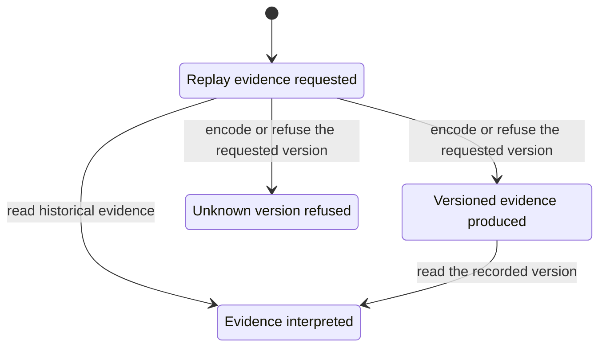

# Replay ordering and version evidence

**Property:** New replay evidence uses a locale-independent order and records the encoding version; an unmarked historical record is interpreted as version 1, and unsupported versions are refused.

**Why:** Insertion order or machine locale must not change a new digest, and a digest must not silently be read under a different encoding.

**Review baseline:** `f71262809c8d28edba15917daa1faa4df71c7160`.

## Covered code and checks

- `packages/runtime/src/replay/canonicalization.ts`, `equivalence.ts`, `divergence.ts` and `replayer.ts` choose ordering, validate versions, compute digests and attach version markers. `parse.ts` interprets report and divergence markers.
- `packages/runtime/data-models/replay/replay_report.proto`, its generated TypeScript and matching CUE schema carry an optional marker, so historical wire records remain readable.
- `packages/runtime/test/replay/ordering-version.test.ts` checks locale and Unicode ties in actual code, legacy and current report digests, event and vector ordering, unsupported and conflicting versions, callback compatibility, and version-marker protobuf binary round trips. Seed 614614 generates 150 permutations. The cross-process check uses English and Swedish Node locales; version 1 intentionally differs while version 2 agrees.
- The related [evidence skill](../verify-replay-evidence/SKILL.md) checks that returned report markers and positions remain immutable.

From the repository root with dependencies installed, run:

```sh
bash scripts/verify-state-machine.sh .agents/skills/verify-replay-ordering
```

The runner checks the pinned TLC 1.7.4 jar and uses Z3 4.15.4. Set `TLA2TOOLS` and `BUDGET_Z3_PYTHONPATH` to existing installations for offline runs. Java 11+, Python, Node and the repository dependencies are required. The following separate command checks eleven broken scratch implementations with the full skill, then reruns the restored implementation:

```sh
python3 .agents/skills/verify-replay-ordering/mutations/full.py
```

## Model and evidence

`ReplayOrdering` explores 360 states and 360 non-stuttering steps for two distinct keys, both insertion orders, three abstract collations, a legacy record and three requested versions. It requires version 2 to produce the same ordering, interprets marked and historical evidence under its recorded version, and refuses the unknown version. Its four-state projection has four arrows and hides 144 same-label steps. Read each TLC result with `/statechart`; the maintained view supplies the projection.



Using a locale-sensitive comparator for version 2 makes the two representations of the same keys sort differently; the real-code Unicode and subprocess tests reproduce this. Dropping a version 2 marker makes the reader interpret it as version 1. Treating an unmarked legacy record as version 2 or accepting an unknown version likewise violates a checked rule. Four weakened TLC configurations and four weakened Z3 assumptions produce counterexamples. Z3 proves abstract two-key ordering and version-binding implications under the assumptions in `proof/ordering.py`; it does not verify TypeScript or cryptographic hashes.

The model assumes faithful key comparisons, serialization and marker transport; it does not model JSON encoding, arbitrary key counts, hash collisions, duplicate event identities, callbacks, remote providers, or implementation refinement. Property-based tests sample actual key sets rather than proving the implementation for all strings. Version 1 remains locale-sensitive and may require the original locale to reproduce; unknown-field-stripping intermediaries can drop the new marker. The [protobuf evidence skill](../verify-replay-protobuf/SKILL.md) checks the JSON and binary adapters separately.

## Keep in sync

Inspect changes to the covered code, generated schema and tests since the baseline, including uncommitted changes. Replay each counterexample against real code, rerun the verification and mutation command, and advance the baseline only after the model and implementation agree. Use `/maintain-formal-verification-skill` for that review.
