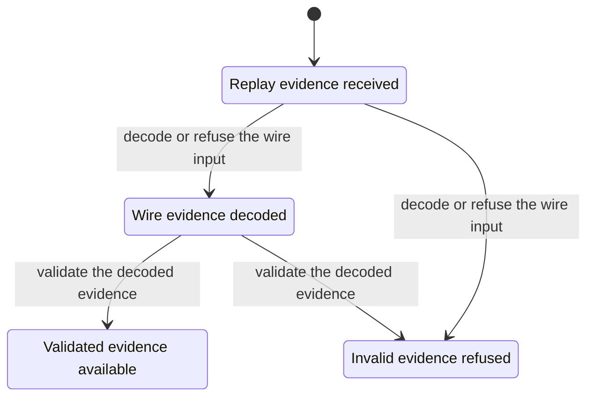
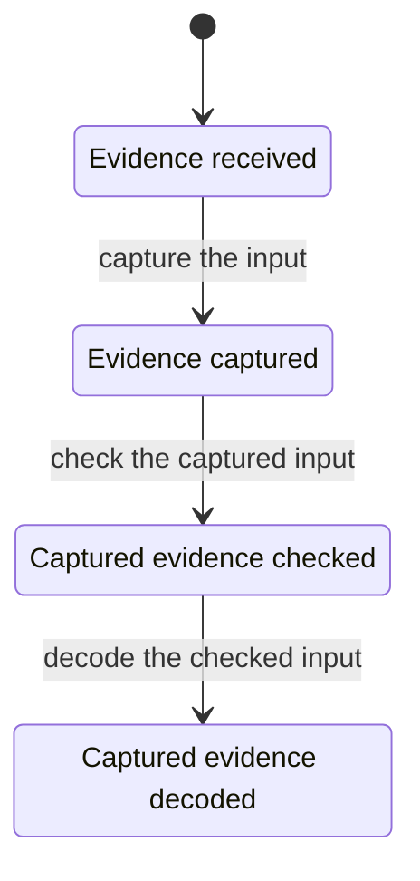

# Replay protobuf evidence

**Property:** Replay protobuf evidence is accepted only with a known or legacy version and an exactly representable non-negative sequence; valid empty collections and version markers survive decoding, and validation and decoding use the same captured input.

**Why:** A decoder that rounds an oversized position, changes the version, or loses an empty vector can misrepresent the evidence for a replay.

**Review baseline:** `f71262809c8d28edba15917daa1faa4df71c7160`.

## Covered code and checks

- `packages/runtime/src/replay/proto.ts` adapts protobuf JSON and binary messages to the strict report and divergence parsers. `proto-json.ts` snapshots ordinary JSON data without invoking getters and `wire.ts` rejects overflowing wire integers and duplicate version markers before protobuf decoding can truncate them. `parse.ts` checks domain values.
- `packages/runtime/data-models/replay/replay_report.proto` and `packages/runtime/src/_generated/replay/replay_report_pb.ts` define the wire representation.
- `packages/runtime/test/replay/protobuf-adapter.test.ts` uses real generated protobuf messages and checks empty arrays, legacy and current markers, exact zero and maximum-safe positions, unsafe numeric and quoted positions, malformed wire varints, duplicate markers, ordinary unknown fields, frozen data, accessors, cycles, excessive nesting and a changing byte array. Seed 614615 generates 100 safe positions and round-trips each through both wire representations.
- The related [evidence skill](../verify-replay-evidence/SKILL.md) checks that parsed records cannot be altered afterward.

From the repository root with dependencies installed, run:

```sh
bash scripts/verify-state-machine.sh .agents/skills/verify-replay-protobuf
```

The runner checks the pinned TLC 1.7.4 jar and uses Z3 4.15.4. Set `TLA2TOOLS` and `BUDGET_Z3_PYTHONPATH` to existing installations for offline runs. Java 11+, Python, Node and the repository dependencies are required. This separate command checks fifteen deliberately broken scratch implementations with the full skill, then reruns the restored code:

```sh
python3 .agents/skills/verify-replay-protobuf/mutations/full.py
```

## Model and evidence

`ReplayProtoAdapter` explores 226 states and 226 non-stuttering steps for JSON numbers, JSON strings and binary input; zero, maximum, unsafe and overflowing position classes; empty or nonempty vectors; and legacy, known, unknown and malformed version markers. It checks exact accepted positions, version interpretation and empty-collection preservation. Its four-state projection has four arrows and hides 91 same-label steps. Read each TLC result with `/statechart`; the maintained view supplies the projection.



An oversized binary varint can otherwise wrap to a small value before the decoded-position check; removing the wire guard exposes this counterexample. Removing decoded bounds allows an unsafe quoted position, and removing version or empty-collection checks admits misleading evidence. Five weakened TLC configurations and five weakened Z3 assumptions produce counterexamples. The numeric precheck and later checks overlap; the model weakens both when demonstrating their combined defense. The real-code numeric-limit mutation removes two independent post-decode guards so the test does not mistake redundant defenses for missing coverage.

`ReplayProtoSnapshot` explores six states and seven steps for an input changed after checking. It requires the checked and decoded values to agree; its four-state projection hides three same-label steps. Removing capture yields a counterexample, and Z3 proves the abstract equality given one captured value. The real-code tests reproduce a reentrant byte-array change and refuse JSON accessors without invoking them.



The models assume the input classes, snapshot, byte inspection and protobuf decoder are faithful. Z3 proves arithmetic, capture and marker implications for abstract values, not the TypeScript implementation. The models are bounded and do not prove serialization, authentication, cryptographic integrity, every malformed protobuf message, arbitrary unknown fields or liveness. JSON numbers already rounded before the adapter receives them cannot be reconstructed; protobuf JSON strings are needed for large positions. The adapter refuses deprecated protobuf groups, duplicate version markers, proxies, accessors and excessively nested JSON, even though some protobuf readers accept them.

## Keep in sync

Inspect changes to the covered code, generated schema and tests since the baseline, including uncommitted changes. Replay counterexamples against real code, rerun verification and mutations, and advance the baseline only after the model and implementation agree. Use `/maintain-formal-verification-skill` for that review.
