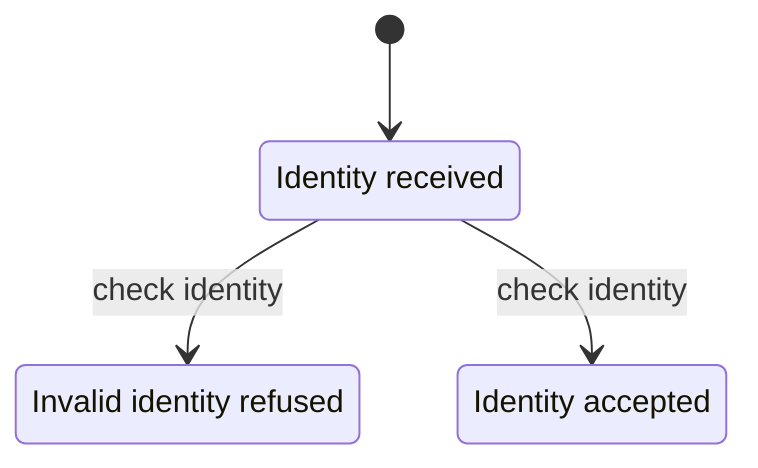
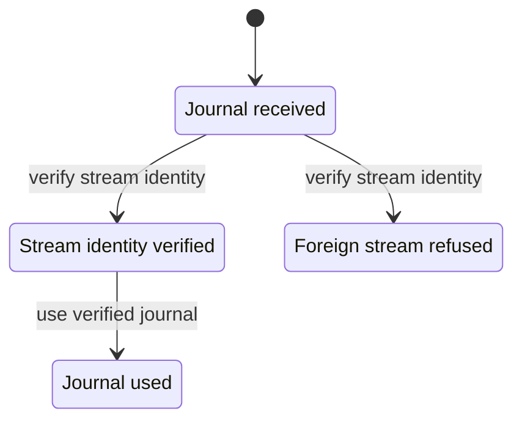

# Replay identity and workflow journal streams

**Property:** Accepted replay identities use primitive strings with required nonempty values, and workflow resume, terminal reuse, replay and journal reads use captured events only from the requested run's stream.

**Why:** Boxed strings can disguise duplicate stream names, and a reader returning another run's events can make work or a stored outcome appear to belong to the wrong run.

**Review baseline:** `555ff3fbd916e158daec16cb00d559810c800fe6`.

## Covered code and checks

- `packages/runtime/src/workflow-boundary.ts` classifies primitive strings. `replay/parse.ts` rejects nonprimitive evidence strings; `replay/equivalence.ts` validates report and stream identities, and `replay/divergence.ts` validates divergence run IDs.
- `packages/runtime/src/replay/journal-stream.ts` captures journal events and checks their stream IDs. `workflow.ts` and `replay/replayer.ts` use that capture before resume, terminal reuse, replay or journal reads.
- `packages/runtime/test/replay/stream-identity.test.ts` checks boxed and impostor strings, empty IDs, foreign start and terminal records, direct report construction and journal changes during replay and resume. Seed 614618 samples 100 special and Unicode stream names.

From the repository root with dependencies installed, run:

```sh
bash scripts/verify-state-machine.sh .agents/skills/verify-replay-stream-identity
```

The runner checks the pinned TLC 1.7.4 jar and uses Z3 4.15.4. Set `TLA2TOOLS` and `BUDGET_Z3_PYTHONPATH` to existing installations for offline runs. Java 11+, Python, Node and the repository dependencies are required. This separate command checks fifteen deliberately broken scratch implementations with the full skill, then reruns the restored code:

```sh
python3 .agents/skills/verify-replay-stream-identity/mutations/full.py
```

## Model and evidence

`ReplayPrimitiveIdentity` explores 32 states and 32 steps for run, seed, stream and order fields with valid, empty, boxed and non-string values. It requires accepted values to be primitive and required identities to be nonempty; its three-state projection has two arrows and hides 16 same-label steps. Read each TLC result with `/statechart`; the maintained views supply the projections.



`WorkflowJournalStream` explores 28 states and 32 steps for resume, terminal reuse, replay or journal reads, one foreign or matching event, and a caller edit. It requires used events to match the requested stream; its four-state projection has three arrows and hides 16 same-label steps.



A boxed stream name and its primitive equivalent previously evaded duplicate detection. A foreign start or terminal event could be accepted for another run. Without a detached journal capture, a caller can change a replay read set or a cached step result after it is read. Real-code tests reproduce these cases. Four weakened TLC configurations and four weakened Z3 assumptions produce counterexamples. Z3 proves abstract classification and captured-stream implications, not TypeScript refinement.

The models assume faithful primitive classification, cloning and event stream IDs, and bound each case to one modeled event or identity. `structuredClone` may invoke accessors in the supplied journal; the reader and JavaScript intrinsics remain trusted. These checks do not authenticate a journal, establish its completeness or order, prove callback purity, eliminate hash collisions, or guarantee cross-process fencing and liveness. Empty or nonprimitive report identities that older code accepted are now refused.

## Keep in sync

Inspect changes to covered code and tests since the baseline, including uncommitted changes. Replay counterexamples against real code, rerun verification and mutations, and advance the baseline only after the model and implementation agree. Use `/maintain-formal-verification-skill` for that review.
