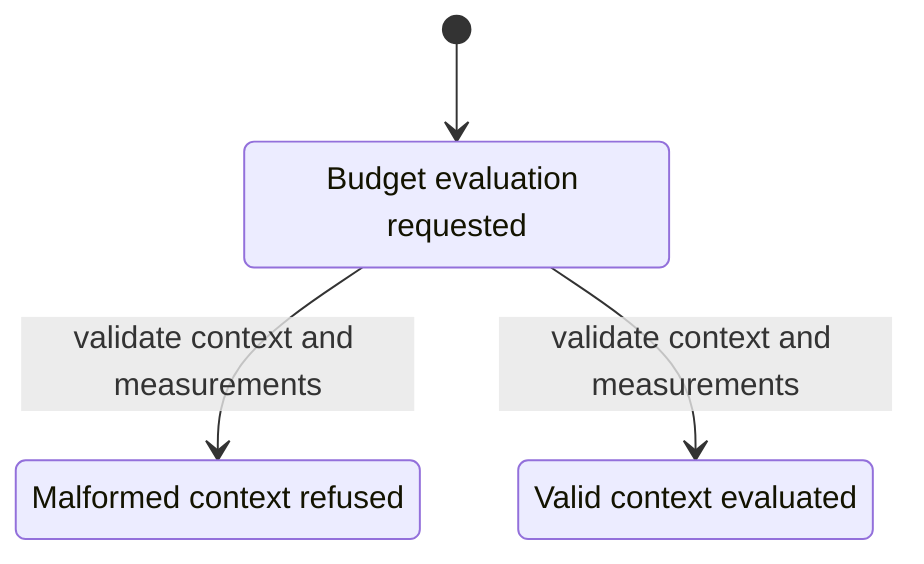

# Shared budget-policy evaluation

**Property:** A feasible policy decision must match the bound scope and funded window, fit the monetary and metric ceilings, and require native provenance before strict admission. An explicit non-array constraint list must be rejected rather than treated as omitted. Malformed evaluation contexts and measurements are refused instead of being accepted or causing a type error.

**Why:** A policy that accepts foreign scope, stale windows, excess exposure, or unauthenticated strict bounds can authorize work outside its budget.

**Review baseline:** `84770e58fbe7ea0e4d2623c9ccab040ceb0a5bc2`.

## Covered code

- `packages/core/src/ports/budget-policy.ts` (`parseBudgetPolicy`, `evaluateBudgetPolicy`)
- `packages/core/test/budget-policy.property.test.ts` and `budget-policy-schema.test.ts`
- `packages/core/data-models/budget_policy.proto` and related CUE contracts
- Consumers include `packages/ci/src/routing.ts`, `packages/ci/src/shared-budget.ts`, and `packages/cloud/src/planner/hosting-budget.ts`.

## Run

From the repository root after installing workspace dependencies:

```sh
bash scripts/verify-state-machine.sh .agents/skills/verify-shared-budget-policy
python3 .agents/skills/verify-shared-budget-policy/mutations/implementation.py
```

The first command runs fast-check and the CUE contract against the actual policy boundary, TLC 1.7.4, model mutations, and Z3 4.15.4 with deliberately weakened variants. The second runs six broken implementations in scratch copies and reruns the restored tests. Set `BUDGET_Z3_PYTHONPATH` to the pinned solver or allow a temporary installation. Set `TLA2TOOLS` to the pinned jar or let the shared runner download it. Java 11+, Python, CUE 0.14.0, Node with the repo's `tsx`, Vitest and fast-check are required. Set `HOBO_CUE_BIN` to the pinned executable, put it on `PATH`, or populate the repository CUE cache. Use `/statechart` to read the model result and chart.

## Scope and evidence

The generated checks use seed 614438 and 500 cases per property, including nonnegative safe-integer edge values through `Number.MAX_SAFE_INTEGER`. They reject null and other non-array constraint lists, compare BigInt-projected costs to an independent arithmetic oracle, distinguish feasible strict planning from admission, check scope/metric refusal and generate fixed-window boundaries. The model abstracts an individual synchronous evaluation into one step with booleans for scope, window, budget and metrics. TLC checks every combination of those booleans and strict/native/planning flags; it does not establish that the booleans were derived correctly or model actor concurrency. PolicyShape checks eight states covering omitted, array, null, and other constraint shapes; a mutation that treats null as omitted violates its invalid-shape invariant. The executable CUE contract test separately checks that both the parser and CUE reject null. The evaluator receives the `boundKind` label from its caller; it does not authenticate provider evidence itself. Z3 proves the admission and fixed-window arithmetic obligations over unbounded nonnegative integers and checks the strict/native gate, assuming trusted measurements and atomic evaluation. It is not a proof that TypeScript refines the abstraction or that providers enforce the claimed bound. `SHARED_POLICY_PROOF_MUTATION=omit-cost` and `omit-native` produce counterexamples. Removing the cost or native gate in the finite model violates its independently stated invariants. Mutating the implementation's projected-cost guard and strict-native admission guard separately in scratch copies must make the corresponding generated tests fail. The dispatcher and CI routing skills cover separate behavior.

BudgetContext explores 12 states and 18 steps for valid or invalid context objects and measurement collections or entries. It checks that malformed inputs neither produce an accepted decision nor crash. The three-state projection hides 12 same-label steps. Removing either validation guard yields a TLC counterexample; generated real-code cases and six isolated implementation mutations exercise the matching boundaries. The model assumes an otherwise valid authored policy and abstracts the remaining feasibility checks; it does not establish TypeScript refinement, authenticate measurement provenance, or cover hostile getters and proxies.



## Keep in sync

Inspect changes to the covered files since the sync commit, including uncommitted changes. Update the model and generated checks for intended behavior, replay model counterexamples against real code, rerun the check and deliberately broken scratch variants, then advance the sync commit only after confirming correspondence. Use `/maintain-formal-verification-skill`.
