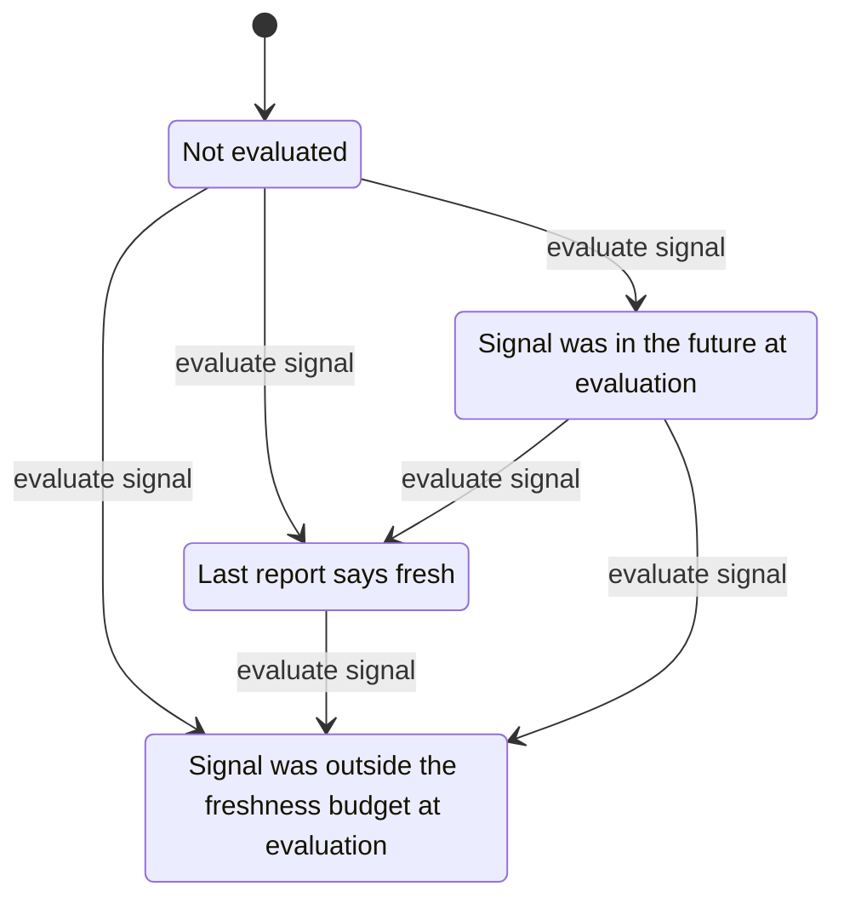

# Status-page signal freshness

**Property:** A signal is fresh only when its parsed age at evaluation is between zero and the configured budget, inclusive. The budget must be a nonnegative safe integer. Without an active incident overlay, a signal outside that window renders delayed and unknown rather than operational.

**Why:** A future-dated or expired healthy measurement must not make an unavailable or unobservable component look healthy; an infinite or malformed budget must not silently disable the freshness boundary.

**Review baseline:** `95a7be1f89efb73e0062ab7df71d80dc8283d029`.

## Covered code and checks

- `packages/status-page/src/model.ts` validates `freshnessBudgetMs`, derives signal age from `evaluatedAt` and `lastSignalAt`, and applies incident and maintenance overlays. `packages/status-page/data-models/status_page.cue` declares a nonnegative integer freshness budget.
- `packages/status-page/src/projection.ts` supplies the measurements used by the real-code freshness checks.
- `packages/status-page/test/freshness-window.test.ts` checks future, exact start, exact end and expired boundaries; malformed budgets; and 300 deterministic clock-offset and budget pairs from seed `0x7b10cafe`. Existing model tests exercise stale signals and incident overlays.

The related [signal-order skill](../verify-status-page-signal-order/SKILL.md) checks SLO measurement ordering and label validation.

From the repository root with dependencies installed, run:

```sh
bash scripts/verify-state-machine.sh .agents/skills/verify-status-page-freshness
```

The runner checks the pinned TLC 1.7.4 jar and uses Z3 4.15.4. Set `TLA2TOOLS` and `BUDGET_Z3_PYTHONPATH` to existing installations for offline runs. Java 11+, Python, Node and the repository dependencies are required. This separate command runs five deliberately broken scratch implementations through the full skill and reruns the restored code:

```sh
python3 .agents/skills/verify-status-page-freshness/mutations/full.py
```

## Model and evidence

`StatusFreshness` checks 100 states and 270 steps for one fixed signal timestamp, a clock from zero to four, budget one, and evaluations at any clock step. It requires that a fresh verdict at evaluation is neither future-dated nor older than the budget. Its four-state projection has six arrows and hides 213 same-label steps, including clock advances and evaluations that do not change the visible verdict. A report is refreshed only when the page is evaluated again. Read every TLC result with `/statechart`; the maintained view supplies the projection.



Previously, a negative signal age passed the upper-bound check, and an infinite budget kept arbitrarily old signals fresh. Real-code checks reproduce both cases. Two weakened TLC configurations produce counterexamples, and five real-code mutations cover the future and expiry guards, inclusive boundaries and budget validation. Z3 proves the age implications and inclusive endpoints for arbitrary integer times and a nonnegative integer budget. These are mathematical abstraction results, not a proof of TypeScript refinement.

The model uses one signal, a fixed budget and bounded clock; it does not model new samples, persistence, rendering, invalid timestamps or incident and maintenance transitions. The implementation tests cover invalid budgets and generated timestamps, and the status-page suite covers incident overlays. The clock and source timestamps are trusted inputs; a future measurement becomes eligible when the supplied evaluation time reaches it. Active incidents can override an unknown component with their acknowledged impact, and stale or future measurements may still appear in history. Safe-integer validation is stricter than CUE's unbounded integer domain.

## Keep in sync

Inspect changes to covered code, time and budget contracts, and tests since the baseline, including uncommitted changes. Replay counterexamples against real code, rerun verification and mutations, and advance the baseline only after the model and implementation agree. Use `/maintain-formal-verification-skill` for that review.
