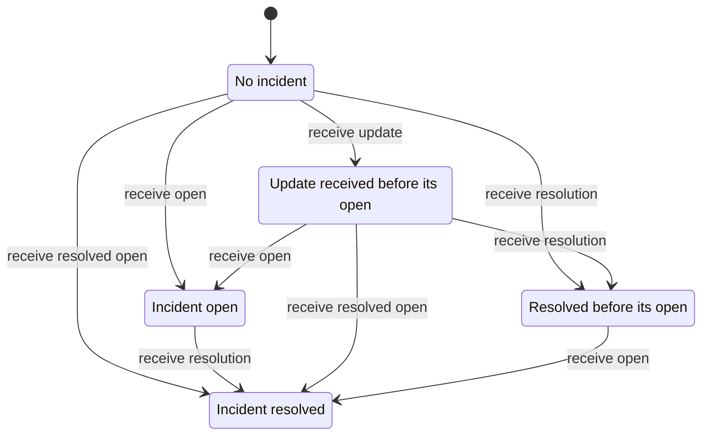

# Status-page incident lifecycle and late opens

**Property:** Incident state advances monotonically. The first actual open supplies the retained impact and can advance a placeholder's state; duplicate opens cannot replace that impact or advance the state. A resolved incident never reopens.

**Why:** A late open must not leave a critical incident with the placeholder's minor impact, hide a later lifecycle state, or overwrite an outcome reported by earlier events.

**Review baseline:** `68d4d6dbff597b53447da4a1988717e67b496908`.

## Covered code and checks

- `packages/status-page/src/projection.ts` tracks placeholders awaiting their first open, backfills impact, merges that open's lifecycle, preserves resolution time and consumes the marker. `src/types.ts` defines incident lifecycle ordering; `src/model.ts` overlays the resulting impact on component status.
- `packages/status-page/test/incident-backfill.test.ts` checks update, public-update and resolved placeholders; all first-open states; resolution timestamps; duplicate opens; separate IDs; and 768 combinations of three updates, three impacts and four first-open positions.
- The related [maintenance skill](../verify-status-page-maintenance/SKILL.md) covers maintenance outcomes and pre-schedule updates. The [freshness skill](../verify-status-page-freshness/SKILL.md) covers signal age and budget validation.

From the repository root with dependencies installed, run:

```sh
bash scripts/verify-state-machine.sh .agents/skills/verify-status-page-incident
```

The runner checks the pinned TLC 1.7.4 jar and uses Z3 4.15.4. Set `TLA2TOOLS` and `BUDGET_Z3_PYTHONPATH` to existing installations for offline runs. Java 11+, Python, Node and the repository dependencies are required. This separate command runs ten deliberately broken scratch implementations through the full skill and reruns the restored code:

```sh
python3 .agents/skills/verify-status-page-incident/mutations/full.py
```

## Model and evidence

`StatusIncident` checks 17 states and 115 steps for one incident ID, all four lifecycle states, three impacts, updates, the first open and duplicate opens. It checks pending markers, retained first-open impact and lifecycle agreement. Its five-state projection has nine arrows and hides 57 same-label steps, including updates that do not change the displayed state. Read every TLC result with `/statechart`; the maintained view supplies the projection.



Previously, an update or resolution before an open left the incident at the placeholder's minor impact after the open. A late first open's newer lifecycle state was also ignored. Real-code tests reproduce both paths. Five weakened TLC configurations yield counterexamples. Ten real-code mutations check marker creation and isolation, impact restoration, duplicate opens, lifecycle merging and resolution time. Z3 checks abstract first-impact preservation and monotone rank, not TypeScript refinement.

The model covers one ID and valid states and impacts; implementation tests also check two IDs, a public update, rendered impact and resolution timestamps. Event timestamps, invalid payloads, duplicate-open metadata, persistence, delivery and distributed ordering are abstracted. The first open is determined by fold order. Before an open arrives, its impact is not yet known and the placeholder uses minor; markers for IDs that never open remain in the projection. Older snapshots must be rebuilt from the event log to recover backfill omitted by earlier versions.

## Keep in sync

Inspect changes to covered code, event contracts and tests since the baseline, including uncommitted changes. Replay counterexamples against real code, rerun verification and mutations, and advance the baseline only after the model and implementation agree. Use `/maintain-formal-verification-skill` for that review.
