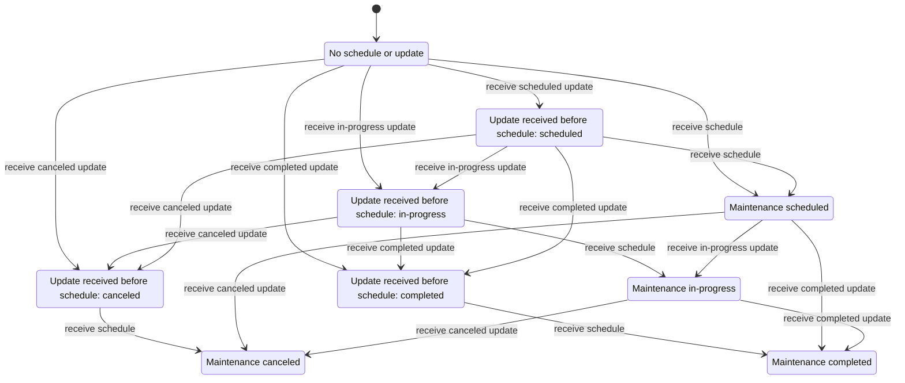

# Status-page maintenance lifecycle

**Property:** The first completed or canceled update is terminal. A valid update received before its maintenance schedule is retained by ID and applied when that schedule arrives.

**Why:** Discarding an early completion can make finished maintenance appear active, and switching between completed and canceled changes the reported outcome after the fact.

**Review baseline:** `68d4d6dbff597b53447da4a1988717e67b496908`.

## Covered code and checks

- `packages/status-page/src/types.ts` implements the terminal guard; `src/projection.ts` retains and consumes pending maintenance states and rejects malformed updates. `src/model.ts` uses the resulting lifecycle when applying a maintenance overlay.
- `packages/status-page/test/maintenance-lifecycle.test.ts` checks all transition pairs and 256 combinations of three updates with the schedule at each position, two independent pending IDs, invalid updates and the rendered result of a late schedule.
- The related [freshness skill](../verify-status-page-freshness/SKILL.md) covers signal age and budget validation.

The related [incident skill](../verify-status-page-incident/SKILL.md) covers incident lifecycle and late-open backfill.

From the repository root with dependencies installed, run:

```sh
bash scripts/verify-state-machine.sh .agents/skills/verify-status-page-maintenance
```

The runner checks the pinned TLC 1.7.4 jar and uses Z3 4.15.4. Set `TLA2TOOLS` and `BUDGET_Z3_PYTHONPATH` to existing installations for offline runs. Java 11+, Python, Node and the repository dependencies are required. This separate command runs six deliberately broken scratch implementations through the full skill and reruns the restored code:

```sh
python3 .agents/skills/verify-status-page-maintenance/mutations/full.py
```

## Model and evidence

`StatusMaintenance` checks nine states and 36 steps for one maintenance ID, arbitrary sequences of the four valid update states and one schedule. Its expected transition table is separate from the rank-based implementation abstraction. The projection has nine states and 19 arrows and hides 17 same-label steps, including duplicate and regressive updates. Read every TLC result with `/statechart`; the maintained view supplies the projection.



Previously, completion before scheduling was discarded and a late schedule appeared scheduled; after a completion, a canceled update could replace the outcome. Real-code tests replay both paths. Two weakened TLC configurations yield counterexamples. Six real-code mutations exercise terminal guards, pending storage and application, ID isolation, consumption and invalid-update refusal. Z3 checks abstract terminal and pending-state implications, not TypeScript refinement.

The model covers one ID, valid update values and one schedule; the implementation tests also check two IDs and malformed updates. The first terminal outcome is determined by fold order, not event timestamps. The model does not verify event delivery, duplicate scheduling metadata, persistence, distributed ordering or every status-page overlay. Older projection snapshots that discarded pre-schedule updates must be rebuilt from the event log to recover them.

## Keep in sync

Inspect changes to covered code, event contracts and tests since the baseline, including uncommitted changes. Replay counterexamples against real code, rerun verification and mutations, and advance the baseline only after the model and implementation agree. Use `/maintain-formal-verification-skill` for that review.
