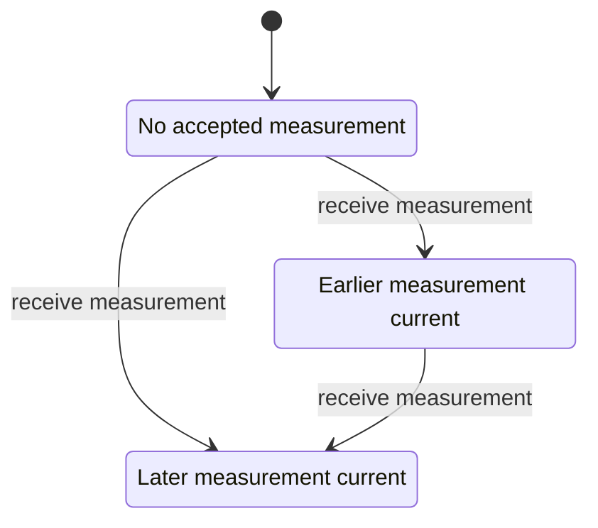

# Status-page measurement ordering

**Property:** A valid older measurement may update history but cannot replace the current measurement's label, status, timestamp, attainment or target. Equal timestamps use the last folded measurement. An invalid optional label causes its measurement to be ignored.

**Why:** A stale or malformed label should not be paired with a newer health status, and late measurements should still contribute to historical reporting.

**Review baseline:** `95a7be1f89efb73e0062ab7df71d80dc8283d029`.

## Covered code and checks

- `packages/status-page/src/projection.ts` validates SLO payloads, orders measurements and maintains per-day history. `src/model.ts` renders the resulting component label, current status and history.
- `packages/status-page/test/signal-order.test.ts` checks all six arrival orders of three distinct timestamps, equal timestamps, late targets, omitted and malformed labels, and 100 deterministic five-sample sequences with seed `0x136a8c29`.
- Related skills cover [freshness](../verify-status-page-freshness/SKILL.md), [maintenance](../verify-status-page-maintenance/SKILL.md) and [incidents](../verify-status-page-incident/SKILL.md).

From the repository root with dependencies installed, run:

```sh
bash scripts/verify-state-machine.sh .agents/skills/verify-status-page-signal-order
```

The runner checks the pinned TLC 1.7.4 jar and uses Z3 4.15.4. Set `TLA2TOOLS` and `BUDGET_Z3_PYTHONPATH` to existing installations for offline runs. Java 11+, Python, Node and the repository dependencies are required. This separate command runs nine deliberately broken scratch implementations through the full skill and reruns the restored code:

```sh
python3 .agents/skills/verify-status-page-signal-order/mutations/full.py
```

## Model and evidence

`StatusSignalOrder` checks 27 states and 101 steps for at most two measurements of one component, two timestamps, two valid labels, an invalid label and two abstract statuses. It compares the current measurement and historical sample count with an independent reference fold. Its three-state projection has three arrows and hides 69 same-label steps, including rejected, tied and older measurements and history updates. Read every TLC result with `/statechart`; the maintained view supplies the projection.



Previously, an older measurement could replace the newer label and a non-string label could enter the projection. Real-code tests reproduce both cases. Three weakened TLC configurations yield counterexamples. Nine real-code mutations cover late fields, history, ties and label validation. Z3 proves abstract monotone timestamp selection, older-label preservation and the equal-timestamp rule for arbitrary integers; this does not prove TypeScript refinement.

The model bounds the number of measurements and uses supplied-label samples, one history bucket and abstract statuses. Implementation tests additionally cover omitted labels, multiple targets and malformed JSON values. It does not model the 90-day history limit, clock freshness, event delivery, source correctness or arbitrary component IDs. A future-dated measurement can remain the latest projection sample and mask later-arriving samples with earlier measurement times until the evaluation clock reaches it; freshness evaluation fails closed in that case.

## Keep in sync

Inspect changes to covered code, payload contracts and tests since the baseline, including uncommitted changes. Replay counterexamples against real code, rerun verification and mutations, and advance the baseline only after the model and implementation agree. Use `/maintain-formal-verification-skill` for that review.
