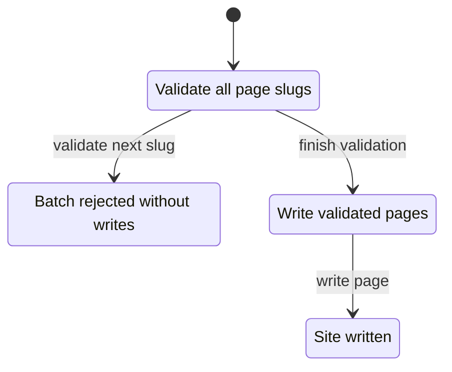

# Status-site batch preflight

**Property:** If any page slug is malformed or duplicated, `writeStatusSite` rejects the batch before creating the site root or changing existing files. All slugs are validated before writing a valid batch.

**Why:** A request rejected by validation should not leave some pages updated and others unchanged.

**Review baseline:** `d55f4edcc9371648fc8f197a87e196c7c1113ff4`.

## Covered code and checks

- `packages/status-page/src/site.ts` resolves and validates slugs, detects duplicates and writes static site files.
- `packages/status-page/test/site-preflight.test.ts` checks a duplicate after valid pages, a malformed later slug with an existing sentinel, and 28 generated duplicate positions. `test/site.test.ts` covers valid site output and the existing slug rules.

From the repository root with dependencies installed, run:

```sh
bash scripts/verify-state-machine.sh .agents/skills/verify-status-site-preflight
```

The runner checks the pinned TLC 1.7.4 jar and uses Z3 4.15.4. Set `TLA2TOOLS` and `BUDGET_Z3_PYTHONPATH` to existing installations for offline runs. Java 11+, Python, Node and the repository dependencies are required. This separate command runs four deliberately broken scratch implementations through the full skill and reruns the restored code:

```sh
python3 .agents/skills/verify-status-site-preflight/mutations/full.py
```

## Model and evidence

`StatusSitePreflight` checks 11 states and 19 steps for a two-page batch with no error or a first invalid entry at either position. It checks that invalid batches do not touch the filesystem and that any write follows a complete scan. Its four-state projection has three arrows and hides 15 same-label steps, including intermediate validation and writes. Read every TLC result with `/statechart`; the maintained view supplies the projection.



Previously, the writer could create the root and write earlier pages before rejecting a duplicate or malformed later slug. Real-code tests reproduce both paths. Three weakened TLC configurations yield counterexamples; four real-code mutations exercise invalid-slug and duplicate checks, early root creation and lazy validation. Z3 proves that a successful complete abstract scan cannot contain an invalid entry for any positive batch size; this does not prove TypeScript refinement.

The model abstracts slug parsing into a valid or invalid position and bounds the batch to two pages; implementation tests also exercise larger batches and existing files. This is a validation barrier, not a filesystem transaction: an I/O error, process interruption or concurrent writer after validation can leave partial output. Filesystem semantics, rendering, publication authorization and arbitrary JavaScript callbacks are outside the model.

## Keep in sync

Inspect changes to covered code, slug contracts and tests since the baseline, including uncommitted changes. Replay counterexamples against real code, rerun verification and mutations, and advance the baseline only after the model and implementation agree. Use `/maintain-formal-verification-skill` for that review.
