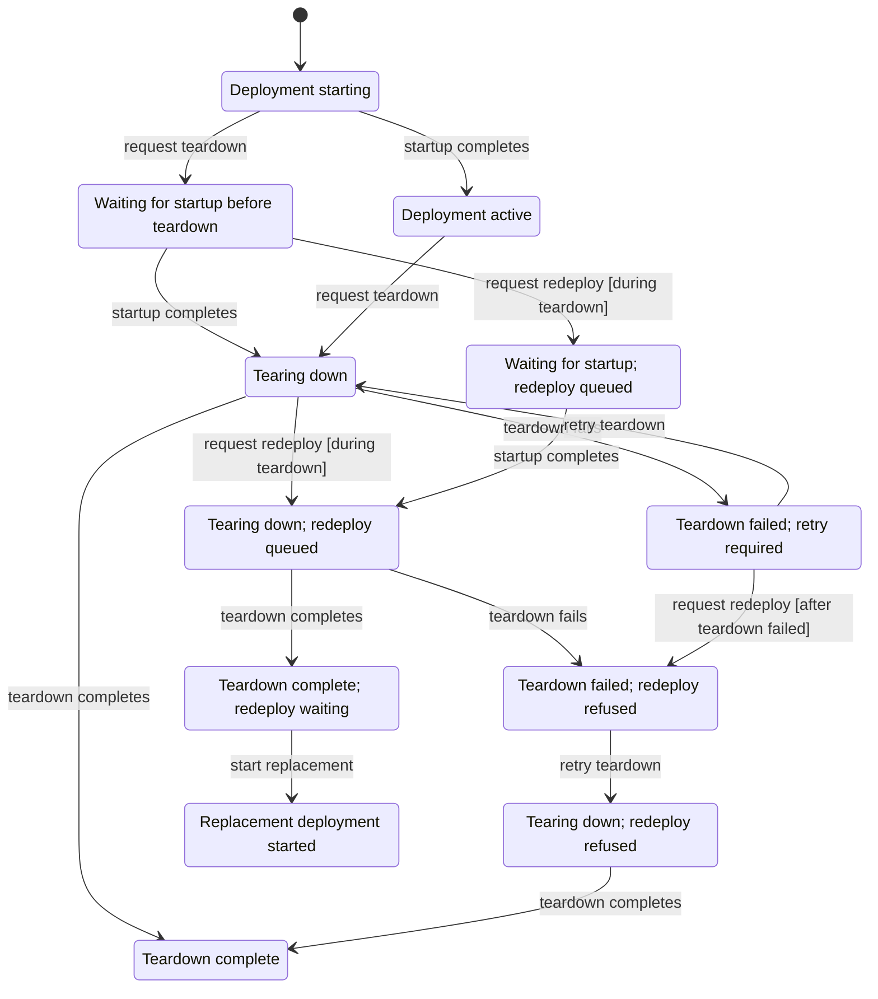
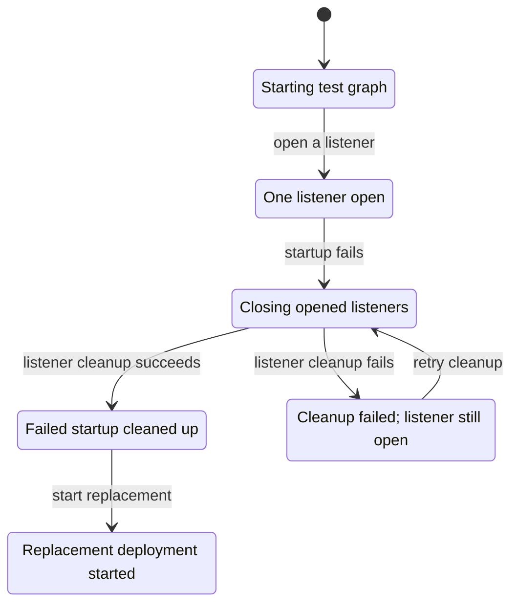

# Test harness deployment lifecycle

**Properties:** Concurrent starts for one Bindle share a deployment. Concurrent destroys share teardown; a replacement waits until teardown succeeds. A failed teardown fences redeployment until an explicit destroy retry succeeds. If startup fails after opening listeners, those listeners are cleaned up; incomplete cleanup fences redeployment until it succeeds.

**Why:** Overlapping local deployments and a prematurely successful destroy can leave a suite using an old listener or leak it after a failed startup.

**Review baseline:** `2e6fdad41370c93197efd2bd54e44e08c0e69aed`.

## Covered code and checks

- `packages/testing/src/harness.ts` shares starts and teardown, retains failure fences, and retries cleanup.
- `packages/testing/src/lanes/in-process.ts` opens listeners in dependency order, closes them in reverse order, and preserves incomplete startup cleanup for retry.
- `packages/testing/test/harness-lifecycle.test.ts` exercises all 64 combinations of one through four concurrent start, destroy, and redeploy calls in the tested ordering, plus reentrant startup and failed operations. `test/in-process-cleanup.test.ts` uses real local listeners and injects a close failure to check cleanup and retry.

From the repository root with dependencies installed, run:

```sh
bash scripts/verify-state-machine.sh .agents/skills/verify-testing-harness-lifecycle
```

The runner checks TLC 1.7.4 and uses Z3 4.15.4. Set `TLA2TOOLS` and `BUDGET_Z3_PYTHONPATH` to existing installations for offline runs. Java 11+, Python, Node and repository dependencies are required. The following separate command tests nine broken scratch implementations and reruns the restored skill:

```sh
python3 .agents/skills/verify-testing-harness-lifecycle/mutations/full.py
```

## Model and evidence

`TestingHarnessLifecycle` explores 82 distinct states and 182 generated states for one Bindle, one replacement request, a second destroy, one reentrant start and up to one teardown failure. It checks one initial start, no replacement before cleanup, and no successful second destroy before cleanup. The chart merges caller counts and hides 97 same-label steps. Read each TLC result with `/statechart`; the maintained view supplies the projection.



`TestingStartupCleanup` explores nine states and 18 generated states for one listener opened before a failed startup, one possible cleanup failure, and a replacement. It checks that a failed startup reported as clean leaves no listener and that a replacement never overlaps the old listener. The chart hides nine same-label steps.



The original implementation allowed a second destroy to return and a replacement to start while the first destroy was pending; synchronous reentry could also start twice. It leaked a real listener when a later startup step failed. The tests reproduce those paths. Five weakened models produce counterexamples for early return, overlap, duplicate start, missing startup cleanup, and missing cleanup fencing. Nine scratch implementation mutations exercise those guards and failure paths, and the restored skill passes. Z3 proves an inductive exclusion property for an abstract old/replacement deployment and finds an overlap when its restart guard is removed.

The models cover one Bindle and bounded callers, listeners and failures. They assume the in-process lane reports successful cleanup only after the operating system closes the listener. They do not prove TypeScript refinement, Node or operating-system behavior, arbitrary outside manipulation of server objects, process crashes, effects within user handlers, cross-process coordination, or the unimplemented ephemeral-Camp lane. A start or cleanup that never settles can keep a Bindle fenced indefinitely; no liveness guarantee is claimed. The Z3 proof is over a Boolean abstraction, not the implementation.

## Keep in sync

Inspect changes to the covered code and tests since the baseline, including uncommitted changes. Replay counterexamples against real code, rerun the verification and scratch mutations, and advance the baseline only when model and implementation agree. Use `/maintain-formal-verification-skill`.
