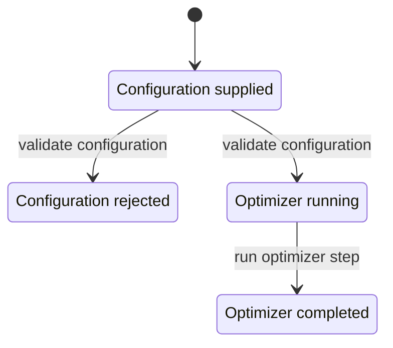

# Training optimizer count configuration

**Property:** Iteration and demonstration counts must be integers in the protobuf's positive `uint32` range. The bounded model admits only valid counts and, assuming enabled steps eventually run, completes an admitted optimization.

**Why:** Values outside the wire contract cannot be faithfully represented, and sufficiently large JavaScript integers can stop increasing when incremented.

**Review baseline:** `6a7ecb7b0431ab6a8582eb6fd901d34c3b50e549`.

## Covered code and checks

- `packages/training/src/optimizer.ts` parses both count fields and runs the iteration loop. `data-models/training_optimizer.proto` specifies `uint32` fields; `data-models/training_optimizer.cue` constrains them to the same positive range.
- `packages/training/test/optimizer-config-bounds.test.ts` checks both field boundaries, typed error paths and 100 generated values on either side of the upper bound without executing oversized optimizations. Existing optimizer tests cover defaults and normal runs.
- The related [seeded generator skill](../verify-training-prng/SKILL.md) checks generator contracts, and the [trace sink skill](../verify-training-trace-sink/SKILL.md) checks recorded trace snapshots.

The related [selection skill](../verify-training-selection/SKILL.md) checks reward admission and keep-best behavior.

From the repository root with dependencies installed, run:

```sh
bash scripts/verify-state-machine.sh .agents/skills/verify-training-config
```

The runner checks the pinned TLC 1.7.4 jar and uses Z3 4.15.4. The schema checks require CUE 0.14.0 on `PATH`, or `HOBO_CUE_BIN` pointing to it. Set `TLA2TOOLS` and `BUDGET_Z3_PYTHONPATH` to existing installations for offline runs. Java 11+, Python, Node and the repository dependencies are required. This separate command runs seven deliberately broken scratch implementations or schemas through the full skill and reruns the restored code:

```sh
python3 .agents/skills/verify-training-config/mutations/full.py
```

## Model and evidence

`TrainingConfig` checks 29 states and 48 steps for one abstract count, values zero through four, an abstract maximum of three and integral or non-integral input. It checks admission, no iteration overshoot and eventual completion under weak fairness for the optimizer step. Its four-state projection has three arrows and hides 35 same-label steps, including intermediate optimizer steps. Read every TLC result with `/statechart`; the maintained view supplies the projection.



Previously, both count fields accepted values above `4294967295`; real-code tests reproduce this mismatch. Three weakened TLC configurations yield counterexamples. Seven scratch mutations exercise integer and range guards, field-specific error paths and both CUE upper bounds. Z3 checks abstract integer-loop bounds and the binary64 example where adding one at `2^53` rounds back to the same value. These checks do not prove TypeScript refinement or whole-program termination.

The model uses a small abstract range and one count at a time; implementation and CUE checks exercise both real fields. The liveness result assumes steps are scheduled and abstracts scoring, allocation, exceptions and external effects. The `uint32` maximum is a wire limit, not a practical workload cap: large valid counts can still consume substantial time or memory. Binary64 exactness within the modeled integer range is assumed when relating the arithmetic result to JavaScript.

## Keep in sync

Inspect changes to covered code, protobuf and CUE constraints, and tests since the baseline, including uncommitted changes. Replay counterexamples against real code, rerun verification and mutations, and advance the baseline only after the model and implementation agree. Use `/maintain-formal-verification-skill` for that review.
