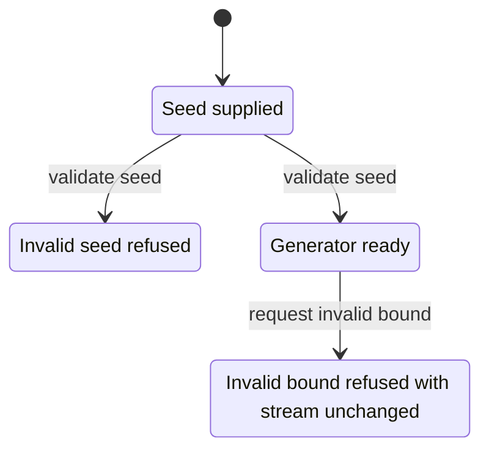

# Training seeded generator

**Property:** The generator accepts only unsigned 32-bit integer seeds and positive safe-integer bounds. A rejected bound does not consume a draw; valid draws follow the same deterministic splitmix32 trajectory for the same seed and call sequence.

**Why:** Silent seed coercion and state changes during failed calls can make a recorded training run replay a different proposal trajectory.

**Review baseline:** `6a7ecb7b0431ab6a8582eb6fd901d34c3b50e549`.

## Covered code and checks

- `packages/training/src/prng.ts` validates inputs, advances the 32-bit state, mixes each word and implements bounded draws. `src/optimizer.ts` uses the generator to make proposals.
- `packages/training/test/prng-contract.test.ts` checks invalid inputs and unchanged streams, fixed splitmix32 output vectors for three seeds, and generated sequences for 100 seeds and six bounds. `test/optimizer.test.ts` checks replay at the optimizer level.

The related [trace sink skill](../verify-training-trace-sink/SKILL.md) checks snapshots and draining of optimizer traces.

The related [optimizer config skill](../verify-training-config/SKILL.md) checks count bounds and abstract loop progress.

The related [selection skill](../verify-training-selection/SKILL.md) checks reward admission and keep-best behavior.

From the repository root with dependencies installed, run:

```sh
bash scripts/verify-state-machine.sh .agents/skills/verify-training-prng
```

The runner checks the pinned TLC 1.7.4 jar and uses Z3 4.15.4. Set `TLA2TOOLS` and `BUDGET_Z3_PYTHONPATH` to existing installations for offline runs. Java 11+, Python, Node and the repository dependencies are required. This separate command runs nine deliberately broken scratch implementations through the full skill and reruns the restored code:

```sh
python3 .agents/skills/verify-training-prng/mutations/full.py
```

## Model and evidence

`TrainingPrng` checks 44 states and 92 steps for valid and invalid seeds, a four-state abstract generator, up to three draws and one invalid-bound request. It requires invalid seeds to be refused and invalid bounds to leave the stream aligned with a reference stream. Its four-state projection has three arrows and hides 68 same-label steps, including draws. Read every TLC result with `/statechart`; the maintained view supplies the projection.



Previously, invalid numeric seeds and bounds were silently coerced or accepted. Real-code tests reproduce the failures and verify rejected bounds do not consume state. Two weakened TLC configurations yield counterexamples; nine real-code mutations exercise seed and bound guards, state consumption, the state step, mixing and scaling. Z3 proves that the abstract 32-bit increment has a full `2^32` state cycle and that each bit-mixing multiplication and xor shift has a 32-bit inverse. It also checks real-number product bounds for positive bounds. These are mathematical results under the stated bit-vector and real arithmetic semantics, not a proof of TypeScript or floating-point refinement.

The state-machine model uses four states and three draws rather than all 32-bit states and arbitrary executions; the bit-vector obligations address separate arithmetic properties. Implementation tests sample inputs and pin vectors, but do not prove every JavaScript result or optimizer trajectory. `nextInt` scales one of `2^32` possible draws; it makes no unbiased-sampling guarantee, and bounds above `2^32` have unreachable values. Invalid direct API inputs that were previously coerced now throw.

## Keep in sync

Inspect changes to covered code, generator contracts and tests since the baseline, including uncommitted changes. Replay counterexamples against real code, rerun verification and mutations, and advance the baseline only after the model and implementation agree. Use `/maintain-formal-verification-skill` for that review.
