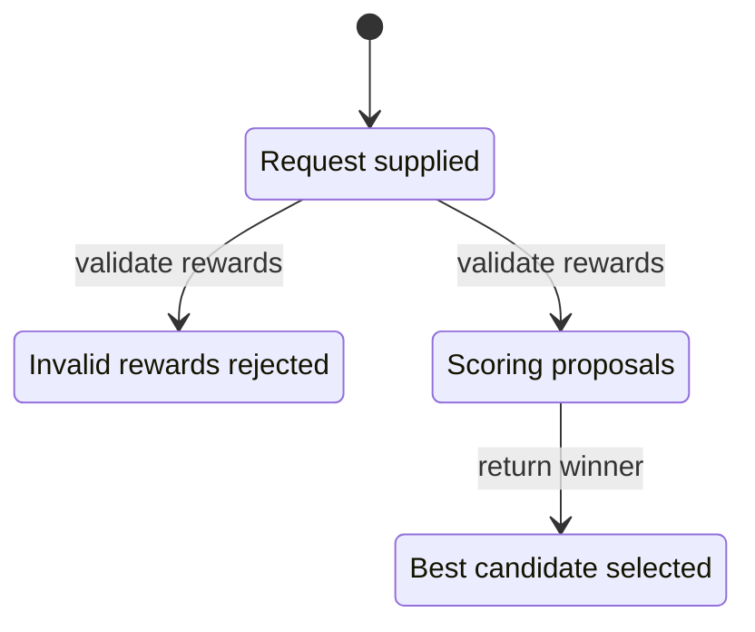

# Training optimizer selection

**Property:** Non-finite or out-of-range rewards are rejected before trace recording. For valid scores, the optimizer keeps the highest-scoring proposal seen so far, keeps the first proposal on ties and reports that winner.

**Why:** Invalid rewards can corrupt selection and traces, while replacing a better candidate or a tied first winner makes replayed results disagree with the recorded trajectory.

**Review baseline:** `783afc988b682ee6de6bf97df6ada2b4bba5a14b`.

## Covered code and checks

- `packages/training/src/optimizer.ts` validates rewards, generates and scores proposals, keeps the incumbent and emits the winning artifact and traces. `src/trace-sink.ts` stores the traces; core's `parseOptimizeRequest` also checks reward ranges for parsed requests.
- `packages/training/test/optimizer-selection.test.ts` checks invalid rewards before tracing, all-tie behavior and 80 deterministic generated runs against recorded decisions and winner payloads. Existing optimizer tests cover candidate shape and normal replay.
- Related skills cover [configuration](../verify-training-config/SKILL.md), the [seeded generator](../verify-training-prng/SKILL.md) and [trace snapshots](../verify-training-trace-sink/SKILL.md).

The related [trace commit skill](../verify-training-trace-commit/SKILL.md) checks when a run publishes its trace batch.

From the repository root with dependencies installed, run:

```sh
bash scripts/verify-state-machine.sh .agents/skills/verify-training-selection
```

The runner checks the pinned TLC 1.7.4 jar and uses Z3 4.15.4. Set `TLA2TOOLS` and `BUDGET_Z3_PYTHONPATH` to existing installations for offline runs. Java 11+, Python, Node and the repository dependencies are required. This separate command runs eight deliberately broken scratch implementations through the full skill and reruns the restored code:

```sh
python3 .agents/skills/verify-training-selection/mutations/full.py
```

## Model and evidence

`TrainingSelection` checks 26 states and 53 steps for valid or invalid rewards, three abstract scores and three proposals. It checks admission, no trace for invalid rewards, best-score and first-tie selection, the reported winner and eventual completion under weak fairness for enabled scoring and finish steps. Its four-state projection has three arrows and hides 44 same-label steps, including individual proposal scores. Read every TLC result with `/statechart`; the maintained view supplies the projection.



Previously, invalid reward scores could reach selection and produce traces or a candidate. Real-code tests reproduce that behavior. Five weakened TLC configurations yield counterexamples. Eight real-code mutations exercise reward guards, validation before tracing, keep-best and tie behavior, and the returned winner fields. Z3 proves abstract keep-best and tie implications and bounds the mean of two in-range real rewards. These results do not prove TypeScript or floating-point refinement.

The model bounds proposals and scores, abstracts reward validity to a boolean and assumes enabled steps eventually run. It does not prove sampler distribution, arbitrary-size floating-point averages, candidate serialization, persistence, other malformed request fields or whole-program termination. The generator and parser remain separate trust boundaries; valid inputs can still require substantial resources.

## Keep in sync

Inspect changes to covered code, reward and candidate contracts, and tests since the baseline, including uncommitted changes. Replay counterexamples against real code, rerun verification and mutations, and advance the baseline only after the model and implementation agree. Use `/maintain-formal-verification-skill` for that review.
