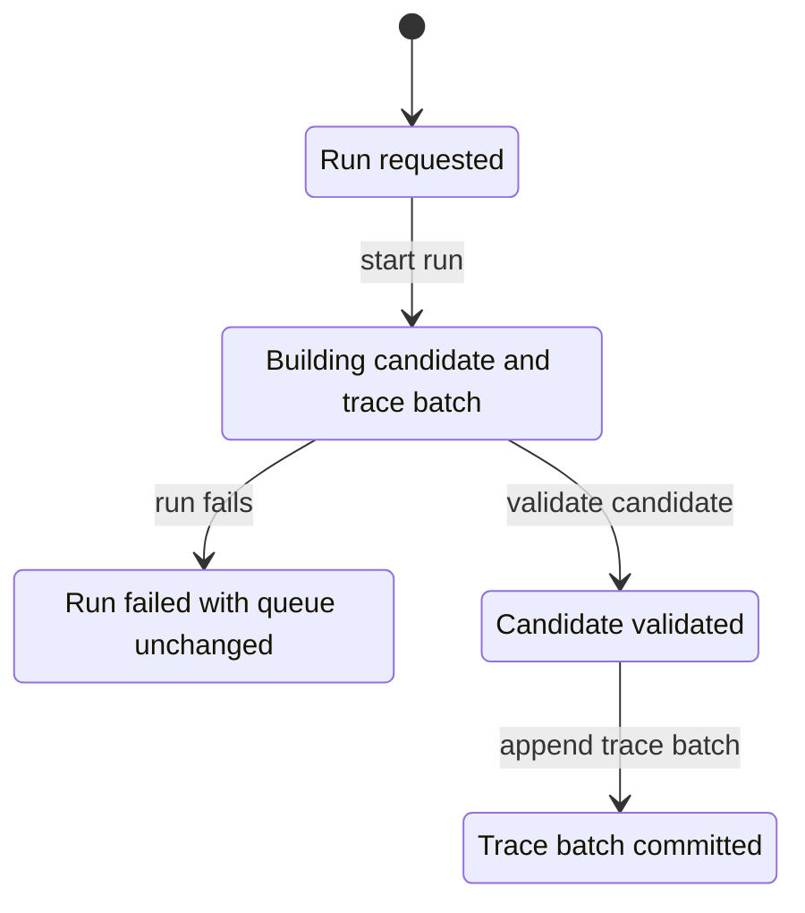

# Training trace batch commit

**Property:** A run that fails before candidate validation leaves the shared trace queue unchanged. A successful run appends its complete trace batch after any previously queued spans.

**Why:** Partial traces from a rejected run can otherwise be mistaken for the trajectory of a successful candidate or mixed with earlier results.

**Review baseline:** `783afc988b682ee6de6bf97df6ada2b4bba5a14b`.

## Covered code and checks

- `packages/training/src/optimizer.ts` buffers each run's step spans, validates the candidate and then appends the batch to the sink. `src/trace-sink.ts` stores and drains spans.
- `packages/training/test/optimizer-selection.test.ts` checks a failure after scoring with earlier spans still queued, repeated successful runs, reward validation and winner selection.
- Related skills cover [selection](../verify-training-selection/SKILL.md), [trace snapshots](../verify-training-trace-sink/SKILL.md), [configuration](../verify-training-config/SKILL.md) and the [seeded generator](../verify-training-prng/SKILL.md).

From the repository root with dependencies installed, run:

```sh
bash scripts/verify-state-machine.sh .agents/skills/verify-training-trace-commit
```

The runner checks the pinned TLC 1.7.4 jar and uses Z3 4.15.4. Set `TLA2TOOLS` and `BUDGET_Z3_PYTHONPATH` to existing installations for offline runs. Java 11+, Python, Node and the repository dependencies are required. This separate command runs four deliberately broken scratch implementations through the full skill and reruns the restored code:

```sh
python3 .agents/skills/verify-training-trace-commit/mutations/full.py
```

## Model and evidence

`TrainingTraceCommit` checks 18 states and 34 steps for a run with two buffered steps, zero or one previously queued span, failure before validation and successful batch commit. It requires no visible writes before commit, no change after failure and a complete appended batch after success. Its five-state projection has four arrows and hides 22 same-label steps, including intermediate scoring. Read every TLC result with `/statechart`; the maintained view supplies the projection.



Previously, a candidate validation failure after scoring left its spans in the shared queue. A real-code test reproduces this after a prior successful run. Three weakened TLC configurations yield counterexamples. Four real-code mutations exercise eager recording, skipped commit, loss of prior spans and committing before candidate validation. Z3 checks abstract batch-count accounting, not TypeScript refinement.

The model bounds the batch and existing queue and treats the synchronous batch append as one step. It assumes the in-memory sink accepts the internally produced spans and does not model allocation failure, exceptions during append, arbitrary callback reentry, persistence or cross-process delivery. Such failures can still leave a partially appended batch. Buffering also requires memory proportional to the iteration count.

## Keep in sync

Inspect changes to covered code, candidate validation and trace contracts, and tests since the baseline, including uncommitted changes. Replay counterexamples against real code, rerun verification and mutations, and advance the baseline only after the model and implementation agree. Use `/maintain-formal-verification-skill` for that review.
