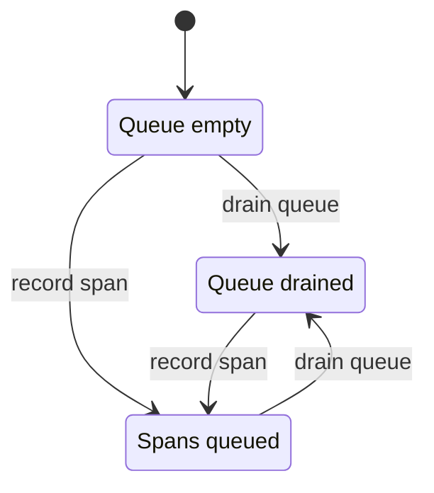

# Training trace sink

**Property:** Recording captures an immutable span and attribute snapshot. Draining returns queued spans in order once, clears the queue and leaves prior results independent of later source edits and records.

**Why:** Caller mutations after recording must not rewrite trace evidence or change a previously drained result.

**Review baseline:** `c66788fc93b3a550f991f7754294b7b4451d9c72`.

## Covered code and checks

- `packages/training/src/trace-sink.ts` snapshots and freezes recorded spans and attributes and swaps the queue on drain. `src/optimizer.ts` records the optimizer's step spans.
- `packages/training/test/trace-sink-snapshots.test.ts` checks source and attribute mutations, frozen results, repeated drains and 100 deterministic record/drain sequences with seed `0x55a762d3`. Existing optimizer tests check trace capture and replay.
- The related [seeded generator skill](../verify-training-prng/SKILL.md) covers deterministic generator inputs and state.

The related [optimizer config skill](../verify-training-config/SKILL.md) checks count bounds and abstract loop progress.

From the repository root with dependencies installed, run:

```sh
bash scripts/verify-state-machine.sh .agents/skills/verify-training-trace-sink
```

The runner checks the pinned TLC 1.7.4 jar and uses Z3 4.15.4. Set `TLA2TOOLS` and `BUDGET_Z3_PYTHONPATH` to existing installations for offline runs. Java 11+, Python, Node and the repository dependencies are required. This separate command runs six deliberately broken scratch implementations through the full skill and reruns the restored code:

```sh
python3 .agents/skills/verify-training-trace-sink/mutations/full.py
```

## Model and evidence

`TrainingTraceSink` checks 195 states and 473 steps for up to two records and two drains, source and attribute edits, and a retained last drain. It compares both the queue and drained output with a snapshot reference. Its three-state projection has four arrows and hides 369 same-label steps, including additional records and source edits. Read every TLC result with `/statechart`; the maintained view supplies the projection.



Previously, editing a caller-owned span or its attributes after recording changed queued and drained results. Real-code tests reproduce that behavior. Three weakened TLC configurations yield counterexamples; six real-code mutations exercise span and attribute copying and freezing, drain clearing and frozen output. Z3 proves an abstract source-cell write cannot change a distinct snapshot cell; this does not prove TypeScript refinement.

The model bounds records and drains and retains only the latest drain, while generated implementation tests also retain multiple earlier results. Copies are shallow and rely on the current primitive span fields and string-valued attributes; nested mutable values would require stronger copying. The sink, caller-supplied values and JavaScript intrinsics remain trusted. It is an in-memory queue and does not provide persistence or cross-process delivery.

## Keep in sync

Inspect changes to covered code, span field types and tests since the baseline, including uncommitted changes. Replay counterexamples against real code, rerun verification and mutations, and advance the baseline only after the model and implementation agree. Use `/maintain-formal-verification-skill` for that review.
