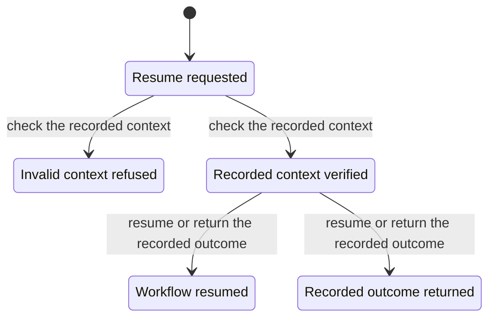
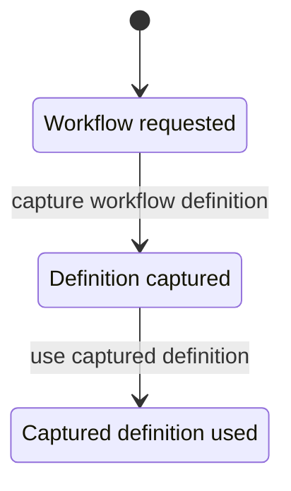

# Workflow resume context and definition capture

**Property:** A workflow cannot resume or reuse a terminal outcome without its recorded input, name and seed; missing or malformed recorded fields are refused. Start, resume and replay adapters use the definition bindings captured before waiting.

**Why:** Missing or changed context can make work run, or a stored result appear valid, under a different workflow or deterministic seed.

**Review baseline:** `e9c20aea41e67c779a47d169e25de38ce28552fa`.

## Covered code and checks

- `packages/runtime/src/workflow-value.ts` parses the recorded `run.Started` fact and requires its input, name and seed. `workflow.ts` compares the recorded input and name before execution or terminal reuse and captures workflow names, callbacks, tools and capabilities before asynchronous journal work. `replay/replayer.ts` uses the same parser, validates supplied replay seeds and invokes captured callbacks without reading their mutable `call` properties.
- `packages/runtime/test/authoring/workflow-context-validation.test.ts` checks missing fields with and without a terminal outcome, malformed recorded names and seeds, invalid new names and seeds, definition and tool changes while storage waits, replay adapter capture and changed callback `call` properties. Seed 614617 generates 50 invalid context and terminal combinations.
- The broader [workflow replay skill](../verify-workflow-replay/SKILL.md) checks journal recovery, input snapshots, commands, timers and local execution fencing.

- The related [stream identity skill](../verify-replay-stream-identity/SKILL.md) checks primitive identities and binds captured journal events to their requested stream.

- The related [journal history skill](../verify-workflow-journal-history/SKILL.md) checks visible sequence, start and terminal structure before resume and replay.

From the repository root with dependencies installed, run:

```sh
bash scripts/verify-state-machine.sh .agents/skills/verify-workflow-context
```

The runner checks the pinned TLC 1.7.4 jar and uses Z3 4.15.4. Set `TLA2TOOLS` and `BUDGET_Z3_PYTHONPATH` to existing installations for offline runs. Java 11+, Python, Node and the repository dependencies are required. This separate command checks seventeen deliberately broken scratch implementations with the full skill, then reruns the restored code:

```sh
python3 .agents/skills/verify-workflow-context/mutations/full.py
```

## Model and evidence

`WorkflowResumeContext` explores 26 states for a record with one missing or malformed context field, or none, and either execution or terminal reuse. It requires each resulting outcome to have valid modeled context; its five-state projection has four arrows. Read each TLC result with `/statechart`; the maintained views supply the projections.



`WorkflowDefinitionSnapshot` explores 75 states and 90 steps for start, resume or replay, one definition binding and a caller edit. It requires the selected binding to match the captured one; its three-state projection has two arrows and hides 45 same-label steps, including caller edits.



A journal missing its seed would otherwise reach workflow execution or terminal reuse; real tests reproduce both paths. The input and name field checks are backed by the engine's equality checks against the caller's input and definition, so the real-code variants remove both defenses together. A definition changed during a delayed append or journal read previously changed what ran. Eight weakened TLC configurations and four weakened Z3 assumptions produce counterexamples. Z3 proves abstract context-check and captured-selection implications, not the TypeScript implementation.

The models bound each run to one defective context field or one changed binding and assume faithful equality, capture and journal observations. They do not establish TypeScript refinement, workflow code identity, callback purity, authentication, cross-process fencing, exactly-once external effects or liveness. A callback still receives its original definition as `this` and can read mutable application state. Records with absent or malformed fields are refused and may need reconciliation.

## Keep in sync

Inspect changes to covered code and tests since the baseline, including uncommitted changes. Replay counterexamples against real code, rerun verification and mutations, and advance the baseline only after the model and implementation agree. Use `/maintain-formal-verification-skill` for that review.
