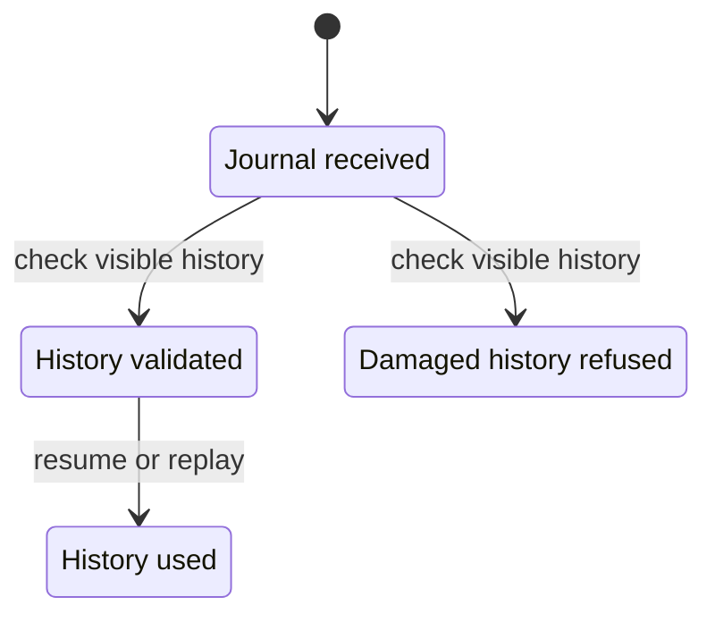

# Workflow journal history

**Property:** Before starting or resuming workflow code, reusing a terminal outcome, or invoking replay callbacks, the captured journal has contiguous safe-integer positions starting at one, starts with exactly one `run.Started`, contains no record after a terminal outcome, has nonempty primitive event types, and contains only recognized reserved `run.*` types.

**Why:** An omitted interior record, repeated start, extra record after the outcome, or unknown runtime fact can make a damaged journal look authoritative.

**Review baseline:** `e9c20aea41e67c779a47d169e25de38ce28552fa`.

## Covered code and checks

- `packages/runtime/src/replay/journal-history.ts` validates the visible prefix. `workflow.ts` and `replay/replayer.ts` apply the checks before reuse or callbacks, after capturing the requested stream.
- `packages/runtime/test/authoring/workflow-journal-history.test.ts` checks each structural guard, fresh-start, resume and replay call sites, terminal reuse and diagnostic reads. Seed 614619 generates 60 histories, removes each interior application event, and checks that visible gaps are refused.
- `packages/runtime/test/authoring/workflow-journal-authority.test.ts`, `workflow-replay.property.test.ts`, `workflow-sleep-completion.test.ts`, and `workflow-tree-replay.test.ts` retain separate missing-command and completion checks using contiguous altered histories.
- The related [stream identity skill](../verify-replay-stream-identity/SKILL.md) checks captured stream binding; [workflow replay](../verify-workflow-replay/SKILL.md) checks command semantics and terminal outcomes.

From the repository root with dependencies installed, run:

```sh
bash scripts/verify-state-machine.sh .agents/skills/verify-workflow-journal-history
```

The runner checks the pinned TLC 1.7.4 jar and uses Z3 4.15.4. Set `TLA2TOOLS` and `BUDGET_Z3_PYTHONPATH` to existing installations for offline runs. Java 11+, Python, Node and the repository dependencies are required. This separate command runs eight deliberately broken scratch implementations through the full skill and reruns the restored code:

```sh
python3 .agents/skills/verify-workflow-journal-history/mutations/full.py
```

## Model and evidence

`WorkflowJournalHistory` checks 148 reachable states for resume or replay, nine selected three-record histories, and four position patterns. It checks that only structurally valid visible histories are used. The four-state projection has three arrows. Read each TLC result with `/statechart`; the maintained view supplies the projection.



Without these checks, a journal with a missing interior position or a duplicate start could return a terminal result, and an unknown reserved record could be ignored. Real-code tests replay these cases. Six weakened TLC configurations yield counterexamples. The first-record model mutation describes validation alone; the real caller separately rejects a wholly missing start. Z3 proves the ordering and distance consequences of abstract contiguous integer positions and the last-position implication of a terminal with no successor; weakened assumptions admit counterexamples. These mathematical obligations do not prove TypeScript refinement.

The finite model uses selected three-record cases and abstracts parsing, command-tree validation, journal capture and event storage. A visible contiguous prefix cannot show that its tail was omitted or that a reader deleted and renumbered records. The reader, journal data and JavaScript intrinsics remain trusted; records are not authenticated. Malformed histories are refused and require reconciliation. Diagnostic `journal()` checks stream binding but deliberately does not enforce these structural rules.

## Keep in sync

Inspect changes to covered code and tests since the baseline, including uncommitted changes. Replay counterexamples against real code, rerun verification and mutations, and advance the baseline only after the model and implementation agree. Use `/maintain-formal-verification-skill` for that review.
