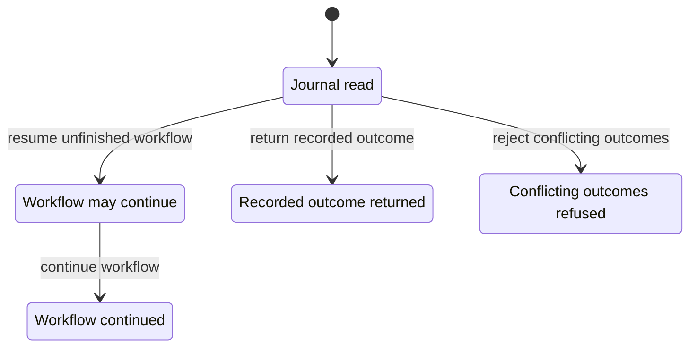
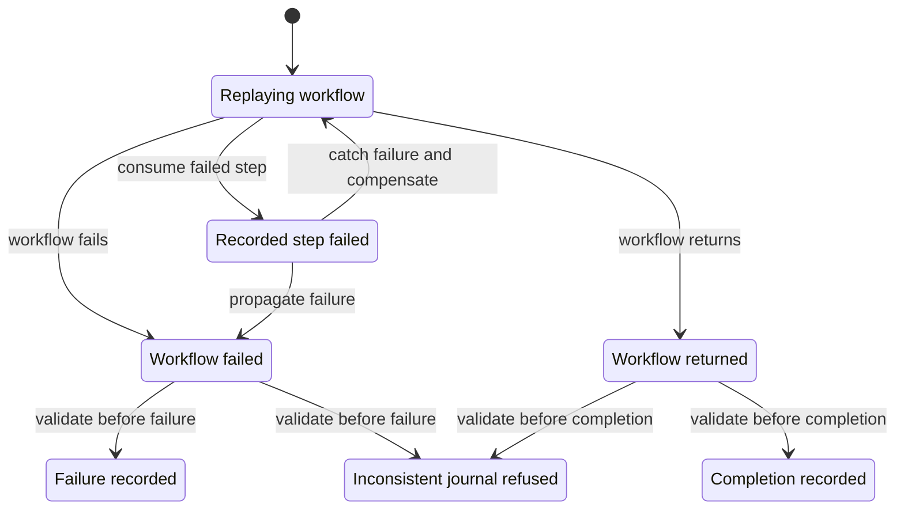
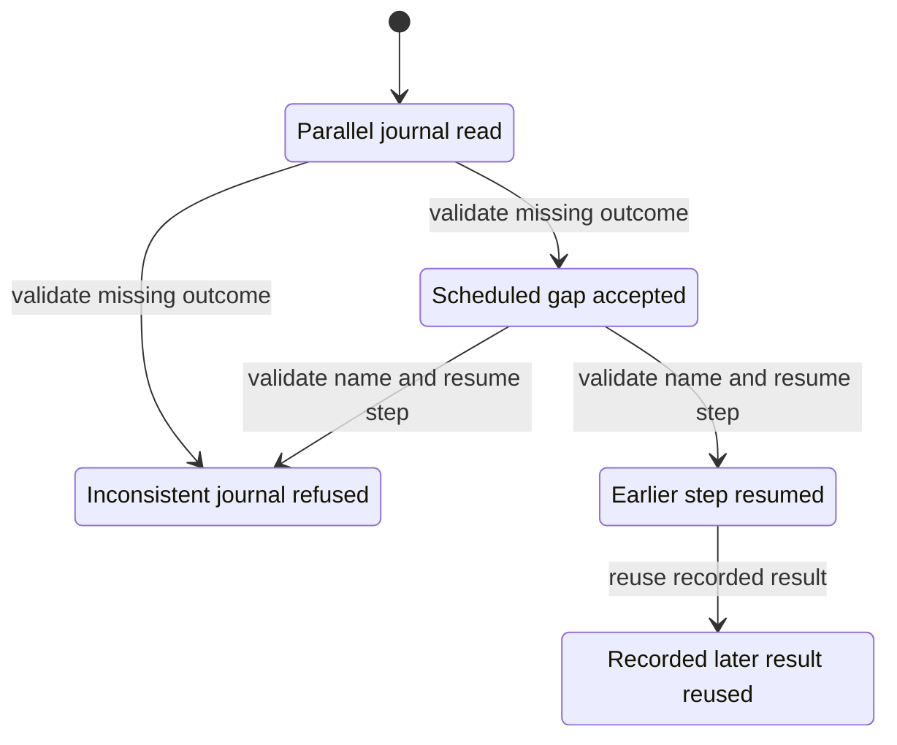
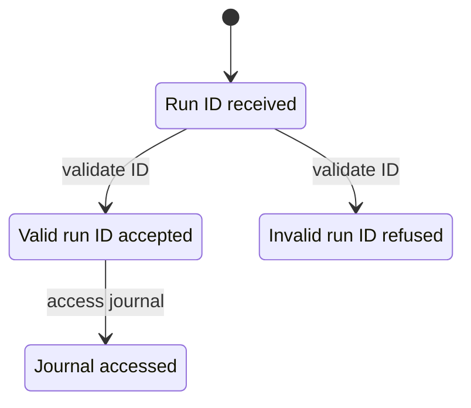
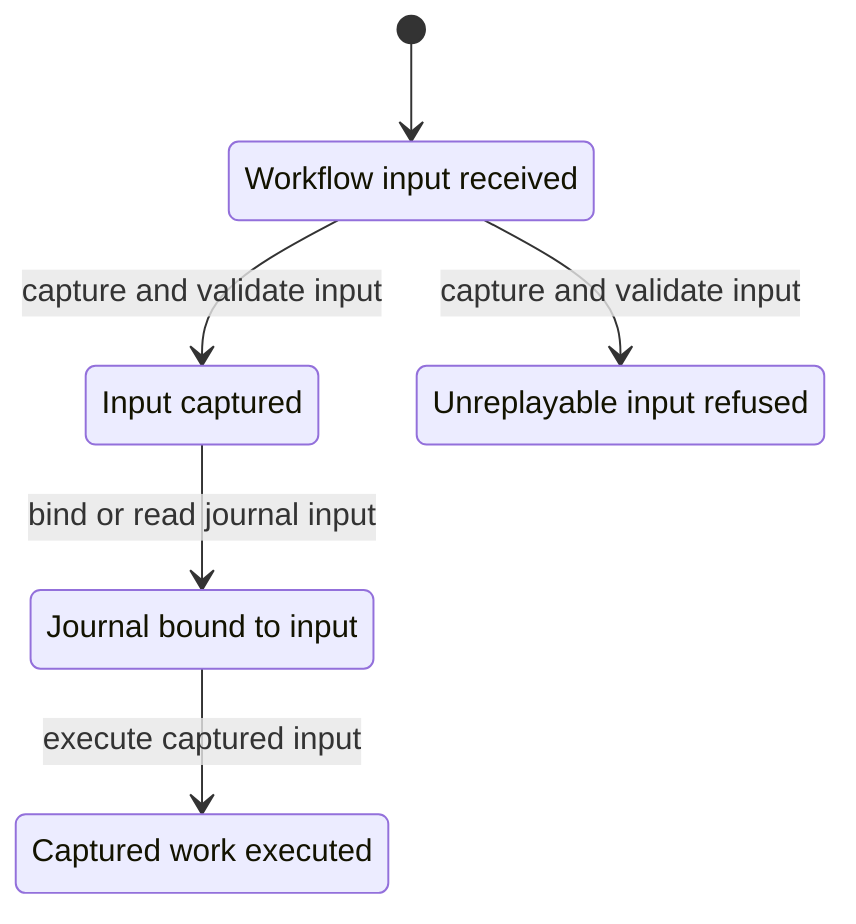
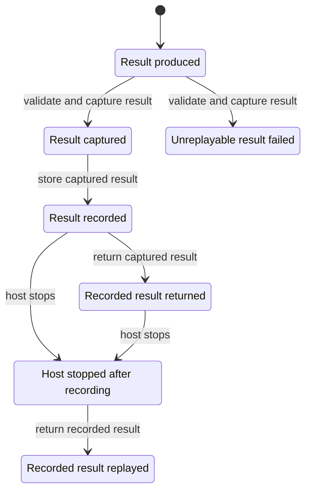

# Durable workflow identity and replay

**Properties:** A completed journaled step is reused on resume; workflow operations validate run IDs; a fresh run atomically claims its ID; start and resume capture reproducible input; a resume checks recorded input and workflow identity, uses the recorded seed, checks prior step and sleep commands in order, refuses duplicate terminal facts, and returns a recorded terminal outcome without running the workflow or appending another terminal fact. Versioned terminal histories are checked before reuse, and application events cannot use the runtime's `run.` namespace. Journaled step and workflow results are captured before return. A terminal fact is not appended while recorded step outcomes remain unconsumed; a caught step failure can be followed by compensation and a completed run. A scheduled earlier step may resume when a later parallel step already has a recorded outcome, provided its name still matches. Replay consumes recorded root commands, including sleeps and completed steps, in order and refuses missing, changed, or unused records; versioned journals can reuse a parent only when its nested steps have recorded outcomes and nested sleeps have completion facts. A sleep does not continue before its recorded deadline, which is retained across an explicit resume; it records completion after the deadline and reuses a committed completion after a lost response. Within one execution, journal appends are serialized, effects require an acknowledged scheduling append, and a failed append blocks later appends. A parent finishing with outstanding steps, sleeps, or event appends aborts without a terminal fact; a closed asynchronous scope cannot schedule new commands. Sequence numbers do not exceed the safe-integer limit. New runs record the parent of each scheduled step or sleep in its own async context.

**Why:** Repeating effects or reusing results for different inputs can corrupt work.

**Review baseline:** `07bb5f8587cb37c953a495e695073710f4f89d85`.

## Covered code

- `packages/runtime/src/workflow.ts` and `packages/runtime/src/replay/store.ts` implement the engine and its replay store contract.
- `packages/runtime/src/replay/replayer.ts` and `command-tree.ts` check ordered root commands and parent/child outcomes in versioned journals; legacy journals use the flat replay path.
- `packages/cli/src/codegen/runtime-artifacts.ts` starts a new generated workflow when its journal is empty and resumes an existing one. The generated-runtime integration test exercises a real SQLite journal across reopening.
- `packages/runtime/test/authoring/workflow-replay.property.test.ts` generates terminal outcomes and concurrent fresh-ID claims against the real engine.
- `packages/runtime/src/workflow-value.ts` captures JSON-reproducible workflow inputs and step and workflow results.
- `packages/runtime/test/authoring/workflow-result-snapshot.test.ts` checks generated results, producer edits during storage, invalid values, stable failures and top-level `undefined`.
- `packages/runtime/test/authoring/workflow-input-snapshot.test.ts` checks edits during start and resume, unreproducible values, and invalid inputs leaving no claimed journal.
- `packages/runtime/test/authoring/workflow-id-boundary.test.ts` checks invalid IDs at start, resume and journal access, including a numeric resume while its string-named run is active.
- `packages/runtime/test/authoring/workflow-parallel-replay.test.ts` exercises out-of-order completion, scheduled gaps, and caught step-name and sleep-schedule divergence against the engine.
- `packages/runtime/test/authoring/workflow.test.ts` checks successful and failed terminal resumes and refuses each pair of duplicate terminal fact types.
- `packages/runtime/test/authoring/workflow-sleep.test.ts` checks waiting, recovery, legacy rebasing, invalid deadlines, timer limits, and a reopened SQLite journal.
- `packages/runtime/test/authoring/workflow-step-history.test.ts` checks command order, shortened histories, and interrupted same-step retries.
- `packages/runtime/test/authoring/workflow-concurrent-append.test.ts` exercises concurrent appends, uncertain outcomes, call-time payload snapshots, sequence exhaustion, and SQLite recovery.
- `packages/runtime/test/authoring/workflow-command-provenance.test.ts` checks nested step and sleep parent records through concurrent step bodies and SQLite reopening.
- `packages/runtime/test/authoring/workflow-tree-replay.test.ts` checks completed nested replay, unfinished or orphaned children, handled child failure, and SQLite reopening.
- `packages/runtime/test/authoring/workflow-sleep-completion.test.ts` checks nested and root completion evidence, duplicate and early records, and both outcomes of a lost completion response.
- `packages/runtime/test/authoring/workflow-command-lifetime.test.ts` checks unfinished commands, callbacks retaining closed scopes, already-started effects, and append failure inside a parent step.
- `packages/runtime/test/authoring/workflow-journal-authority.test.ts` checks reserved application event names and refuses damaged, duplicated, late, and unknown-version terminal histories.

## Run

From the repository root with workspace dependencies installed:

```sh
pnpm --filter @hobo/runtime pretest
bash scripts/verify-state-machine.sh .agents/skills/verify-workflow-replay
python3 .agents/skills/verify-workflow-replay/mutations/result-snapshot.py
python3 .agents/skills/verify-workflow-replay/mutations/input-snapshot.py
python3 .agents/skills/verify-workflow-replay/mutations/run-id-boundary.py
python3 .agents/skills/verify-workflow-replay/mutations/terminal-history.py
pnpm --filter @hobo/runtime build
pnpm --filter @hobo/cli exec vitest run test/generated-runtime-execution.test.ts --maxWorkers=1 --no-file-parallelism
```

The first command runs the real-code checks, generated properties, TLC 1.7.4 with the pinned checksum, and Z3 4.15.4. The next four commands check six result, five input, six run-ID and one terminal-history variant in isolated copies, then rerun the restored tests. The runner uses `TLA2TOOLS` and `BUDGET_Z3_PYTHONPATH` if set; otherwise it downloads the jar and installs Z3 in temporary directories. Java 11+, Python, Node with the repo's `tsx`, `curl`, and `sha256sum` are required. Read the TLA+ result with `/statechart` and its view in `models/`.

## Scope and evidence

WorkflowReplay bounds one step to two calls and permits crashes before or after its completion fact (17 states). WorkflowRunIds explores two workers, two candidate IDs, preexisting legacy journals, retries, and an atomic empty-stream claim (278 states). WorkflowResume checks input, recorded workflow name, and recorded seed (280 states). WorkflowTerminal explores completed and failed terminal outcomes and repeated resumes (15 states); independent invariants require no subsequent body call, no duplicate terminal fact, and the recorded outcome to be returned. The `NoDuplicateTerminalFact` mutation replaces the `Resume` action's unchanged terminal count with an increment and must produce that invariant's counterexample.

WorkflowTimers explores all pairs of journal and replay histories up to two sleeps and two possible delays (120 states). It checks the matched prefix and requires an accepted history to match exactly. The Z3 obligations prove empty-prefix, next-record induction, accepted-history equality, and the next-record condition for equal histories over unbounded integer-indexed arrays. The abstraction does not prove that TypeScript refines the model or model optional record indices.

WorkflowSleepDeadline explores a clock bounded to 0..3, delays of one or two units, early wake-ups, crashes, explicit resumes, and completion (22 states). It checks no early completion and preservation of the original deadline. Z3 separately proves the reached-deadline and positive-remaining-time arithmetic for unbounded integers. The model abstracts a legacy rebase as the initial deadline assignment; it does not model journal corruption, a clock jumping forward, or automatic process recovery.

WorkflowCommands explores all pairs of histories up to two step or sleep commands (425 states). It requires the consumed history to match and prevents acceptance when recorded commands remain unused. Its view is `models/commands-view.mts`. The abstraction treats commands as an ordered flat sequence; it does not cover parent-child relationships or arbitrary effects outside those commands.
WorkflowTerminalHistory explores seven states and eleven steps for a journal with zero, one or two terminal facts. It checks that duplicate terminal facts do not return an outcome and that a terminal journal does not execute the workflow. The five-state projection hides seven same-label steps. Removing duplicate detection returns a conflicting outcome; real-code checks exercise all four pairs of completed and failed facts and reject a `run.*` fact following a terminal. Z3 finds counterexamples when duplicate terminal facts still return an outcome. This model assumes the journal read is truthful and does not model the post-terminal ordering check or validate the complete order or authenticity of history, prove TypeScript refinement, or establish liveness.

WorkflowAppend explores two concurrent requests and both pre-commit and lost-response failures (31 states). It checks one append at a time, no later writes after failure, and no effect without an acknowledged scheduling append. The model allows an effect authorized before a different append fails to continue; it does not model cross-process fencing, payload serialization, retries or automatic recovery. Its `/statechart` projection in `models/append-view.mts` has five displayed states and hides 25 same-state transitions. Z3 separately proves the next-sequence arithmetic for unbounded integers; the implementation's safe-integer guard supplies the finite bound.



Read this model with `/statechart` using the terminal-history view in `models/`.

WorkflowStepJournal explores 148 states and 306 steps for histories of up to three outcomes and at most one failed step. It checks that terminal recording consumes every saved outcome, that a caught failure was replayed, and that completion after a failed step requires catching it. TLC reaches a caught failure followed by another outcome and completion. Removing either terminal-consumption guard produces a counterexample; Z3 checks the corresponding integer implications. Real-code tests cover normal compensation, a crash after compensation, repeated terminal resume, and refusal of unconsumed outcomes. The seven-state projection hides 162 steps within the same displayed state. The model assumes sequential consumption, truthful parsing and unique indices; it does not establish storage authenticity, TypeScript refinement, concurrent execution, or liveness.



Read this model with `/statechart` using the step-journal view in `models/`.

WorkflowParallelReplay explores 11 states and 18 steps for a recorded later outcome and an earlier step whose outcome is absent. It checks that recovery does not execute an unscheduled or differently named step and does not repeat the recorded effect. A reachability check finds the valid scheduled recovery; removing each guard produces a TLC counterexample. The five-state projection hides 11 steps within the same displayed state. The real-code test snapshots an in-flight parallel run, resumes it, and checks that the saved later effect is not repeated; 100 generated histories cover multiple scheduled gaps. The model abstracts journal parsing, scheduling and storage, does not model concurrent append interleavings, and does not prove TypeScript refinement or exactly-once execution of an unfinished effect.



Read this model with `/statechart` using the parallel-replay view in `models/`.

WorkflowRunIdBoundary explores 16 states and 25 steps for two valid strings, an empty string, a number, a boxed string, null and a proxy. It checks that only valid IDs are admitted, that a coerced value cannot access the same modeled stream, and that validation does not inspect a proxy. Its four-state projection hides 16 same-label steps. Removing the guard or safe check violates these properties; real-code tests reproduce the numeric-alias and proxy-inspection paths. Z3 proves fixed-prefix cancellation for arbitrary strings and finds counterexamples when run-ID guards are removed. The model assumes trusted JavaScript intrinsics and truthful primitive-string validation; it does not establish TypeScript refinement, cross-process fencing or global authorization.



Read this model with `/statechart` using the run-ID view in `models/`.

WorkflowInputSnapshot explores 18 states and 34 steps for start or resume, valid or invalid input, a caller edit, journal binding and execution. It checks that executed input matches the journal and that invalid input is neither recorded on start nor executed. Its five-state projection hides 22 same-label steps, including caller edits. Weakening the input guard or snapshot produces counterexamples; Z3 finds counterexamples when input snapshot or validation guards are weakened. The model assumes truthful validation and journal reads, trusted JavaScript intrinsics, a detached capture and no application mutation of its local copy; it does not prove TypeScript refinement or liveness.



With input validation removed, `/statechart` reaches an accepted unreplayable input, records it, and executes it. The input tests reproduce that path against the earlier implementation. Read this model with `/statechart` using the input-snapshot view in `models/`.

WorkflowResultSnapshot explores 15 states and 22 steps for one valid or invalid result, one producer edit, a journal write, a return and a host stop. It applies to both workflow and step results: only valid results complete, the journal records the capture, and the returned value matches the record. Its seven-state projection hides eight same-label transitions, including producer edits. Weakening the validity, recording or return guard yields a counterexample. Z3 proves the corresponding implications over arbitrary abstract strings and finds counterexamples when validation or the captured return is removed. The model treats JSON validity and capture as atomic, assumes trusted JavaScript intrinsics and a successful durable write, and does not establish TypeScript refinement, arbitrary concurrent executions, external-effect idempotency or recovery of values already lost in old journals; `packages/runtime/test/authoring/workflow.test.ts` exercises journaled `run.StepFailed` replay without re-running the step effect.



For the mutable-return variant, `/statechart` found the shortest violation: produce a result, capture it, edit the original while storage waits, record the capture, and return the edited original. The delayed-write real-code tests reproduce that path for both a step and a workflow. Read this model with `/statechart` using the result-snapshot view in `models/`.

WorkflowProvenance explores interleaved entry, child recording and exit for two step contexts (25 states). It checks that each recorded child names its own parent; replacing the context-local parent with the most recently entered parent yields a counterexample. Z3 proves the stated isolation property for distinct unbounded integer context IDs. The model does not cover detached callbacks after a parent returns or use provenance during replay.

WorkflowNestedReplay explores one parent with no child, a completed or failed child step, an unfinished child step, or a nested sleep before or after a completion fact (24 states). A cached parent can be reused only when its child outcome was established before the parent closed. A child completing later does not repair the earlier missing evidence. The model abstracts away arbitrary tree depth, storage corruption and effects outside the journal.

WorkflowSleepCompletion explores a bounded clock, host stops, explicit resumes, completion writes and a committed write whose response is lost (12 states). It requires at most one completion, no completion before the deadline, and a completion fact before returning. Its `models/sleep-completion-view.mts` projection hides nine same-state transitions. The existing Z3 deadline arithmetic applies to the time guard. This model assumes durable atomic journal writes and an accurate monotonic clock; it does not prove the TypeScript refines the model or address concurrent resumes.

WorkflowCommandLifetime explores one scope and one command through scheduling, an in-flight journal write, effect start, completion and early parent closure (14 states). It checks that a closed scope schedules no command, starts no new effect, and records no terminal outcome while a command is outstanding. The `models/command-lifetime-view.mts` projection hides 11 same-state transitions. An effect or storage write already in progress can finish after abort; the model does not cover arbitrary nesting, retries, effects outside these commands, other executions, or TypeScript refinement.

WorkflowJournalAuthority explores an application event attempt, a runtime terminal outcome, damaged evidence, and resume (10 states). It checks that the modeled application cannot create an accepted terminal fact and that damaged evidence is not accepted. The `models/journal-authority-view.mts` projection hides five same-state transitions. The model assumes the journal writer is trusted and starts without earlier forged records; its evidence flag abstracts the parser's checks and does not authenticate old records or prove TypeScript refinement.

The generated implementation properties use seeds 614448, 614449 and 614450 and 150 examples each. They check successful and failed terminal resumes, races between fresh runs claiming the same ID, and multiple caught failures with later steps and crashes at varying points. Seed 614451 generates 100 scheduled-gap histories. Seeds 151942 and 151943 generate 150 JSON results each for terminal and step replay. Input seeds 614606 and 614607 generate 40 caller-edit and 100 ordinary-JSON cases; seed 614605 generates 100 invalid IDs. Seeds 614456 and 614457 exercise 150 valid timer histories and 100 damaged histories with missing, changed, or unused records; a separate test checks unindexed legacy records and inconsistent indices. Seed 614458 checks 150 delay and crash-duration combinations, including exactly one completion no earlier than the deadline; separate tests cover an early wake, old-record rebasing, malformed and overflowing deadlines, the Node timer limit, a real clock, and closing and reopening a SQLite journal. Seed 614459 generates 100 shortened step histories; further tests check omitted and changed commands, failure paths, and an interrupted retry of the same step. Seed 614460 generates 100 parallel append-delay histories. Separate checks inject a committed or uncommitted append error, resume from each case, verify snapshot isolation and sequence limits, and reopen a SQLite journal. Seed 614461 checks 100 interleavings of concurrent parent steps, nested children and grandchildren, sleeps, and return to root; a separate SQLite reopen test checks persisted provenance. Seed 614462 checks 100 nested-step replay interleavings. Seed 614463 checks 100 awaited sibling interleavings; focused tests cover pending root and nested commands, late callbacks, failed and successful terminal paths, a running effect, and nested append errors without retrying the parent. Seed 614464 checks 100 reserved event names; focused tests cover missing completion evidence, duplicate or late terminal records, and unknown versions. Additional checks cover handled child failures, missing outcomes, invalid or inactive parents, nested sleeps without completion facts, duplicate or early completion facts, committed and uncommitted lost completion responses, and SQLite reopen. The generated-app SQLite integration test covers starting and resuming through the generated adapter, including no extra terminal journal entry.

The store must implement atomic expected-sequence compare-and-set. An append error may have committed and recovery must reread the journal; the queue cannot cancel already authorized external effects. Journal sequences stop at `Number.MAX_SAFE_INTEGER` and require migration to continue. The journal and its writer are trusted; records written by an older version or another writer cannot be authenticated retroactively, and unversioned terminal histories retain legacy checks. Legacy journals without recorded input are interpreted as null, so prior undefined inputs cannot be recovered. Legacy journals without a workflow name cannot establish workflow identity; legacy journals without a seed use the current engine seed, and old failed events without a step cannot recover that step. Concurrent resumes are not fenced. An external effect can repeat after a crash between the effect and its completion fact; this is not an exactly-once guarantee. Sleep safety assumes an accurate clock and durable journal, and progress requires a waiter that returns and an explicit host resume after a stop. This engine does not discover or wake stopped runs. An unfinished legacy sleep is rebased for its full delay once; already completed legacy runs cannot be repaired retroactively. Version-two replay requires root sleep completion and all nested sleep completions; older histories may lack those facts or parent provenance. Resume still treats histories as flat. The host must account for in-flight storage writes and already-started effects before resuming an aborted execution. Scope ownership depends on asynchronous context propagation; callbacks invoked from unrelated contexts and arbitrary effects outside these commands are not controlled by the scope check.

In scratch variants, disabling completed-step lookup or terminal replay causes real-code checks to fail. Removing the unconsumed-sleep check, returning from a sleep early, resetting its deadline on resume, omitting the command check, removing append serialization or failure poisoning, allowing an exhausted sequence, omitting the async parent scope, accepting an unfinished nested child, omitting a completion fact, writing it again after a lost response, accepting an early fact, omitting lifetime guards, retrying an aborted parent, permitting reserved application events, skipping terminal validation, allowing post-terminal records, or accepting an unknown version makes the respective implementation tests fail. Eleven reproducible mutations of the original replay models weaken step lookup, fresh-ID or resume checks, permit a post-terminal body call, append on terminal resume, or return the wrong outcome; their corresponding invariants fail. Three result-model mutations detect missing validation, recording the mutable original, and returning it. Model mutations comparing every sleep against the first, accepting unused records, waking early, changing a deadline, accepting changed or incomplete command histories, permitting overlapping appends, writing after failure, executing an unacknowledged effect, using one shared parent, accepting an unproven child, writing completion twice or early, returning without it, scheduling or starting an effect after closure, recording a terminal outcome with pending work, accepting an application terminal, or returning an unproven terminal violate their corresponding invariants. `TIMER_PROOF_MUTATION=first`, `omit-deadline-check`, `WORKFLOW_APPEND_PROOF_MUTATION=allow-exhausted`, and `WORKFLOW_PROVENANCE_PROOF_MUTATION=shared` make their respective Z3 obligations fail. TLC checks these finite abstractions, not all possible implementations, storage providers, or production integrations.

## Keep in sync

Inspect changes to the covered files since the review baseline, including uncommitted changes. When behavior changes, update the model and real-code checks, replay counterexamples against the code, rerun the checks and deliberately broken variants, and advance the baseline only after confirming correspondence. Use `/maintain-formal-verification-skill` for that update.
