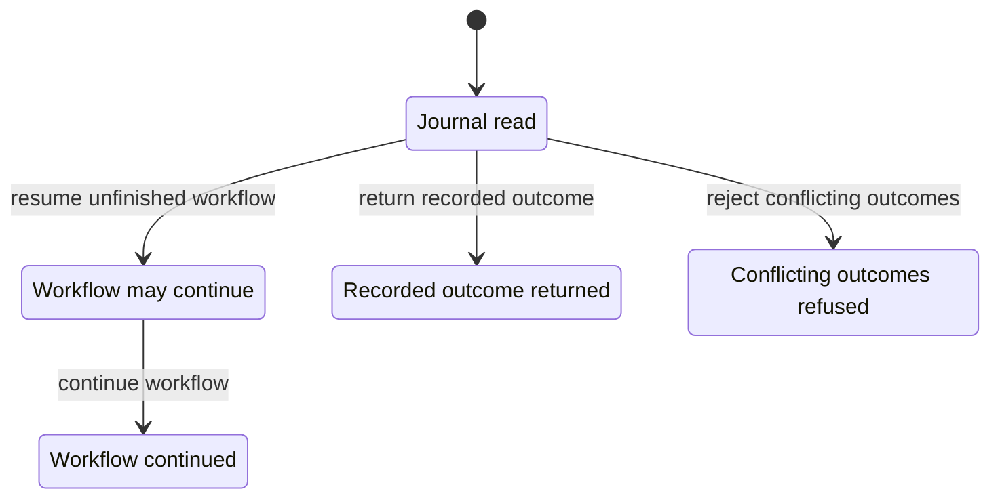
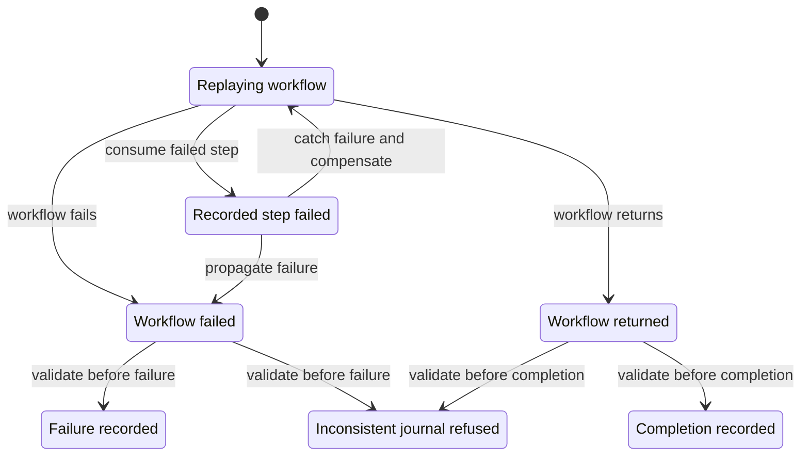
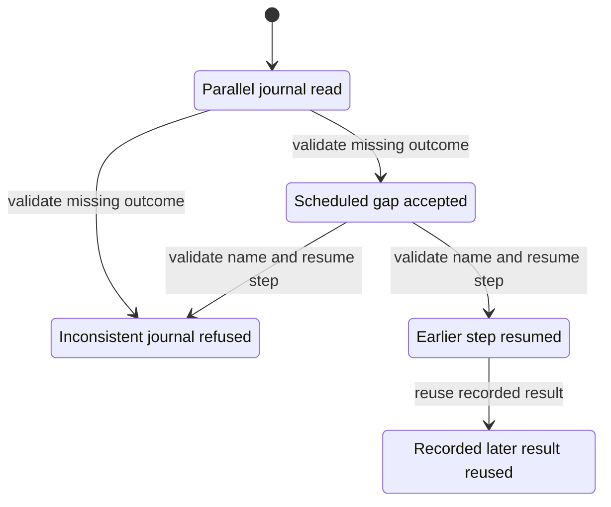
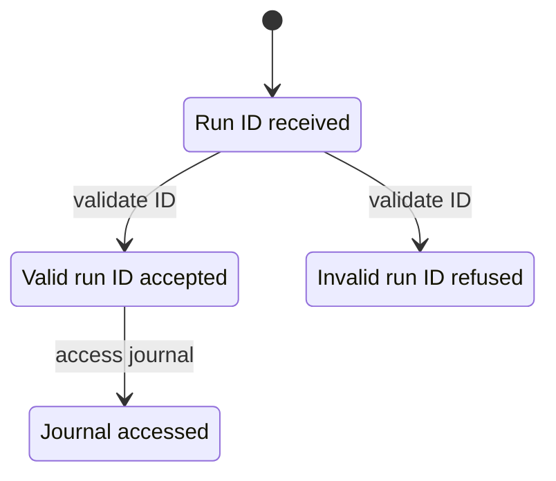
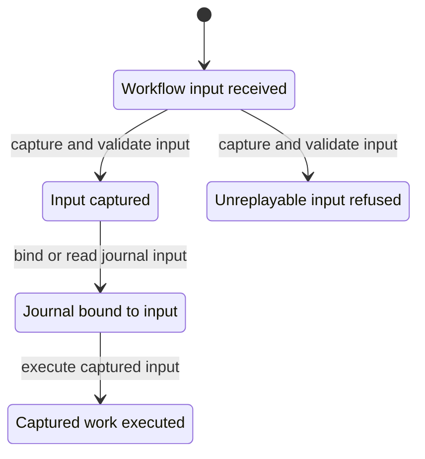
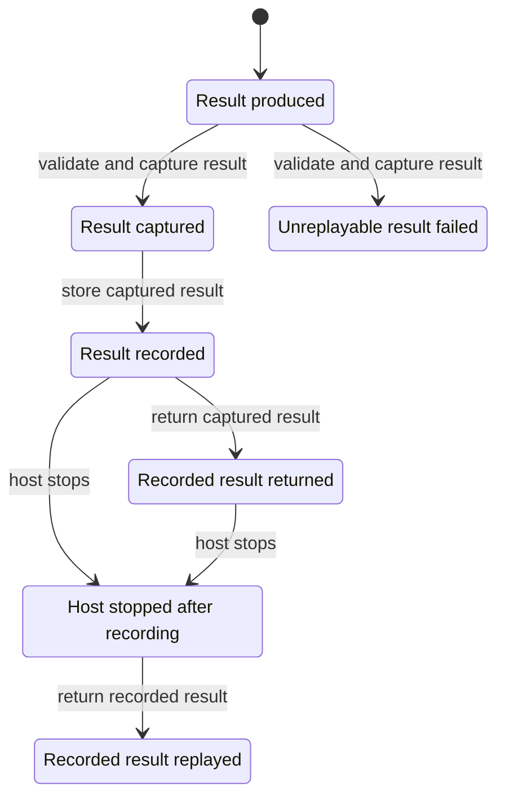

# Durable workflow identity and replay

**Properties:** A completed journaled step is reused on resume; workflow operations validate run IDs; a fresh run atomically claims its ID; start and resume capture reproducible input; a resume checks recorded input and workflow identity, uses the recorded seed, refuses duplicate terminal facts, and returns a recorded terminal outcome without running the workflow or appending another terminal fact. Journaled step and workflow results are captured before return. A terminal fact is not appended while recorded step outcomes remain unconsumed; a caught step failure can be followed by compensation and a completed run. A scheduled earlier step may resume when a later parallel step already has a recorded outcome, provided its name still matches.

**Why:** Repeating effects or reusing results for different inputs can corrupt work.

**Review baseline:** `4d10e369124caa0809c37830bd1cdd4f36e6c8d9`.

## Covered code

- `packages/runtime/src/workflow.ts` and `packages/runtime/src/replay/store.ts` implement the engine and its replay store contract.
- `packages/cli/src/codegen/runtime-artifacts.ts` starts a new generated workflow when its journal is empty and resumes an existing one. The generated-runtime integration test exercises a real SQLite journal across reopening.
- `packages/runtime/test/authoring/workflow-replay.property.test.ts` generates terminal outcomes and concurrent fresh-ID claims against the real engine.
- `packages/runtime/src/workflow-value.ts` captures JSON-reproducible workflow inputs and step and workflow results.
- `packages/runtime/test/authoring/workflow-result-snapshot.test.ts` checks generated results, producer edits during storage, invalid values, stable failures and top-level `undefined`.
- `packages/runtime/test/authoring/workflow-input-snapshot.test.ts` checks edits during start and resume, unreproducible values, and invalid inputs leaving no claimed journal.
- `packages/runtime/test/authoring/workflow-id-boundary.test.ts` checks invalid IDs at start, resume and journal access, including a numeric resume while its string-named run is active.
- `packages/runtime/test/authoring/workflow-parallel-replay.test.ts` exercises out-of-order completion, scheduled gaps, and caught step-name and sleep-schedule divergence against the engine.
- `packages/runtime/test/authoring/workflow.test.ts` checks successful and failed terminal resumes and refuses each pair of duplicate terminal fact types.

## Run

From the repository root with workspace dependencies installed:

```sh
bash scripts/verify-state-machine.sh .agents/skills/verify-workflow-replay
python3 .agents/skills/verify-workflow-replay/mutations/result-snapshot.py
python3 .agents/skills/verify-workflow-replay/mutations/input-snapshot.py
python3 .agents/skills/verify-workflow-replay/mutations/run-id-boundary.py
python3 .agents/skills/verify-workflow-replay/mutations/terminal-history.py
pnpm --filter @hobo/runtime build
pnpm --filter @hobo/cli exec vitest run test/generated-runtime-execution.test.ts --maxWorkers=1 --no-file-parallelism
```

The first command runs the real-code checks, generated properties, TLC 1.7.4 with the pinned checksum, and Z3 4.15.4. The next four commands check six result, five input, six run-ID and one terminal-history variant in isolated copies, then rerun the restored tests. The runner uses `TLA2TOOLS` and `BUDGET_Z3_PYTHONPATH` if set; otherwise it downloads the jar and installs Z3 in temporary directories. Java 11+, Python, Node with the repo's `tsx`, `curl`, and `sha256sum` are required. Read the TLA+ result with `/statechart` and its view in `models/`.

## Scope and evidence

WorkflowReplay bounds one step to two calls and permits crashes before or after its completion fact (17 states); `NoJournaledReexecution` is `journaled => calls = journaledCalls` (non-vacuous call-count freeze after journal). WorkflowRunIds explores two workers, two candidate IDs, preexisting legacy journals, retries, and an atomic empty-stream claim (278 states). WorkflowResume checks input, recorded workflow name, and recorded seed (280 states). WorkflowTerminal explores completed and failed terminal outcomes and repeated resumes (15 states); independent invariants require no subsequent body call, no duplicate terminal fact, and the recorded outcome to be returned. The `NoDuplicateTerminalFact` mutation replaces the `Resume` action's unchanged terminal count with an increment and must produce that invariant's counterexample.

WorkflowTerminalHistory explores seven states and eleven steps for a journal with zero, one or two terminal facts. It checks that duplicate terminal facts do not return an outcome and that a terminal journal does not execute the workflow. The five-state projection hides seven same-label steps. Removing duplicate detection returns a conflicting outcome; real-code checks exercise all four pairs of completed and failed facts and reject a `run.*` fact following a terminal. Z3 finds counterexamples when duplicate terminal facts still return an outcome. This model assumes the journal read is truthful and does not model the post-terminal ordering check or validate the complete order or authenticity of history, prove TypeScript refinement, or establish liveness.



Read this model with `/statechart` using the terminal-history view in `models/`.

WorkflowStepJournal explores 148 states and 306 steps for histories of up to three outcomes and at most one failed step. It checks that terminal recording consumes every saved outcome, that a caught failure was replayed, and that completion after a failed step requires catching it. TLC reaches a caught failure followed by another outcome and completion. Removing either terminal-consumption guard produces a counterexample; Z3 checks the corresponding integer implications. Real-code tests cover normal compensation, a crash after compensation, repeated terminal resume, and refusal of unconsumed outcomes. The seven-state projection hides 162 steps within the same displayed state. The model assumes sequential consumption, truthful parsing and unique indices; it does not establish storage authenticity, TypeScript refinement, concurrent execution, or liveness.



Read this model with `/statechart` using the step-journal view in `models/`.

WorkflowParallelReplay explores 11 states and 18 steps for a recorded later outcome and an earlier step whose outcome is absent. It checks that recovery does not execute an unscheduled or differently named step and does not repeat the recorded effect. A reachability check finds the valid scheduled recovery; removing each guard produces a TLC counterexample. The five-state projection hides 11 steps within the same displayed state. The real-code test snapshots an in-flight parallel run, resumes it, and checks that the saved later effect is not repeated; 100 generated histories cover multiple scheduled gaps. The model abstracts journal parsing, scheduling and storage, does not model concurrent append interleavings, and does not prove TypeScript refinement or exactly-once execution of an unfinished effect.



Read this model with `/statechart` using the parallel-replay view in `models/`.

WorkflowRunIdBoundary explores 16 states and 25 steps for two valid strings, an empty string, a number, a boxed string, null and a proxy. It checks that only valid IDs are admitted, that a coerced value cannot access the same modeled stream, and that validation does not inspect a proxy. Its four-state projection hides 16 same-label steps. Removing the guard or safe check violates these properties; real-code tests reproduce the numeric-alias and proxy-inspection paths. Z3 proves fixed-prefix cancellation for arbitrary strings and finds counterexamples when run-ID guards are removed. The model assumes trusted JavaScript intrinsics and truthful primitive-string validation; it does not establish TypeScript refinement, cross-process fencing or global authorization.



Read this model with `/statechart` using the run-ID view in `models/`.

WorkflowInputSnapshot explores 18 states and 34 steps for start or resume, valid or invalid input, a caller edit, journal binding and execution. It checks that executed input matches the journal and that invalid input is neither recorded on start nor executed. Its five-state projection hides 22 same-label steps, including caller edits. Weakening the input guard or snapshot produces counterexamples; Z3 finds counterexamples when input snapshot or validation guards are weakened. The model assumes truthful validation and journal reads, trusted JavaScript intrinsics, a detached capture and no application mutation of its local copy; it does not prove TypeScript refinement or liveness.



With input validation removed, `/statechart` reaches an accepted unreplayable input, records it, and executes it. The input tests reproduce that path against the earlier implementation. Read this model with `/statechart` using the input-snapshot view in `models/`.

WorkflowResultSnapshot explores 15 states and 22 steps for one valid or invalid result, one producer edit, a journal write, a return and a host stop. It applies to both workflow and step results: only valid results complete, the journal records the capture, and the returned value matches the record. Its seven-state projection hides eight same-label transitions, including producer edits. Weakening the validity, recording or return guard yields a counterexample. Z3 proves the corresponding implications over arbitrary abstract strings and finds counterexamples when validation or the captured return is removed. The model treats JSON validity and capture as atomic, assumes trusted JavaScript intrinsics and a successful durable write, and does not establish TypeScript refinement, arbitrary concurrent executions, external-effect idempotency or recovery of values already lost in old journals; `packages/runtime/test/authoring/workflow.test.ts` exercises journaled `run.StepFailed` replay without re-running the step effect.



For the mutable-return variant, `/statechart` found the shortest violation: produce a result, capture it, edit the original while storage waits, record the capture, and return the edited original. The delayed-write real-code tests reproduce that path for both a step and a workflow. Read this model with `/statechart` using the result-snapshot view in `models/`.

The generated implementation properties use seeds 614448, 614449 and 614450 and 150 examples each. They check successful and failed terminal resumes, races between fresh runs claiming the same ID, and multiple caught failures with later steps and crashes at varying points. Seed 614451 generates 100 scheduled-gap histories. Seeds 151942 and 151943 generate 150 JSON results each for terminal and step replay. Input seeds 614606 and 614607 generate 40 caller-edit and 100 ordinary-JSON cases; seed 614605 generates 100 invalid IDs. The generated-app SQLite integration test covers starting and resuming through the generated adapter, including no extra terminal journal entry.

The store must implement atomic expected-sequence compare-and-set. Legacy journals without recorded input are interpreted as null, so prior undefined inputs cannot be recovered. Legacy journals without a workflow name cannot establish workflow identity; legacy journals without a seed use the current engine seed, and old failed events without a step cannot recover that step. Concurrent resumes are not fenced. An external effect can repeat after a crash between the effect and its completion fact; this is not an exactly-once guarantee.

In scratch variants, disabling completed-step lookup or terminal replay causes real-code checks to fail. Thirteen reproducible mutations of the original replay models weaken step lookup, fresh-ID or resume checks, drop seed-preservation, skip WorkflowStepJournal consumption, permit a post-terminal body call, append on terminal resume, or return the wrong outcome; their corresponding invariants fail. Three result-model mutations detect missing validation, recording the mutable original, and returning it. TLC checks these finite abstractions, not all possible implementations, storage providers, or production integrations.

## Keep in sync

Inspect changes to the covered files since the review baseline, including uncommitted changes. When behavior changes, update the model and real-code checks, replay counterexamples against the code, rerun the checks and deliberately broken variants, and advance the baseline only after confirming correspondence. Use `/maintain-formal-verification-skill` for that update.
