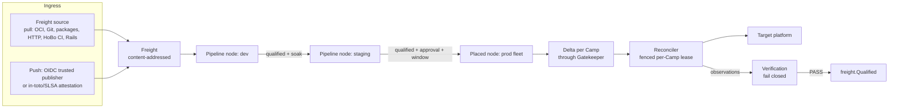

# HoBo.CD: Continuous Delivery

`@hobo/cd` is the delivery sibling of `@hobo/ci`. **CI builds, verifies and
produces artifacts, and it can be any CI. CD discovers or accepts immutable
Freight, moves it through a graph of Camps under policy, makes each Camp
converge by pull, exposes the change progressively, verifies it, and rolls it
back.**

- **Decision record:** [ADR-0181](./adr/01-architecture-core.md#adr-0181) (D1–D26).
- **Binding plan and research:** [plan 0024](../plans/0024-hobo-cd-swarm-instruction.md)
  (Kargo, Harness, Karmada and Open Cluster Management, what was taken and what
  was not).
- **Operator surface:** `packages/hobo/CD.md` (`hobo deploy`, `hobo serve cd`, `hobo incident`).
- **Runbooks:** [`docs/runbooks/cd/`](../runbooks/cd/index.md).
- **Package map:** [`packages/cd/README.md`](../../packages/cd/README.md).

## What it replaces

Before HoBo.CD, four delivery lanes (`hobo up`, hosting transitions, the
fixture-only CD plane in `@hobo/cloud`, and broker `deliver`) shared no desired
state. Evidence failed open, rollback never re-applied the prior Set, and there
was no Freight contract, reconciler, lineage, change window or fleet model.
Now every lane delivers through `@hobo/cd`:

| Entry point | Path through CD |
|---|---|
| `hobo up` / `down` | `LOCAL_BUILD` Freight promoted into the deployment Camp; an in-process conductor converges it. `down` is a teardown Delta. `UpResult`/`DownResult` are unchanged. |
| `hobo deploy *` | The CD command surface (`packages/hobo/CD.md`). |
| Broker `deliver` | A neutral `DeliveryPolicy` (`reconciler_mode`, optional `publisher`); the deprecated `argo` engine maps to a `@hobo/cd-gitops` publisher ([upgrade notes](./delivery-policy-upgrade.md)). |
| Pipelines, MCP, agents | The same modules; MCP tools are derived from the CLI verbs. |

## Concepts

The glossary defines each term; this is how they fit together.

### Freight

Freight is the immutable, content-addressed promotion unit for one Bindle: a
declaration hash, artifact digests by kind, its source, and its provenance. Its
id is `sha256:` over the canonical manifest, and its alias is a deterministic
two-word name. **Promote means carry the same Freight, re-run Matching per
target Camp, and apply the result as a Delta.** Bytes are identical everywhere
(I1); infrastructure may differ, and the difference is shown as
`infrastructure_diff`. Camp configuration lives in the declaration, so a
config-only change is new Freight with the same artifacts.

Freight is not a release channel. A [release channel](./release-channels.md)
names a moving stream of versions that users subscribe to; Freight is one
version, and a pipeline decides where it may go.

### Ingress

Pull comes first (D3):

- **Freight sources** hold Subscriptions: `OCI_REPOSITORY` (OCI distribution
  API), `GIT_REPOSITORY` (smart-HTTP protocol v2 against any host, with no Git
  binary and no host API), `PACKAGE_REGISTRY` (through the `hobo:artifact-repo`
  ecosystems), `HTTP_INDEX`, `HOBO_CI` (a structural reader over CI events) and
  `HOBO_RAIL` (Rail approvals). Discovery is forward-only from a high-water mark.
- **Webhooks only nudge.** A registry or Git webhook, or a CloudEvents/CDEvents
  POST, schedules a poll. The verified read is the source of truth; a payload
  never becomes Freight (I15).
- **Push is optional.** `FreightIngest` accepts a manifest or an attestation
  from a trusted publisher: an OIDC JWT from any issuer (GitHub, GitLab,
  CircleCI, Buildkite, Azure Pipelines, Jenkins or a custom issuer) matched
  against a `TrustedPublisherRecord`, or a HoBo principal.
- **Provenance** is an in-toto Statement v1 with SLSA provenance, parsed by
  `@hobo/registry` and verified as a Sigstore bundle or a HoBo-signed
  attestation. A Subscription can require provenance and pin builder ids and
  signer identities.

### Pipelines, lineage and windows

A Pipeline is a DAG of nodes, one per Bindle (D4). A node names Camps, or a
Placement, and declares its sources, availability, soak, auto-promotion,
strategy, `VerificationSpec`, Change windows, hooks and whether approval is
required. Lineage holds by construction: Freight reaches a node only through
upstream qualification plus soak, or through an unexpired approval (I16).
`freight.Qualified` is written only from a PASS verification.

Each Camp has one in-flight promotion; newer queued Freight supersedes older.
Typed hooks (`RUNBOOK`, `NOTIFY`, `SUITE`) at `BEFORE_APPLY`,
`AFTER_CONVERGED`, `AFTER_QUALIFIED` and `ON_FAILURE` replace any imperative
step runner. There is no expression language anywhere in delivery.

Change windows (D10) are ALLOW or FREEZE rules with an RRULE subset and an IANA
timezone. A promotion requested in a closed window waits (`AWAITING_WINDOW`); a
rollout already in flight holds at its next stage boundary and never aborts
mid-stage. Overrides are governed, expire, and are audited. Rollback is allowed
by default.

If the Freight's declaration changes data shape, promotion is sequenced with
[Trails](./data-engines-continuous-migration.md): `expand`, then the hosting
transition, then soak, then `contract`. Rollback past a completed `contract` is
refused, and the refusal names the compensating `expand` (D11).

### Reconciliation by pull

Desired state for a Camp is the fold of its spec stream; observations go to a
separate status stream, so the two never contend (D5). A Reconciler holds the
per-Camp fenced lease, so one Camp has exactly one writer (I4), and it is the
only thing that mutates a delivery target (I2).

| Mode | Where it runs | Credentials | Use |
|---|---|---|---|
| `conductor` | Inside a Station or Yard service | Short-lived, broker-issued | SaaS targets. A conductor still calls the SaaS API outward; "pull" means it converges on desired state it reads, not that the target pulls. |
| `agent` | Inside the target boundary (`hobo deploy agent run`) | Local to the agent; the Station holds none (I3) | Private networks, edge sites, air-gapped Yards. Outbound HTTPS only, with a key-bound JWT-SVID and a DPoP proof per request. Replaces Plan 25's reverse-tunnel Relay for delivery. |
| `publisher` | Writes to a GitOps repository (`@hobo/cd-gitops`) | Git host token held by the publisher | Argo CD or Flux estates; convergence is known only from the engine's observed status. |

Camps are `MANAGED` (the default) or `OBSERVE_ONLY`, which reads, reports and
evaluates posture but never applies. Drift is detected from observations and
routed through the same Delta path ([drift-reconciliation.md](./drift-reconciliation.md));
fields owned by target-side controllers, such as autoscaler replica counts, are
retained rather than treated as drift.

### Every platform

Realization adds no provider port methods (D6). Resource graphs apply through
the Orchestrator's ResourceActors; workload versions go through the
hosting-transition coordinator with the resolver hosting provider. Every
hosting provider resolves to a realization path and a traffic profile, or to a
typed refusal (I14). A platform with no in-tree resolver is reached with an
out-of-tree `hobo:resolver` WASM component, with no change to HoBo
([resolver-component-authoring.md](./resolver-component-authoring.md)). There
is no shell-script escape hatch.

### Progressive exposure and verification

A strategy is lowered onto what each Camp can actually do (D7): its traffic
offerings are ranked `edge.canary` → `lb.weighted` → `dns.weighted` →
`inprocess.weighted` and the chosen rung is recorded. If a canary is required
and nothing can realize it, or the fallback is forbidden by policy, the
promotion is refused with `progressive-unsupported`; there is no silent
downgrade. Flags (OpenFeature) handle exposure within a version, traffic
handles exposure and A/B between versions, and `OpenExperimentEngine` handles
experiment assignment. `OpenDeliveryEngine` is the only rollout state machine
and Station cutover the only caller of `TrafficRoutingPort.apply` (D8).

Verification is deterministic and fails closed (D9, I5): thresholds,
canary-versus-baseline comparison with a two-sided Mann–Whitney U test, HTTP
probes and verify suites. No data means FAIL. Health sources are a port:
Prometheus HTTP API, HoBo metering, generic HTTP JSON and HoBo posture are
built in, and Datadog, New Relic and CloudWatch are adapters. No ML or model
call sits on a decision path.

Rollback is zero exposure, then a Delta to the predecessor Set through the same
gate (D12, I7).

## Fleets

A pipeline node can target a **Placement** over Rail-bound Camp sets instead of
a list of Camps.

- **Inventory (D19).** Every Camp has a status record with conditions
  (`READY`, `REACHABLE`, `LEASED`, `CREDENTIAL_VALID`, `CLAIMS_CONSISTENT`,
  `POSTURE_COMPLIANT`), each naming its source, plus observed claims and
  taints. Claims are facts an agent reports; they can only exclude a Camp,
  never satisfy residency or a binding (I19). `NO_PLACE` is added
  automatically; `NO_RUN` needs an operator or a Rail-permitted rule with two
  independent signals, one Station-observed. An agent cannot taint itself into
  a failover.
- **Enrollment is double opt-in (I24).** An agent enrolls its public key with a
  single-use bootstrap token scoped to a Camp set, then needs two recorded
  grants (`reconciler.approve-key` and `reconciler.accept`), or a Rail
  auto-accept rule that matches the token's scope.
- **Placement (D20)** is a pure function. Candidates are bound sets ∩ the
  predicate, `MANAGED` Camps only. Taints, missing required claims, Rail
  provider restrictions and residency failures exclude Camps; residency uses
  `evaluateResidency` against each Camp's **declared** regions. Survivors are
  ordered by unexpired score snapshots, then Camp id, and taken under spread
  constraints over Yard, provider, region, jurisdiction or a label. The
  decision records its inventory and score digests and every exclusion, so
  replay reproduces it (I18). Placement selects Camps; **Matching** still
  selects providers and resolvers within each Camp's Yard.
- **Fan-out (D21)** schedules ordinary per-Camp promotions: all at once,
  rolling under a concurrency limit, or one group at a time with mandatory
  pilot groups first. Offline Camps are deferred, not failed, and caught up
  later. Exceeding the failure budget halts the fan-out and rolls back only the
  failed Camps. Downstream proceeds on quorum (I20).
- **Failover (D23)** is a governed saga, off unless a Rail opts in: re-place
  one replacement under the same residency and bindings, promote the node's
  current qualified Freight, verify, cut traffic over, and purge the source
  only after the replacement qualifies. Failover moves compute, never data; if
  the data lives in the failing Camp the answer is `failover-unsafe`, with a
  Trails replica handover named. Nothing fails back until someone runs
  `rebalance` (I21).
- **Per-Camp values (D22)** stay in Camp topology and change through a
  `topology` Delta. There is no JSON-patch override; artifact mirrors never
  change a digest.

## Policy delivered and observed

**Policy decides what is allowed and what compliant means. CD moves versions,
including policy versions, and is the only thing that changes targets.**

| Concern | Policy layer | CD |
|---|---|---|
| Which Camps a Station may target | Rail `delivery.camp_sets` | Placement reads it |
| Residency, budget, entitlements | `@hobo/core` residency, budget and entitlement authorities, Gatekeeper | Placement and the gate evaluate and record |
| Failover permission, enrollment rules | Rail `delivery.failover`, `delivery.enrollment` | The failover saga and enrollment enforce them |
| Posture rules, OSCAL | `@hobo/policy/posture` (pure) | Supplies observations, records compliance, proposes repair Deltas |
| Rail versions | Authoring, approval, digest | Discovery, promotion, shadow, enforce, rollback |
| Mutation of targets | Never | Reconcilers only |

- **Rails as Freight (D24).** An approved Rail version is discovered as Freight
  with subject `RAIL` and promoted through the same pipelines, windows,
  fan-out and rollback as a workload. An `INFORM` node binds it as each Camp's
  candidate: the enforced Rail still decides, the gate records shadow
  decisions and divergences, and posture evaluates the candidate. An `ENFORCE`
  node needs a qualified `INFORM` node upstream (I23). A Camp with no binding
  keeps using its Station's active Rail, so existing behavior is unchanged.
- **Posture (D25).** Reconcilers report only the attributes the bound packs
  declare, secret-free and bounded. A Station-side service evaluates them with
  the pure posture evaluator, records compliance, and exports OSCAL assessment
  results ([governance-planes.md](./governance-planes.md)). Enforcement acts
  only through a repair Delta applied by the Camp's reconciler; a rule that
  contradicts a value the Set owns is `ownership-conflict`, never a silent
  overwrite (I22).

## Toolset independence

No CI system, registry, Git host, observability vendor, GitOps engine or
orchestrator is required (D17, D26):

- **Out:** CDEvents (`dev.cdevents.*`, with HoBo-specific facts as
  `dev.cdeventsx.hobo.*`), OpenTelemetry CI/CD semantic-convention spans and
  metrics over OTLP/HTTP JSON, and CloudEvents webhooks.
- **In:** CDEvents (nudge only), OIDC trusted publishing, in-toto/SLSA,
  Sigstore.
- **Kubernetes fleets:** `@hobo/cd-kube-fleet` imports SIG-Multicluster
  ClusterProfiles as `OBSERVE_ONLY` Camps and realizes promoted Camps through
  one OCM ManifestWork per Camp or a Karmada PropagationPolicy pinned to one
  member cluster. Karmada and OCM are transports and inventory only: they never
  schedule, override, fail over or roll out a HoBo delivery.

## Durability and scale

Everything rebuilds from the journal (ADR-0135 ports). SQLite is the default
and suffices for one node (`hobo up`, local, one conductor). PostgreSQL 16 or
newer, through `@hobo/storage-postgres`, is required when `hobo serve cd` runs
more than one replica or an agent fleet spans more than one Station process
(D16). Leases are fenced per Camp, per fan-out and per failover; commands are
idempotent (I12); delivery is at-least-once and tolerated. Every numeric
default is in `CD_DEFAULTS` (`packages/cd/src/events.ts`).

## Security

Every mutating action is authorized against a policy pack and recorded (D15,
I10). Agent principals propose by default. Agents hold key-bound JWT-SVIDs and
prove possession on each request. Credentials stay where the reconciler runs;
resolver components never see secrets (I9). Records are secret-free.

## Dogfooding: HoBo CI delivered by HoBo.CD

HoBo uses HoBo.CD to deliver HoBo. The intent is that HoBo CI's own moving
parts are Bindles promoted through `@hobo/cd`, not deployed by hand or by
workflow scripts:

- **The hosted CI relay** ([hosted-relay-stateless.md](./hosted-relay-stateless.md))
  is Freight built by HoBo CI and promoted through a staging Camp to
  production, verified on its own health, with rollback as a Delta.
- **Runner controllers** are delivered the same way, per Yard.
- **Self-hosted runner fleets** are Camps in Rail-bound Camp sets: agents
  enroll with double opt-in, a placed node fans new runner images out group by
  group under a failure budget, and offline runners are deferred rather than
  failed.

What exists today is the seam: `@hobo/cd/compose` exports
`hoboCiDogfoodSources`, which declares `HOBO_CI` Freight sources for the relay
and the runner fleet so they can be applied with
`hobo deploy pipeline apply`. The pipelines, Camp sets, Rails and runbooks
that actually move HoBo CI through HoBo.CD land in a follow-up dogfood
package; until then HoBo CI's deployment is unchanged.

## Limits and honest scope

- Live lanes are credential- or availability-gated and skip with a visible
  reason. The `kind` lane for `@hobo/cd-kube-fleet` exists; the Vercel,
  Cloudflare and Prometheus-backed verification lanes plan 0024 requires are
  tracked in [live-provider-matrix.md](./live-provider-matrix.md#hobocd-live-lanes).
  Nothing here claims a live run that has not happened.
- Fixtures are reachable only with `--simulate`, which labels every result.
- `hobo:resolver` components are exercised through the reference components
  and the conformance kit; componentize's default output is still synthetic
  bytes.
- `@hobo/*` packages, including the CD packages, are not on npm
  ([npm-publish-allowlist.md](./npm-publish-allowlist.md)).
