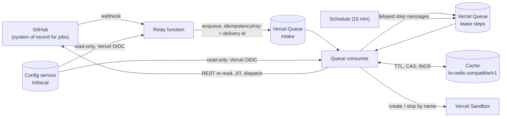

# Hosted CI Relay Without Durable State

**Status:** design accepted as
[ADR-0179](./adr/hosted-relay-stateless.md#adr-0179). Implemented so far
([delivery plan](#delivery-plan)): the cache port (phase 2), the config-service
client (phase 3), the relay store on the cache (phase 4a) and, in phase 4b, the
relay composed on them with no database: config and secrets from the config
service, per-job state in the cache, webhook intake and per-lease steps on
Vercel Queues ([The stateless relay](../../packages/ci-vercel/README.md#the-stateless-relay)).
None of it has been deployed or run against Vercel, Upstash, Infisical or
GitHub. The PostgreSQL code stays in the tree, off the relay's path, until
phase 7 removes it; the sections of
[`@hobo/ci-vercel`](../../packages/ci-vercel/README.md) that describe it are
marked superseded.

## Why

On 2026-11-10 the hosted relay's Postgres on Neon went over its plan quota and
the relay answered 503 to everything, GitHub's webhook deliveries included
([CI Relay Mesh](./ci-relay-mesh.md#no-hosted-database-in-the-job-path)). The
response so far has been to make the database more available: a store chosen
among several attached ones, a relay database fleet across providers with a
writer register and replication, a Drizzle schema with migrations, and a plan
to self-host Postgres. Each step added machinery the relay must operate, and
none changed the fact that a relay with a database is down when its database
is.

Most of what the relay writes does not need to outlive a job. GitHub already
holds the authoritative state of every job, the relay already re-reads it
before acting
([`hosted-relay.ts`](../../packages/ci-gh-actions/src/hosted-relay.ts), the
REST re-reads around lines 802–833 and 897–925), and the remaining state is
configuration, secrets and counters with a natural expiry. So the relay should
keep no durable state of its own: a twelve-factor process with its config in
the environment's config service, its backing services attached by binding,
and its short-lived state in a cache whose loss it tolerates.

## Words used here

| Term | Means |
|---|---|
| **Hosted relay** | The relay deployed on Vercel from `@hobo/ci-vercel`: one function, a queue consumer and a schedule |
| **Relay database fleet** | The machinery that runs the hosted relay on several PostgreSQL databases: store selection, the writer register, replication, failover (`packages/ci-vercel/src/database-*.ts` over `@hobo/data-postgres`'s fleet module). Removed by this design |
| **Compute fleet** | The machines that run jobs: the mesh, capacity, runner routing and balancing, NATS mesh state (`packages/ci/src/fleet/`, `packages/ci-gh-actions/src/fleet-*.ts`, `mesh-nats.ts`). Unchanged |
| **Cache** | A Redis- or Valkey-protocol store reached through the `kv.redis-compatible/v1` port. Holds state that may be lost |
| **Config service** | The service that holds the relay's configuration and secrets. First binding: Infisical Cloud |

"Fleet" alone is ambiguous in this repository and is not used below.

## State classes

| Class | What | Where | Lifetime | Loss means |
|---|---|---|---|---|
| Secrets | GitHub App private key, webhook secret, OAuth client secret, session key, cron secret, onboarding token | Config service, read-only to the relay, cached in process memory | Until rotated | The relay holds no copy that matters; if the config service is unreachable a cold instance cannot start, and warm instances keep their in-memory copy |
| Config | Accounts, policy, offers with declared budget caps, connections, control-token digests, routing preferences | Config service, read-only to the relay, cached in process memory with a short refresh | Until an operator changes it | Same as secrets |
| In-flight job state | One lease record per job attempt, job-taken markers, a small per-account in-flight index, intent timestamps | Cache, with TTL | Until the job is terminal, plus a margin | Rebuilt from GitHub and Vercel by deterministic names |
| Sessions | Signed-in operator sessions, OAuth `state` | Encrypted signed cookies; `state` single-use in the cache | Minutes to hours | The operator signs in again |
| Short-lived counters | Scanner locks and cursors, API-rate windows, redelivery cooldowns, egress mirror, the MCP change ring, worker health, usage pulled from providers | Cache, with TTL | Seconds to days | Recomputed on the next tick; a lost cursor restarts its scan |
| Removed | The event journal, terminal tombstones, snapshot backups, the partition lock, store selection, the relay database fleet's registers, the migration ledger | Nowhere | — | — |

The relay writes nothing that must survive the loss of its cache. The only
durable state it depends on is the config service, which it only reads, and
GitHub.

## Architecture

## Config and secrets are a separate service

The relay reads its configuration and secrets from a config service and never
writes to it.

- **First binding: Infisical Cloud on the free plan.** It is open source, so
  the same service can later run on HoBo's own compute without a client change.
  The relay's secret references use the existing `infisical` scheme of
  `SecretRef` ([`secret-ref.ts`](../../packages/bindings/src/secret-ref.ts)).
- **No secret zero on the relay.** The relay authenticates with the Vercel
  OIDC token every function already has (`@vercel/oidc`, a dependency today)
  through Infisical's OIDC Auth. The relay's machine identity trusts the issuer
  `https://oidc.vercel.com/<team>` and binds the token's subject to this
  project and its production environment. It has read access to one project
  environment and nothing else.
- **CI has its own identity.** The deploy workflow authenticates with GitHub
  Actions OIDC to a separate admin identity bound to this repository's
  protected deployment environment. That identity can read the Vercel deploy
  credential and write configuration; the relay's identity can do neither.
- **What lives there.** Config: accounts, policy, offers (with their declared
  budget caps and whether they are free, prepaid or pay-as-you-go), repository
  connections, control-token digests, routing preferences. Secrets: the GitHub
  App private key, webhook secret and OAuth client secret, the session key, the
  cron secret, the onboarding token. Config is one revisioned document; each
  secret is its own entry.
- **Caching.** A function instance reads config and secrets once at start and
  refreshes config at most once a minute. A refresh that fails keeps the last
  good copy and logs it; a cold instance that cannot read the config service
  fails its readiness probe and answers 503 with `Retry-After`, as a relay with
  a down store does today.
- **Fallback binding.** GCP Secret Manager through Vercel OIDC workload
  identity federation implements the same port. Its free tier is small (a
  handful of active secret versions and a monthly access allowance, per
  Google's pricing page; re-check before choosing it), so on that binding the
  config document and the secrets are stored as two bundled entries.

The relay's broker on Neon (`neon-secret-broker.ts`, `neon-broker-entry.ts`,
`runtime-config-client.ts`, and the broker address fixed in `entry.ts`) is
replaced, not ported.

## No database: a cache with TTL and compare-and-set

Short-lived per-job state lives in a cache that speaks the Redis or Valkey
protocol. The relay's port is the existing `@hobo/kv-redis-compatible`
requirement with `ttl`, `atomicIncrement` and `atomicCompareAndSet`, so any
store that passes that package's conformance suite can serve it.

- **First binding on Vercel: Upstash Redis through the Vercel Marketplace, free
  tier.** As stated by the vendor at the time of writing: 256 MB and 500,000
  commands a month free, then pay-as-you-go at $0.20 per 100,000 commands.
  Re-check at provisioning. It is chosen because it costs nothing and needs no
  infrastructure. This is a new Marketplace binding; it is not the
  `upstash.temporary-redis/v1` provider in
  [`@hobo/provider-upstash`](../../packages/providers/provider-upstash/README.md).
- **Self-hosted Valkey binds to the same port** with no relay code change.
- **Loss is tolerated.** Every key has a TTL, and everything in the cache can
  be rebuilt from GitHub and Vercel by deterministic names
  ([below](#github-is-the-system-of-record-for-jobs)). An empty cache costs a
  rebuild pass, not a lost job.
- **Command budget is a design constraint.** Work is driven by events (queue
  messages, including delayed ones), never by polling the cache. The
  [cost model](#cost-model) counts commands per job and per repair tick.
- **Namespacing.** Keys are prefixed `hobo-ci:<environment>:`. Production and
  preview deployments use separate cache databases where the Marketplace
  integration allows it, and separate prefixes always.

## Vercel Queues: where they fit and where they do not

| Use | How | Replaces |
|---|---|---|
| Webhook intake | The relay verifies the signature, enqueues the delivery with `idempotencyKey` = the `X-GitHub-Delivery` id (deduplicated for 24 h, retained at most 7 days, delivered at least once, retried with back-off honouring `Retry-After`) and only then acknowledges GitHub | `hobo_ci_inbox` |
| Per-lease lifecycle steps | Dispatch check, claim timeout, reconcile and each Sandbox step are delayed messages with idempotency key `${leaseId}:${step}:${n}`. A step reads the lease, acts, and enqueues the next step | Scans over every in-flight lease on each tick |
| Repair ticks | The `hobo-ci-repair` schedule publishes to the queue, as today | — |
| Retries | A step that fails transiently is redelivered by the queue with back-off | Hand-written retry loops |

Queues are **not** used for anything that must be read, compared or browsed:
state reads, compare-and-set and mutual exclusion, counters and quotas, the
MCP change feed, config or secrets. A queue cannot be read back or listed, so
each of those stays in the cache or the config service.

A delivery the consumer can never admit (it does not parse, or names an
unknown installation) is acknowledged, logged as
`hobo_ci_webhook_quarantined` with its delivery id, and dropped. An operator
redelivers it from GitHub with `hobo ci` within GitHub's three-day window. The
quarantine list and its retry endpoint go away with the inbox.

## GitHub is the system of record for jobs

The relay already treats GitHub's REST view of a job and its run as
authoritative before it writes anything. This design leans on that fully.

**Deterministic lease ids.** A lease id is a UUIDv5, under a fixed HoBo
namespace, of `repositoryId:jobId:runAttempt`. When a verified queued job is
re-admitted after its host was settled, the requeue generation `g` is appended
(`repositoryId:jobId:runAttempt:g`, for `g > 0`), so generation 0 is exactly
the plain key. Every external name follows from the lease id:

| Thing | Name | Where it is made today |
|---|---|---|
| JIT runner | `hobo-<leaseId>` | `job-runner-custody.ts` |
| Workflow-bridge run | display title `HoBo lease <leaseId>` | `hosted-relay.ts`, `discover()` |
| Vercel Sandbox | `hobo-<leaseId>` | `sandbox-controller.ts` |

**Rebuilding a lost lease.** For each queued or in-progress job the relay can
see (the queued-job scanner already lists them), it computes the lease ids for
generations 0 to the bound, and looks up runners, bridge runs and sandboxes
under those names. What it finds becomes the lease record again: a runner
assigned to the job means `dispatched` or later; a bridge run or sandbox with
no runner means `dispatching`; nothing means the job is still pending. Two
records for one job collapse to the one GitHub assigned. A `hobo-` runner,
bridge run or sandbox that matches no candidate of any live job is an orphan
and is stopped after a grace period, as the orphan sweep does today.

Where the provider refuses a second resource with the same name (GitHub runner
names, Vercel named sandboxes), a duplicate create fails at the provider. Phase
4 verifies both against the live APIs before relying on it. A workflow-bridge
dispatch has no such guarantee; a duplicate bridge run finds its runner name
taken, exits, and is cancelled by reconcile.

## Mutual exclusion without a partition lock

Today every write takes one PostgreSQL row lock on the partition
([`postgres-store.ts`](../../packages/ci/src/postgres-store.ts), the
`SELECT … FOR UPDATE` on `hobo_ci_partitions` around lines 516–538), which
serializes the whole relay. It is replaced by per-key compare-and-set:

| Need | Key | Operation |
|---|---|---|
| One lease per job attempt | `lease:<leaseId>` holding the lease and a `version` | Create with set-if-absent; every transition is a compare-and-set on `version` |
| A job is taken once | `job:<repositoryId>:<jobId>:<runAttempt>` → lease id | `SET NX` with a TTL; holds `terminal` after completion |
| Account and offer concurrency limits | `inflight:<accountId>`: the account's in-flight lease ids, each with its offer and its budget hold | Compare-and-set on the index's version; admission adds an entry only if the limit holds |
| Crash recovery | The lease record's `intent: { kind, at }` | Written by compare-and-set before any external call; cleared with the outcome |
| Queue deadline | The lease record | Derived from the GitHub job's `created_at`, never from when the relay first saw it |

**Crash recovery keeps today's rule.** A function can die after recording its
intent and before recording the outcome. The step message scheduled for the
intent's cutoff (2 minutes, or 17 minutes for a Sandbox operation, as in
[`hosted-runtime.ts`](../../packages/ci-gh-actions/src/hosted-runtime.ts)
lines 362–414) finds the intent still open and marks the lease `uncertain`. An
uncertain lease is never retried blind: it is resolved by looking up its
deterministic names, adopting what exists, and re-admitting the job under the
next generation only when nothing exists and GitHub still reports it queued.
This replaces reading the latest intent events from the event journal.

**TTLs.** A lease key lives for the account's maximum runtime plus startup plus
one hour, refreshed on each transition. A terminal job marker lives 24 hours,
covering the queue's deduplication window; after that a re-read of the GitHub
job says it is completed.

## Sessions and OAuth state

Operator sessions become encrypted, authenticated cookies sealed with
`HOBO_CI_SESSION_KEY` (AES-GCM, with a key id so the key can rotate). The
cookie carries what `hobo_ci_oauth_sessions` holds today. OAuth `state` is
written with `SET NX` and a ten-minute TTL and consumed with a get-and-delete,
so it is single-use. A lost cache costs a sign-in that has to start again.

## Budgets and cost

- **Routing prefers** free offers, then prepaid ones, then the cheapest
  pay-as-you-go offer, as declared in config.
- **Budget caps are declared** in config per account and per offer.
- **Exposure** = provider usage the relay pulled on its last tick (Vercel's
  usage and billing API for Sandbox, GitHub's billing usage API for Actions
  minutes) + the holds of in-flight leases in the cache (each lease's maximum
  runtime times its offer's price). Admission to a priced offer requires
  exposure plus the new hold to stay under the cap.
- **No accounting records.** `spent_micros` stops being a field the relay
  writes; spend is what the provider reports.
- **Overrun is bounded by one pull interval**: spend outside the relay's own
  leases, and provider reporting lag, are not seen until the next pull.
- **Fail closed for money, open for free capacity.** When the in-flight index
  is missing (the cache was emptied), priced offers are paused until a rebuild
  pass has restored the holds; free and self-hosted offers keep admitting, as
  the [mesh](./ci-relay-mesh.md#what-stays-consistent) does.
- **Broker budget-policy accounts are not supported by the hosted relay.**
  They never were on Vercel: `composition.ts` builds `PostgresCiStore` without
  the shared-budget hooks, so such an account is refused there today. The
  Broker budget ledger library is unchanged.

## Config is read-only at runtime

The hosted relay stops serving every endpoint that writes configuration:

| Removed from the hosted relay | Replaced by |
|---|---|
| `PUT /v1/accounts/self/policy`, `PUT /v2/accounts/self/policy` | `hobo ci` writing the config document in the config service |
| `PUT /v2/accounts/self/providers` | Same |
| `POST /v2/accounts/self/signals` | Budget exposure pulled from providers ([above](#budgets-and-cost)) |
| `POST /v2/accounts/self/observations`, `POST /v2/accounts/self/rate-observations` | The relay pulling provider usage and rate data on its tick |
| `GET /v2/accounts/self/inbox/quarantined`, `POST /v2/accounts/self/inbox/<id>/retry` | Quarantine logged; redelivery from GitHub through `hobo ci` |
| `POST /v1/accounts/self/repositories/prepare`, `POST /v1/accounts/self/repositories/isolated-connect` and their operation reads | `hobo ci` acting against the config service and the GitHub API directly |

Read endpoints stay: the policy view (now read from config), in-flight leases,
installations (from the GitHub API, cached in memory), mesh nodes, the runtime
diagnostic, and lease reconcile (an operation on in-flight state, not on
config). The control plane is shared by every relay host; the Node service
behind `hobo ci serve` keeps its SQLite store and its write endpoints, which
this design does not change. The hosted composition passes a read-only config
source, and the shared control plane refuses writes against one.

**Config fencing moves to the writer.** Today a configuration change is a
compare-and-set on a revision, and active leases fence changes to a
connection's identity. Now each lease records the config revision and
identities it was admitted under and keeps them until it is terminal. `hobo ci`
refuses an identity change for a connection that has in-flight leases (it asks
the relay's read API) unless forced, and writes the new document with the
config service's own versioning. Admission keeps re-reading config after its
GitHub REST reads before committing demand, as `hosted-relay.ts` does now.

## MCP

`list_leases` and the pending-job views show in-flight work only; finished
jobs are GitHub's to show. `wait_for_events` reads a bounded change ring in
the cache: per account, the last few hundred changes, each with a TTL of one
hour. A wait reads the ring when it starts and then every 15 seconds; an
account with nothing in flight is answered at once with a hint to wait a
minute. A cursor older than the ring, or a ring that was lost, returns a
cursor reset, and the client re-reads the in-flight list.

## Sandbox egress and proxy caps

The authoritative egress counter and request-rate window for a Sandbox live in
that Sandbox's own proxy VM, which exists exactly as long as the Sandbox does
([sandbox egress](../../packages/ci-vercel/SANDBOX-EGRESS.md)). The proxy
enforces the cap itself and mirrors its counter to the cache about once a
minute for reporting. The proxy's session token is derived (an HMAC of the
lease id under a key from the config service) instead of stored, so
`hobo_ci_sandbox_proxies` has nothing left to hold.

## Correctness hazards and how each is kept

| Hazard | How it is kept |
|---|---|
| Double-provisioning | Job-taken marker (`SET NX`), then compare-and-set on the lease; before creating anything a step looks the deterministic name up; providers that enforce unique names refuse a duplicate. If the marker is lost, the name lookup still finds the first resource |
| Duplicate webhooks | Queue idempotency on the delivery id for 24 h; beyond that, every delivery is re-read against GitHub's REST view and the lease compare-and-set makes reprocessing a no-op |
| Budget overrun | Exposure = pulled usage + in-flight holds; overrun bounded by one pull interval; priced offers paused while holds are unknown |
| Sandbox egress cap | Enforced in the Sandbox's proxy VM, whose state lives and dies with the Sandbox; the cache only mirrors it |
| Lease fencing and crash recovery | Version compare-and-set on each lease; intent recorded before every external call; an open intent past its cutoff makes the lease uncertain; uncertainty resolved by name lookup, never by blind retry |
| Scanner exclusion | One lock per scanner and App (`SET NX` with a TTL a little longer than a scan pass); cursors in the cache; a lost cursor restarts from the newest page, bounded by five pages per tick and GitHub's three-day delivery history |
| GitHub API rate limits | Redelivery claims per delivery id with a 15-minute cooldown (`SET NX`), an App-wide limit of 20 redeliveries a minute and the queued-scan API budget as `INCR` windows with a TTL; a lost window allows at most one window's worth of extra calls |
| Config fencing | Each lease keeps the revision and identities it was admitted under; `hobo ci` refuses identity changes over in-flight leases; admission re-reads config after its REST checks |
| Readiness after cache loss | Worker-health keys missing means "no evidence yet", reported as starting, not failing; the next tick writes them |

## When GitHub is down

When GitHub Actions is down, no runner can start and no job can report. Keeping
state of our own does not buy availability for work GitHub triggers; it only
let the relay fail on its own, as it did on 2026-11-10. So the relay does not
try to be available while GitHub is not.

The cache buys resilience to partial outages, which are the common case:

- **Delayed or dropped webhooks.** GitHub does not retry a failed delivery on
  its own; its delivery history and redelivery are available for three days.
  The repair scanner redelivers failed deliveries from that history, and the
  queued-job scanner finds queued jobs whose delivery never arrived.
- **REST 5xx and rate limiting.** Steps are queue messages, so a failed call
  is retried by the queue with back-off; the lease records where it got to.
- **Instance restarts.** Nothing lives in the function. The next instance reads
  config and secrets, and the lease records and queue messages carry on.

## Cost model

Everything the relay attaches has a free allowance that this workload stays
inside. Exceeding one is cheap: the budget exists so the default deployment
costs nothing, not because an overrun is expensive.

| Service | Plan | What the relay uses |
|---|---|---|
| Vercel Functions, Queues, Schedules, Sandbox | The project's existing plan | As today; about eight queue messages per job (three or four webhook deliveries plus lifecycle steps) and one repair message per tick |
| Cache (Upstash via Marketplace) | Free: 256 MB, 500,000 commands a month | Below |
| Config service (Infisical Cloud) | Free | A read per cold start, a config refresh at most once a minute per warm instance |
| GitHub API | Included with the App | As today, plus listings during a rebuild |

**Cache commands per job (estimate):**

| Step | Commands |
|---|---|
| Intake: delivery seen-marker | 1 per delivery |
| Queued: job-taken marker, lease create, in-flight index read and compare-and-set, change ring append | 5 |
| Dispatch: read lease, record intent, record outcome, ring | 4 |
| Claim: read, compare-and-set, ring | 3 |
| Claim-timeout and reconcile checks | 2 |
| In progress: seen-marker, read, compare-and-set, ring | 4 |
| Completed: seen-marker, read, terminal marker, index read and compare-and-set, delete lease, ring | 7 |
| **Job on the workflow bridge** | **about 25** |
| Sandbox steps (create, start, stop: read and compare-and-set each) | 6 |
| Egress mirror, once a minute for a 10-minute run | 10 |
| **Sandbox job** | **about 45** |

**Cache commands per repair tick (every 15 minutes, about 2,900 a month):** two
scanner locks, two cursor reads and two writes, one or two API-budget
increments, the in-flight index, one read per in-flight lease, two usage
writes, one worker-health write: about 12 plus one per in-flight lease. With
five leases in flight on average, about 17 per tick, about 50,000 a month.

**MCP waits:** an idle account costs one command a minute per waiting client,
about 43,000 a month for an agent waiting all the time; a busy account about
four commands per 50-second wait.

At 100 jobs a day on the workflow bridge (about 75,000 commands), plus repair
ticks (about 50,000) and one agent waiting continuously (about 45,000 to
70,000), a month is about 200,000 commands: under half the free allowance.

## One-time owner actions

1. Create an Infisical organization on the free plan and one machine identity
   that trusts this repository's GitHub Actions OIDC, bound to the protected
   deployment environment. The deploy workflow uses it to create the relay's
   own read-only identity (trusting Vercel's OIDC issuer for this team and
   project); if the free plan does not allow that through the API, the owner
   creates the second identity by hand in the same sitting.
2. Store a Vercel deploy token in Infisical, where only the admin identity can
   read it.
3. Re-create the GitHub App once through the HoBo CLI, so its private key,
   webhook secret and client secret go straight into Infisical and are never
   copied by hand.

Everything else, including attaching the cache through the Marketplace, is done
by the deployment.

## Deployment through HoBo

The relay's deployment config is HoBo's own app model: the Bindle in
[`src/bindle.ts`](../../packages/ci-vercel/src/bindle.ts) plus a Yard and Camp
that target Vercel. It declares bindings for the cache
(`kv.redis-compatible/v1`, bound to the Upstash Marketplace integration), the
queue, the schedule, and the config service; the `data` resource for
PostgreSQL goes away. `hobo ci deploy` plans from that declaration instead of
hardcoding Vercel in `programFor`
([`ci-relay-deploy.ts`](../../packages/hobo/src/ci-relay-deploy.ts)). A
workflow on `main` runs it: it authenticates to Infisical with GitHub OIDC,
reads the Vercel deploy credential, and deploys the commit it was triggered
by. There are no manual deploys.

**Pay only for what is used.** The relay's deployment includes only what it
uses. Neon and its Vercel integration, the Neon-hosted config broker and
Turso (attached to the project but never used) are disconnected.

## Delivery plan

| Phase | Delivers | Done when |
|---|---|---|
| 1 | This design and ADR-0179 | Merged |
| 2 | The relay's cache port over `@hobo/kv-redis-compatible` (TTL, compare-and-set, increment), an in-memory implementation and an Upstash REST implementation, each passing the kv conformance suite; a Valkey implementation over RESP | The suite passes for all three; the in-memory one runs in every relay test |
| 3 | The config-service client (Infisical OIDC Auth with the Vercel token; GCP Secret Manager behind the same port), and GitHub App creation from `hobo ci` that writes the App's credentials straight into the config service | The relay starts from Infisical with no secret in its environment; App creation lands credentials in custody without passing through the terminal |
| 4 | A relay store on the cache: deterministic lease ids, per-key compare-and-set, the in-flight index, intent timestamps; Queue intake with delivery-id idempotency; per-lease step messages; rebuild by name | The relay's store contract tests pass on the cache store; killing the cache mid-job loses no job; a duplicated delivery provisions once; GitHub and Vercel name uniqueness verified live |

**Phase 4 so far.** 4a: the store on the cache (`@hobo/ci-gh-actions/relay-cache`).
4b: `composeStatelessRelay` in `@hobo/ci-vercel`: the cache backend chosen from
the deployment's bindings (Upstash REST, then Valkey; in memory only off Vercel)
behind one seam, `selectCacheBackend`, with every command metered against a
monthly allowance; intake on the `hobo-ci-intake` topic keyed by delivery id;
per-lease steps on `hobo-ci-lease-steps` keyed `${leaseId}:${step}:${n}`, each
rung at a fixed offset from the lease's creation so chains of one lease
collapse; the 15-minute repair tick as backstop with a rebuild pass for lost
holds; the control plane's configuration writes answering 410. End-to-end tests
on the in-memory cache cover a Sandbox job from webhook to settlement,
duplicate deliveries provisioning once, and the cache wiped mid-job (the lease
rebuilt by name, the running job adopted rather than stopped). Still open:
policy-driven cache selection (4c); settling a rebuilt Sandbox lease, whose
proxy meters were in the lost cache (it stays `uncertain` until its record
lapses); name uniqueness at GitHub and Vercel verified live. A Sandbox job
costs 99 cache commands through the whole composition, against the estimate of
about 45 above; the store's own path dropped from 62 to 43.
| 5 | Helpers on the cache: repair scanners (locks, cursors, rate windows), cookie sessions and OAuth state, bootstrap and onboarding without the platform-App tables, the MCP change ring, provider usage pulls for budgets | Each helper's tests pass on the in-memory cache; the removed control endpoints answer 404 on the hosted relay |
| 6 | Deployment config (Bindle, Yard, Camp) with cache, queue, schedule and config-service bindings; `hobo ci deploy` planning from it; the deploy workflow on `main`; Marketplace cache provisioning | A merge to `main` deploys the relay with no manual step and no secret in the repository |
| 7 | Removals ([itemized](#phase-7-removals)) | The hosted relay's bundle has no `pg`, no `@neon/functions` and no `@hobo/data-postgres`; the removed files are gone |
| 8 | Cutover and an end-to-end job | A real `runs-on: hobo` job runs through the new relay; Neon, the broker and Turso are disconnected |

### Phase 7 removals

`packages/ci-vercel`:

- `src/`: `database-connections.ts`, `database-discovery.ts`,
  `database-fleet.ts`, `database-fleet-config.ts`,
  `database-fleet-conformance.ts`, `database-fleet-executor.ts`,
  `database-selection.ts`, `database-selection-import.ts`,
  `database-selection-marker.ts`, `database-selection-relay.ts`,
  `relay-schema.ts`, `neon-secret-broker.ts`, `neon-broker-entry.ts`,
  `neon-trigger.ts`, `runtime-config-client.ts`; the Postgres read store in
  `worker-health.ts` (moves to the cache); the Postgres wiring in
  `composition.ts`, `bootstrap-entry.ts`, `sandbox-composition.ts` and
  `entry.ts` (rewired, not deleted).
- `db/` (schema, source, migrations, the embedded-DDL lock), `tsconfig.db.json`,
  `deploy/postgres/`.
- `scripts/`: `bootstrap-postgres-contract.ts`,
  `database-connections-postgres-contract.ts`, `database-fleet-proof.ts`,
  `sandbox-pg-contract.ts`, `worker-postgres-contract.ts`.
- `test/`: `database-connections.test.ts`, `database-discovery.test.ts`,
  `database-fleet*.test.ts`, `database-fleet-harness.ts`,
  `database-selection*.test.ts`, `neon-secret-broker.test.ts`,
  `neon-trigger.test.ts`, `postgres-schema.test.ts`, `relay-schema.test.ts`,
  `runtime-config-client.test.ts`; the Postgres cases of
  `worker-health.test.ts`.
- `package.json`: `pg`, `@types/pg`, `@neon/functions`, `@hobo/data-postgres`,
  the Drizzle dev dependencies and the `db:*` scripts.

`packages/ci`:

- `src/postgres-store.ts` (`PostgresCiStore`), `src/schema-migrations.ts`, the
  `./postgres` and `./schema-migrations` exports.
- `db/` (schema, source, migrations, tooling), `tsconfig.db.json`,
  `scripts/postgres-contract.ts`.
- `test/`: `postgres-authoritative-admission.test.ts`,
  `postgres-schema.test.ts`, `postgres-schema-lineage.test.ts`,
  `schema-tooling.test.ts`.
- `package.json`: `pg`, `@types/pg`, Drizzle dev dependencies, `db:*` scripts.

`packages/ci-gh-actions`:

- `src/`: `app-registration-postgres.ts`, `github-oauth-session-postgres.ts`,
  `hosted-schema.ts`, `postgres-session-lock.ts`,
  `isolated-worker/postgres-pool.ts`; the Postgres stores inside
  `webhook-repair.ts`, `queued-job-repair.ts`, `hosted-app-bootstrap.ts` and
  `hosted-app-onboarding.ts` (moved onto the cache in phase 5); the
  `HOBO_CI_STORE=postgres` branch of `isolated-worker/worker-store.ts` (the box
  worker's shared Postgres partition option).
- `db/`, `tsconfig.db.json`; `scripts/onboarding-postgres-contract.ts`,
  `owner-bootstrap-postgres-contract.ts`,
  `queued-job-repair-postgres-contract.ts`.
- `test/`: `app-registration-postgres.test.ts`, `hosted-schema.test.ts`,
  `pinned-postgres-testcontainers.test.ts`, `postgres-schema.test.ts`,
  `postgres-schema-lineage.test.ts`, `postgres-session-lock.test.ts`; the
  Postgres leg of `ci-store-contract.test.ts` (its SQLite leg stays).
- `package.json`: `pg`, `@types/pg`, Drizzle dev dependencies, `db:*` scripts.

`packages/hobo`: the `store: { kind: "postgres" }` option of `hobo ci serve`
(`src/ci-serve.ts`) and its documentation in `CI.md`.

Documentation: the superseded sections in `packages/ci-vercel/README.md`,
`packages/ci/README.md`, `packages/ci-gh-actions/README.md` and
`packages/ci/RUNNER-QUEUE.md` are deleted rather than kept with a banner.

### Phase 8 cutover

1. Deploy the new relay to a preview environment with its own cache prefix and
   run a job end to end against a test repository.
2. Let the old relay drain: stop admitting, wait until no lease is in flight.
   Old leases have random ids, so the new relay would treat their runners as
   orphans; cutting over with leases in flight would stop them.
3. Point the GitHub App's webhook at the new production deployment. Old
   deployments' queue consumers already forward to the canonical URL.
4. Run a `runs-on: hobo` job on `main` through the new relay.
5. Disconnect Neon and its Vercel integration, delete the Neon broker project,
   disconnect Turso.

## Former tables and their replacements

Every `hobo_ci_*` table the hosted relay used, and where its job goes:

| Table | Owner | Held | Replaced by |
|---|---|---|---|
| `hobo_ci_inbox` | `@hobo/ci` | Verified webhook deliveries awaiting admission | Vercel Queue intake with `idempotencyKey` = delivery id |
| `hobo_ci_events` | `@hobo/ci` | The CI event journal | Structured logs and CloudEvents (`HOBO_CI_EVENTS_URL`) for history; the MCP change ring for live changes; GitHub for job history |
| `hobo_ci_leases` | `@hobo/ci` | Lease projection | `lease:<leaseId>` in the cache, rebuilt by name |
| `hobo_ci_terminal_jobs` | `@hobo/ci` | Tombstones stopping re-admission | Job-taken marker holding `terminal` for 24 h, then GitHub's REST view |
| `hobo_ci_assigned_jobs` | `@hobo/ci` | Job-to-runner assignment | The GitHub job's `runner_name`, copied onto the lease record |
| `hobo_ci_pending_jobs` | `@hobo/ci` | Queued jobs awaiting capacity | In-flight index entries in `pending` plus a delayed step message; deadline from `created_at` |
| `hobo_ci_configuration` | `@hobo/ci` | Revisioned configuration | The config document in the config service |
| `hobo_ci_control_records` | `@hobo/ci` | Onboarding and setup operation records | `hobo ci` against the config service and GitHub; nothing on the relay |
| `hobo_ci_sandbox_egress` | `@hobo/ci` | Egress cap and bytes used per Sandbox | The Sandbox's proxy VM, mirrored to the cache |
| `hobo_ci_sandbox_proxies` | `@hobo/ci` | Proxy sessions and token digests | A token derived from the lease id; nothing stored |
| `hobo_ci_sandbox_proxy_requests` | `@hobo/ci` | Proxy request-rate window | The proxy VM's own memory |
| `hobo_ci_partitions` | `@hobo/ci` | The partition row everything locked | Removed; per-key compare-and-set |
| `hobo_ci_snapshot_backups` | `@hobo/ci` | SQLite snapshots imported into Postgres | Removed |
| `hobo_ci_app_states` | `@hobo/ci-gh-actions` | App-manifest flow state | App created from `hobo ci`; any single-use state is `SET NX` with a TTL |
| `hobo_ci_app_credentials` | `@hobo/ci-gh-actions` | The App's private key and secrets | Secrets in the config service |
| `hobo_ci_app_installations` | `@hobo/ci-gh-actions` | Known installations | The GitHub API (App JWT), cached in memory |
| `hobo_ci_oauth_states` | `@hobo/ci-gh-actions` | OAuth `state` | `SET NX` with a ten-minute TTL, consumed with get-and-delete |
| `hobo_ci_oauth_sessions` | `@hobo/ci-gh-actions` | Operator sessions | Encrypted signed cookies |
| `hobo_ci_platform_app` | `@hobo/ci-gh-actions` | The platform-App bootstrap fence | App creation from `hobo ci` into the config service |
| `hobo_ci_platform_app_attempts` | `@hobo/ci-gh-actions` | Bootstrap attempts | Removed with the in-relay bootstrap |
| `hobo_ci_platform_app_invitations` | `@hobo/ci-gh-actions` | Onboarding invitations | The onboarding token in the config service, with its expiry; a consumed-marker `SET NX` in the cache; `hobo ci` rotates the token after use |
| `hobo_ci_queued_scans` | `@hobo/ci-gh-actions` | Queued-job scan cursors | Cursor keys in the cache |
| `hobo_ci_queued_api_budget` | `@hobo/ci-gh-actions` | GitHub API calls spent by the queued scan | `INCR` windows with a TTL |
| `hobo_ci_webhook_repairs` | `@hobo/ci-gh-actions` | Per-delivery redelivery claims | `SET NX` with a 15-minute TTL per delivery id |
| `hobo_ci_webhook_successes` | `@hobo/ci-gh-actions` | Deliveries known to have succeeded (four days) | A seen-marker per delivery id with a four-day TTL, and GitHub's own delivery status |
| `hobo_ci_webhook_scan_cursors` | `@hobo/ci-gh-actions` | Delivery-history scan cursors | Cursor keys in the cache |
| `hobo_ci_worker_health` | `@hobo/ci-vercel` | Last success and failure per worker | Keys in the cache with a TTL; missing reads as "starting" |
| `hobo_ci_database_probes` | `@hobo/ci-vercel` | Database reachability probes | Removed |
| `hobo_ci_store_selection` | `@hobo/ci-vercel` | Which attached store was chosen | Removed |
| `hobo_ci_fleet_assignments`, `hobo_ci_fleet_watermarks`, `hobo_ci_fleet_usage` | relay database fleet over `@hobo/data-postgres` | Writer register, replication watermarks, per-backend usage | Removed with the relay database fleet |
| `hobo_ci_schema_migrations` | `@hobo/ci` tooling | The migration ledger | Removed |

## Out of scope and unchanged

- **The compute fleet:** the relay mesh, capacity, runner routing and
  balancing, NATS mesh state, `packages/ci/src/fleet/*`,
  `packages/ci-gh-actions/src/fleet-*.ts`, `mesh-nats.ts`.
- **`SqliteCiStore`** for local box workers and `hobo ci serve`, and the Node
  service's own control endpoints.
- **`@hobo/data-postgres`**, including its fleet module. It is a library for
  user workloads; the hosted relay only stops depending on it.
- **The Broker budget ledger library.**
- **The box worker's pull admission** and everything in
  [CI Relay Mesh](./ci-relay-mesh.md) about nodes, claims and trust.

## Open questions

- **Live name uniqueness.** Whether GitHub refuses a second JIT runner with the
  same name in every scope the relay uses, and whether Vercel refuses a second
  named Sandbox, is checked in phase 4 before double-provisioning relies on it.
- **Provider usage latency.** How far behind Vercel's and GitHub's usage APIs
  run sets the real overrun bound; phase 5 measures it.
- **Infisical free-plan limits** on machine identities and API rate are
  checked when the organization is created.
- **Preview deployments.** Whether the Marketplace integration gives preview a
  separate cache database, or only a key prefix separates them.

## Related

[ADR-0179](./adr/hosted-relay-stateless.md#adr-0179) ·
[CI Relay Mesh](./ci-relay-mesh.md) ·
[`@hobo/ci-vercel`](../../packages/ci-vercel/README.md) ·
[`@hobo/kv-redis-compatible`](../../packages/kv-redis-compatible/README.md) ·
[Shared budget policy](./shared-budget-policy.md)
