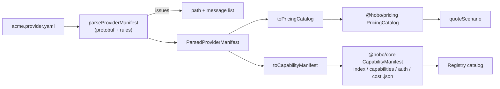

---

type: Design
title: "HoBo Provider Manifest"
description: "One serialized YAML/JSON manifest declares a provider's auth flows, capability mappings, and billing models, and is deserialized into the existing pricing-catalog and capability-manifest types."
status: Accepted
repository: "https://github.com/Hobo-Labs/HoBo"

---

# HoBo Provider Manifest

A provider manifest is a single YAML or JSON document in which a provider — or
anyone in the community — declares three things as data:

1. how to authenticate (OAuth 2.0, [auth.md](../../AUTH.md), OIDC federation, API keys),
2. which provider services realize which HoBo ports,
3. what things cost, in whatever units the provider bills.

`@hobo/provider-manifest` parses it and deserializes it into types that already
exist. No provider package is written and no new runtime type is generated
([ADR-0177](./adr/provider-manifest.md#adr-0177)).



It is the authoring format for the [Capability Manifest](./ai-native-agent-auth.md#plan-06):
the four `/.well-known/capability-manifest/*` documents are an output of it.

## Shape

```yaml
schema: hobo.provider-manifest/v1
provider: { id: acme-cloud, displayName: Acme Cloud }
auth: { issuer: ..., flows: [...] }
capabilities: { regions: [...], mappings: [...] }
billing: { currency: USD, source: {...}, billables: [...], products: [...] }
```

Any of the three sections may be omitted; at least one is required. The full
worked example is
[`packages/provider-manifest/examples/acme-cloud.provider.yaml`](../../packages/provider-manifest/examples/acme-cloud.provider.yaml).
The record source is `data-models/provider_manifest.proto`; the document is the
protobuf JSON form of `ProviderManifest`, so field names are camelCase and an
unknown field is an error, not a silently ignored typo.

## Auth flows

```yaml
flows:
  - id: console-oauth
    scopes: [{ name: compute:deploy }]
    oauth2:
      grant: authorization-code
      metadataUrl: https://auth.acme.example.com/.well-known/oauth-authorization-server
  - id: agent-registration
    authMd:
      resource: https://api.acme.example.com
      anonymousRegistration: true
      humanClaim: true
```

| Variant | Published flow type |
|---|---|
| `oauth2` `authorization-code` | `oauth2-authorization-code` (always PKCE S256) |
| `oauth2` `device-code` | `device-code` |
| `oauth2` `token-exchange` | `oauth2-obo` |
| `oauth2` `jwt-bearer` | `oauth2-xaa` |
| `oauth2` `client-credentials` | `oauth2-client-credentials` |
| `authMd` | `auth-md` |
| `oidcFederation` | `oidc-federation` |
| `apiKey` | `api-key` |
| `extension` | the declared `x-…` type, `supported: false` |

An `authMd` flow names only the protected resource. The Protected Resource
Metadata URL and the `auth.md` document URL are derived by `@hobo/auth-md`'s
own discovery helpers, so the manifest and the discovery client cannot drift.

Flows are published in preference order — `oidc-federation`, `oauth2-xaa`,
`oauth2-obo`, `auth-md`, `oauth2-authorization-code`, `device-code`,
`oauth2-client-credentials`, `api-key`, then extensions — extending the keyless
ordering in [§6.1](./ai-native-agent-auth.md#plan-06). Endpoints must be `https`.
A manifest declares endpoints; this package never dereferences them.

## Capability mappings

```yaml
mappings:
  - id: database/postgres
    port: database
    resourceClass: postgres
    providerService: acme.pg.flex
    features: [managed, ha]
    profiles: [data.postgres/v1]
    products: [pg-flex]
```

Each mapping becomes one `capabilities.json` entry and one equivalence class.
`profiles` are parsed with `@hobo/manifest-capability`'s `parseProfileId`;
`products` must name products in the billing section and link the capability to
its pricing-catalog product.

## Billing models

Billing has two layers. **Billables** are the author's vocabulary of things
that can be charged for; **charges** price them.

```yaml
billables:
  - { id: gpu-time,     category: hardware, unit: second }
  - { id: input-tokens, category: ai,       unit: token }
  - { id: workload,     category: ai,       unit: workload }
  - { id: seat,         category: license,  unit: seat, aggregation: max }
  - { id: filament,     category: material, unit: kg, increment: 0.25 }
```

`category`, `unit`, and a product's `kind` are open strings. Adding a new kind
of billable — a material, a licence, a support tier — is a data change.

| What you want to say | Charge |
|---|---|
| Hardware, metered | `metered: { billable: gpu-time, package: { per: 3600, amount: 1.80 } }` |
| Hardware, monthly | `recurring: { interval: monthly, amount: 900.00, per: instance }` |
| AI, token pricing | `metered: { billable: input-tokens, package: { per: 1000000, amount: 3.00 } }` |
| AI, price per workload | `metered: { billable: workload, unitPrice: 0.40 }` |
| AI, monthly subscription | `recurring: { interval: monthly, amount: 30.00, per: seat }` |
| Tiered usage | `metered: { billable: storage, graduated: { tiers: [...] } }` |
| Indivisible units | `package: { per: 0.25, amount: 6.00, whole: true }` |
| Something else entirely | `external: { model: x-spot-auction, params: {...} }` |

A product may offer several plans, so one product can be sold metered *and*
monthly. A charge's `when` map restricts it to workloads with matching
attributes (model, region, tier).

### Lowering to `@hobo/pricing`

| Manifest | Pricing catalog |
|---|---|
| product | `ProviderProduct` `<providerId>/<productId>`; meters from its billables |
| billable | `MeterDefinition` (dimension = id; `increment` → period rounding) |
| plan | `RateCard` `<providerId>/<productId>/<planId>@<version>` |
| `recurring` | `FixedCharge` |
| `metered` | `UsageCharge` (`perUnit`, `package`, `graduated`, `volume`) |
| `when` | charge selectors |

The catalog hash is `catalogHashOf` from `@hobo/pricing`; lowering is
deterministic.

### Fail-closed rules

- Money and quantities are decimal strings. An unquoted YAML number is read
  from its source text, never through a float.
- `billing.source` (`url`, `checkedAt`) is required: transcribed prices are
  ranking input, never billing input, and always say where and when they were
  checked.
- A pro-rata package must divide to an exact per-unit decimal, or declare
  `whole: true`.
- A plan containing an `external` charge is returned as *unrated* and gets no
  rate card; rating it without that charge would under-quote.
- `included` usage is reported as a declared fact. It is not lowered to an
  `AllowanceGrant`, which is tenant state with dated evidence.
- `cost.json` (the legacy single-price ranking input) carries a price only for
  a plan that is exactly one unconditional flat-rate metered charge; otherwise
  `pricingStatus: "unknown"`, which the matcher ranks last.

## Gates

| Gate | What it pins |
|---|---|
| Protobuf (`codegen:check`) | `provider_manifest.proto` ↔ `src/_generated/` |
| CUE (`test:schema`) | vocabularies, formats, one-of rules, against `fixtures/{valid,invalid}` |
| PACT (`test:contract:consumer`) | registry-ingest expectation of the lowered documents and the refusal envelope |
| TypeScript (`test`) | runtime parser agrees with the CUE corpus; every billing model rated by the real kernel |

## Scope

Implemented: the schema, parser, three lowerings, a `check`/`lower` CLI, and a
worked example. Not implemented: `hobo registry add <manifest>` wiring, signing
of the published index, and realization — a data-only provider can be found,
authenticated against, ranked, and quoted, but provisioning its resources still
requires a `realize()` implementation or a Resource Pack.
