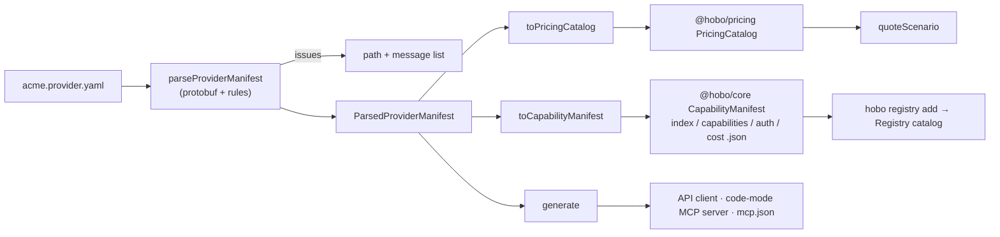
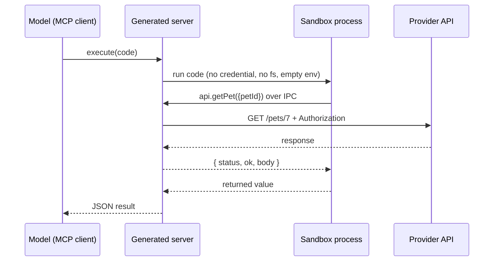

---

type: Design
title: "HoBo Provider Manifest"
description: "One serialized YAML/JSON manifest declares a provider's auth flows, capability mappings, and billing models, and is deserialized into the existing pricing-catalog and capability-manifest types."
status: Accepted
repository: "https://github.com/Hobo-Labs/HoBo"

---

# HoBo Provider Manifest

A provider manifest is a single YAML or JSON document in which a provider — or
anyone in the community — declares four things as data:

1. how to authenticate (OAuth 2.0, [auth.md](../../AUTH.md), OIDC federation, API keys),
2. which provider services realize which HoBo ports,
3. what things cost, in whatever units the provider bills,
4. where its API descriptions and MCP servers are.

`@hobo/provider-manifest` parses it and deserializes it into types that already
exist. No provider package is written and no new runtime type is generated
([ADR-0177](./adr/provider-manifest.md#adr-0177)).



It is the authoring format for the [Capability Manifest](./ai-native-agent-auth.md#plan-06):
the four `/.well-known/capability-manifest/*` documents are an output of it.

## Shape

```yaml
schema: hobo.provider-manifest/v1
provider: { id: acme-cloud, displayName: Acme Cloud }
auth: { issuer: ..., flows: [...] }
capabilities: { regions: [...], mappings: [...] }
billing: { currency: USD, source: {...}, billables: [...], products: [...] }
api: { specs: [...], mcpServers: [...] }
```

Any of the four sections may be omitted; at least one is required. The full
worked example is
[`packages/provider-manifest/examples/acme-cloud.provider.yaml`](../../packages/provider-manifest/examples/acme-cloud.provider.yaml).
The record source is `data-models/provider_manifest.proto`; the document is the
protobuf JSON form of `ProviderManifest`, so field names are camelCase and an
unknown field is an error, not a silently ignored typo.

## Auth flows

```yaml
flows:
  - id: console-oauth
    scopes: [{ name: compute:deploy }]
    oauth2:
      grant: authorization-code
      metadataUrl: https://auth.acme.example.com/.well-known/oauth-authorization-server
  - id: agent-registration
    authMd:
      resource: https://api.acme.example.com
      anonymousRegistration: true
      humanClaim: true
```

| Variant | Published flow type |
|---|---|
| `oauth2` `authorization-code` | `oauth2-authorization-code` (always PKCE S256) |
| `oauth2` `device-code` | `device-code` |
| `oauth2` `token-exchange` | `oauth2-obo` |
| `oauth2` `jwt-bearer` | `oauth2-xaa` |
| `oauth2` `client-credentials` | `oauth2-client-credentials` |
| `authMd` | `auth-md` |
| `oidcFederation` | `oidc-federation` |
| `apiKey` | `api-key` |
| `extension` | the declared `x-…` type, `supported: false` |

An `authMd` flow names only the protected resource. The Protected Resource
Metadata URL and the `auth.md` document URL are derived by `@hobo/auth-md`'s
own discovery helpers, so the manifest and the discovery client cannot drift.

Flows are published in preference order — `oidc-federation`, `oauth2-xaa`,
`oauth2-obo`, `auth-md`, `oauth2-authorization-code`, `device-code`,
`oauth2-client-credentials`, `api-key`, then extensions — extending the keyless
ordering in [§6.1](./ai-native-agent-auth.md#plan-06). Endpoints must be `https`.
A manifest declares endpoints; this package never dereferences them.

## Capability mappings

```yaml
mappings:
  - id: database/postgres
    port: database
    resourceClass: postgres
    providerService: acme.pg.flex
    features: [managed, ha]
    profiles: [data.postgres/v1]
    products: [pg-flex]
```

Each mapping becomes one `capabilities.json` entry and one equivalence class.
`profiles` are parsed with `@hobo/manifest-capability`'s `parseProfileId`;
`products` must name products in the billing section and link the capability to
its pricing-catalog product.

## Billing models

Billing has two layers. **Billables** are the author's vocabulary of things
that can be charged for; **charges** price them.

```yaml
billables:
  - { id: gpu-time,     category: hardware, unit: second }
  - { id: input-tokens, category: ai,       unit: token }
  - { id: workload,     category: ai,       unit: workload }
  - { id: seat,         category: license,  unit: seat, aggregation: max }
  - { id: filament,     category: material, unit: kg, increment: 0.25 }
```

`category`, `unit`, and a product's `kind` are open strings. Adding a new kind
of billable — a material, a licence, a support tier — is a data change.

| What you want to say | Charge |
|---|---|
| Hardware, metered | `metered: { billable: gpu-time, package: { per: 3600, amount: 1.80 } }` |
| Hardware, monthly | `recurring: { interval: monthly, amount: 900.00, per: instance }` |
| AI, token pricing | `metered: { billable: input-tokens, package: { per: 1000000, amount: 3.00 } }` |
| AI, price per workload | `metered: { billable: workload, unitPrice: 0.40 }` |
| AI, monthly subscription | `recurring: { interval: monthly, amount: 30.00, per: seat }` |
| Tiered usage | `metered: { billable: storage, graduated: { tiers: [...] } }` |
| Indivisible units | `package: { per: 0.25, amount: 6.00, whole: true }` |
| Something else entirely | `external: { model: x-spot-auction, params: {...} }` |

A product may offer several plans, so one product can be sold metered *and*
monthly. A charge's `when` map restricts it to workloads with matching
attributes (model, region, tier).

### Lowering to `@hobo/pricing`

| Manifest | Pricing catalog |
|---|---|
| product | `ProviderProduct` `<providerId>/<productId>`; meters from its billables |
| billable | `MeterDefinition` (dimension = id; `increment` → period rounding) |
| plan | `RateCard` `<providerId>/<productId>/<planId>@<version>` |
| `recurring` | `FixedCharge` |
| `metered` | `UsageCharge` (`perUnit`, `package`, `graduated`, `volume`) |
| `when` | charge selectors |

The catalog hash is `catalogHashOf` from `@hobo/pricing`; lowering is
deterministic.

### Fail-closed rules

- Money and quantities are decimal strings. An unquoted YAML number is read
  from its source text, never through a float.
- `billing.source` (`url`, `checkedAt`) is required: transcribed prices are
  ranking input, never billing input, and always say where and when they were
  checked.
- A pro-rata package must divide to an exact per-unit decimal, or declare
  `whole: true`.
- A plan containing an `external` charge is returned as *unrated* and gets no
  rate card; rating it without that charge would under-quote.
- `included` usage is reported as a declared fact. It is not lowered to an
  `AllowanceGrant`, which is tenant state with dated evidence.
- `cost.json` (the legacy single-price ranking input) carries a price only for
  a plan that is exactly one unconditional flat-rate metered charge; otherwise
  `pricingStatus: "unknown"`, which the matcher ranks last.

## API specs and generated clients

```yaml
api:
  specs:
    - { id: pets, format: openapi, path: petstore.openapi.yaml, auth: [console-oauth] }
    - { id: events, format: asyncapi, url: https://acme.example.com/asyncapi.yaml }
  mcpServers:
    - { id: remote, url: https://mcp.acme.example.com/mcp }
```

A spec names its standard — `openapi`, `asyncapi`, `graphql`, `grpc`, or an
`x-…` extension — and exactly one location: a published `url`, or a `path`
beside the manifest (never outside its directory). `auth` lists the flows that
grant access to it. Specs and MCP servers are published under `apis` in
`capabilities.json`.

`hobo-provider-manifest generate <file> <outDir>` reads a manifest **or a bare
OpenAPI document** and writes:

| Output | Condition |
|---|---|
| `<id>.client.ts` — a dependency-free `fetch` client, one method per operation | each OpenAPI 3.0/3.1 spec available as a file |
| `<id>.mcp-server.mjs` — a code-mode MCP server | the provider declares no MCP server of its own, which includes the spec-only case |
| `mcp.json` — MCP client configuration | any MCP server, declared or generated |

Generation is OpenAPI-only today; other formats are declared, published, and
reported as skipped. It makes no network call: a `url`-only spec is not fetched.

### Code mode

A tool per endpoint scales badly: a few hundred operations is a few hundred
tool definitions in context, and every call is a model round trip. The
generated server instead exposes two tools. `search` returns call signatures
for matching operations; `execute` runs model-written JavaScript against an
`api` object with one async method per operation, so a model composes several
calls, loops, and filters results before anything returns to its context.



The containment boundary is deliberate about what it does and does not cover.
Model code runs in a child Node process under the permission model (no
filesystem, child processes, or workers) with an empty environment and a
timeout. It never holds the credential: the parent builds every request from
the operation table, pinned to the configured server. It is **not** a network
sandbox — the child can still open outbound connections, so data the API
returned can be sent elsewhere. Deploy it where that egress is acceptable or
blocked.

## Registration

`hobo registry add <manifest>` parses the manifest, builds a registrable
provider (`providerFromManifest`), and appends `provider.Registered` to the
registry stream. Because a manifest declares capabilities without being able to
provision them, the provider is registered **held** — listed, never matched.
Running the command a second time appends `provider.Approved`. A manifest with
issues, with no capability mappings, or claiming a built-in provider's id is
refused without writing anything.

When the manifest declares billing, the derived `PricingCatalog` is persisted
as a `pricing.CatalogRegistered` fact appended **in the same append** as
`provider.Registered`, so a held provider never exists without the prices it
was ranked on. The fact carries the whole catalog as canonical protobuf-JSON
plus its `catalogHash`; replaying the registry stream rebuilds it with no other
source (`readStoredCatalog` in `@hobo/hobo`). A reader recomputes the hash and
**fails closed** on a body that does not decode or does not match — altered
prices must not rank anything. The wire shape is pinned append-only in
`@hobo/events` (`PRICING_EVENT_CONTRACTS`, golden corpus). `hobo registry`
lists the stored hash on each installed provider.

**Changing prices.** Editing a manifest and running `hobo registry add` again
refreshes what is stored. The catalog hash is compared with the stored one: if
it differs, a new `pricing.CatalogRegistered` fact is appended and supersedes
the old (the old one stays in the stream; facts are never rewritten). The
ranking facts the Planner reads (`cost.json` prices, capability mappings) ride
`provider.Registered`, which is derived from the same manifest, so when the
manifest's digest moved that fact is re-appended **in the same append** — the
stored catalog and the ranking price cannot disagree. Approval is a separate
fact and is **kept**: an approved provider stays approved and is ranked on the
new facts from then on (the result says `updated` and prints the old and new
catalog hash). A held provider is refreshed too, and the second run still is the
approval. An unchanged manifest appends nothing, and a provider registered
before catalogs were stored gets its catalog on the next run.

## Gates

| Gate | What it pins |
|---|---|
| Protobuf (`codegen:check`) | `provider_manifest.proto` ↔ `src/_generated/` |
| CUE (`test:schema`) | vocabularies, formats, one-of rules, against `fixtures/{valid,invalid}` |
| PACT (`test:contract:consumer`) | registry-ingest expectation of the lowered documents and the refusal envelope |
| TypeScript (`test`) | runtime parser agrees with the CUE corpus; every billing model rated by the real kernel |
| Executed generated code (`test`) | the generated client against a local HTTP server; the generated MCP server over stdio, including sandbox refusals |
| `packages/hobo/test/registry-add.test.ts` | held → approved registration, and each refusal, through the composed CLI |

## Scope

Implemented: the schema, parser, lowerings, `hobo registry add`, OpenAPI client
and code-mode MCP server generation, a `check`/`lower`/`generate` CLI, and a
worked example.

Not implemented: signing of the published index; clearing a stored catalog when
a manifest drops its billing section (append-only, and there is no "cleared"
fact yet, so the last catalog stays); consumption of the stored catalog by the
quote engine's financial-state views; generation from AsyncAPI,
GraphQL, or gRPC; schema-typed request and response bodies; and realization —
a data-only provider can be found, authenticated against, ranked, quoted, and
called through its API, but provisioning its resources through HoBo still
requires a `realize()` implementation or a Resource Pack.
