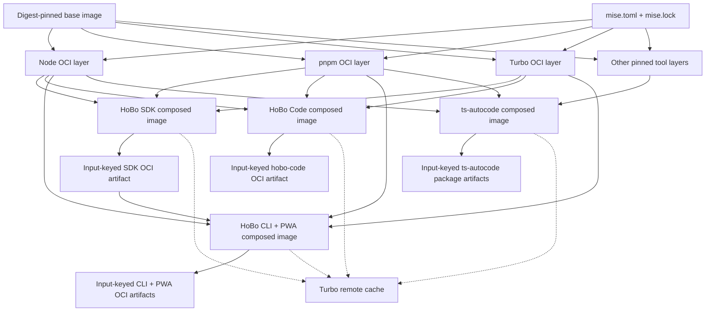

# Release pipelines

Four release pipelines ship independently: **ts-autocode**, **HoBo SDK**, **HoBo Code**, and **HoBo CLI + PWA**. A release in one pipeline neither triggers nor requires a release in another. Versioning, tags, and release approval follow each pipeline's own cadence.

Most release jobs have a **10-minute hard timeout** and a **5-minute target duration**; test shards and publishing jobs use their explicitly documented larger budgets. Jobs use **`runs-on: hobo`** and the hermetic worker image. Every third-party GitHub Action is pinned to a **full commit SHA**; mutable version tags are not sufficient.

`release-hobo` and `release-code` jobs run `pnpm run pins:fetch ts-autocode` after checkout (`submodules: recursive`) and before `pnpm install`, matching HoBo CI's sibling-pin setup.

Pull requests may build and inspect release artifacts, but any npm packaging is **`npm pack --dry-run` only**. PRs never publish, never write to npm, and never receive publish credentials.

PR OCI builds are **affected-only**: [`scripts/ci/release-oci-affected.mts`](../../scripts/ci/release-oci-affected.mts) diffs `origin/main...HEAD` (override with `HOBO_CHECK_BASE`) against each image's Dockerfile, image directory, source inputs, and shared toolchain or workspace inputs, then emits the build matrix. An empty result skips the build job; CLI changes also select the dependent MCP image, with `hobo-cli` ordered before `hobo-mcp`. Image inputs use package dependency cones rather than the broad `packages/` prefix: a `packages/code/**` diff selects only `hobo-code`, never the CLI or SDK images. `release-hobo` manual dispatch retains its full image matrix; `release-code` always restricts its PR matrix to `hobo-code`.

## Hermetic build model

The worker image starts from a **digest-pinned base image**. Pinned `mise.toml` and `mise.lock` inputs produce **one OCI layer per tool** through `mise oci build`. Pipelines compose only the layers they need instead of installing tools during a job or maintaining separate monolithic images.



A tool layer is reusable across **both HoBo and ts-autocode** when the relevant lock inputs match. Matching locks therefore produce cache hits across repository and pipeline boundaries; differing locks select different layers rather than mutating a shared environment.

Each package's OCI artifact is keyed by its complete build inputs, including source, relevant lockfiles, package metadata, and composed tool layers. Turbo remote cache avoids repeating build and test tasks, but it does not replace the input-keyed release artifact: release jobs materialize and verify the artifact selected for the exact release inputs.

The **CLI + PWA pipeline pulls the SDK's OCI artifact**. It never rebuilds the SDK from source. This keeps the SDK boundary explicit and prevents a CLI release from silently publishing or packaging a different SDK build.

## Pipeline responsibilities

| Pipeline | Owns | Release relationship |
|---|---|---|
| ts-autocode | Its publishable packages and package OCI artifacts | Releases on the upstream repository's cadence |
| HoBo SDK | The allowlisted HoBo SDK packages and SDK OCI artifact | Releases independently; supplies the immutable artifact consumed by CLI + PWA |
| HoBo Code | `@hobo/code` / `@hobo-labs/code`, the `hobo-code` binary, and its OCI image | Releases independently on `code-vX.Y.Z`; does not run SDK or CLI releases |
| HoBo CLI + PWA | CLI and PWA artifacts built against a selected SDK artifact | Pulls the SDK artifact; never builds SDK source |

## HoBo Code pipeline

[`.github/workflows/release-code.yml`](../../.github/workflows/release-code.yml) owns the fourth pipeline. Its independent release cadence uses **`code-vX.Y.Z`** tags; the shared **`vX.Y.Z`** CLI/SDK tag does not publish HoBo Code.

- Pull requests trigger only for `packages/code/**`, the `hobo-code` image definition, release manifests and scope mapping, code-related release scripts and contract tests, the workflow and attestation action, or this document. Draft-proof paths under `src/draft/**` are not release inputs.
- Static checks run the npm scope-map and OCI manifest contract tests. Lint is exactly `pnpm --filter @hobo/code lint`.
- A single `code-build-cone` job builds the `@hobo/code...`, `@hobo/hobo...`, and `@hobo/adapter-hono...` cones and uploads their package dist trees; four Vitest shards restore that artifact instead of rebuilding, with **45 minutes per shard**, `HOBO_TURBO_CONCURRENCY=1`, and `fail-fast: false`.
- PR OCI work reuses affected-image selection but filters the matrix to **`hobo-code` only**, builds locally, and never pushes.
- `code-v*` tags and manual dispatch restore the same build artifact, stage `@hobo/code` as **`@hobo-labs/code`** and run `npm pack --dry-run`, then push `hobo-code` to GHCR without rebuilding its dependency cone and attach provenance and SBOM attestations. Manual dispatch is a release operation, not a dry run.

The **SDK and CLI + PWA pipelines do not run HoBo Code tests or lint**. `@hobo/hobo` may still compile against the published `@hobo-labs/code` package at release boundaries without running HoBo Code's 5k+ test suite; that compilation is not a substitute for the independent `release-code` test gate.

## npm publication

Public packages publish under **`@hobo-labs/*`** through the **`hobodev`** npm publisher identity. The source workspace keeps its existing **`@hobo/*`** package names and workspace dependency graph.

[`release/npm-scope-map.json`](../../release/npm-scope-map.json) is the explicit source-to-public package mapping. [`scripts/ci/npm-publish-scope.mts`](../../scripts/ci/npm-publish-scope.mts) applies that mapping to the release manifest **at the publish boundary only**, in the packaging/publish staging area. It must not rewrite checked-in workspace manifests, source imports, or the workspace lockfile. Dry-run packing exercises the same staged manifest transformation without publishing so the inspected tarball matches the public package name and mapped dependencies.

Real publication requires both:

- **`NPM_TOKEN`** for the `hobodev` publisher, supplied only to the protected release job; and
- **GitHub OIDC npm provenance**, using `npm publish --provenance` so the published package links to the source and builder identity.

Missing credentials, an unmapped public package, or a failed pack/provenance precondition fails closed. PR dry runs receive neither token nor OIDC publishing permission.

These pipelines replace **`workflows-disabled/publish.yml`**; implementation must not leave that disabled workflow as a second, divergent publish path.

## GHCR hostable images

Release pipelines publish **composable app images** on top of the same **mise OCI toolchain** as `hobo-ci-worker` (see [`packages/ci-gh-actions/deploy/ci-runner/build.sh`](../../packages/ci-gh-actions/deploy/ci-runner/build.sh)). Image definitions live in [`release/oci-images.json`](../../release/oci-images.json); build entrypoint is [`scripts/ci/build-release-oci-image.mts`](../../scripts/ci/build-release-oci-image.mts).

Release OCI apps are staged on the runner by [`scripts/ci/stage-release-oci-app.mts`](../../scripts/ci/stage-release-oci-app.mts): the host installs the frozen workspace with lifecycle scripts disabled, builds the image's Turbo targets, and materializes production deploys, SDK tarballs, or site output under `deploy/release-images/.staging/<image-id>/`. That staged directory is the Docker build context. Unknown image IDs fail before the staging directory is replaced. Release Dockerfiles are runtime-only and copy staged artifacts; they never run `pnpm install` or Turbo.

| Image | GHCR name | Role |
|---|---|---|
| `hobo-cli` | `ghcr.io/hobo-labs/hobo/hobo-cli` | Product `hobo` binary |
| `hobo-code` | `ghcr.io/hobo-labs/hobo/hobo-code` | HoBo Code harness and `hobo-code` binary |
| `hobo-mcp` | `ghcr.io/hobo-labs/hobo/hobo-mcp` | stdio MCP (`hobo-mcp`) |
| `hobo-codegen` | `ghcr.io/hobo-labs/hobo/hobo-codegen` | `@hobo/schema-tools` codegen CLI |
| `hobo-ci-serve` | `ghcr.io/hobo-labs/hobo/hobo-ci-serve` | CI relay (`/readyz` on 8787) |
| `hobo-site` | `ghcr.io/hobo-labs/hobo/hobo-site` | Astro docs/PWA static server |
| `hobo-sdk` | `ghcr.io/hobo-labs/hobo/hobo-sdk` | Allowlisted SDK tarball layer (CLI/PWA consume **by digest**) |

**ts-autocode** images publish under **`ghcr.io/tyler-r-kendrick/...`** until the upstream repo moves into `hobo-labs` (same contract tests and mise-layer model).

### Image config requirements

Each Dockerfile sets:

- **`USER 1000:1000`**, **`WORKDIR`**, **`ENTRYPOINT`/`CMD`**, documented **`ENV`** (see manifest `envDoc`)
- **`EXPOSE` + `HEALTHCHECK`** for servers (`hobo-ci-serve`, `hobo-site`; non-server images omit them)
- **`VOLUME`** for mutable state (`.hobo`, relay SQLite, `/work`, `/sdk/out`)
- OCI labels: `org.opencontainers.image.source`, `version`, `revision`, `licenses`, plus `io.hobo.release.*`

Multi-arch builds are **native-only** on `hobo` runners (amd64 or arm64 per box); no QEMU matrix unless a future runner pool adds it for free.

### Tags, digests, and pipeline references

- CLI/SDK release tags: **`vX.Y.Z`** semver on git tag → image tag `vX.Y.Z` **and** immutable **`@sha256:…`** digest.
- HoBo Code release tags: **`code-vX.Y.Z`** → `hobo-code:code-vX.Y.Z` and an immutable digest, independent of CLI/SDK tags.
- Downstream pipelines (CLI + PWA) **pin the SDK image by digest**, never `:latest`.
- PR workflows **build + contract-test** images locally; they **do not push** to GHCR.
- Tag/`workflow_dispatch` releases push with **`GITHUB_TOKEN`** (`packages: write`); no new secrets.

### Signing, SBOM, and provenance

- **GitHub artifact attestations** (keyless, no cosign secret): `actions/attest-build-provenance` + `actions/attest-sbom` after push, one attestation per image digest (pinned SHAs in [`.github/workflows/release-hobo.yml`](../../.github/workflows/release-hobo.yml) and [`.github/workflows/release-code.yml`](../../.github/workflows/release-code.yml)).
- npm packages continue to use **`npm publish --provenance`** (OIDC) on the same release train.

### Contract tests

[`scripts/test/release-oci-image-contract.test.ts`](../../scripts/test/release-oci-image-contract.test.ts) validates:

1. Manifest + Dockerfile presence (always), including the explicit `hobo-code` entrypoint, state volume, and environment documentation
2. **`docker inspect`** config vs expected `USER`, `WORKDIR`, `ENTRYPOINT`, `EXPOSE`, `VOLUME`, labels when **`HOBO_RELEASE_OCI_CONTRACT=live`**
3. The declared help/version probe inside the candidate container as non-root

Local:

```bash
pnpm exec vitest run scripts/test/release-oci-image-contract.test.ts scripts/test/stage-release-oci-app.test.ts
bash packages/ci-gh-actions/deploy/ci-runner/build.sh
node --no-warnings scripts/ci/build-release-oci-image.mts hobo-cli
HOBO_RELEASE_OCI_CONTRACT=live HOBO_RELEASE_OCI_IMAGE_ID=hobo-cli pnpm exec vitest run scripts/test/release-oci-image-contract.test.ts
```

Set `HOBO_RELEASE_OCI_IMAGE_ID` to each built image id, or omit it after building every manifest image to run all live contracts in one invocation. `HOBO_RELEASE_VERSION` and `HOBO_RELEASE_REVISION` must match the candidate build when supplied.

## ts-autocode upstream migration

Upstream [`Tyler-R-Kendrick/ts-autocode`](https://github.com/Tyler-R-Kendrick/ts-autocode) currently uses **`setup-node` + `npm ci`** and has no mise-based toolchain. Its target release model is:

1. Add pinned **`mise.toml` + `mise.lock`** inputs.
2. Run CI and release jobs on **`runs-on: hobo`** with the same digest-pinned, mise-layered worker-image model as HoBo.
3. Remove **`setup-node`** and **Corepack** setup from those jobs; tools come from the composed image, not runtime installation.
4. Publish its packages under **`@hobo-labs/*`** with the same scoped-publish and provenance rules.
5. Keep HoBo consumption through the pinned **git submodule sparse cone**, not through a source rebuild in the CLI pipeline or an unpinned upstream checkout.

The sparse cone remains limited to the workspace members declared by HoBo's sibling-pin configuration. Publishing upstream packages does not change HoBo's source-consumption boundary by itself.

## Related references

- [npm publish allowlist](../design/npm-publish-allowlist.md)
- [0018: npm publish path — release engineering design](../plans/0018-npm-publish-design.md)
- [HoBo runner queue troubleshooting](../../packages/ci/RUNNER-QUEUE.md)
