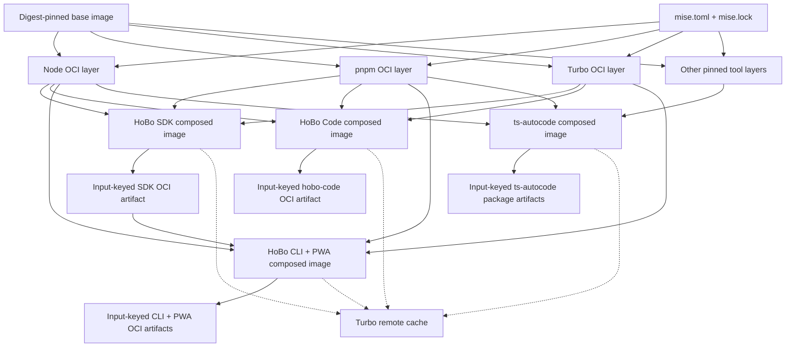

# Release pipelines

Four release pipelines ship independently: **ts-autocode**, **HoBo SDK**, **HoBo Code**, and **HoBo CLI + PWA**. A release in one pipeline neither triggers nor requires a release in another. Versioning, tags, and release approval follow each pipeline's own cadence.

Most release jobs have a **10-minute hard timeout** and a **5-minute target duration**; the pull-request jobs that build images or run the HoBo Code suite, and the publishing jobs, use their explicitly documented larger budgets (for example **30 minutes** for `release-hobo` / `release-contract` and **45 minutes** for `release-code` / `code-release`). Jobs use **`runs-on: hobo`** and the hermetic worker image. Every third-party GitHub Action is pinned to a **full commit SHA**; mutable version tags are not sufficient.

`release-hobo` and `release-code` jobs run `pnpm run pins:fetch ts-autocode` after checkout (`submodules: recursive`) and before `pnpm install`, matching HoBo CI's sibling-pin setup. `release-hobo` also listens on **`merge_group`** (same path filters as pull requests) so merge-queue checks run the contract job; checkout steps must not duplicate YAML keys under `actions/checkout` `with:` (GitHub rejects the workflow with zero jobs). **`pnpm run actions:lint`** parses every enabled workflow with strict YAML (`uniqueKeys`) so duplicate job-level keys (for example two `env:` maps) fail in CI before GitHub does. Sparse release checkouts use **`.github/actions/hobo-checkout`** (blob:none cone) and **`pins:fetch`** instead of `submodules: recursive` on checkout, which avoids promisor fetch failures during tag releases. CI and the deps image export **`SOURCE_DATE_EPOCH` as Unix seconds**; `@hobo/componentize` accepts seconds or ISO timestamps before determinism guards run.

Pull requests may build and inspect release artifacts, but any npm packaging is **`npm pack --dry-run` only**. PRs never publish, never write to npm, and never receive publish credentials. For npm staging, a PR `HOBO_RELEASE_VERSION=pr-N` maps to the valid semver `0.0.0-pr.N`; strict release-tag parsing still rejects `pr-*` refs.

PR OCI builds are **affected-only, keyed by build inputs**: [`scripts/ci/release-oci-affected.mts`](../../scripts/ci/release-oci-affected.mts) hashes an input key for every manifest image from the git trees of the merge base (`HOBO_CHECK_BASE`, default `origin/main`) and of HEAD, and prints the images whose key changed. The detector uses scoped `releaseInputGitTree` pathspecs (not full-repo `ls-tree`), reads each blob batch through one `git archive` pack transfer instead of lazy per-blob promisor fetches, memoizes trees/`parseLockfile`, and indexes package blobs only within each image's lockfile closure (see [`scripts/test/release-oci-affected.test.ts`](../../scripts/test/release-oci-affected.test.ts)). The key covers:

- the image's Dockerfile directory and manifest entry, plus the manifest's top-level fields;
- the release build scripts (`build-release-oci-image.mts`, `stage-release-oci-app.mts`, `stage-sdk-artifacts.mts`, the contract libraries), `tsconfig.base.json`, `pnpm-workspace.yaml` and `.npmrc`;
- the worker toolchain the Dockerfiles build `FROM`: `mise.toml`, `mise.lock` and `packages/ci-gh-actions/deploy/ci-runner/`;
- the **Turbo build inputs** of every workspace package in the image's `pnpm-lock.yaml` importer closure (the root importer included, since packages build with its `tsc`), filtered by `turbo.json`'s `build` task inputs or the package's own `<name>#build` override, so tests, Markdown and contracts never rebuild an image; a closure package inside a submodule is keyed by the submodule commit;
- the **lockfile slice** that closure resolves: its importer blocks and every snapshot and package entry they reach, plus the lockfile settings. A dependency bump rebuilds only the images that ship it;
- the root `package.json` fields pnpm reads (`packageManager`, `pnpm`, `engines`) and the `turbo.json` build fields, so a script or test-task edit rebuilds nothing;
- inputs the lockfile graph cannot see, listed per image: the SDK's scope map and publish script, and the site's `examples/try-site/`, `examples/browser-runtime/`, `packages/runtime/` and `packages/runtimes/runtime-wasm/`, which it reads by path;
- for `hobo-mcp`, the key of `hobo-cli`, which it is built `FROM`.

An image whose package is not a lockfile importer fails the detector rather than being skipped. `--explain` prints which group changed per image; `--only=` and `--exclude=` filter the result, and `--all` selects every image for manual dispatch. `release-code` builds only `hobo-code` and `release-hobo` excludes it, so no image is built twice for one PR. `@hobo/hobo` depends on `@hobo/code` at runtime, so a `packages/code/**` change does select `hobo-cli` and `hobo-mcp` when `release-hobo` runs. Its PR trigger paths still cover release, toolchain and root inputs only, not package sources.

### One job per pull request, per pipeline

The box has two `hobo` slots, and every job pays its own checkout (about 70 s against GitHub's git endpoint) and install (20 to 40 s) before it does any work, then waits for a slot. A PR that touched both pipelines used to queue 13 jobs, among them four Vitest shards of 13 to 18 s of tests each and one job per image. So each pipeline now runs **one PR job**:

- `release-hobo` / `release-contract` (30 minutes) runs the contract tests and the npm pack dry run, selects the affected images other than `hobo-code`, then builds them one after another through the Turbo cache, checking each with the live OCI config contract. A failing image does not stop the others; the job fails at the end and names them.
- `release-code` / `code-release` (45 minutes) runs the contract tests, lint, the whole `@hobo/code` suite through `turbo run test --filter=@hobo/code`, and the `hobo-code` image build when its inputs changed. The test step has a 20-minute hard timeout (`timeout -k 30s 20m`), Vitest `testTimeout` / `hookTimeout` default to two minutes per test (`HOBO_TEST_TIMEOUT`), and the package teardown kills tracked subprocess groups plus orphaned `evidence-sidecar-main.js` workers whose `HOBO_HOME` dir is already gone so a hung PTY or sidecar cannot hold a runner for 14+ minutes.

Both diff the PR merge commit against `HEAD^1`, its base tip, so the checkout needs `fetch-depth: 2` instead of the full history. OCI staging combines the SCM-affected Turbo filter `--filter=...[HEAD^1...HEAD]` (changed packages plus dependents) with each requested image's build filter and dependency cone. The image filter keeps an unchanged image package scheduled so Turbo cache hits restore its required `dist` output without rebuilding the full repository; tag and local builds without a resolved base use only the image filters. The affected-image allowlist also prevents staging an image the workflow did not select. A PR that edits a pipeline's own workflow builds every image that pipeline owns, because the workflow is how they are built.

## Hermetic build model

The worker image starts from a **digest-pinned base image**. Pinned `mise.toml` and `mise.lock` inputs produce **one OCI layer per tool** through `mise --locked oci build`. Pipelines compose only the layers they need instead of maintaining separate monolithic images. Healthy jobs perform no tool installation; preflight can repair an older image by installing only missing tools from the checkout's lockfile before enforcing the contract.



A tool layer is reusable across **both HoBo and ts-autocode** when the relevant lock inputs match. Matching locks therefore produce cache hits across repository and pipeline boundaries; differing locks select different layers rather than mutating a shared environment.

Each package's OCI artifact is keyed by its complete build inputs, including source, relevant lockfiles, package metadata, and composed tool layers. Turbo remote cache avoids repeating build and test tasks, but it does not replace the input-keyed release artifact: release jobs materialize and verify the artifact selected for the exact release inputs.

The **CLI + PWA pipeline pulls the SDK's OCI artifact**. It never rebuilds the SDK from source. This keeps the SDK boundary explicit and prevents a CLI release from silently publishing or packaging a different SDK build.

## Pipeline responsibilities

| Pipeline | Owns | Release relationship |
|---|---|---|
| ts-autocode | Its publishable packages and package OCI artifacts | Releases on the upstream repository's cadence |
| HoBo SDK | The allowlisted HoBo SDK packages and SDK OCI artifact | Releases independently; supplies the immutable artifact consumed by CLI + PWA |
| HoBo Code | `@hobo/code` / `@hobo-labs/code`, the `hobo-code` binary, and its OCI image | Releases independently on `code-vX.Y.Z`; does not run SDK or CLI releases |
| HoBo CLI + PWA | CLI and PWA artifacts built against a selected SDK artifact | Pulls the SDK artifact; never builds SDK source |

## HoBo Code pipeline

[`.github/workflows/release-code.yml`](../../.github/workflows/release-code.yml) owns the fourth pipeline. Its independent release cadence uses **`code-vX.Y.Z`** tags; the shared **`vX.Y.Z`** CLI/SDK tag does not publish HoBo Code.

- Pull requests trigger only for `packages/code/**`, the `hobo-code` image definition, release manifests and scope mapping, code-related release scripts and contract tests, the workflow and attestation action, or this document. Draft-proof paths under `src/draft/**` are not release inputs.
- Sparse checkout cones are canonical in [`scripts/lib/release-sparse-cone.mts`](../../scripts/lib/release-sparse-cone.mts); [`scripts/test/release-sparse-cone.test.ts`](../../scripts/test/release-sparse-cone.test.ts) fails when a workflow cone omits root vitest setup files (`test/setup/`), pins inputs (`tools/pins/siblings.json`), OCI contract paths derived from `release/oci-images.json` and the release contract vitest suite, or directory cones from `releaseOciInputSparseCones()` required by the OCI detector's scoped git reads. HoBo Code sparse jobs use the full `deploy/` cone, not only `hobo-code`.
- Release workflow `pull_request` path filters include runner contract scripts (`scripts/lib/ci-runner-contract.mts`, `scripts/ci-runner-preflight.mts`, `.github/actions/ci-runner-preflight/`) so preflight fixes re-run the static contract jobs.
- Changed shell scripts in release/CI paths must pass `bash -n` and `shellcheck` via `pnpm run lint:shell:changed` (shellcheck is pinned in `mise.lock` and invoked with `mise exec`, not the host PATH; release contract preflight runs `mise install` before the runner contract). Sparse PR checkouts use `fetch-depth: 2` and diff shell changes with `--base=HEAD^1` (the merge base tip already in the clone), not `origin/main`. The HoBo CI Fabric `CI runner image (mise oci)` job runs `ci-runner-preflight`, then `pnpm-store` + root `pnpm install --ignore-scripts` (the checkout has no ts-autocode submodule), then `lint:shell:changed --base=HEAD~1` before `build.sh`.
- One `code-release` job runs the npm scope-map and OCI manifest contract tests, then lint, which is exactly `pnpm --filter @hobo/code lint`.
- The same job runs the whole suite unsharded as `turbo run test --filter=@hobo/code` with `HOBO_TURBO_CONCURRENCY=1` and a **45-minute** budget. `@hobo/code#test` depends on its own build and on `@hobo/hobo#build` and `@hobo/adapter-hono#build`, so Turbo builds that cone first and replays it, and an unchanged suite, from cache. Outside pull requests it then packs dist trees from every pnpm workspace member, including the sibling `external/ts-autocode` packages, for the publish job.
- PR OCI work runs `release-oci-affected.mts --only=hobo-code`, builds the image locally from the cone already built, and never pushes.
- `code-v*` tags and manual dispatch restore the same build artifact, stage `@hobo/code` as **`@hobo-labs/code`** and run `npm pack --dry-run`, then push `hobo-code` to GHCR without rebuilding its dependency cone and attach provenance and SBOM attestations. Manual dispatch is a release operation, not a dry run.

The **SDK and CLI + PWA pipelines do not run HoBo Code tests or lint**. `@hobo/hobo` may still compile against the published `@hobo-labs/code` package at release boundaries without running HoBo Code's 5k+ test suite; that compilation is not a substitute for the independent `release-code` test gate.

## npm publication

Public packages publish under **`@hobo-labs/*`** through the **`hobodev`** npm publisher identity. The source workspace keeps its existing **`@hobo/*`** package names and workspace dependency graph.

[`release/npm-scope-map.json`](../../release/npm-scope-map.json) is the explicit source-to-public package mapping. [`scripts/ci/npm-publish-scope.mts`](../../scripts/ci/npm-publish-scope.mts) applies that mapping to the release manifest **at the publish boundary only**, in the packaging/publish staging area. It must not rewrite checked-in workspace manifests, source imports, or the workspace lockfile. Dry-run packing exercises the same staged manifest transformation without publishing so the inspected tarball matches the public package name and mapped dependencies.

Real publication requires both:

- **`NPM_TOKEN`** for the `hobodev` publisher, supplied only to the protected release job; and
- **GitHub OIDC npm provenance**, using `npm publish --provenance` so the published package links to the source and builder identity.

Missing credentials, an unmapped public package, or a failed pack/provenance precondition fails closed. PR dry runs receive neither token nor OIDC publishing permission.

These pipelines replace **`workflows-disabled/publish.yml`**; implementation must not leave that disabled workflow as a second, divergent publish path.

## GHCR hostable images

Release pipelines publish **composable app images** on top of the same **mise OCI toolchain** as `hobo-ci-worker` (see [`packages/ci-gh-actions/deploy/ci-runner/build.sh`](../../packages/ci-gh-actions/deploy/ci-runner/build.sh)). Image definitions live in [`release/oci-images.json`](../../release/oci-images.json); build entrypoint is [`scripts/ci/build-release-oci-image.mts`](../../scripts/ci/build-release-oci-image.mts).

Release OCI apps are staged on the runner by [`scripts/ci/stage-release-oci-app.mts`](../../scripts/ci/stage-release-oci-app.mts): the host installs the frozen workspace with lifecycle scripts disabled, builds the image's Turbo targets, and materializes production deploys, SDK tarballs, or site output under `deploy/release-images/.staging/<image-id>/`, or under the configured pnpm store when it is on the same device. The selected staged directory is the Docker build context. OCI builds are serialized on self-hosted runners, staging uses a deploy-only `.dockerignore` context, and Dockerfiles never recursively chown deployed `node_modules` trees. Unknown image IDs fail before the staging directory is replaced. Release Dockerfiles are runtime-only and copy staged artifacts; they never run `pnpm install` or Turbo.

Release run 41724528781 hit ENOSPC while `hobo-cli` deploy copied both Copilot Linux architecture packages across filesystems; skip-build staging measured **2.0 GiB and 64,367 files** before the fix. Every deploy stage now passes `--cpu=current --os=current --libc=current`, retaining only build-host-native optional packages while preserving the production, offline deploy. The same x64 staging measured **1.5 GiB and 64,150 files** afterward (809 packages instead of 817), with only x64 Copilot present; an explicit arm64 control retained only the arm64 package. With `npm_config_store_dir` set, staging also verifies a same-device store directory, stages beneath `<store>/.hobo-release-staging/<image-id>/<run-id>/` with `--config.package-import-method=hardlink`, and records the exact run directory for repeated cleanup; otherwise it keeps in-repo staging and pnpm's default import method. Local `df --output=used` measurements grew by **1,709,732 KiB with copy** versus **56,120 KiB with hardlinks** (96.7% less new disk usage). Wrappers and `.dockerignore` are newly created files, never in-place modifications of deployed hardlinks.

| Image | GHCR name | Role |
|---|---|---|
| `hobo-cli` | `ghcr.io/hobo-labs/hobo/hobo-cli` | Product `hobo` binary |
| `hobo-code` | `ghcr.io/hobo-labs/hobo/hobo-code` | HoBo Code harness and `hobo-code` binary |
| `hobo-mcp` | `ghcr.io/hobo-labs/hobo/hobo-mcp` | stdio MCP (`hobo-mcp`) |
| `hobo-codegen` | `ghcr.io/hobo-labs/hobo/hobo-codegen` | `@hobo/schema-tools` codegen CLI |
| `hobo-ci-serve` | `ghcr.io/hobo-labs/hobo/hobo-ci-serve` | CI relay (`/readyz` on 8787) |
| `hobo-site` | `ghcr.io/hobo-labs/hobo/hobo-site` | Astro docs/PWA static server |
| `hobo-sdk` | `ghcr.io/hobo-labs/hobo/hobo-sdk` | Allowlisted SDK tarball layer (CLI/PWA consume **by digest**) |

**ts-autocode** images publish under **`ghcr.io/tyler-r-kendrick/...`** until the upstream repo moves into `hobo-labs` (same contract tests and mise-layer model).

### Image config requirements

Each Dockerfile sets:

- **`USER 1000:1000`**, **`WORKDIR`**, **`ENTRYPOINT`/`CMD`**, documented **`ENV`** (see manifest `envDoc`)
- **`EXPOSE` + `HEALTHCHECK`** for servers (`hobo-ci-serve`, `hobo-site`; non-server images omit them)
- **`VOLUME`** for mutable state (`.hobo`, relay SQLite, `/work/out`, `/sdk/out`)
- OCI labels: `org.opencontainers.image.source`, `version`, `revision`, `licenses`, plus `io.hobo.release.*`

Multi-arch builds are **native-only** on `hobo` runners (amd64 or arm64 per box); no QEMU matrix unless a future runner pool adds it for free.

### Tags, digests, and pipeline references

- CLI/SDK release tags: **`vX.Y.Z`** or semver prereleases such as **`v0.0.0-alpha.0`** on the git tag → GHCR image tag equals the tag (e.g. `v0.0.0-alpha.0`) **and** immutable **`@sha256:…`** digest. Prerelease images **never** receive a `:latest` tag. Independent trains use **`sdk-v…`** (npm SDK + `hobo-sdk` GHCR) and **`cli-v…`** (`hobo-cli` + `hobo-mcp` GHCR; CLI staging consumes the SDK OCI artifact by digest, not a source rebuild). Semver parsing and train selection live in [`scripts/lib/release-version.mts`](../../scripts/lib/release-version.mts) (`resolve-release-version.mts` in CI).
- npm: prerelease semver (e.g. `0.0.0-alpha.0` derived from the tag) publishes with **`npm publish --tag <prerelease-id>`** (`alpha` for `-alpha.0`), so **`latest`** stays reserved for stable `vX.Y.Z` releases without a prerelease segment. Staged `@hobo-labs/*` tarballs take their **`version`** field from `HOBO_RELEASE_SEMVER` / the parsed tag, not the workspace `0.0.1` dev versions.
- HoBo Code release tags: **`code-vX.Y.Z`** → `hobo-code:code-vX.Y.Z` and an immutable digest, independent of CLI/SDK tags.
- **`vX.Y.Z`** also runs the **`release-pages`** job (Astro `site/` → `gh-pages` branch via SHA-pinned `peaceiris/actions-gh-pages@4f9cc6602d3f66b9c108549d475ec49e8ef4d45e`, v4.0.0) and **`release-github`** (annotated GitHub Release with **`--prerelease`** when the semver carries a prerelease id). Tag/workflow_dispatch OCI staging shallow-fetches **`origin/main`** when present; otherwise it builds the full importer closure with no Turbo affected base. Sparse checkouts retry partial-clone fetches over HTTP/1.1.
- Downstream pipelines (CLI + PWA) **pin the SDK image by digest**, never `:latest`.
- PR workflows **build + contract-test** images locally; they **do not push** to GHCR.
- Tag/`workflow_dispatch` releases push with **`GITHUB_TOKEN`** (`packages: write`); no new secrets.

### Signing, SBOM, and provenance

- **GitHub artifact attestations** (keyless, no cosign secret): `actions/attest-build-provenance` + `actions/attest-sbom` after push, one attestation per image digest (pinned SHAs in [`.github/workflows/release-hobo.yml`](../../.github/workflows/release-hobo.yml) and [`.github/workflows/release-code.yml`](../../.github/workflows/release-code.yml)).
- npm packages continue to use **`npm publish --provenance`** (OIDC) on the same release train.

### Contract tests

[`scripts/test/release-oci-image-contract.test.ts`](../../scripts/test/release-oci-image-contract.test.ts) and [`scripts/test/release-version.test.ts`](../../scripts/test/release-version.test.ts) validate:

1. Manifest + Dockerfile presence (always), including the explicit `hobo-code` entrypoint, state volume, and environment documentation
2. Release ref parsing, npm dist-tag selection, and GHCR tag rules (no `:latest` on prereleases)
3. **`docker inspect`** config vs expected `USER`, `WORKDIR`, `ENTRYPOINT`, `EXPOSE`, `VOLUME`, labels when **`HOBO_RELEASE_OCI_CONTRACT=live`**
4. The declared help/version probe inside the candidate container as non-root

Local:

```bash
pnpm exec vitest run scripts/test/release-oci-image-contract.test.ts scripts/test/release-version.test.ts scripts/test/stage-release-oci-app.test.ts
bash packages/ci-gh-actions/deploy/ci-runner/build.sh
node --no-warnings scripts/ci/build-release-oci-image.mts hobo-cli --keep-candidate
HOBO_RELEASE_OCI_CONTRACT=live HOBO_RELEASE_OCI_IMAGE_ID=hobo-cli pnpm exec vitest run scripts/test/release-oci-image-contract.test.ts
node --no-warnings scripts/ci/build-release-oci-image.mts hobo-cli --cleanup-only
```

Set `HOBO_RELEASE_OCI_IMAGE_ID` to each built image id, or omit it after building every manifest image to run all live contracts in one invocation. `HOBO_RELEASE_VERSION` and `HOBO_RELEASE_REVISION` must match the candidate build when supplied.

[`release-ts-autocode.yml`](../../.github/workflows/release-ts-autocode.yml) verifies the pinned ts-autocode sparse cone on **`ts-autocode-v*.*.*`** tags (npm pack dry-run only; upstream owns publication). Its sparse checkout includes the HoBo **`packages/`** cone so root `pnpm install` can link `ts-autocode-grounding` into `@hobo/runtime` after `pnpm run pins:fetch ts-autocode`; contract tests in [`scripts/test/release-sparse-cone.test.ts`](../../scripts/test/release-sparse-cone.test.ts) gate the cone and step order.

## ts-autocode upstream migration

Upstream [`Tyler-R-Kendrick/ts-autocode`](https://github.com/Tyler-R-Kendrick/ts-autocode) currently uses **`setup-node` + `npm ci`** and has no mise-based toolchain. Its target release model is:

1. Add pinned **`mise.toml` + `mise.lock`** inputs.
2. Run CI and release jobs on **`runs-on: hobo`** with the same digest-pinned, mise-layered worker-image model as HoBo.
3. Remove **`setup-node`** and **Corepack** setup from those jobs; tools come from the composed image, not runtime installation.
4. Publish its packages under **`@hobo-labs/*`** with the same scoped-publish and provenance rules.
5. Keep HoBo consumption through the pinned **git submodule sparse cone**, not through a source rebuild in the CLI pipeline or an unpinned upstream checkout.

The sparse cone remains limited to the workspace members declared by HoBo's sibling-pin configuration. Publishing upstream packages does not change HoBo's source-consumption boundary by itself.

## Related references

- [npm publish allowlist](../design/npm-publish-allowlist.md)
- [0018: npm publish path — release engineering design](../plans/0018-npm-publish-design.md)
- [HoBo runner queue troubleshooting](../../packages/ci/RUNNER-QUEUE.md)
