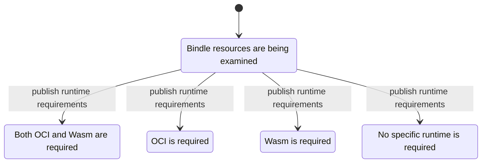

# HoBo state machines and verification

This is a **partial** verification record, not a claim that the framework is fully modeled or proved. Each skill below identifies the covered code, review baseline, executable checks, formal properties, assumptions, and known gaps. The [candidate inventory](./state-machine-candidates.md) is a historical lexical audit queue, not an exhaustive list of state machines or a list of verified behavior.

| Subsystem | Maintained verification | Main checked properties |
| --- | --- | --- |
| Shared budget policy | [verify-shared-budget-policy](../.agents/skills/verify-shared-budget-policy/SKILL.md) | Scope, windows, monetary and metric limits, native-bound labels, and policy constraint shapes. |
| Dispatcher budget-policy routing | [verify-budget-policy-routing](../.agents/skills/verify-budget-policy-routing/SKILL.md) | Admission and settlement preserve modeled available budget; imported consumption is bounded, holds use the selected category, estimate-aware selection can choose a funded alternative, new tie ordering is locale-independent, recognizable inconsistent history stops combined admission, and exhausted sequence fences refuse mutations without partial expiry. |
| Pricing financial sources | [verify-pricing-credit-order](../.agents/skills/verify-pricing-credit-order/SKILL.md) | New quotes reject duplicate, foreign, unscoped, negative or over-capacity sources and inconsistent basis in the checked scenarios; monetary commitment consumption uses currency units, and equal-priority credit ordering is locale-independent. Earlier replay preserves legacy behavior. |
| Pricing UTC validity | [verify-pricing-time](../.agents/skills/verify-pricing-time/SKILL.md) | Current quote evidence and priority checks use exact UTC ordering, reject invalid calendar dates, and reject conflicting values at the same latest instant in the checked cases. |
| Pricing workload selectors and tiers | [verify-pricing-selectors](../.agents/skills/verify-pricing-selectors/SKILL.md) | Checked workloads use their matching charge groups; mismatched products, unknown meters, duplicate identities and invalid tier ranges reject instead of producing a misleading quote. |
| Pricing completeness and dispatch | [verify-pricing-eligibility](../.agents/skills/verify-pricing-eligibility/SKILL.md) | Partial showback remains ineligible and dispatcher v2 requires explicit quote eligibility in the checked cases. |
| Broker whole-quote routing | [verify-broker-whole-quote-routing](../.agents/skills/verify-broker-whole-quote-routing/SKILL.md) | Bounded complete-quote ranking, safe billing fallback and pricing authority rechecks hold in the modeled cases. |
| Yard residual placement | [verify-yard-residual-placement](../.agents/skills/verify-yard-residual-placement/SKILL.md) | Full capability, supported region, provider, stable catalog evidence and exact marginal-price ordering hold in the checked cases. |
| Yard resource binding | [verify-yard-resource-binding](../.agents/skills/verify-yard-resource-binding/SKILL.md) | Unique resource identities retain their exact selected definitions and the caller's resource snapshot in the checked cases. |
| Yard Camp binding | [verify-yard-camp-binding](../.agents/skills/verify-yard-camp-binding/SKILL.md) | Camp environment and identity survive parsing; a Camp outside the planned or selected Yard is refused before quoting, generation and placement in the checked cases. |
| Embedded HoBo Camp handoff | [verify-hobo-embedded-camp-binding](../.agents/skills/verify-hobo-embedded-camp-binding/SKILL.md) | The original Camp is sent to the broker; success returns its approved Camp and rejection reports the original request in the checked cases. |
| Yard request wire binding | [verify-yard-request-wire](../.agents/skills/verify-yard-request-wire/SKILL.md) | Complete request fields and digest survive the checked protobuf round trip; invalid, unsupported or internally inconsistent snapshots are refused in the modeled cases. |
| Yard request validation | [verify-yard-request-validation](../.agents/skills/verify-yard-request-validation/SKILL.md) | Malformed placement restrictions and missing or invalid estimates are refused before host authorization in the checked cases. |
| Yard JSON constraints | [verify-yard-json-constraints](../.agents/skills/verify-yard-json-constraints/SKILL.md) | Special JSON keys survive parsing and wire encoding; captured nested arrays stay immutable, and structured values match by content in the checked cases. |
| Yard residency validation | [verify-yard-residency-validation](../.agents/skills/verify-yard-residency-validation/SKILL.md) | Invalid jurisdiction and classification tags cannot become eligible solely because a Yard repeats them, or reach a generation hold or provider effect through the deployment path. |
| Yard funded admission | [verify-yard-funded-admission](../.agents/skills/verify-yard-funded-admission/SKILL.md) | Policy proof binds quote content, and Yard quotes bind selected work and generation plan; authority and freshness fences retain and reconcile covered exposure. |
| Yard generation authority | [verify-yard-generation-authority](../.agents/skills/verify-yard-generation-authority/SKILL.md) | Current policy, runtime and connector evidence gate generation; the approved callable is pinned and covered post-effect changes retain exposure. |
| Yard local hosting | [verify-yard-local-hosting](../.agents/skills/verify-yard-local-hosting/SKILL.md) | Local placement requires bound host policy and zero-liability proof, current context and local runtime requirements; generation needs separate funding in the checked cases. |
| Bindle runtime inference | [verify-bindles-runtime-inference](../.agents/skills/verify-bindles-runtime-inference/SKILL.md) | Declared and actual dependency runtimes survive inference; ordinary handlers do not invent an OCI or Wasm requirement in the checked cases. |
| HoBo budget fallback | [verify-hobo-budget-fallback](../.agents/skills/verify-hobo-budget-fallback/SKILL.md) | A required budget prevents local startup or preview after a Yard stub; runtime and flag changes are rechecked before the handoff. |
| HoBo local work binding | [verify-hobo-local-work-binding](../.agents/skills/verify-hobo-local-work-binding/SKILL.md) | Local placement, in-process serving and the persistent worker use the verified content-addressed copy whose digest the Yard approved in the checked cases. |
| Broker catalog ordering | [verify-broker-catalog-ordering](../.agents/skills/verify-broker-catalog-ordering/SKILL.md) | Legacy estimate mode validates catalog prices, compares matching units exactly, and breaks ties deterministically in the checked cases. |
| Broker resolution signatures | [verify-broker-resolution-signature](../.agents/skills/verify-broker-resolution-signature/SKILL.md) | Signature verification requires an enrolled matching key and digest; signing emits public key material only and uses stable ordering. |
| Broker delivery and resolution claims | [verify-broker-delivery-claim](../.agents/skills/verify-broker-delivery-claim/SKILL.md) | A single broker instance admits one receipt per request and dispatches a matching, current receipt at most once; uncertain submissions stay claimed. |
| Broker quote-backed admission | [verify-broker-quote-admission](../.agents/skills/verify-broker-quote-admission/SKILL.md) | Selected work receives an attested liability, policy and billing see that bound, and quote, environment, catalog and hold checks precede receipt issuance in the modeled path. |
| Broker quote provenance | [verify-broker-quote-provenance](../.agents/skills/verify-broker-quote-provenance/SKILL.md) | A trusted host attests quote provenance and an upper liability bound; raw estimates require explicit trust in the checked helper. |
| Broker budget authority | [verify-broker-budget-authority](../.agents/skills/verify-broker-budget-authority/SKILL.md) | Quote authorization checks eligibility and exact bounds; holds account for liabilities; claimed work retains funding; signed settlement requires bound receiver and finance evidence. |
| Hosting evidence time | [verify-hosting-evidence-time](../.agents/skills/verify-hosting-evidence-time/SKILL.md) | Quote, snapshot and HoBo bridge freshness and financial observation fences compare valid instants exactly, including offsets and fractional seconds. |
| Broker billing preflight | [verify-broker-metered-billing](../.agents/skills/verify-broker-metered-billing/SKILL.md) | Default and metered planes retain outstanding estimates; exact decimal charges and holds count toward admission, and changed evidence, finalized identities, and repeated resolutions fail closed in the checked cases. |
| Broker budget signal arithmetic | [verify-budget-signal-arithmetic](../.agents/skills/verify-budget-signal-arithmetic/SKILL.md) | Exact decimal usage and credit decide crossings and recoveries, and inconsistent numeric projections are refused in the checked cases. |
| Broker budget signal replay | [verify-budget-signal-replay](../.agents/skills/verify-budget-signal-replay/SKILL.md) | Complete scoped facts, reconstructed replay records and journal keys determine whether a signal is emitted, suppressed or refused in the checked cases; orphaned records require reconciliation. |
| Broker estimate presence | [verify-broker-request-estimate](../.agents/skills/verify-broker-request-estimate/SKILL.md) | Missing or conflicting estimates reject, explicit zero survives protobuf, and registry-backed CLI requests cannot acquire an invented zero estimate. |
| SQLite queue and outbox | [verify-outbox-lease](../.agents/skills/verify-outbox-lease/SKILL.md) | A stale delivery attempt cannot acknowledge a later attempt, even when lease IDs and fences repeat. |
| Provider connections | [verify-connection-lifecycle](../.agents/skills/verify-connection-lifecycle/SKILL.md) | Revocation is terminal across commands and replay. |
| Durable workflows | [verify-workflow-replay](../.agents/skills/verify-workflow-replay/SKILL.md) | Fresh runs claim identities; each execution serializes journal writes and stops after an append error; resume checks recorded commands, deadlines and terminal results. |
| CI fleet capacity admission | [verify-ci-capacity](../.agents/skills/verify-ci-capacity/SKILL.md) | Stale capacity revisions are refused; revision exhaustion cannot wrap the wire counter. |
| CI uncertain-runner capacity | [verify-ci-uncertain-capacity](../.agents/skills/verify-ci-uncertain-capacity/SKILL.md) | Uncertain slots retain capacity; confirmed recovery releases it once, under trusted teardown evidence. |
| CI fleet effect delivery | [verify-ci-fleet-delivery](../.agents/skills/verify-ci-fleet-delivery/SKILL.md) | Fresh bounded delivery fences reject stale workers and ambiguous dispatch is not reissued. |
| CI fleet start binding | [verify-ci-start-binding](../.agents/skills/verify-ci-start-binding/SKILL.md) | Transactional claims preserve unique bindings; the hook requires a matching receipt; the handler checks the credential, binding, assignment, and final observed claim, with explicit race counterexamples. |
| CI runner correlation | [verify-ci-runner-correlation](../.agents/skills/verify-ci-runner-correlation/SKILL.md) | Confirmed execution takes priority; unknown statuses and invalid queued timing retain runners, incomplete scans cannot transfer custody, and conflicting runner IDs cannot match. |
| CI financial evidence time | [verify-ci-financial-time](../.agents/skills/verify-ci-financial-time/SKILL.md) | Observation history, funded-window coverage, free settlement and elapsed billing preserve fractional instants in the checked cases. |
| CI shared-budget window | [verify-ci-budget-window](../.agents/skills/verify-ci-budget-window/SKILL.md) | Work duration is rechecked after durable reservations and claims; post-commit refusals keep their holds. |
| CI budget routing | [verify-ci-budget-routing](../.agents/skills/verify-ci-budget-routing/SKILL.md) | Routing counts unobserved usage and conservatively aggregates provider-account observations. |
| CD fan-out | [verify-cd-fanout](../.agents/skills/verify-cd-fanout/SKILL.md) | Halt and mandatory-pilot gates apply during normal and catch-up scheduling; missing slots remain pending. |
| CD promotion and rollback | [verify-promotion-verification](../.agents/skills/verify-promotion-verification/SKILL.md) | Qualification requires passing verification; request identities bind retries and rollback claims. |

The package READMEs include selected user-flow projections produced from the checked models. A projection hides internal transitions and is not a production trace. The Yard quoted-work model combines its work check, policy callback and hold into one abstract transition; separate admission models and real-code races cover selected intervening changes. The skill states each model's bounds and the number of hidden steps. The pricing source models check admission and debit of one abstract financial source; the selector models check two linear-price workloads and abstract product and meter bindings; the credit model compares two hosts and records the legacy locale counterexample; and the time model checks abstract interval coverage and expiry ordering. The dispatcher category model covers three category identities, two requests and an abstract history gate; its estimate model covers two providers and preserved replay inputs, and its ordering model separates new decisions from locale-dependent legacy replays. The dispatcher sequence model covers exhausted fences and expiry batches with up to two pending reservations; its consumption model checks bounded restoration for abstract integer quantities. The strict-start receipt model checks hook behavior under a trusted endpoint assumption; separate bounded models check the scoped GitHub evidence and handler observations. Executable counterexamples show that those observations can become stale before receipt issuance. Workflow verification includes SQLite close-and-reopen tests and models for sleep deadlines and completion, ambiguous append outcomes, command lifetimes, journal authority, parent provenance, nested-step replay, nested resume, and event recovery.

The local-hosting and self-hosted broker integration tests deploy temporary copies of the example and exclude its existing deployment state, so those checks do not run `up` or `down` against that project.

The direct Yard generation residency model checks nine bounded states across planner and saga entry points. Its five-state projection hides four same-label steps and assumes the supplied residency tag remains fixed through the abstract provider call.

The exact Camp selection model checks 28 bounded states across quote and deployment paths. Its seven-state projection hides eight same-label steps and assumes the other admission checks succeed.

The embedded Camp handoff model checks 47 bounded states across input capture, caller edits, broker approval and return. Its six-state projection hides 36 same-label steps and trusts the broker's Camp check.

The general broker now requires host-attested quote liability before admission unless the host explicitly trusts legacy estimates. Selected work and the liability are bound into a receipt, and its optional signature covers those fields. Signature verification requires an independently trusted public key and checks the recorded payload digest; enrollment and broker-to-key binding remain host responsibilities. The host attestor, provider liability, in-memory default holds, and external delivery are trust boundaries. Delivery accepts only a receipt issued by the same broker instance and prevents repeat dispatch in that process; the registry is not durable, does not authenticate callers, and does not prove what the remote receiver executes. Guest input is rejected until its consent and claim evidence are integrated.

Generic broker placement now requests a complete, attested USD quote for every eligible combination of definitions and regions, refusing searches larger than 128 plans or containing unavailable, ineligible or untrusted quotes. It orders statically affordable plans by the exact quoted total. An explicitly confirmed no-reservation budget denial permits trying the next plan; policy denials and ambiguous billing outcomes stop. Optimality is limited to the enumerated catalog, truthful host quotes and honest policy and billing callbacks. The catalog hash is a trusted snapshot assertion, and the default holds and delivery claims are process-local. Legacy estimate mode still ranks individual marginal prices with matching units; that ordering does not establish complete workload cost.

Yard-first deployment is a distinct path. Residual placement requires full capability and region matches, checks catalog evidence, and compares valid same-unit marginal prices exactly. Each resource execution unit now records its exact selected definition, and duplicate or malformed resource identities are rejected. Local placement without a budget authority requires explicit host policy and zero-liability proof bound to the selected work; it cannot authorize Yard generation. The embedded policy covers the local HoBo service fee only, not infrastructure or third-party charges. The embedded runtime refuses OCI or Wasm requirements under a local-process proof and rechecks requirements through placement. HoBo's local fallback now carries the selected workload digest into a verified content-addressed execution copy and worker; other Yard consumers and remote execution still need their own handoff enforcement. Funded admission snapshots quote and budget context, rechecks it around policy and reservation, and retains holds when evidence changes after reservation. The funded policy proof binds the full quote digest as well as its ID; old proofs without that digest are refused. A funded Yard quote binds the selected definitions, request, catalog, Yard and generation plan; legacy Yard quotes without that binding are refused. Generation snapshots and rechecks policy, runtime-catalog and connector evidence around authorization, claim and provider execution, and pins the selected connector callable. Those checks trust host evidence and cannot detect a change restored between observations or prove a remote effect. Construction of an outer broker receipt, rechecking local proof at other receivers, and execution paths outside the checked local fallback require separate work. The request codec now preserves resource and Camp inputs, but it is not wired to a remote receiver; the protobuf receipt still omits execution-unit and local-proof fields. Marginal comparison does not establish complete workload cost. Do not infer that the general broker's quote checks cover this path.

Budget signal replay assumes complete truthful facts and an uncontended target-stream read. A concurrent writer can occupy a key before append, so callers must inspect deduplicated results; threshold decisions use exact serialized decimal inputs, and an unrepresentable numeric wire decision is refused.

Default and metered preflight each use a single in-memory writer and trust their unused-funds confirmation and the amount provided by the host. General broker admission now supplies the attested liability unless legacy estimate trust is explicitly enabled. Restart loses their holds; metered preflight also trusts its meter facts and cannot detect facts missing before its first read. The default plane has no meter feed and keeps successful holds for its lifetime. The replay check requires reconciliation instead of issuing another receipt. Custom billing planes must report whether they created a hold to participate in that check and permit automatic release after failed placement.

CI runner-correlation verification covers priority within a run and across observed runs, unknown statuses, detection of truncated listings, custody transfer, runner identity matching, queued-grace timing, and fail-closed handling of incomplete lookups. The pagination model checks up to three abstract jobs with a limit of one or two, and the implementation tests place a matching job beyond the first page. The unknown-status model checks two abstract observations in both teardown modes, with queued grace expired. The identity model covers missing, equal, and conflicting IDs; the queued-grace model covers invalid, recent, and expired timing. GitHub pagination does not provide an atomic snapshot, so a changing listing can still hide an assignment. Matching by runner name when an ID is unavailable remains ambiguous, and the production start hook remains unwired.

## Bindle runtime requirements

The bounded model projects the authoring flow below. It considers up to two
resources and hides 136 steps while resources are examined; the skill explains
the symbolic and implementation checks that complement this bound.



## Run and maintain

With workspace dependencies installed, run every listed verification skill or select individual skills:

```sh
pnpm run verify:state-machines
pnpm run verify:state-machines -- verify-budget-policy-routing verify-broker-budget-authority
```

The runner checks the pinned TLC jar and reuses or installs the pinned Z3 solver in a temporary directory. Set `TLA2TOOLS` and `BUDGET_Z3_PYTHONPATH` to existing pinned installations for offline runs. The broker authority, request-estimate, hosting evidence time, budget signal arithmetic and CI financial time skills build workspace dependencies before their integration tests; the Yard residency skill builds the core jurisdiction parser. Initialize the pinned submodules and install workspace dependencies first. Java 11+, Python, Node, and the dependencies listed by each skill are required. The aggregate command reports all selected results and fails if any fails.

When covered behavior changes, review the code and its intended policy, update the implementation tests and model, replay counterexamples against code, exercise deliberately broken variants, regenerate affected charts, run the skill, and update its baseline. Keep `.agents/skills/` and `.claude/skills/` byte-for-byte mirrored. Pstack's `/maintain-formal-verification-skill` and `/statechart` describe that workflow.

## Open work and proof boundaries

- The historical candidate queue covers only selected source languages and paths and has not been fully classified. CI, CD, cloud providers, stores, examples, integrations, and additional stateful subsystems need further source review and their own checks.
- Fleet capacity revisions stop at the uint32 wire limit; further changes, including releases, require a future format migration and reconciliation. Delivery fences and observation sequences have the same finite wire limit.
- Yard Camp selection preserves the requested environment, refuses a foreign or nested Camp ID, and requires an ID for exact selection. It does not yet check the selected Camp's existence, full selection-mode semantics, capability or runtime requirements. Existing quotes or reservations created from a request whose Camp fields were previously discarded may need replacement or reconciliation.
- Yard deployment parsing refuses invalid residency tags before quoting or funded generation. The direct generation planner and saga also validate residency, but a valid tag does not establish a supplied plan's authorization, other fields or actual data location.
- The Yard request codec is not integrated with a deployed remote receiver, and its self-contained digest and version marker are not authentication. Unknown nested Struct and map-entry fields, legacy receivers and the still-incomplete protobuf placement receipt need separate work.
- Fleet teardown confirmations are trusted controller assertions; provider evidence is not independently checked or recorded by the strict store.
- Older versions may already have released reservations for uncertain slots. Quarantine and reconcile those slots before enabling admission after upgrade.
- Strict CI starts remain unavailable in production: a scoped GitHub assignment lookup and an optional handler exist, but the production host does not configure them or install the hook, and the hook does not derive the actual assigned job on its own. Assignment and paginated results can change after observation, and a claim can settle before receipt issuance; full profile compatibility and fencing need controller integration.
- Concurrent workflow resumes are not fenced. A crash between an external effect and its completion fact can repeat that effect. Version-three journals identify application event appends for recovery; earlier versions may repeat them, and recovery requires the store to preserve event metadata. Journal sequences fail closed at the JavaScript safe-integer limit and require a format migration to continue. Legacy workflow records can lack identifying context. Sleep deadlines and completion facts survive an explicit resume, but no host automatically discovers or wakes stopped runs; accurate clocks and a functioning waiter remain necessary. Old completed sleeps that returned immediately cannot be corrected retroactively. New-format resume tracks nested histories by parent; older journals retain the flat path and may lack parent information. A parent that finishes with pending steps, sleeps, or event appends aborts without a terminal fact, but an already-started storage write or external effect can still finish; hosts must account for that before resuming. The scope check depends on asynchronous context propagation and does not control arbitrary effects or callbacks invoked from unrelated contexts. The journal and its writer are trusted: old or externally written runtime events cannot be authenticated retroactively, and legacy unversioned terminal histories retain their earlier checks.
- Promotion and rollback binding assumes atomic journal claims and preserved metadata. Concurrent retries of the same operation and Rail effects that do not change the current Set still require fencing and reconciliation. Older records can be refused when their original request cannot be reconstructed.
- The delivery checks assume the storage transaction and its persisted attempt counter are durable. Callers must pass the attempt returned by each claim. They do not establish exactly-once external delivery.
- Unversioned dispatcher histories and explicitly replayed pricing v1 quotes can yield different ties under another locale. Pricing v1 and v2 replay retain their previous timestamp behavior; v1–v3 retain earlier source-identity checks, v1–v4 retain earlier source-balance and basis behavior, v1–v5 retain earlier workload-selector and meter behavior, v1–v6 retain order-dependent handling of conflicting latest measurements, v1–v7 retain earlier tier coverage behavior, and v1–v8 can mark partial financial states eligible. Affected old quotes need reconciliation. Pricing v4 and later reject financial sources when the state contains agreements for multiple provider accounts, including inactive or unused agreements: the source schema cannot bind grants to an account. Pricing v5 and later treat a source's used and remaining amounts as belonging to the same grant and bucket and reject paid-credit rollover and commitment rollover or true-up until their basis and bucket semantics can be represented. Broker quote authorization requires an eligible current quote with an intact content hash and a trusted host attestation binding it to the work and a conservative liability. Raw estimates require explicit trust. Quote hashes do not authenticate their source; the attestation callback and facts it checks remain a host trust boundary. Source amounts, prior consumption, tenant, account and identity fields remain trusted assertions and cannot prove that differently named records represent distinct real grants. Budget proofs assume the recorded observations and evidence are accurate, and the relevant atomic storage operations work as specified. Snapshot validation bounds recorded consumption but does not prove that a plausible amount was actually deducted; that requires trusted history. Earlier cross-category dispatches may have recorded holds or charges on the wrong account. The combined helper blocks recognizable inconsistent replay records, but records without replay metadata and direct ledger calls require quarantine and reconciliation. An authority's typed admission denial must mean it refused before writing; post-commit callback denials are converted to reconciliation errors. Provider charges can exceed a reservation; the ledger records the overrun. PostgreSQL and other provider integrations require their own exercised environments.
- The in-memory dispatcher ledger refuses mutations, including settlement, when its safe-integer sequence is exhausted. Wider durable sequence storage and reconciliation are required before it can continue; existing unsafe snapshots are rejected.
- TLC explores each finite configuration. The Z3 obligations prove mathematical abstractions for their stated assumptions. Neither alone proves that the TypeScript implementation refines the model, proves liveness, or establishes external provider behavior.

Lauren Tan's [statechart discussion](https://x.com/poteto/status/2118416074601545968), its [accessible mirror](https://potibo.dev/en/post/2118416074601545968), and [Pstack's verification guide](https://github.com/cursor/plugins/blob/main/pstack/docs/guide/06-verify-and-ship.md) motivate pairing human-readable charts, model checking, executable tests, and scoped proofs to reduce model drift.
