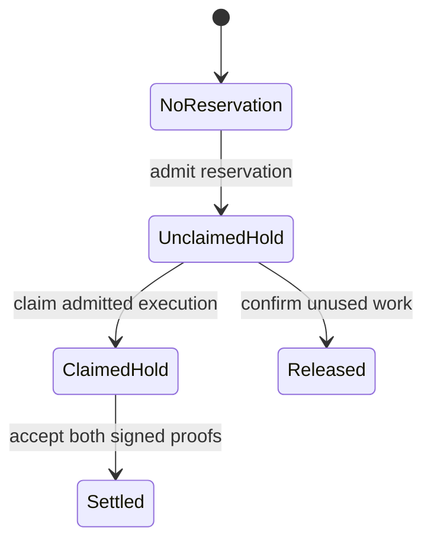
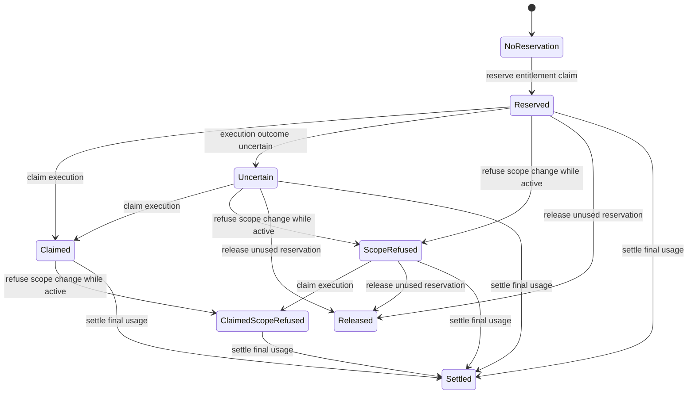

# @hobo/broker

The finite TLA+ model in `model/IacBudget.tla` checks admission, fencing and
disclosure invariants under its stated host-trust assumptions. The model also
checks enrollment or an authenticated guard at both reservation and execution
claim, including a reopen with changed enrollment. It checks that each priced
reservation fit the available budget when admitted, and demonstrates that
actual charges can later exceed the modeled bound. The budget abstraction has
two operations, unit-sized reservations, one aggregate currency budget, no
initial or external commitments, and atomic reserve transitions. It checks the
same invariants at limits of one and two. It does not
model provider-account or entitlement limits, unresolved or recovery reserves,
external commitments, the concrete journal or CAS implementation, or unreported
charges before settlement. Run them with
`HOBO_TLA_TOOLS=/path/to/tla2tools-1.8.0.jar node --experimental-strip-types scripts/check-iac-models.ts`
from the repository root. The tool is available from the
[TLA+ 1.8.0 release](https://github.com/tlaplus/tlaplus/releases/tag/v1.8.0);
the runner verifies the pinned `tla2tools.jar` digest for release v1.8.0 and limits each checker invocation to
60 seconds, a 512 MiB Java heap and 16 MiB per captured output stream. A timeout,
resource failure or signal-terminated process fails the check. The host must
separately bound total process memory and logs. These abstractions complement the
implementation's bounded tests; they do not prove the external host or provider
implementation.
The runner also removes representative guards in temporary model copies and
requires the checker to find counterexamples. The pricing CI workflow runs the
same checks when either model or its runner changes.

## Hosting budget admission

`admitIacTarget` applies the same durable authority to a provider-neutral IaC
inventory and whole-target pricing model. It refuses unknown pricing and
requires a trusted host to authenticate liability evidence covering the exact
plan, inventory, model, quote and provider accounts. It reserves the verified
upper bound and incremental entitlement consumption, checks policy, and claims
execution once. Each decision discloses budget evaluation and reservation
state. An uncertain write or execution claim must be reconciled; it is never
permission to retry the provider call. The host remains responsible for
verifying inventory completeness and eventual usage and source-stop evidence.
Price ranking alone does not create a reservation; admission is the budget gate.
Reservation and execution acknowledgements must match the exact quote, scope,
liability bound and pricing pin. Mismatched receipts are reported as uncertain;
after a claim, the authority must revalidate that the exact hold remains active.
These checks rely on the host's durable authority and do not prove its behavior.
Liability evidence must cover each distinct provider-account ID exactly once;
the input order of those account records does not affect the scope check.
The admission request accepts only its declared own data fields; unknown fields,
accessors, proxies and inventory fields outside the exact schema are denied
before financial authority calls. Enumerating JavaScript object keys can itself
allocate before these bounds are checked, so the host must enforce input size,
memory and execution-time limits before materializing untrusted requests.
`createIacFinancialServices` combines these checks into an injectable port for
IaC adapters. Its optional `pricing` model is developer supplied; the trusted
host still provides liability issuance and verification, policy and authority.
The whole-target quote and its baseline entitlement calculation both use
`pricing-rating/v2`; a quote from another rating version cannot supply the same
plan-bound hash. Reconcile outstanding holds before switching a live operation
to a different rating version.
When no model is available, omit `pricing`. Supplied model data is checked
before normalization; malformed or unsupported input raises an error instead of
becoming an unavailable model or a lower quote. Incomplete bindings cannot
produce a quote.
It accepts both the synchronous local authority and the asynchronous shared
authority, including the PostgreSQL implementation.

The financial service inspects and detaches plan and expectation data before
using them. Invalid assessment input raises an error; invalid admission input
returns `REQUEST_INVALID` without consulting authorities. JavaScript own-key
enumeration can allocate before its size is known, so the host must bound
input before materialization and enforce independent memory and time limits.
Financial authority callbacks and their state are trusted host infrastructure;
the host must fence them throughout each operation.
Provide the authority and callbacks as own enumerable data properties. The
service invokes captured callbacks with a frozen, detached configuration
receiver, so methods must not rely on the original options object's identity or
private fields. Pricing data in that receiver is detached and frozen; the
authority remains the original host object. Revocation must be enforced by the
captured callbacks and that authority, including its mutable state and backend
credentials, as well as callback closure state.


Before creating or starting a priced IaC hold without a separately verified
fence guard, install `iacPricedSettlementTrust` on the budget authority.
Absent trust denies admission with `budget.settlement-unavailable`; it also
prevents a previously unclaimed hold from starting. Existing holds remain
readable for reconciliation, but cannot revalidate for execution until the
required trust is present. Its synchronous,
independently enrolled verifier must authenticate the exact tenant, budget,
reservation, plan, execution, provider accounts, final usage and permanent
source-retirement evidence. Nonempty references or a caller assertion alone do
not establish those facts. The verifier receives the original live reservation
on settlement and journal replay; retain historical verification material.
Missing, forged, asynchronous or unavailable evidence leaves the hold in place.
Unclaimed holds may be released only when confirmed unused.

The budget journal and its append authority are trusted host infrastructure.
Restrict the database and journal writer to the budget authority, and protect
against rollback or rewriting. Replay checks reservation transitions and
settlement accounting, but the first priced reservation records quote and
liability digests rather than the complete authenticated quote evidence; replay
cannot authenticate an initial event supplied by an arbitrary journal writer.
Never expose raw journal writes as an admission or recovery API.

`financial.assess(plan)` exposes `providerCoverage` for the declared target. It
distinguishes unavailable models and missing bindings from a successfully
quoted joint model, and labels failures that cannot be attributed to a single
provider as unverified. `admissionPath` says whether the configured next step
is a bounded budget evaluation, an explicit unpriced policy check that would
bypass the budget if allowed, or an unavailable path with a reason code. This
reflects the authority callbacks captured when the financial service was
constructed; later changes to the original options do not enable or disable a
path. It does not evaluate the policy or predict its outcome. Its `budget` is
always `not-evaluated` and `not-created`: price assessment and ranking are not
budget authorization.
Only the later admission receipt says whether a bounded hold was allowed, an
explicit unbounded policy bypass was held, or the request was denied or left
uncertain.

When pricing is unavailable, admission denies by default. A host may explicitly
configure `unpriced.authorize` and an independently enrolled
`unpricedScopeTrust` on the budget authority to permit a particular request.
Its policy proof pins the request, inventory, budget identity, revision,
obligations and validity window. The signed scope proof covers exactly the
target's provider accounts. A receipt then says `evaluation: "bypassed"`,
`reservation: "held"` and `unboundedExposure: true`: it states that the
budget did not bound the cost. It carries no quote or price. It is never a
zero-cost estimate. The host supplies a trusted clock for claim revalidation
and policy expiration. `unboundedExposureCount` remains visible through replay.
Outstanding bounded holds and unbounded holds cannot coexist in one ledger;
active unbounded holds prevent new bounded admission, including across
connections sharing that ledger. Unpriced admission also refuses shared
entitlements.

Unpriced admission rejects inaccessible, malformed or extra envelope fields and
unknown inventory data before policy or budget authority work. JavaScript must
enumerate own keys before their count is known; the host must bound input size
before materialization and enforce independent process memory and time limits.

The host-enrolled scope authority is a necessary trust boundary: it must
independently authenticate globally canonical account IDs across providers and
aliases, reject alternate names for the same billable account, and enforce
exclusive financial ownership across every budget authority and billing period,
including authorities created later, until source retirement and settlement.
The ledger cannot independently prove
that other ledgers or provider accounts obey that contract. Its synchronous
verifier also authenticates settlement for the exact claim, plan, account
charges, final usage and permanent source retirement; it is called again during
journal replay. Keep historical verification material available. Failed,
unavailable or asynchronous verification preserves the exposure.
Trust callbacks are own enumerable host functions invoked with a frozen receiver
containing the captured callbacks. They must not rely on the original trust
object's identity or private fields. Only a synchronous `true` authorizes a
decision; ordinary same-realm native Promise rejections are observed and refused.
Fulfilled values are discarded without inspecting or assimilating their contents.
The host must prevent and
reconcile any asynchronous verifier effects, handle rejections from other
thenables or exotic/cross-realm Promises, and initialize and fence trusted
JavaScript intrinsics and the verifier's mutable state.

The adapter must revalidate the exact claimed receipt and plan immediately
before provider start, and use a shared route authority across all candidate
targets to prevent retries from starting a second effect. The host must fence
scope or policy revocation and provider credentials through provider start;
an external provider call cannot be atomic with the local ledger. Claims remain
held for reconciliation after expiry or revocation.

`resolveBindleDeployment` ranks compatible Yards using trusted, normalized,
whole-request hosting quotes. Capacity is never a substitute for price. A quote
contains itemized expected cost and a separate conservative liability bound in
integer USD microdollars. Unknown, stale, foreign, unbounded or unaffordable
quotes are ineligible. The provider and tenant on every quote must match the
selected Yard; residual resources stay within that Yard's provider.

Funded hosting requires `hostingBudget: {authority, quotes, now}` and a bound
`authorizeHosting` callback. The callback returns the existing `GateDecision`
plus a generated `HostingPolicyProof` tied to request digest, quote, budget
identity/revision and policy hash. Denials, pending approvals and unfulfilled
obligations refuse admission. A successful receipt pins proof, quote and financial
reservation. The zero-cost local host floor remains available; the local seed
cannot impersonate a remote provider.

`createSqliteBudgetAdmissionAuthority({path, snapshot, now})` is the concrete
local durable adapter. Every operation reloads the authoritative journal under
`BEGIN IMMEDIATE`; journal commit and acknowledgement are atomic. Separate local
connections/processes share the same file. Reopen restores held and uncertain
reservations and idempotent terminal records. Distributed hosts require a shared
transactional database adapter to `BudgetAdmissionAuthority`; copying a SQLite
file or creating one ledger per worker does not establish shared authority.
The in-memory factory is explicitly marked `persistence: 'memory'` and cannot
authorize funded Yard hosting.

`createFleetBudgetAdmissionAuthority` replays decisions from a fixed,
majority-chosen journal. Its inspection calls do not repair an undecided tail.
For active workloads, `createOperationalFleetBudgetAdmissionAuthority` can
recover an already offered entry under a separately funded, revalidated actor
lease before retrying the operation. The host must provide independently
verified member identities, anti-rollback protection and per-voter funding;
an actor lease alone does not fence a delayed provider request.

`pnpm run test:data-live` exercises Broker recovery with PostgreSQL voter
records, a local SQLite actor fixture, a voter outage and a lost acknowledgement.
The live-engine gate requires this test to run and rejects missing or skipped
results. The test does not establish a distributed actor lease.

One transaction reserves global money, provider-account ceilings and each named
free-allocation bucket. Quantities use integer normalized base units; unknown
accounts, units, periods and expired allowance evidence refuse admission. Every
entitlement must have one authoritative owner, including across budget scopes;
independent ledgers may not duplicate a provider account's free allocation.
`unresolvedMicros`, `externalCommittedMicros` and `recoveryReserveMicros` remain
protected in every reserve calculation. `reservedMicros` is exclusively the
authority's journal-derived holds; external commitments use their separate field.

The synchronous commit callback must finish its durable append before returning.
An object or function return is refused because it could represent unfinished
work; incidental primitive returns are ignored. After an ambiguous return or any
callback exception, the authority refuses reads and operations until the host
reconciles any pending write and reopens it from the durable journal: a callback
can append successfully and then throw. The authority wraps every callback
exception as an uncertain commit with the original error as its cause, so even a
denial from another module cannot be mistaken for a definite refusal.
A callback that starts asynchronous
work but returns a primitive cannot be detected; the host must honor the contract.
The host must also handle rejections from foreign promises and other thenables,
which the authority does not await or inspect.

`settle` requires confirmed source retirement and authoritative usage evidence,
including complete actual account charges and entitlement consumption when those
dimensions were reserved. A reservation is an admission-time bound, not a
provider spending cap: actual charges can exceed it and the overall budget.
Actual overruns are recorded and consume remaining headroom. Unknown outcomes
retain all holds. `release` requires positive evidence
that the reservation was unused. Policy revisions cannot erase commitments, and
period rollover refuses while journal-owned work remains outstanding. Reducing
external unresolved/committed exposure requires reconciliation evidence.
Zero-cash holds also block rollover: fully credited work still owns its allocation.
Spent account watermarks cannot disappear within a financial period.

`claimExecution` atomically binds a gateway's existing financial reservation to one
transition digest. Replay of that same execution reuses the hold; another execution
cannot claim it. This avoids reserving the same deployment twice while preserving
the financial plan hash and pinned quote identity through crash recovery.
Funded Yard generation claims its hold before calling the provider connector, so
a concurrent unused cancellation cannot release in-flight provisioning liability.
An identical claimed generation retry inspects the original operation instead of
provisioning it again; unknown outcomes retain their financial exposure.

For a cross-provider route operation, the initial reservation may pin a fenced
settlement guard. It binds the budget, quote, execution, logical Camp, source
and destination placements and their deployment, incarnation, manifest and plan
identities, source fence, current and desired Sets, expected
receiver route generation, Trails migration and decision head, route decision
and separately enrolled receiver and financial authority keys. A later claim
cannot change that scope.
The hold remains reserved until the receiver signs the exact committed route and
the financial authority independently signs the final usage and source-stop
evidence. Both proofs and the guard are checked again when replaying the journal.
Keep historical public enrollments available while their records remain in the
journal. An unsigned or uncertain result leaves the hold in place.

The host must authenticate those enrollments and use a receiver that atomically
holds the source operation and commits the route before signing. The finance
signer must independently establish final usage and permanent source retirement;
the signatures do not themselves provide either capability. This interface does
not enroll a receiver, authenticate a provider, or make a route operation safe on
its own. Production readiness must continue to verify the complete host path.

Generated wire records live in `data-models/yard_placement.proto`; constraints
live in `data-models/budget.cue`. The message Pact is hand-authored offline port
evidence, not provider-verified billing evidence. Regression tests exercise the
real SQLite adapter, competing connections, crash/reopen, policy changes,
protected reserves, free-allocation exhaustion and quote selection.

## Budget signal migration and metered preflight

Versioned signal policies supply `identity: {tenantId,budgetId,periodId,policyRevision}`.
Usage and credit facts must name the matching `budgetId` and `periodId`.
`budget.StateReset` explicitly initializes each new identity; threshold cycle
keys include the whole identity. Replays emit no duplicate resets or crossings.
Changing a cap or threshold set requires a new revision. Unscoped legacy policies
retain tenant/lifetime semantics for existing consumers and have no period rollover
guarantee; new hosting controls use versioned identities.

Zero USD budget or per-resolution cap means zero, never unlimited. Unlimited
preflight behavior requires `budgetUnlimited` or `spendCapUnlimited` explicitly.
`createMeteredBillingPlane` rereads a live event reader on each authorization and
holds outstanding request identities atomically within that one plane. Consumable
snapshot iterators are rejected. A finalized usage fact may retire a hold only by
naming its reservation ID. This legacy preflight is single-writer and is not the
durable financial authority for funded cloud hosting.

The **HoBo Broker**: the policy-governed authority that actually brokers
Bindle/Camp/Yard/Junction placements **across providers**, spins resources up
and down, and hands accepted work to delivery — based on the configured
policies the broker itself maintains. It is the runtime counterpart of the
[Meta-cloud Broker design](../../docs/design/hobo-broker.md); the Meta-cloud
Broker artifact vocabulary (Contract Manifest → Resolution Receipt /
Resolution Rejection) is preserved here as the receipt/rejection wire shapes.

This broker is **distinct** from the Identity token broker (ADR-0008) and the
connector runtime broker (HOBO-235): those broker *credentials*; this package
brokers *placements*. The connector registry below stores `credentialRef`
pointers into the token broker — never raw secrets.

## What it wraps

The broker is a wrapper around five planes, each behind a port so engines can
be swapped without touching the brokering pipeline:

| Plane | Port | Default engine | Alternate engine (shipped in this package) |
|---|---|---|---|
| Policy | `GatePlane` (OPA-shaped request/decision documents) | `@hobo/contracts` policy pack (imported and **run**, not reinvented) | **Rego** via `createOpaGatePlane` — OPA Data API decision at `hobo/broker/decision`, fail-closed (`policy-engine-unavailable`), pinned by `broker_policy_opa.pact.json` |
| Contracts | `GatePlane` (can-deploy compatibility) | `@hobo/contracts` Gatekeeper (PACT-style boundary semantics) | an external Pact broker verification feed (port-compatible) |
| Billing | `BillingPlane` | in-proc budget + spend-cap + quota checks | `createMeteredBillingPlane` — folds `meter.UsageRecorded` facts into observed spend and authorizes against the metered remaining budget; `authorizeBillingSpend` prefers `@hobo/pricing` incremental USD when supplied |
| Delivery | `DeliveryPlane` | `createDeliveryPlane` — in-process conductor only; agent/publisher policies fail closed with `delivery-plane-unwired` | `createReconcilerDeliveryPlane({ requestPromotion })` — every receipt is delivered through `@hobo/cd` (ADR-0182: D14), fail-closed, pinned by `broker_delivery_cd.pact.json`. GitOps rendering (Argo CD `Application`, Flux `Kustomization`) moved to `@hobo/cd-gitops` |
| Connectors | `ConnectorRegistry` | event-sourced registry of `github-app`, `pulumi`, `azure`, `vercel`, `cloudflare`, `custom` configs | an external connector catalog |

Beyond M0, this package also ships:

- **Receipt integrity** — Ed25519 detached signatures over canonical JSON for
  every receipt and rejection (`signResolution`/`verifyResolution`,
  `broker.ResolutionSigned` facts).
- **The closed rejection matrix** (`REJECTION_MATRIX`) — every broker-owned
  rejection code pinned to its plane and an agent-actionable remediation,
  test-enforced against the pipeline.
- **Cedar** as the second external policy language (`createCedarGatePlane`,
  fail-closed, pinned by `broker_policy_cedar.pact.json`) beside Rego.
- **Broker Environments** (admin controls): `publishEnvironmentFact` /
  `approveEnvironmentFact` / `foldBrokerEnvironments`; resolutions against an
  unapproved environment or a stale pinned catalog snapshot reject
  (`environment-unapproved`, `catalog-snapshot-stale`), and eligibility is
  bounded to the environment's approved providers.
- **The hosted authority surface** — `createBrokerHttpHandler` / `serveBroker`
  expose resolve/scale/deliver/rejection-matrix over HTTP, and the resolve
  route is PROVIDER-verified against `broker_resolution.pact.json`
  (`contracts/provider/`). The `hobo broker` CLI verb (and its derived MCP
  tool) runs the same pipeline against the composed Yard's live registry.

Branding note: product surfaces call this component **the Conductor**; code
and technical docs keep **broker**.

Placement itself consumes any `BrokerCatalog` — a structural mirror of
`@hobo/cloud`'s `PlannerRegistry`, so the Yard's live provider catalog plugs
in directly.

## Command/event model

The broker is an **actor**: it consumes commands (`resolve`, `scale`,
`deliver`, connector `register`/`disable`), coordinates durable state through
the facts it emits, and never mutates a query read model directly. Event
families:

- `broker.Requested` → `broker.Resolved` (receipt) or `broker.Rejected`
  (structured per-plane reasons), with the Gatekeeper's `policy.Decided` /
  `gatekeeper.Decided` facts appended to the same stream for replay.
- `broker.ScaleRequested` — spin up/down/zero directives.
- `broker.DeliverySubmitted` — delivery-plane handoff. Body schema `hobo.broker.delivery-submitted/v2` (reconciler mode, publisher, promotion id); persisted v1 bodies (`engine: argo | in-proc`) are lifted by `upcastDeliverySubmitted` (golden corpus `test/fixtures/delivery-submitted/`).
- `connector.Registered` / `connector.Disabled` — connector registry facts.

Query surfaces are event-driven: `foldBrokerDecisions` and
`foldConnectorRegistry` are pure folds over the **event store** stream into
**materialized view** rows (each **projection** rebuilds from zero), and
`snapshotBrokerDecisions`/`restoreBrokerDecisions` persist a **snapshot** of
the current rows to a **read store** for cached current reads; replaying the
stream over a restored snapshot yields the same view.

## Parse, don't validate

Untrusted policy documents, brokering requests, connector configs, and scale
directives cross exactly one parser boundary (`parseBrokerPolicySet`,
`parseBrokerRequest`, `parseConnectorConfig`, `parseScaleDirective`). The
parsers apply the protobuf + CUE constraints from `data-models/broker.proto`
and `data-models/broker.cue` and return refined **parsed domain types**
(`src/types.ts`, including the branded `PolicyHash` derived type), so invalid
values are unrepresentable past the boundary — core functions never re-check
raw DTOs.

## Policy semantics

Placement policies are maintained per topology scope kind. The effective
policy for a request merges junction → yard → camp → bindle: narrower scopes
override choice-shaped fields (objective, allowed providers/regions, pins),
while restrictions **accumulate** — a junction broker admin's
`requireExplicitCamps` lockdown or denied-provider list can never be relaxed
by a narrower policy. Every receipt and rejection pins `policyHash` (the
content address of the whole policy set) and `catalogHash`, so a decision is
replayable against the exact policies and catalog that produced it.

## Boundary contract

The consumer-driven PACT contract for the resolve boundary lives in
[`contracts/pacts/broker_resolution.pact.json`](contracts/pacts/broker_resolution.pact.json),
exercised by `contracts/consumer/broker-resolution-boundary.test.ts`.

## Verification

```sh
pnpm --filter @hobo/broker test
pnpm --filter @hobo/broker test:contract:consumer
```

## Delivery policy (neutral, ADR-0182 D14)

`DeliveryPolicy` names how a Camp converges, never a GitOps engine, cluster or
namespace:

| Field | Meaning |
|---|---|
| `reconciler_mode` | `conductor` (in-process), `agent` (pull agent) or `publisher` (a `@hobo/cd-gitops` publisher). |
| `publisher` | `{ target: argo-cd \| flux, repository? }`, exactly in `publisher` mode. |
| `sync_mode`, `prune` | Unchanged. |
| `engine`, `gitops_repo`, `destination_namespace` | Deprecated wire fields. `engine: argo` maps to the `argo-cd` publisher (its `gitops_repo` becomes `publisher.repository`); `engine: in-proc` maps to `conductor`. `destination_namespace` is never read. |

`DeliveryPolicy.engine` / `DeliveryTicket.engine` survive only as a display
label (`in-proc`, `agent`, `publisher:<target>`) for existing readers.

## Runbook

| Symptom | Cause | Action |
|---|---|---|
| `delivery-plane-unwired` | The policy routes through an agent or publisher but the broker was built without the CD plane. | Compose `createReconcilerDeliveryPlane({ requestPromotion })` (the CD host does this), or set `reconciler_mode: conductor` for local runs. |
| `delivery-refused` | CD refused the promotion (window, lineage, gate, policy). | Read the reasons and remediation on the error; fix the cause and deliver again (idempotent per receipt). |
| `delivery-transport-failed` | The CD control plane was unreachable. | Check CD service health; nothing was applied. Retry. |
| `delivery-fact-unknown` on replay | A persisted `broker.DeliverySubmitted` body has a shape the upcaster does not know. | Add the shape and a golden corpus entry before replaying. |
| A legacy policy still says `engine: argo` | Pre-D14 configuration. | It keeps working through the `argo-cd` publisher; migrate to `reconciler_mode: publisher` + `publisher.target: argo-cd`. |

## Budget authority verification

The authority rejects mutations made from its journal commit callback.
Configure refuses to retarget a bucket's unit or period while reserved units
remain on that bucket or a live claim still references it. A live entitlement
claim also keeps its bucket's unit and period stable, including when the claim
has zero units; reconcile or settle the reservation before changing that scope.
Replay rejects journal entries that violate the same scope rule, without
requiring reservation identity when matching entitlement buckets.
The journal commit path clones events before invoking the host callback so local
schema failures do not fence the authority.

The [budget-authority verification skill](../../.agents/skills/verify-broker-budget-authority/SKILL.md)
checks admission, held liabilities, replay, and receiver- and finance-signed
settlement. Generated histories exercise the TypeScript authority; the finite
TLA+ models and unbounded arithmetic abstraction state their assumptions and do
not prove the storage adapters, cryptography, or provider effects. The
`BrokerBudget` finite model admits a unit reserve only while `Spent + Held` stays
under the aggregate cap and records over-reserve attempts through `badAdmission`,
and the `BrokerEntitlement` config exercises uncertain fencing plus the
zero-unit scope invariant the journal enforces; optional Z3 scope lemmas in the
skill mirror those same bucket rules.

The following is a projection of the signed-settlement model, not a production
trace. TLC explored 129 states and 830 steps; the chart hides 723 steps that
remain within a displayed state.



The active entitlement-scope model follows zero-unit claims as well as claims
that consume an allocation. TLC explored 35 states and 81 steps; this view draws
eight states and 16 arrows and hides 38 steps within a displayed state.


