# @hobo/broker

## Hosting budget admission

`resolveBindleDeployment` ranks compatible Yards using trusted, normalized,
whole-request hosting quotes. Capacity is never a substitute for price. A quote
contains itemized expected cost and a separate conservative liability bound in
integer USD microdollars. Unknown, stale, foreign, unbounded or unaffordable
quotes are ineligible. The provider and tenant on every quote must match the
selected Yard; residual resources stay within that Yard's provider.
Each residual resource requires a full catalog capability verdict and a region
supported by its selected definition. Wildcards must also report a full match.
Eligible definitions need distinct IDs and nonnegative decimal marginal prices
with matching units; comparison is exact and ties use the definition ID. Failed
or changing catalog evidence refuses placement. Marginal ordering remains a
per-resource comparison and does not establish whole-request cost optimality.
Resource IDs and ports must be nonempty, and resource IDs must be unique. Each
resource execution unit records the exact definition selected for that resource.
`buildExecutionUnits` callers must pass `resourcePlacements` containing explicit
resource and definition ID pairs; the former parallel ID arrays could not express
that association reliably.

Deployment requests must include a finite nonnegative `spendEstimateUsd`; an
explicit zero remains distinct from a missing estimate and does not replace a
host's bound zero-liability proof. Supplied selection modes, Yard and Camp
constraint lists, and Bindle requirement lists and labels must be well formed.
Malformed values are refused instead of being discarded and weakening placement
requirements. Callers that previously omitted the estimate must supply it
explicitly before retrying; recompute any affected request digest and quote.
Yard JSON properties compare by value, including nested objects and arrays;
object key order does not affect a match. JSON property and label names are
preserved even when they match inherited JavaScript names, and nested property
arrays are frozen in the parsed snapshot.
Residency tags must use a recognized jurisdiction and, when present, a
recognized classification. A Yard repeating an invalid tag does not make it
valid; correct such requests and attestations before retrying. A valid explicit
attestation is still trusted host evidence, not independent proof of location.
The Yard deployment request and quote-preparation paths reject invalid tags
before a generation hold or provider call. Direct calls to the generation
planner and saga also reject invalid residency; the saga checks before looking
up or invoking a connector, including retries. These checks do not establish
that a supplied plan is authorized or that its other fields are correct.
Earlier invalid requests may already have triggered generation; reconcile any
associated provider resources and budget holds before retrying.

The [Yard residency validation skill](../../.agents/skills/verify-yard-residency-validation/SKILL.md)
checks this bounded decision; its projection hides eight same-state steps.

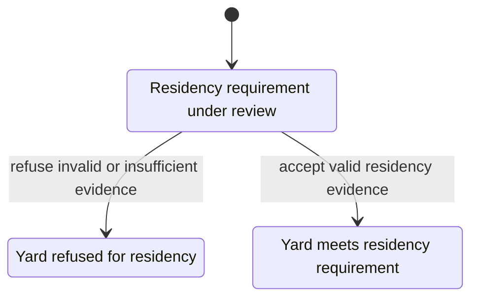

The generation projection hides two same-state steps and assumes the remaining
funding and policy checks allow the request.

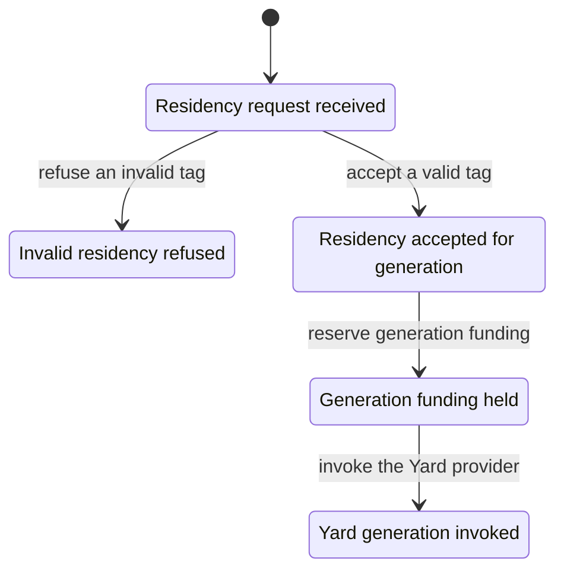

The direct-generation projection checks calls through the planner and calls
that supply a plan to the saga. It hides four same-state steps and abstracts
the other policy, funding and connector checks.

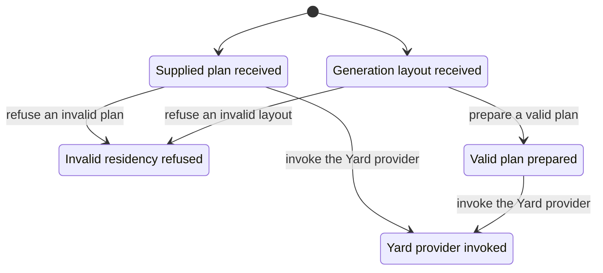

The [Yard JSON constraint skill](../../.agents/skills/verify-yard-json-constraints/SKILL.md)
checks a bounded property-matching model. This projection hides three same-state
steps and retains the existing rule that an undeclared Yard property is unconstrained.

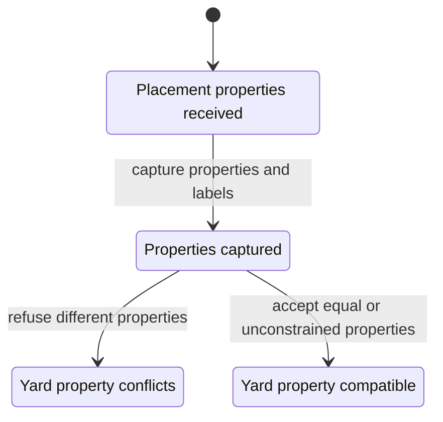

The [Yard request validation skill](../../.agents/skills/verify-yard-request-validation/SKILL.md)
checks a bounded model of parsing before host authorization. The projection
hides 11 same-state steps and abstracts matching and policy decisions.

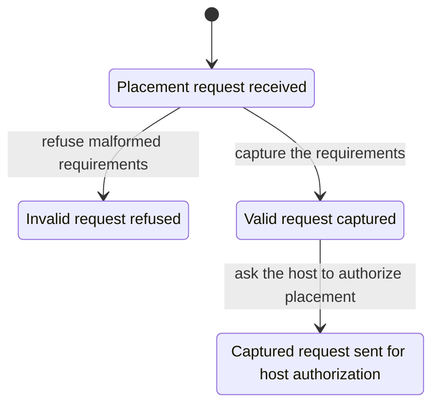

Camp placement preserves the requested Camp layout, including its environment
type, in the request used for authorization. An `exact` Camp request must name
a Camp ID; a missing ID is refused before quoting or host authorization. Other
requests without an ID use `camp:<envType>`, or `camp:dev` when no environment
was requested. An explicit ID takes precedence, but a qualified ID must name a
direct child of the selected Yard; a foreign or malformed ID is refused before
quoting, budget reservation or Yard generation when the planned Yard is known,
and checked again against the selected Yard before placement. Empty or malformed
Camp IDs and environment types are refused during parsing. This check does not
yet verify that a named Camp exists, its environment or selection-mode
semantics. Until Camp matching is implemented, quote preparation and placement
refuse nonempty Camp capability, runtime or label requirements and nested Camp
layouts in a Yard request with `camp-constraints-unverified`. Direct Yard
matching and generation also refuse nested Camp layouts. Existing work accepted
with these requirements may need reconciliation; preserving a requirement in a
digest alone does not establish that it was met.
Because the request digest now includes Camp fields that were previously
discarded, a quote created by an older parser may no longer match the request.
Obtain a new quote and reconcile any existing reservation before retrying.

The [Camp constraint skill](../../.agents/skills/verify-yard-camp-constraints/SKILL.md)
checks this boundary. Its bounded projection hides eight same-state steps. It
treats other authorization and budget decisions as successful and does not
establish that an accepted Camp exists or meets unmodeled preferences.

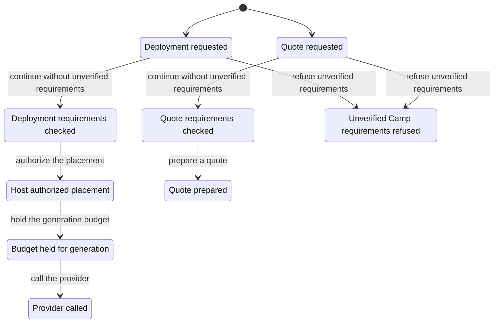

The [Camp verification skill](../../.agents/skills/verify-yard-camp-binding/SKILL.md)
models exact selection across quote and deployment paths. This projection hides
eight same-state steps and assumes the other admission checks succeed.

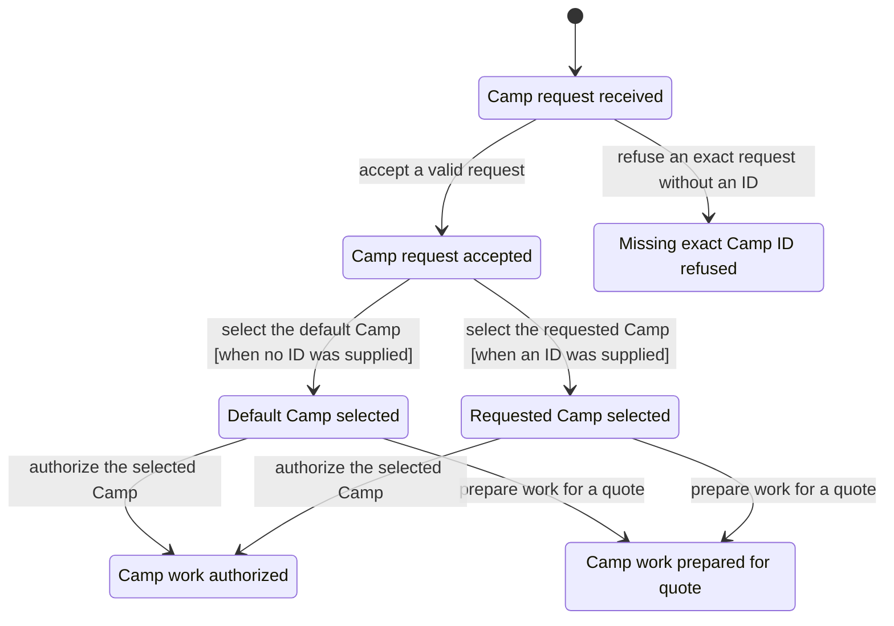

`encodeBindleDeploymentRequest` and `decodeBindleDeploymentRequest` provide a
versioned protobuf snapshot of the complete normalized placement request,
including Yard constraints, Bindle requirements, resources and Camp layout.
They preserve the request digest used for quoting, distinguish a zero estimate
from a missing one, and reject unsupported, incomplete or inconsistent work.
An encoder rejects noncanonical requests; use `parseBindleDeploymentRequest`
first. The encoder emits version 2, which carries labels as explicit entries and
Yard properties as JSON object text so special keys are not lost by protobuf
map handling. Version 2 property text must match `JSON.stringify` of the parsed
object, and duplicate label entries are refused. The decoder also accepts
complete version 1 requests; a version 1-only receiver must be upgraded before
using version 2. Older messages without a completeness marker must be rebuilt
from the original request; an old quote or reservation may need reconciliation.

Exact Yard selection requires a nonblank `requestedYardId`; supplied IDs must
also be nonblank for other selection modes. The parser, decoder and CUE contract
refuse an exact request without an ID before placement. Requests previously
accepted without a Yard ID must be corrected and any related quotes or
holds reconciled before retrying.

The Yard request CUE contract requires a nonblank Camp ID for exact selection
and rejects blank Camp IDs, environment types and capability or runtime
requirements using the same whitespace rules as the parser. Previously accepted
CUE documents with those invalid Camp fields must be corrected before reuse;
other request semantics and receiver authorization still require separate checks.
CUE 0.14's JSON reader rejects a literal U+FEFF inside a JSON string; encode it
as `\ufeff` when validating such input with CUE. This does not change the ID.

The bounded Yard wire projection hides 18 same-state steps. Acceptance still
requires the later matching, policy and authorization checks.

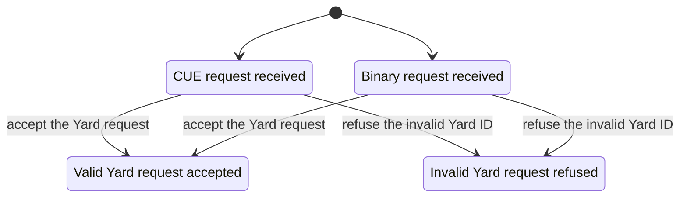

The bounded Camp wire projection hides 54 same-state steps. A request accepted
here still requires authorization and does not establish that the Camp exists.

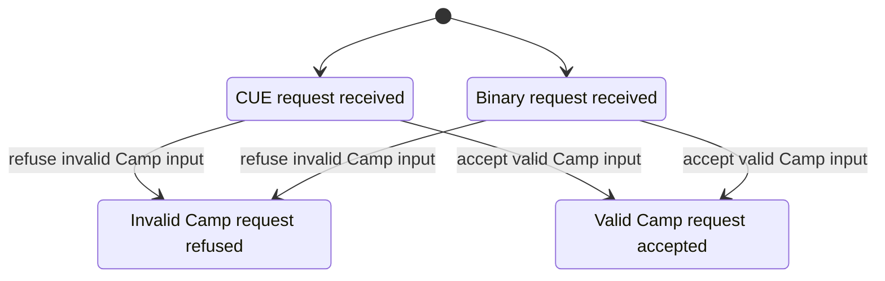

The embedded digest is an integrity comparison, not a signature: a receiver
must compare it with independently authenticated quote or authorization data.
The decoder refuses unknown fields retained by protobuf in ordinary messages;
the runtime's special handling of nested `google.protobuf.Struct` values is not
covered by that unknown-field check. These functions are a public codec, not a
deployed transport or a guarantee that an older receiver enforces the marker.
The protobuf receipt still omits execution-unit details.

The [Yard request wire skill](../../.agents/skills/verify-yard-request-wire/SKILL.md)
checks a bounded model of the codec. This projection hides 96 same-state steps;
acceptance means the request can proceed to authorization, not that its sender
or its claimed digest has been authenticated.

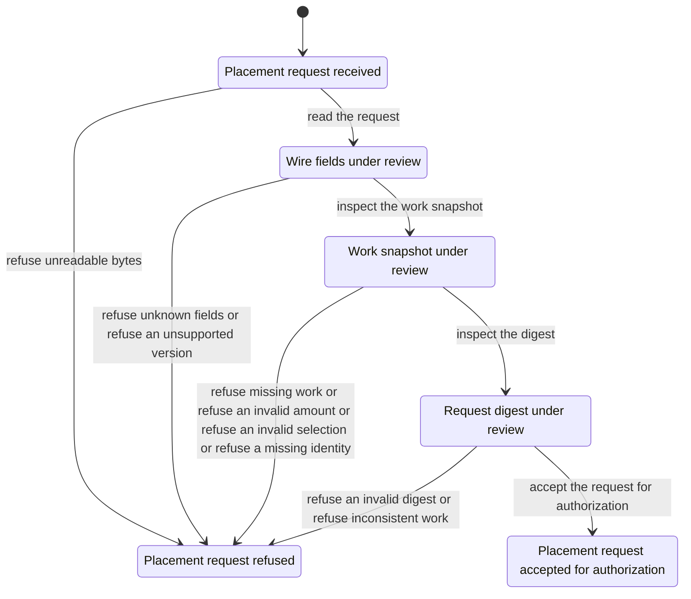

The [Yard Camp binding skill](../../.agents/skills/verify-yard-camp-binding/SKILL.md)
checks a bounded placement flow. This projection hides 60 same-state steps and
114 caller-edit steps; it assumes a ready Yard and abstracts host authorization.

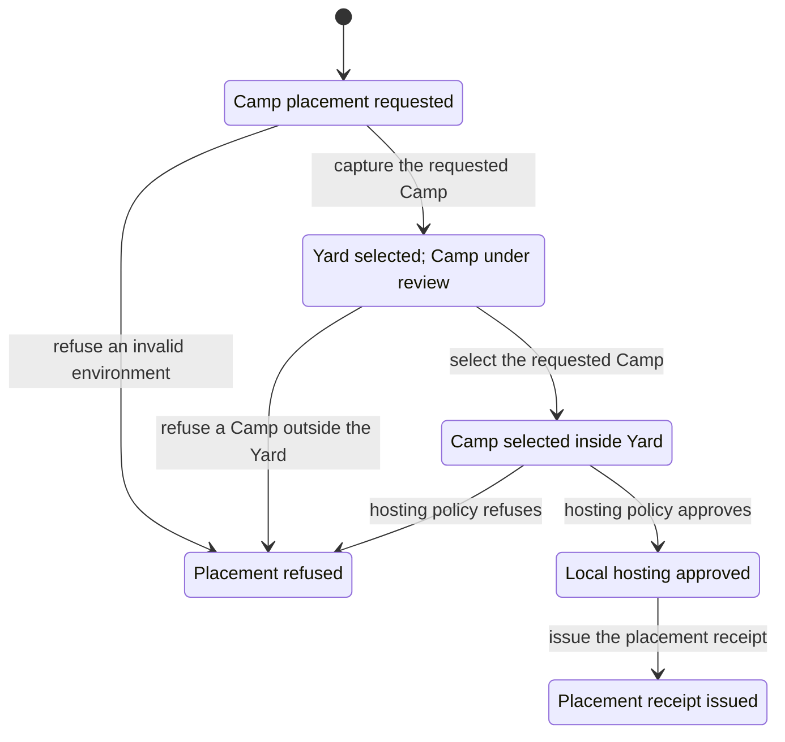

The generation model checks 14 states and hides four same-state steps. It
assumes a successful uncertainty write after a provider effect.

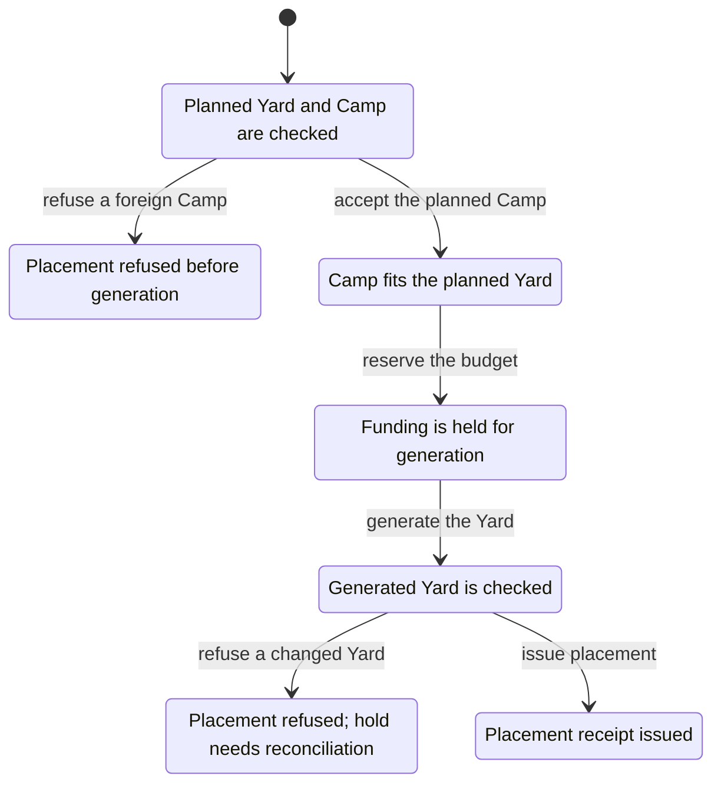

The [Yard residual placement skill](../../.agents/skills/verify-yard-residual-placement/SKILL.md)
checks a one-resource abstraction of capability and evidence. This view hides 24
same-label steps; it assumes the host's catalog evidence is truthful.

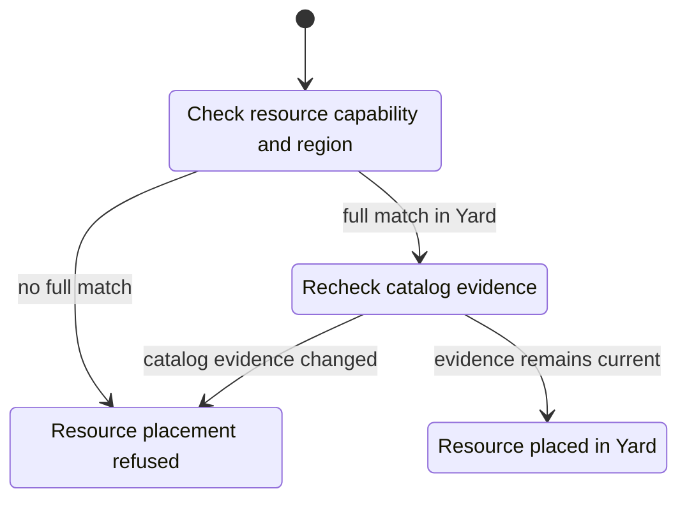

The [Yard resource binding skill](../../.agents/skills/verify-yard-resource-binding/SKILL.md)
checks a two-resource abstraction. This projection hides 32 same-label steps;
the separate request-snapshot model also checks a caller mutation.

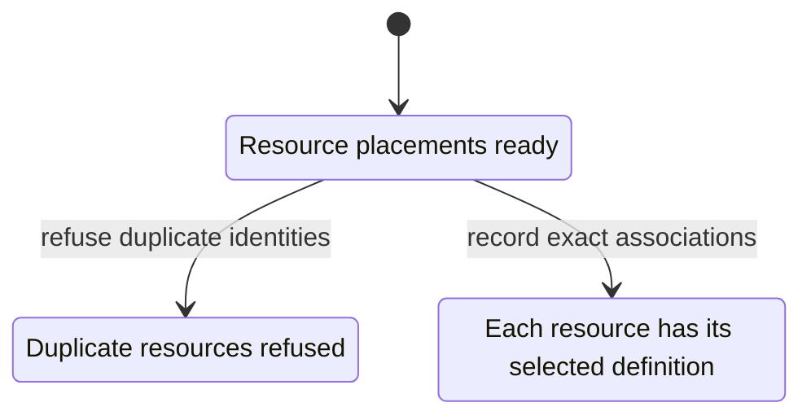

Funded hosting requires `hostingBudget: {authority, quotes, now}` and a bound
`authorizeHosting` callback. The callback returns the existing `GateDecision`
plus a generated `HostingPolicyProof` tied to request digest, quote, budget
identity/revision and policy hash. Denials, pending approvals and unfulfilled
obligations refuse admission. A successful receipt pins proof, quote and financial
reservation. The broker snapshots quote and budget context, checks for changes
across policy and reservation callbacks, and rechecks quote freshness before
receipt issuance or generation. If evidence changes after a reservation is
created, admission is refused and the hold remains for reconciliation. After a
generation effect, failures attempt to mark the original hold uncertain; if
that write fails, the broker reports the failure and retains the hold. The
policy callback receives the quote's SHA-256 digest as `quoteDigest` and must
include it in `HostingPolicyProof`. The digest is the lowercase hexadecimal
SHA-256 of the protobuf JSON quote, matching the durable reservation digest.
Approvals lacking a digest, including legacy proofs, are refused. Yard quotes
also carry a `workDigest` binding the selected definitions, request, catalog,
Yard, broker and (when generating a Yard) generation plan. Use
`prepareYardHostingWork` with the request, Yard and catalog to compute the work
and digest before obtaining a quote; generated Yards also supply the planned
`generationPlanHash`. The policy callback receives the bound placements and
both digests. Legacy Yard quotes without a work digest are refused. If selected
work changes after a provider effect, the hold is retained for reconciliation.
Yard generation accepts only the `allow-if-no-match` policy effect with
`requireApproval: false`. A policy requiring approval is refused because no
approval-evidence path is wired; unknown effects and `require-dedicated` are
also refused until dedicated-Yard evidence can be checked. Older attempts that
ran despite those policies may need resource and hold reconciliation.

The planner also refuses policies requiring attestation and nonempty locked
properties until their evidence can be verified. It requires an explicit
`requireAttestation: false` and an empty `lockedProperties` array. Previously
accepted generation may need reconciliation.

The bounded evidence projection hides nine same-state steps and assumes the
other policy, quote, budget and connector checks succeed.

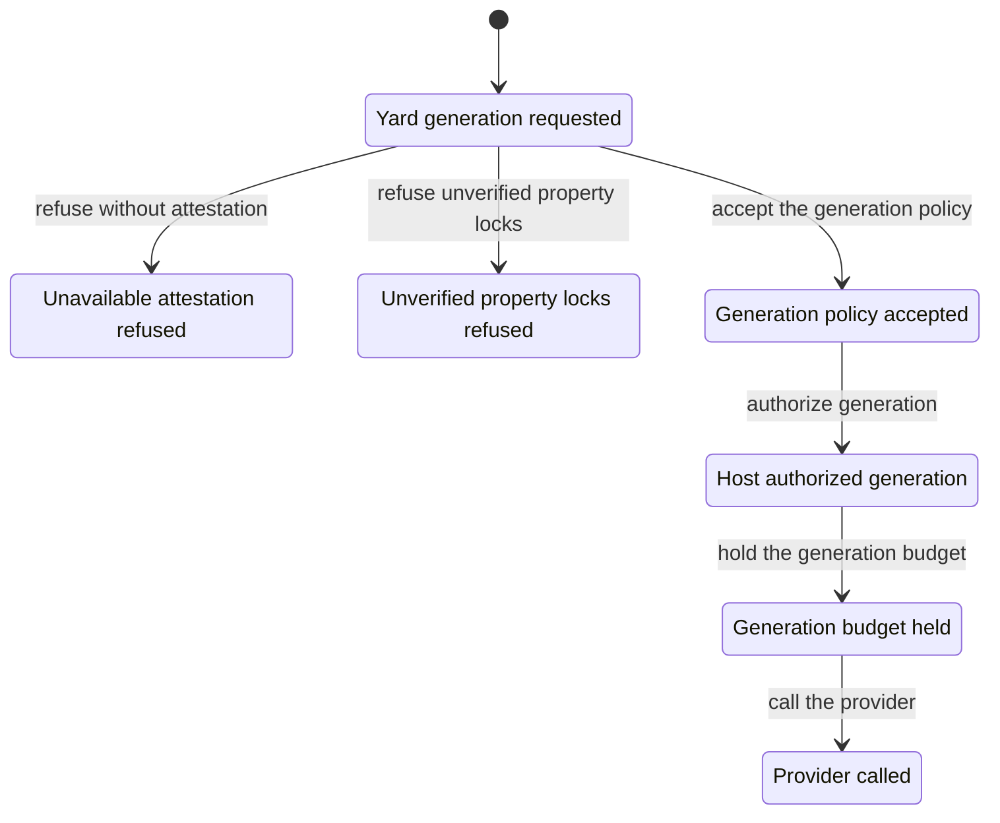

Generated placement requires a shared durable generation quota authority.
After host policy approval and before the budget hold, the broker reserves both
`maxConcurrentGenerations` and `maxYardsPerTenant` capacity for the exact plan.
A missing authority, exhausted quota, mismatched claim or changed authority
stops the provider call. The broker atomically claims a durable execution fence
before provider work and rechecks authority at the call boundary. Only a newly
claimed fence may provision; an existing claim is inspected. Custom authorities
must implement `claimExecution`, `cancelUnclaimed` and `lookupCancellation`
with the same atomic semantics and request-bound cancellation evidence. The direct planner relies on its caller to establish that no matching
Yard exists; standalone saga hosts must enforce their own policy and quota.

The SQLite authority counts a fixed initial inventory and retains claimed or
uncertain work until a trusted verifier accepts readiness. On an admission
failure, the broker attempts to cancel a quota reservation it created if no
execution fence has been claimed. Hosts can call `cancelUnclaimed` for other
stranded reservations after checking the bound attempt. A cancelled key cannot
be reused; a new attempt needs a new key. Cancellation fails if an execution
fence exists, and the broker verifies both the bound cancellation tombstone and
the missing claim; unverified cancellations require reconciliation. Lost quota
or budget reservation acknowledgements are reported for reconciliation. A typed
quota denial must mean the call created no reservation; other errors may have
committed. Budget holds remain separate from quota cancellation.
If the budget execution claim loses its acknowledgement, the broker retains
the hold, attempts to mark it uncertain, and reports the outcome for
reconciliation. It verifies the returned and stored execution claim against
the approved quote and rechecks the stored claim at the provider boundary. A
failure to verify the uncertainty record is also reported.

On upgrade, existing claims are conservatively fenced and already-open older
writers are refused by SQLite write guards. Limits and baseline remain fixed;
all writers must use the same database. Out-of-band Yards, incomplete baseline
entries, inaccurate readiness attestations, lost database files and deleted Yard
reconciliation remain outside this authority's guarantees.

The bounded admission projection hides 38 same-state steps. It assumes the
separate quota, policy, budget and provider evidence checks are truthful.

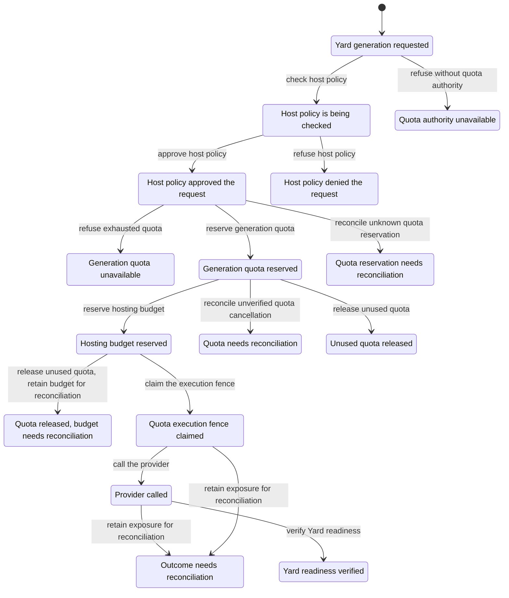

The two-worker claim and cancellation projection hides three same-state
steps. A claimed reservation cannot be cancelled and only the winning caller
may start provider work.

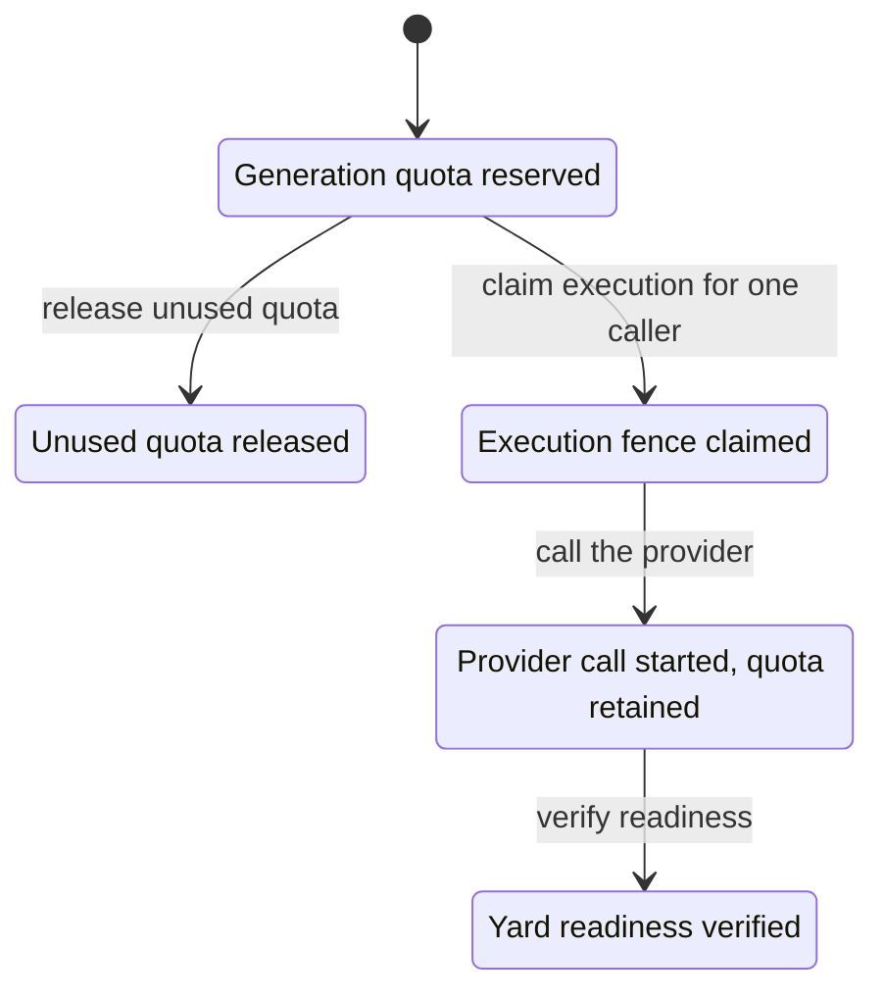

The migration projection hides 12 same-state steps and treats the SQLite
upgrade as atomic. Wrong-scope attempts cannot modify the store.

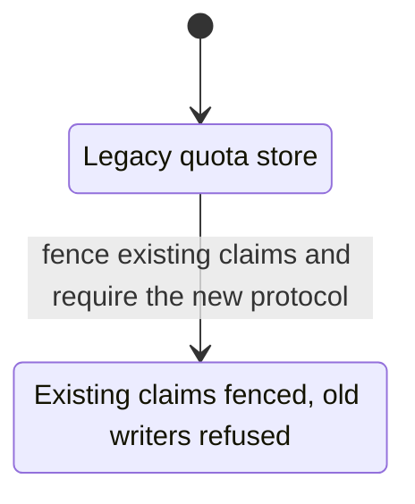

The bounded quota projection follows one of three requests and hides 23
same-state steps; it abstracts execution claims and cancellation, and assumes
atomic storage and trusted baseline and evidence.

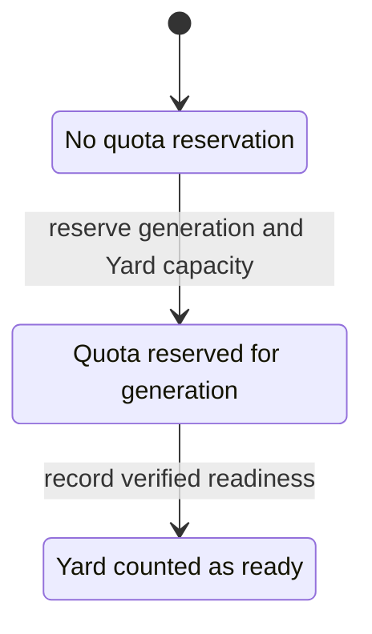

The bounded budget-claim projection hides 15 same-state steps. It treats
claim storage and the provider-call boundary as atomic observations.

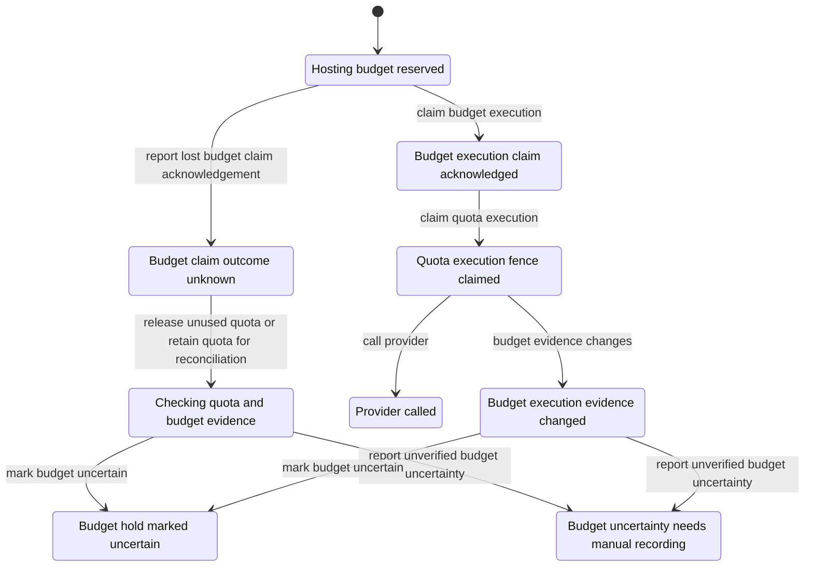

Within one saga instance, identical retries share a pending provision or
inspection; a different plan using the same idempotency key is refused. The
saga snapshots the submitted plan and returned result. Its lease is in memory:
it does not coordinate different processes or survive a restart. A retry with
a different attempt ID is a different plan and is refused by the existing lease.

The bounded retry projection hides 32 same-state steps and models one saga
instance and one idempotency key.

```mermaid
stateDiagram-v2
  s0: Generation not started
  s1: Provider call in progress
  s2: Generation result recorded
  s3: Provider outcome uncertain
  s4: Checking the existing attempt
  [*] --> s0
  s0 --> s1: start provider work
  s1 --> s2: record the provider result
  s1 --> s3: provider reply is lost
  s3 --> s4: inspect the existing attempt
  s4 --> s2: record the inspected result
```

The bounded generation policy projection hides 12 same-state steps and assumes
the separate quote, budget and connector checks succeed.

```mermaid
stateDiagram-v2
  s0: Yard generation requested
  s1: Unavailable approval refused
  s2: Unsupported generation effect refused
  s3: Generation policy accepted
  s4: Host authorized generation
  s5: Generation budget held
  s6: Provider called
  [*] --> s0
  s0 --> s1: refuse without approval
  s0 --> s3: accept the generation policy
  s0 --> s2: refuse the policy effect
  s3 --> s4: authorize generation
  s4 --> s5: hold the generation budget
  s5 --> s6: call the provider
```

The broker snapshots generation policy, runtime registration and connector
identity and methods before policy approval, then checks them again before claim,
before the provider call and after the operation. It invokes pinned connector
methods rather than looking up a new implementation at the call boundary. If
authority changes after a provider effect, the hold remains for reconciliation.
An exact Yard quote must name the requested Yard, and a generation plan for a
different exact ID is refused before funding. After a provider call, a result
for another attempt or Yard is refused and the hold is marked uncertain; if
that write fails, the hold remains and the failure is reported. The returned
and stored uncertainty records must match the captured quote, liability and
budget identity and agree on the execution claim. If a claim response was
lost, either an unclaimed or matching claimed record is accepted; after a
confirmed claim, the matching execution digest must remain present. Invalid or
inconsistent records are reported for reconciliation. An in-progress
result requires a ready signal bound to the same attempt and Yard. A connector's
explicit `ready` result is trusted as readiness evidence when no signal exists.
Provider signal batches must identify the planned attempt and agree with its
Yard, runtime, tenant and idempotency key when those fields are supplied.
Normalized registrations and events are checked before the batch is folded;
broker-owned decisions are refused, event data is privately captured, and
the broker assigns stream sequence numbers. A normalized ready event must name
the attempt; registrations and generic status changes cannot assert readiness.
Connectors emitting signals must include the attempt ID and use supported
provider event types. Earlier mismatched or prematurely accepted generation
attempts may need resource and hold reconciliation.
The host remains responsible for truthful policy, connector and provider facts;
these checks cannot detect a change restored between observations or control
what a remote provider actually does.

The bounded generation identity projection hides 32 same-state steps and assumes
the other policy, quote and readiness checks succeed. The [Yard generation
identity and readiness skill](../../.agents/skills/verify-yard-generation-state/SKILL.md)
checks these boundaries and the provider signal batch separately.

```mermaid
stateDiagram-v2
  s0: Yard generation planned
  s1: Generation plan accepted
  s2: Wrong exact Yard refused
  s3: Generation funding held
  s4: Provider called
  s5: Matching generation accepted
  s6: Hold retained with reconciliation warning
  s7: Hold marked uncertain
  [*] --> s0
  s0 --> s1: accept the generation plan
  s0 --> s2: refuse a different exact Yard
  s1 --> s3: reserve generation funding
  s3 --> s4: call the provider
  s4 --> s6: retain the hold and report the failed write
  s4 --> s5: accept the provider result
  s4 --> s7: mark the hold uncertain
```

The [funded Yard admission skill](../../.agents/skills/verify-yard-funded-admission/SKILL.md)
checks finite abstractions of quote approval, the reservation handoff and
generation recovery.

The uncertainty-evidence model checks 144 states and 216 steps. Its projection
hides 144 same-label steps; it assumes the other reservation fields and the
recorded uncertainty status are already checked.

```mermaid
stateDiagram-v2
  s0: Checking uncertainty evidence
  s1: Uncertain hold verified
  s2: Uncertain hold needs reconciliation
  [*] --> s0
  s0 --> s1: compare returned and stored evidence
  s0 --> s2: compare returned and stored evidence
```

The quote view hides 12 same-label steps and assumes a truthful host and
collision-resistant hash.

```mermaid
stateDiagram-v2
  s0: Quote awaits policy proof
  s1: Unbound approval refused
  s2: Approved quote admitted
  [*] --> s0
  s0 --> s1: refuse mismatched or missing proof
  s0 --> s2: approve this quote
```

The generated-work view hides 32 same-label steps. It assumes the quoted work
and generation plan are truthful and the durable hold is atomic.

```mermaid
stateDiagram-v2
  s0: Work awaits a bound quote
  s1: Unquoted work refused
  s2: Quoted work has a financial hold
  s3: Generation is claimed
  s4: Changed plan refused#59; hold retained
  s5: Provider operation completed
  s6: Current work admitted
  s7: Changed work refused#59; reconcile the hold
  [*] --> s0
  s0 --> s1: refuse an unbound quote
  s0 --> s2: reserve quoted work
  s2 --> s4: refuse a changed plan
  s2 --> s3: claim current generation
  s3 --> s4: refuse a changed plan
  s3 --> s5: run the current provider operation
  s5 --> s7: retain exposure for reconciliation
  s5 --> s6: admit current work
```

The reservation and recovery views hide 128 and 16 same-label steps,
respectively; both assume a truthful host and an atomic durable authority.

```mermaid
stateDiagram-v2
  s0: Quote awaits policy approval
  s1: Changed evidence refused before hold
  s2: Reserve the approved liability
  s3: Recheck before receipt
  s4: Changed evidence refused#59; hold retained
  s5: Funded receipt issued
  [*] --> s0
  s0 --> s1: refuse changed evidence
  s0 --> s2: confirm quote and policy context
  s2 --> s4: retain hold for reconciliation
  s2 --> s3: hold and check evidence
  s3 --> s4: retain hold for reconciliation
  s3 --> s5: issue current receipt
```

```mermaid
stateDiagram-v2
  s0: Generation awaiting funding
  s1: Generation refused
  s2: Funding claimed
  s3: Provider effect completed
  s4: Evidence unavailable#59; reconcile retained hold
  s5: Generated Yard selected
  [*] --> s0
  s0 --> s1: refuse without funding
  s0 --> s2: claim funding
  s2 --> s3: start provider operation
  s3 --> s4: retain exposure for reconciliation
  s3 --> s5: match with current evidence
```

The [Yard generation authority skill](../../.agents/skills/verify-yard-generation-authority/SKILL.md)
checks a finite abstraction of authority changes around a provider effect. This
projection hides 64 same-label steps and assumes truthful host evidence.

```mermaid
stateDiagram-v2
  s0: Generation awaits current authority
  s1: Generation authority claimed
  s2: Changed authority refused#59; hold retained
  s3: Provider operation completed
  s4: Generated Yard admitted
  s5: Changed authority refused#59; reconcile the hold
  [*] --> s0
  s0 --> s2: refuse changed policy, runtime or connector
  s0 --> s1: claim current authority
  s1 --> s2: refuse changed authority
  s1 --> s3: run the provider operation
  s3 --> s5: retain exposure for reconciliation
  s3 --> s4: admit current generation
```

The standalone [generation saga skill](../../.agents/skills/verify-yard-generation-saga/SKILL.md)
checks that a trusted host approves the plan before dispatch and before a cached
retry. The host must enforce its own policy, funding and quota requirements.
This projection hides 47 same-label steps; it abstracts the host decision and
does not prove provider behavior.

```mermaid
stateDiagram-v2
  s0: Generation requested
  s1: Generation refused
  s2: Authorized#59; provider call pending
  s3: Provider called
  [*] --> s0
  s0 --> s2: host approves the plan
  s0 --> s1: host refuses the plan
  s2 --> s3: call the provider with current approval
  s2 --> s1: refuse the provider call
```

Inspection of a started or completed saga also requires the current host
decision. The inspection view hides 36 same-label steps and assumes that the
host decision is truthful; the recorded plan is isolated from the provider.

```mermaid
stateDiagram-v2
  s0: Provider call pending#59; inspection approved
  s1: Provider result recorded#59; inspection approved
  s2: Provider call pending#59; inspection refused
  s3: Provider call pending#59; approved result read
  s4: Provider result recorded#59; inspection refused
  s5: Provider result recorded#59; approved result read
  [*] --> s0
  s0 --> s1: provider result is recorded
  s0 --> s2: host revokes approval
  s0 --> s3: read the approved result
  s1 --> s4: host revokes approval
  s1 --> s5: read the approved result
  s2 --> s0: host restores approval
  s2 --> s4: provider result is recorded
  s3 --> s5: provider result is recorded
  s4 --> s1: host restores approval
```

A provider operation can finish after a host revokes a caller’s decision. The
saga rechecks each waiting caller before returning a result or provider error;
it retains successful results for later authorized inspection. The result view
hides 134 same-label steps and assumes a truthful, synchronous host decision.

```mermaid
stateDiagram-v2
  s0: Provider call pending
  s1: Provider outcome uncertain#59; waiting for callers
  s2: Provider result retained#59; waiting for callers
  s3: Provider outcome uncertain#59; outcome returned
  s4: Provider result retained#59; outcome returned
  s5: Provider outcome uncertain#59; caller refused
  s6: Provider result retained#59; caller refused
  [*] --> s0
  s0 --> s1: provider reply fails#59; retain the started attempt
  s0 --> s2: provider result is recorded
  s1 --> s3: return the outcome with current approval
  s2 --> s4: return the outcome with current approval
  s1 --> s5: refuse the caller
  s2 --> s6: refuse the caller
  s3 --> s5: refuse the caller
  s4 --> s6: refuse the caller
  s5 --> s3: return the outcome with current approval
  s6 --> s4: return the outcome with current approval
```

Without a budget authority, local placement also requires an
explicit `authorizeLocalHosting` callback. It approves the exact request,
catalog, Yard and selected resource placements and returns a bound policy proof
with fulfilled obligations and zero managed-hosting liability. The broker
refuses missing or changed authorization context and stores the proof in the
Yard receipt. Local generation still needs a funded admission; a placement-only
proof cannot authorize provisioning. Hosts must authenticate their own policy
and ensure the asserted bound is enforceable. The local seed cannot impersonate
a remote provider.

The embedded local-process runtime supplies a narrowly scoped policy asserting
that its HoBo service fee is zero. It does not fund the machine's infrastructure
or charges from third-party services; those require separate budget authority.
Its local catalog now records a zero service fee instead of a synthetic positive
price used for preference. Generic hosts must supply their own local authority
or a durable hosting budget; caller-supplied zero estimates alone are refused.

The [local-hosting skill](../../.agents/skills/verify-yard-local-hosting/SKILL.md)
checks a finite abstraction of the policy and liability evidence. This view
hides 64 same-label steps and assumes the host's assertion is truthful.

```mermaid
stateDiagram-v2
  s0: Local work awaits host approval
  s1: Local placement refused
  s2: Bound zero-liability proof accepted
  [*] --> s0
  s0 --> s1: refuse incomplete or denied proof
  s0 --> s2: approve bound zero-liability work
```

`createSqliteBudgetAdmissionAuthority({path, snapshot, now})` is the concrete
local durable adapter. Every operation reloads the authoritative journal under
`BEGIN IMMEDIATE`; journal commit and acknowledgement are atomic. Separate local
connections/processes share the same file. Reopen restores held and uncertain
reservations and idempotent terminal records. Distributed hosts require a shared
transactional database adapter to `BudgetAdmissionAuthority`; copying a SQLite
file or creating one ledger per worker does not establish shared authority.
The in-memory factory is explicitly marked `persistence: 'memory'` and cannot
authorize funded Yard hosting.

`createFleetBudgetAdmissionAuthority` replays decisions from a fixed,
majority-chosen journal. Its inspection calls do not repair an undecided tail.
For active workloads, `createOperationalFleetBudgetAdmissionAuthority` can
recover an already offered entry under a separately funded, revalidated actor
lease before retrying the operation. The host must provide independently
verified member identities, anti-rollback protection and per-voter funding;
an actor lease alone does not fence a delayed provider request.

`pnpm run test:data-live` exercises Broker recovery with PostgreSQL voter
records, a local SQLite actor fixture, a voter outage and a lost acknowledgement.
The live-engine gate requires this test to run and rejects missing or skipped
results. The test does not establish a distributed actor lease.

One transaction reserves global money, provider-account ceilings and each named
free-allocation bucket. Quantities use integer normalized base units; unknown
accounts, units, periods and expired allowance evidence refuse admission. Every
entitlement must have one authoritative owner, including across budget scopes;
independent ledgers may not duplicate a provider account's free allocation.
`unresolvedMicros`, `externalCommittedMicros` and `recoveryReserveMicros` remain
protected in every reserve calculation. `reservedMicros` is exclusively the
authority's journal-derived holds; external commitments use their separate field.

`settle` requires confirmed source retirement and authoritative usage evidence,
including complete actual account charges and entitlement consumption when those
dimensions were reserved. Actual overruns are recorded and consume remaining
headroom. Unknown outcomes retain all holds. `release` requires positive evidence
that the reservation was unused. Policy revisions cannot erase commitments, and
period rollover refuses while journal-owned work remains outstanding. Reducing
external unresolved/committed exposure requires reconciliation evidence.
Zero-cash holds also block rollover: fully credited work still owns its allocation.
Spent account watermarks cannot disappear within a financial period.

`claimExecution` atomically binds a gateway's existing financial reservation to one
transition digest. Replay of that same execution reuses the hold; another execution
cannot claim it. This avoids reserving the same deployment twice while preserving
the financial plan hash and pinned quote identity through crash recovery.
Funded Yard generation claims its hold before calling the provider connector, so
a concurrent unused cancellation cannot release in-flight provisioning liability.
An identical claimed generation retry inspects the original operation instead of
provisioning it again; unknown outcomes retain their financial exposure.

For a cross-provider route operation, the initial reservation may pin a fenced
settlement guard. It binds the budget, quote, execution, logical Camp, source
and destination placements and their deployment, incarnation, manifest and plan
identities, source fence, current and desired Sets, expected
receiver route generation, Trails migration and decision head, route decision
and separately enrolled receiver and financial authority keys. A later claim
cannot change that scope.
The hold remains reserved until the receiver signs the exact committed route and
the financial authority independently signs the final usage and source-stop
evidence. Both proofs and the guard are checked again when replaying the journal.
Keep historical public enrollments available while their records remain in the
journal. An unsigned or uncertain result leaves the hold in place.

The host must authenticate those enrollments and use a receiver that atomically
holds the source operation and commits the route before signing. The finance
signer must independently establish final usage and permanent source retirement;
the signatures do not themselves provide either capability. This interface does
not enroll a receiver, authenticate a provider, or make a route operation safe on
its own. Production readiness must continue to verify the complete host path.

Generated wire records live in `data-models/yard_placement.proto`; constraints
live in `data-models/budget.cue`. The message Pact is hand-authored offline port
evidence, not provider-verified billing evidence. Regression tests exercise the
real SQLite adapter, competing connections, crash/reopen, policy changes,
protected reserves, free-allocation exhaustion and quote selection.

Hosting quote, budget and entitlement evidence must use a valid timestamp with
an explicit `Z` or numeric offset. Freshness and observation-history checks
compare the actual instants, including fractional seconds; different spellings
of the same instant do not create a newer observation. Previously persisted
ambiguous or invalid dates need reconciliation before replay. The HoBo hosting
bridge uses the same exact comparisons; its trusted clock is in milliseconds.
The shared financial time helpers also add integer milliseconds and round elapsed
intervals up to whole minutes without discarding finer timestamp fractions.

The [hosting evidence time skill](../../.agents/skills/verify-hosting-evidence-time/SKILL.md)
checks freshness and observation ordering. Its freshness model explores 256
states and hides 128 same-state steps in this projection.

```mermaid
stateDiagram-v2
  s0: Evidence has an invalid date
  s1: Evidence has expired
  s2: Evidence is from the future
  s3: Evidence is current
  s4: Evidence refused
  s5: Evidence accepted
  [*] --> s0
  [*] --> s1
  [*] --> s2
  [*] --> s3
  s0 --> s4: refuse evidence
  s1 --> s4: refuse evidence
  s2 --> s4: refuse evidence
  s3 --> s5: accept evidence
```

The bridge model checks 16 states. This projection hides eight transitions
between states with the same label; provider timestamps and the host clock
remain trusted inputs.

```mermaid
stateDiagram-v2
  s0: Entitlement observation is current
  s1: Entitlement observation is in the future
  s2: Entitlement evidence accepted
  s3: Entitlement evidence refused
  [*] --> s0
  [*] --> s1
  s0 --> s2: accept evidence
  s1 --> s3: refuse evidence
```

## Budget signal migration and metered preflight

Versioned signal policies supply `identity: {tenantId,budgetId,periodId,policyRevision}`.
Usage and credit facts must name the matching `budgetId` and `periodId`.
`budget.StateReset` explicitly initializes each new identity; threshold cycle
keys include the whole identity. Replays emit no duplicate resets or crossings.
Changing a cap or threshold set requires a new revision. Unscoped legacy policies
retain tenant/lifetime semantics for existing consumers and have no period rollover
guarantee; new hosting controls use versioned identities.

Replay the complete target stream, including event metadata, before appending
signals to it. A recorded signal suppresses emission only if its scope and
payload match the reconstructed transition. A recorded signal that cannot be
reconstructed, a conflicting signal, or an occupied idempotency key requires
journal reconciliation. Explicitly foreign facts are ignored, but missing
scope or invalid amounts on relevant financial facts now
stop the fold; reconcile older unscoped or incomplete records before upgrade.
The journal and its evidence are trusted, and replay alone cannot authenticate
an otherwise matching signal. A concurrent append can occupy a key after the
read; callers must inspect deduplicated append results and reconcile mismatches.

Threshold decisions use exact decimal values serialized from the numeric input.
Reported amounts are numeric projections; if the wire format cannot preserve a
threshold decision, the fold refuses it for reconciliation. Older rounded
signals may disagree with the corrected calculation and must be reconciled before
replay; coordinate the Broker and CI upgrade because CI now validates the exact
decimal threshold projection.

The [budget signal replay skill](../../.agents/skills/verify-budget-signal-replay/SKILL.md)
checks 60 model states. This projection hides 27 transitions between states
with the same label. It assumes the target stream does not change between
replay and append.

```mermaid
stateDiagram-v2
  s0: Journal contains a conflicting signal or key
  s1: Matching signal already recorded
  s2: No matching signal recorded
  s3: Financial facts are incomplete
  s4: Recorded signal has no matching transition
  s5: Replay refused for reconciliation
  s6: Matching signal suppressed
  s7: Signal ready to append
  s8: Signal appended
  [*] --> s0
  [*] --> s1
  [*] --> s2
  [*] --> s3
  [*] --> s4
  s0 --> s5: require reconciliation
  s1 --> s6: reuse recorded signal
  s2 --> s7: prepare signal
  s3 --> s5: require reconciliation
  s4 --> s5: require reconciliation
  s7 --> s8: append signal
```

The [budget signal arithmetic skill](../../.agents/skills/verify-budget-signal-arithmetic/SKILL.md)
checks 75 threshold states and 12 wire-projection states. The threshold chart
hides 155 transitions between states with the same label.

```mermaid
stateDiagram-v2
  s0: Spend remains below threshold
  s1: Budget threshold crossed
  s2: Spend remains above threshold
  s3: Budget headroom restored
  [*] --> s0
  s0 --> s1: record usage
  s1 --> s2: record usage or apply credit
  s1 --> s3: apply credit
  s2 --> s3: apply credit
  s3 --> s1: record usage
  s3 --> s0: apply credit or record usage
```

Zero USD budget or per-resolution cap means zero, never unlimited. Unlimited
preflight behavior requires `budgetUnlimited` or `spendCapUnlimited` explicitly.
The default billing plane retains successful estimates as in-memory holds, so
later requests cannot spend them again. It requires a stable request ID and has
no meter feed: confirmed-unused holds can be released, while successful holds
remain for the lifetime of the plane. Repeated resolutions require
reconciliation rather than receiving another receipt.
`createMeteredBillingPlane` rereads a live event reader on each authorization and
holds outstanding request identities atomically within that one plane. Consumable
snapshot iterators are rejected. A finalized usage fact may retire a hold only by
naming its reservation ID, and that identity cannot be authorized again. Observed
meter facts must remain an unchanged prefix on later reads. Costs and holds use
their serialized decimal values for exact comparisons. A repeated broker
resolution with an existing metered hold requires reconciliation instead of
issuing another receipt. Only a hold created by the current resolution is
released after placement fails. Custom billing planes should return
`reservationCreated` so the broker can distinguish new holds from replays.

This legacy preflight trusts its reader, estimates, and unused-funds
confirmation. Its holds and observation checkpoint are in memory, so restart
loses them; multiple instances do not coordinate. It cannot detect facts that
were already missing on the first read. It is not the durable financial authority
for funded cloud hosting.

The [metered billing skill](../../.agents/skills/verify-broker-metered-billing/SKILL.md)
checks the implementation against generated histories, a bounded TLA+ model,
and an exact-real proof. The following projection covers 48 model states and
hides 140 same-state steps, including replay refusals and evidence changes.

```mermaid
stateDiagram-v2
  s0: Waiting for authorization
  s1: Budget held while placing
  s2: Resolution issued#59; budget held
  s3: Final usage recorded
  [*] --> s0
  s0 --> s1: reserve the estimate [if evidence and budget permit]
  s1 --> s0: release the new unused hold
  s1 --> s2: issue the resolution
  s2 --> s3: record final usage
```

`authorizeBillingSpend` accepts a complete current `QuoteVector` only with an
`attestQuote` callback supplied by a trusted host. The callback must authenticate
the quote, bind it to the actual work and current pricing evidence, and return a
conservative `liabilityBoundUsd`. The bound must cover the quote's expected bill;
the helper compares that bound, not the expected bill, against the budget. The
helper rejects a quote changed during attestation. A quote hash detects changed
contents but does not authenticate its source. Callers using `quoteIncrementalUsd`
or `quoteIncrementalDecimal` must supply the complete quote and attestation.
Raw `spendEstimateUsd` requires explicit `trustEstimate: true` and remains a
trusted caller assertion. The helper does not create a hold; its caller must use
a billing authority for admission.

`createBroker` requires a `pricingAuthority` by default. For each request it
enumerates eligible combinations of definitions and regions, up to
`MAX_BROKER_QUOTE_PLANS` (128), and asks the host for a complete attested USD
quote for every plan. The immutable work, catalog, environment, policy and
station pins are bound to each quote. The broker rejects the search if it is
too large or any candidate's quote is missing, ineligible or untrusted. It
orders the statically affordable plans by their exact quoted total, then sends
the selected plan's conservative liability to both the policy gate and the
billing plane. Quote and attestation callbacks must be side-effect free and may
run many times per request; hosts should account for their latency.

The default billing plane accounts for existing holds. If it denies a candidate
for budget or cap reasons without creating a reservation, the broker can try
the next cheapest plan. A custom billing plane enables this fallback only by
returning `noReservationCreated: true` on a denial that created no reservation
or external effect. An ambiguous denial stops the search. Gate denials and
approval requirements also stop the search. The `broker.CandidateUnaffordable`
event records an attempted plan that was safely declined. The broker rechecks
the authority and evidence across policy and billing callbacks and requires
billing to confirm a new hold. Quote-backed receipts carry the quote hash,
work-binding digest and authorized amount; the optional receipt signature covers
these fields. The host must authenticate quote sources and bind each quote to
the work, current pricing evidence and a conservative provider liability.

Catalog entries still require a provider, distinct definition ID, SKU, unit and
nonnegative price in the pricing package's decimal syntax. Exponent notation
and leading-zero spellings accepted by the former floating-point parser need
migration. Different marginal units are allowed when comparing complete USD
quotes. `trustLegacyEstimates: true` explicitly restores trust in the caller's
estimate and marginal-price ordering, which requires matching units and cannot
establish the cheapest complete plan. Guest requests reject until consent and
claim evidence are integrated into admission.

The CLI's built-in local-host authority attests the local provider's zero service
fee only. It does not cover charges for the underlying machine or other services.
Registry-backed CLI composition needs a host-supplied pricing authority. The
default billing plane's holds are in memory; they are not shared or durable.
Delivery requires an unchanged receipt issued by the same broker instance. It
rechecks quoted evidence and the catalog and environment, then claims the
receipt before submitting it. A failed or uncertain submission cannot be
reissued by that instance without reconciliation. This process-local registry
is lost on restart; it does not authenticate the caller, provide cross-process
coordination, or verify that a remote receiver honors the quote at execution.

The [whole-quote routing skill](../../.agents/skills/verify-broker-whole-quote-routing/SKILL.md)
checks a two-plan abstraction of quote search and billing fallback. The following
views hide 144 and 16 same-label steps respectively; they assume complete,
truthful quotes and honest billing results.

```mermaid
stateDiagram-v2
  s0: Plans awaiting complete quotes
  s1: Trusted complete quotes ready
  s2: Request refused
  s3: Affordable plan selected
  [*] --> s0
  s0 --> s2: refuse incomplete search
  s0 --> s1: check all quotes and bounds
  s1 --> s3: select lowest quoted total
  s1 --> s2: no candidate fits the cap
```

```mermaid
stateDiagram-v2
  s0: Policy decision pending
  s1: Cheapest candidate at billing
  s2: Request refused
  s3: Placement funded
  s4: Next candidate at billing
  [*] --> s0
  s0 --> s2: policy refuses
  s0 --> s1: policy allows
  s1 --> s2: ambiguous denial
  s1 --> s3: authorize cheapest candidate
  s1 --> s4: safe budget denial
  s4 --> s2: next candidate unaffordable
  s4 --> s3: authorize next candidate
```

The [catalog ordering skill](../../.agents/skills/verify-broker-catalog-ordering/SKILL.md)
checks 256 abstract two-candidate states for legacy estimate ordering. This
view hides 128 same-label steps; it does not compare complete plan quotes or
establish currency completeness.

```mermaid
stateDiagram-v2
  s0: A catalog price is invalid
  s1: Catalog price units differ
  s2: Catalog identities conflict
  s3: Comparable catalog prices are ready
  s4: Catalog evidence refused
  s5: Lowest comparable catalog price selected
  [*] --> s0
  [*] --> s1
  [*] --> s2
  [*] --> s3
  s0 --> s4: refuse incomplete evidence
  s1 --> s4: refuse incomplete evidence
  s2 --> s4: refuse incomplete evidence
  s3 --> s5: compare exact prices
```

The [resolution signature skill](../../.agents/skills/verify-broker-resolution-signature/SKILL.md)
checks 256 abstract evidence states. This view hides 128 same-label steps and
assumes the host has enrolled the correct broker key.

```mermaid
stateDiagram-v2
  s0: Public key is invalid or contains private material
  s1: Signing keys disagree
  s2: Signing keys match
  s3: Signing key is not enrolled
  s4: Signature or digest is invalid
  s5: Signature and trusted key are ready
  s6: Signature evidence refused
  s7: Resolution signed
  s8: Trusted signature accepted
  [*] --> s0
  [*] --> s1
  [*] --> s2
  [*] --> s3
  [*] --> s4
  [*] --> s5
  s0 --> s6: refuse invalid evidence
  s1 --> s6: refuse invalid evidence
  s2 --> s7: accept valid evidence
  s3 --> s6: refuse invalid evidence
  s4 --> s6: refuse invalid evidence
  s5 --> s8: accept valid evidence
```

The [delivery claim skill](../../.agents/skills/verify-broker-delivery-claim/SKILL.md)
checks 23 delivery states and 12 resolution-identity states. This delivery view
hides 30 same-label steps and covers a single broker instance; it does not model
a restart or the remote receiver's execution.

```mermaid
stateDiagram-v2
  s0: Receipt ready for delivery
  s1: Receipt and quote being checked
  s2: Delivery submitted#59; result pending
  s3: Delivery accepted
  s4: Delivery outcome requires reconciliation
  [*] --> s0
  s0 --> s1: check the issued receipt
  s1 --> s2: submit delivery
  s2 --> s3: record acceptance
  s2 --> s4: submission outcome is uncertain
  s1 --> s0: refuse stale evidence
```

The [quote-backed admission skill](../../.agents/skills/verify-broker-quote-admission/SKILL.md)
checks 108 states. This view hides 140 same-label steps, including evidence
changes; it does not model delivery or guarantee freshness after the final check.

```mermaid
stateDiagram-v2
  s0: Selected work awaits pricing
  s1: Policy reviews the quoted liability
  s2: Quote and policy checked
  s3: Resolution refused
  s4: Budget held#59; final check pending
  s5: Evidence checked#59; receipt pending
  s6: Resolution issued with pricing evidence
  [*] --> s0
  s0 --> s1: send liability to policy
  s1 --> s2: recheck current evidence
  s0 --> s3: refuse stale or unfunded work
  s2 --> s3: refuse stale or unfunded work
  s2 --> s4: create a hold
  s1 --> s3: refuse stale or unfunded work
  s4 --> s5: recheck the quote
  s5 --> s6: issue the receipt
  s4 --> s3: refuse stale or unfunded work
```

The [quote provenance skill](../../.agents/skills/verify-broker-quote-provenance/SKILL.md)
checks 64 evidence states and 162 liability states. This projection hides 32
same-label steps and treats the host attestation as a trusted predicate.

```mermaid
stateDiagram-v2
  s0: Pricing evidence is invalid
  s1: Legacy estimate has no trust
  s2: Legacy estimate is explicitly trusted
  s3: Quote has no host attestation
  s4: Quote is attested by the host
  s5: Quote changed during attestation
  s6: Pricing evidence refused
  s7: Pricing evidence accepted
  [*] --> s0
  [*] --> s1
  [*] --> s2
  [*] --> s3
  [*] --> s4
  [*] --> s5
  s0 --> s6: refuse evidence
  s1 --> s6: refuse evidence
  s2 --> s7: accept evidence
  s3 --> s6: refuse evidence
  s4 --> s7: accept evidence
  s5 --> s6: refuse evidence
```

Broker request documents must supply `spendEstimateUsd` (or
`spend_estimate_usd`) explicitly, including for free work. Conflicting aliases
reject. Protobuf clients must set the optional scalar even when it is zero;
older encoders that omitted a zero scalar must migrate. For `hobo broker up`,
the built-in local-host catalog can supply its zero estimate; registry-backed
deployments require `--request` with an explicit estimate and a host pricing
authority. An explicit estimate is still a caller assertion and does not
establish quote provenance.

The [request-estimate skill](../../.agents/skills/verify-broker-request-estimate/SKILL.md)
checks those boundaries. Its model explores 14 states and hides seven
same-state steps in this projection.

```mermaid
stateDiagram-v2
  s0: Request has an invalid estimate
  s1: Request has no estimate
  s2: Use the zero-cost local catalog
  s3: Registry request has no estimate
  s4: Request has an explicit estimate
  s5: Request refused
  s6: Continue to the budget check
  [*] --> s0
  [*] --> s1
  [*] --> s2
  [*] --> s3
  [*] --> s4
  s0 --> s5: refuse the request
  s1 --> s5: refuse the request
  s2 --> s6: accept the estimate
  s3 --> s5: refuse the request
  s4 --> s6: accept the estimate
```

The [broker budget skill](../../.agents/skills/verify-broker-budget-authority/SKILL.md)
checks this authorization boundary alongside budget holds and settlement. Its
quote model explores 2,304 states; this constrained projection explores 96
states and hides 48 same-state transitions. Quote validity is abstracted and
the model assumes trusted evidence.

```mermaid
stateDiagram-v2
  s0: Spend evidence received
  s1: Spend authorized
  s2: Spend denied
  [*] --> s0
  s0 --> s2: check evidence and bounds
  s0 --> s1: check evidence and bounds
```

The **HoBo Broker**: the policy-governed authority that actually brokers
Bindle/Camp/Yard/Junction placements **across providers**, spins resources up
and down, and hands accepted work to delivery — based on the configured
policies the broker itself maintains. It is the runtime counterpart of the
[Meta-cloud Broker design](../../docs/design/hobo-broker.md); the Meta-cloud
Broker artifact vocabulary (Contract Manifest → Resolution Receipt /
Resolution Rejection) is preserved here as the receipt/rejection wire shapes.

This broker is **distinct** from the Identity token broker (ADR-0008) and the
connector runtime broker (HOBO-235): those broker *credentials*; this package
brokers *placements*. The connector registry below stores `credentialRef`
pointers into the token broker — never raw secrets.

## What it wraps

The broker is a wrapper around five planes, each behind a port so engines can
be swapped without touching the brokering pipeline:

| Plane | Port | Default engine | Alternate engine (shipped in this package) |
|---|---|---|---|
| Policy | `GatePlane` (OPA-shaped request/decision documents) | `@hobo/contracts` policy pack (imported and **run**, not reinvented) | **Rego** via `createOpaGatePlane` — OPA Data API decision at `hobo/broker/decision`, fail-closed (`policy-engine-unavailable`), pinned by `broker_policy_opa.pact.json` |
| Contracts | `GatePlane` (can-deploy compatibility) | `@hobo/contracts` Gatekeeper (PACT-style boundary semantics) | an external Pact broker verification feed (port-compatible) |
| Billing | `BillingPlane` | in-process budget holds, spend-cap and quota checks | `createMeteredBillingPlane` — folds `meter.UsageRecorded` facts into observed spend and authorizes against the metered remaining budget; `authorizeBillingSpend` checks a complete eligible pricing quote and a host-attested liability bound |
| Delivery | `DeliveryPlane` | `createDeliveryPlane` — in-process conductor only; agent/publisher policies fail closed with `delivery-plane-unwired` | `createReconcilerDeliveryPlane({ requestPromotion })` — every receipt is delivered through `@hobo/cd` (ADR-0182: D14), fail-closed, pinned by `broker_delivery_cd.pact.json`. GitOps rendering (Argo CD `Application`, Flux `Kustomization`) moved to `@hobo/cd-gitops` |
| Connectors | `ConnectorRegistry` | event-sourced registry of `github-app`, `pulumi`, `azure`, `vercel`, `cloudflare`, `custom` configs | an external connector catalog |

Beyond M0, this package also ships:

- **Receipt integrity** — optional Ed25519 detached signatures over canonical
  JSON (`signResolution`/`verifyResolution`, `broker.ResolutionSigned` facts).
  Verification requires `verifyResolution(receipt, signature, trustedPublicKeyPem)`
  with the expected broker's independently enrolled public key and checks the
  payload digest. Signing rejects private key material in the public key field;
  only a normalized public key is emitted. The signature's embedded key does not
  establish trust. Object keys sort by UTF-16 code units, independent of locale.
  Callers must map the enrolled key to the correct broker and scope.
  Signatures produced with the earlier locale-dependent key order may need
  reissuance if their canonical ordering differs.
- **The closed rejection matrix** (`REJECTION_MATRIX`) — every broker-owned
  rejection code pinned to its plane and an agent-actionable remediation,
  test-enforced against the pipeline.
- **Cedar** as the second external policy language (`createCedarGatePlane`,
  fail-closed, pinned by `broker_policy_cedar.pact.json`) beside Rego.
- **Broker Environments** (admin controls): `publishEnvironmentFact` /
  `approveEnvironmentFact` / `foldBrokerEnvironments`; resolutions against an
  unapproved environment or a stale pinned catalog snapshot reject
  (`environment-unapproved`, `catalog-snapshot-stale`), and eligibility is
  bounded to the environment's approved providers.
- **The hosted authority surface** — `createBrokerHttpHandler` / `serveBroker`
  expose resolve/scale/deliver/rejection-matrix over HTTP, and the resolve
  route is PROVIDER-verified against `broker_resolution.pact.json`
  (`contracts/provider/`). The `hobo broker` CLI verb (and its derived MCP
  tool) runs the same pipeline against the composed Yard's live registry.

Branding note: product surfaces call this component **the Conductor**; code
and technical docs keep **broker**.

Placement itself consumes any `BrokerCatalog` — a structural mirror of
`@hobo/cloud`'s `PlannerRegistry`, so the Yard's live provider catalog plugs
in directly.

## Command/event model

The broker is an **actor**: it consumes commands (`resolve`, `scale`,
`deliver`, connector `register`/`disable`), coordinates durable state through
the facts it emits, and never mutates a query read model directly. Event
families:

- `broker.Requested` → `broker.Resolved` (receipt) or `broker.Rejected`
  (structured per-plane reasons), with the Gatekeeper's `policy.Decided` /
  `gatekeeper.Decided` facts appended to the same stream for replay.
- `broker.ScaleRequested` — spin up/down/zero directives.
- `broker.DeliverySubmitted` — delivery-plane handoff. Body schema `hobo.broker.delivery-submitted/v2` (reconciler mode, publisher, promotion id); persisted v1 bodies (`engine: argo | in-proc`) are lifted by `upcastDeliverySubmitted` (golden corpus `test/fixtures/delivery-submitted/`).
- `connector.Registered` / `connector.Disabled` — connector registry facts.

Query surfaces are event-driven: `foldBrokerDecisions` and
`foldConnectorRegistry` are pure folds over the **event store** stream into
**materialized view** rows (each **projection** rebuilds from zero), and
`snapshotBrokerDecisions`/`restoreBrokerDecisions` persist a **snapshot** of
the current rows to a **read store** for cached current reads; replaying the
stream over a restored snapshot yields the same view.

## Parse, don't validate

Untrusted policy documents, brokering requests, connector configs, and scale
directives cross exactly one parser boundary (`parseBrokerPolicySet`,
`parseBrokerRequest`, `parseConnectorConfig`, `parseScaleDirective`). The
parsers apply the protobuf + CUE constraints from `data-models/broker.proto`
and `data-models/broker.cue` and return refined **parsed domain types**
(`src/types.ts`, including the branded `PolicyHash` derived type), so invalid
values are unrepresentable past the boundary — core functions never re-check
raw DTOs.

## Policy semantics

Placement policies are maintained per topology scope kind. The effective
policy for a request merges junction → yard → camp → bindle: narrower scopes
override choice-shaped fields (objective, allowed providers/regions, pins),
while restrictions **accumulate** — a junction broker admin's
`requireExplicitCamps` lockdown or denied-provider list can never be relaxed
by a narrower policy. Every receipt and rejection pins `policyHash` (the
content address of the whole policy set) and `catalogHash`, so a decision is
replayable against the exact policies and catalog that produced it.

## Boundary contract

The consumer-driven PACT contract for the resolve boundary lives in
[`contracts/pacts/broker_resolution.pact.json`](contracts/pacts/broker_resolution.pact.json),
exercised by `contracts/consumer/broker-resolution-boundary.test.ts`.

## Verification

```sh
pnpm --filter @hobo/broker test
pnpm --filter @hobo/broker test:contract:consumer
```

## Delivery policy (neutral, ADR-0182 D14)

`DeliveryPolicy` names how a Camp converges, never a GitOps engine, cluster or
namespace:

| Field | Meaning |
|---|---|
| `reconciler_mode` | `conductor` (in-process), `agent` (pull agent) or `publisher` (a `@hobo/cd-gitops` publisher). |
| `publisher` | `{ target: argo-cd \| flux, repository? }`, exactly in `publisher` mode. |
| `sync_mode`, `prune` | Unchanged. |
| `engine`, `gitops_repo`, `destination_namespace` | Deprecated wire fields. `engine: argo` maps to the `argo-cd` publisher (its `gitops_repo` becomes `publisher.repository`); `engine: in-proc` maps to `conductor`. `destination_namespace` is never read. |

`DeliveryPolicy.engine` / `DeliveryTicket.engine` survive only as a display
label (`in-proc`, `agent`, `publisher:<target>`) for existing readers.

## Runbook

| Symptom | Cause | Action |
|---|---|---|
| `delivery-plane-unwired` | The policy routes through an agent or publisher but the broker was built without the CD plane. | Compose `createReconcilerDeliveryPlane({ requestPromotion })` (the CD host does this), or set `reconciler_mode: conductor` for local runs. |
| `delivery-refused` | CD refused the promotion (window, lineage, gate, policy). | Inspect the reasons and reconcile the claimed attempt before authorizing another one. |
| `delivery-transport-failed` | The request or response failed in transit. | Reconcile with CD; the promotion may have been accepted before the response was lost. |
| `delivery-fact-unknown` on replay | A persisted `broker.DeliverySubmitted` body has a shape the upcaster does not know. | Add the shape and a golden corpus entry before replaying. |
| A legacy policy still says `engine: argo` | Pre-D14 configuration. | It keeps working through the `argo-cd` publisher; migrate to `reconciler_mode: publisher` + `publisher.target: argo-cd`. |

## Budget authority verification

The [budget-authority verification skill](../../.agents/skills/verify-broker-budget-authority/SKILL.md)
checks admission, held liabilities, replay, and receiver- and finance-signed
settlement. Generated histories exercise the TypeScript authority; the finite
TLA+ models and unbounded arithmetic abstraction state their assumptions and do
not prove the storage adapters, cryptography, or provider effects.

The following is a projection of the signed-settlement model, not a production
trace. TLC explored 129 states and 830 steps; the chart hides 723 steps that
remain within a displayed state.

```mermaid
stateDiagram-v2
  [*] --> NoReservation
  NoReservation --> UnclaimedHold: admit reservation
  UnclaimedHold --> ClaimedHold: claim admitted execution
  UnclaimedHold --> Released: confirm unused work
  ClaimedHold --> Settled: accept both signed proofs
```
