# @hobo/broker

## Hosting budget admission

`resolveBindleDeployment` ranks compatible Yards using trusted, normalized,
whole-request hosting quotes. Capacity is never a substitute for price. A quote
contains itemized expected cost and a separate conservative liability bound in
integer USD microdollars. Unknown, stale, foreign, unbounded or unaffordable
quotes are ineligible. The provider and tenant on every quote must match the
selected Yard; residual resources stay within that Yard's provider.
Each residual resource requires a full catalog capability verdict and a region
supported by its selected definition. Wildcards must also report a full match.
Eligible definitions need distinct IDs and nonnegative decimal marginal prices
with matching units; comparison is exact and ties use the definition ID. Failed
or changing catalog evidence refuses placement. Marginal ordering remains a
per-resource comparison and does not establish whole-request cost optimality.
Resource IDs and ports must be nonempty, and resource IDs must be unique. Each
resource execution unit records the exact definition selected for that resource.
`buildExecutionUnits` callers must pass `resourcePlacements` containing explicit
resource and definition ID pairs; the former parallel ID arrays could not express
that association reliably.

The [Yard residual placement skill](../../.agents/skills/verify-yard-residual-placement/SKILL.md)
checks a one-resource abstraction of capability and evidence. This view hides 24
same-label steps; it assumes the host's catalog evidence is truthful.

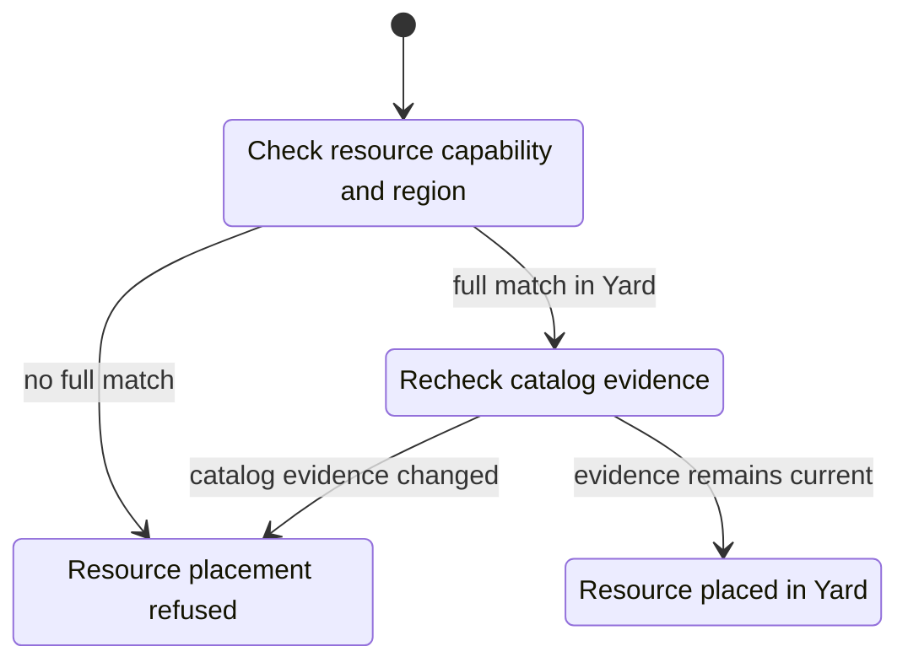

The [Yard resource binding skill](../../.agents/skills/verify-yard-resource-binding/SKILL.md)
checks a two-resource abstraction. This projection hides 32 same-label steps;
the separate request-snapshot model also checks a caller mutation.

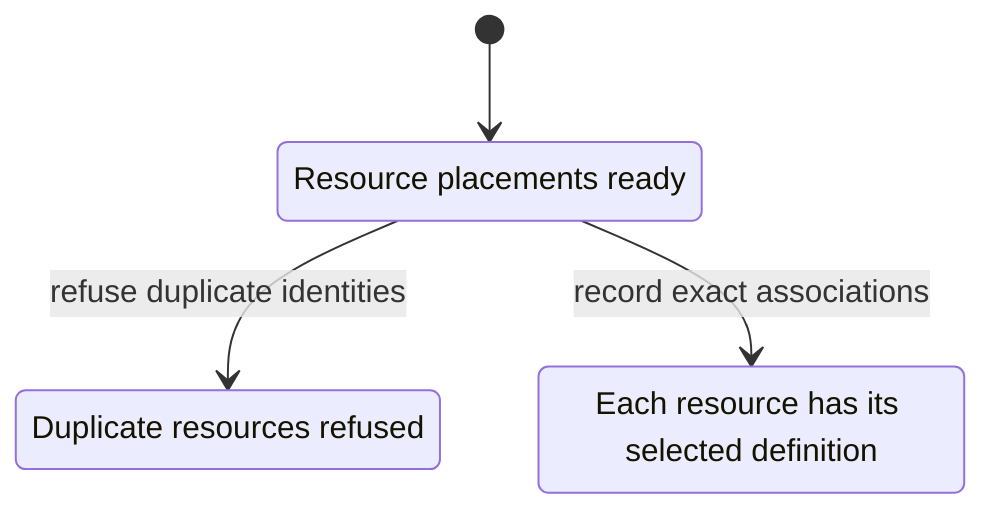

Funded hosting requires `hostingBudget: {authority, quotes, now}` and a bound
`authorizeHosting` callback. The callback returns the existing `GateDecision`
plus a generated `HostingPolicyProof` tied to request digest, quote, budget
identity/revision and policy hash. Denials, pending approvals and unfulfilled
obligations refuse admission. A successful receipt pins proof, quote and financial
reservation. The zero-cost local host floor remains available; the local seed
cannot impersonate a remote provider.

`createSqliteBudgetAdmissionAuthority({path, snapshot, now})` is the concrete
local durable adapter. Every operation reloads the authoritative journal under
`BEGIN IMMEDIATE`; journal commit and acknowledgement are atomic. Separate local
connections/processes share the same file. Reopen restores held and uncertain
reservations and idempotent terminal records. Distributed hosts require a shared
transactional database adapter to `BudgetAdmissionAuthority`; copying a SQLite
file or creating one ledger per worker does not establish shared authority.
The in-memory factory is explicitly marked `persistence: 'memory'` and cannot
authorize funded Yard hosting.

`createFleetBudgetAdmissionAuthority` replays decisions from a fixed,
majority-chosen journal. Its inspection calls do not repair an undecided tail.
For active workloads, `createOperationalFleetBudgetAdmissionAuthority` can
recover an already offered entry under a separately funded, revalidated actor
lease before retrying the operation. The host must provide independently
verified member identities, anti-rollback protection and per-voter funding;
an actor lease alone does not fence a delayed provider request.

`pnpm run test:data-live` exercises Broker recovery with PostgreSQL voter
records, a local SQLite actor fixture, a voter outage and a lost acknowledgement.
The live-engine gate requires this test to run and rejects missing or skipped
results. The test does not establish a distributed actor lease.

One transaction reserves global money, provider-account ceilings and each named
free-allocation bucket. Quantities use integer normalized base units; unknown
accounts, units, periods and expired allowance evidence refuse admission. Every
entitlement must have one authoritative owner, including across budget scopes;
independent ledgers may not duplicate a provider account's free allocation.
`unresolvedMicros`, `externalCommittedMicros` and `recoveryReserveMicros` remain
protected in every reserve calculation. `reservedMicros` is exclusively the
authority's journal-derived holds; external commitments use their separate field.

`settle` requires confirmed source retirement and authoritative usage evidence,
including complete actual account charges and entitlement consumption when those
dimensions were reserved. Actual overruns are recorded and consume remaining
headroom. Unknown outcomes retain all holds. `release` requires positive evidence
that the reservation was unused. Policy revisions cannot erase commitments, and
period rollover refuses while journal-owned work remains outstanding. Reducing
external unresolved/committed exposure requires reconciliation evidence.
Zero-cash holds also block rollover: fully credited work still owns its allocation.
Spent account watermarks cannot disappear within a financial period.

`claimExecution` atomically binds a gateway's existing financial reservation to one
transition digest. Replay of that same execution reuses the hold; another execution
cannot claim it. This avoids reserving the same deployment twice while preserving
the financial plan hash and pinned quote identity through crash recovery.
Funded Yard generation claims its hold before calling the provider connector, so
a concurrent unused cancellation cannot release in-flight provisioning liability.
An identical claimed generation retry inspects the original operation instead of
provisioning it again; unknown outcomes retain their financial exposure.

For a cross-provider route operation, the initial reservation may pin a fenced
settlement guard. It binds the budget, quote, execution, logical Camp, source
and destination placements and their deployment, incarnation, manifest and plan
identities, source fence, current and desired Sets, expected
receiver route generation, Trails migration and decision head, route decision
and separately enrolled receiver and financial authority keys. A later claim
cannot change that scope.
The hold remains reserved until the receiver signs the exact committed route and
the financial authority independently signs the final usage and source-stop
evidence. Both proofs and the guard are checked again when replaying the journal.
Keep historical public enrollments available while their records remain in the
journal. An unsigned or uncertain result leaves the hold in place.

The host must authenticate those enrollments and use a receiver that atomically
holds the source operation and commits the route before signing. The finance
signer must independently establish final usage and permanent source retirement;
the signatures do not themselves provide either capability. This interface does
not enroll a receiver, authenticate a provider, or make a route operation safe on
its own. Production readiness must continue to verify the complete host path.

Generated wire records live in `data-models/yard_placement.proto`; constraints
live in `data-models/budget.cue`. The message Pact is hand-authored offline port
evidence, not provider-verified billing evidence. Regression tests exercise the
real SQLite adapter, competing connections, crash/reopen, policy changes,
protected reserves, free-allocation exhaustion and quote selection.

Hosting quote, budget and entitlement evidence must use a valid timestamp with
an explicit `Z` or numeric offset. Freshness and observation-history checks
compare the actual instants, including fractional seconds; different spellings
of the same instant do not create a newer observation. Previously persisted
ambiguous or invalid dates need reconciliation before replay. The HoBo hosting
bridge uses the same exact comparisons; its trusted clock is in milliseconds.
The shared financial time helpers also add integer milliseconds and round elapsed
intervals up to whole minutes without discarding finer timestamp fractions.

The [hosting evidence time skill](../../.agents/skills/verify-hosting-evidence-time/SKILL.md)
checks freshness and observation ordering. Its freshness model explores 256
states and hides 128 same-state steps in this projection.

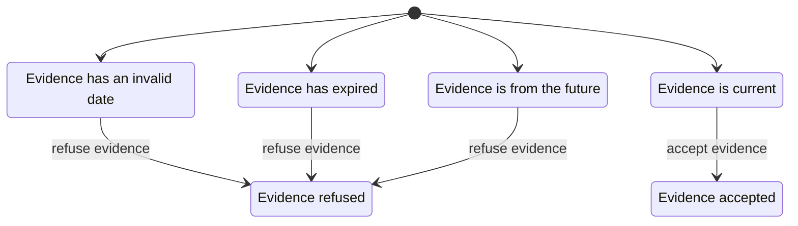

The bridge model checks 16 states. This projection hides eight transitions
between states with the same label; provider timestamps and the host clock
remain trusted inputs.

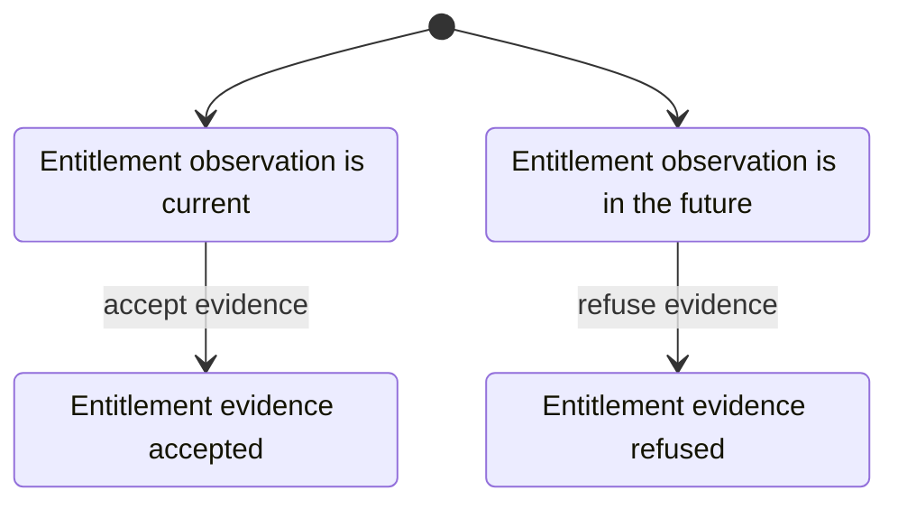

## Budget signal migration and metered preflight

Versioned signal policies supply `identity: {tenantId,budgetId,periodId,policyRevision}`.
Usage and credit facts must name the matching `budgetId` and `periodId`.
`budget.StateReset` explicitly initializes each new identity; threshold cycle
keys include the whole identity. Replays emit no duplicate resets or crossings.
Changing a cap or threshold set requires a new revision. Unscoped legacy policies
retain tenant/lifetime semantics for existing consumers and have no period rollover
guarantee; new hosting controls use versioned identities.

Replay the complete target stream, including event metadata, before appending
signals to it. A recorded signal suppresses emission only if its scope and
payload match the reconstructed transition. A recorded signal that cannot be
reconstructed, a conflicting signal, or an occupied idempotency key requires
journal reconciliation. Explicitly foreign facts are ignored, but missing
scope or invalid amounts on relevant financial facts now
stop the fold; reconcile older unscoped or incomplete records before upgrade.
The journal and its evidence are trusted, and replay alone cannot authenticate
an otherwise matching signal. A concurrent append can occupy a key after the
read; callers must inspect deduplicated append results and reconcile mismatches.

Threshold decisions use exact decimal values serialized from the numeric input.
Reported amounts are numeric projections; if the wire format cannot preserve a
threshold decision, the fold refuses it for reconciliation. Older rounded
signals may disagree with the corrected calculation and must be reconciled before
replay; coordinate the Broker and CI upgrade because CI now validates the exact
decimal threshold projection.

The [budget signal replay skill](../../.agents/skills/verify-budget-signal-replay/SKILL.md)
checks 60 model states. This projection hides 27 transitions between states
with the same label. It assumes the target stream does not change between
replay and append.

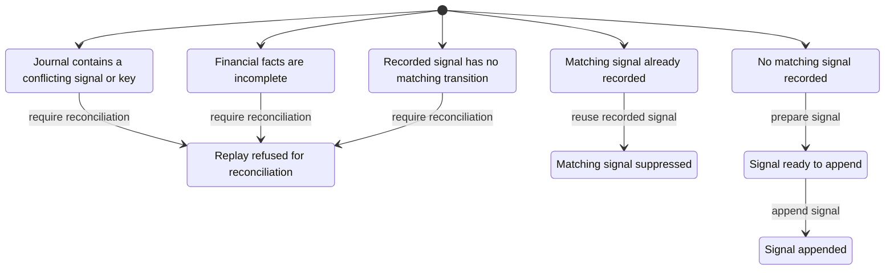

The [budget signal arithmetic skill](../../.agents/skills/verify-budget-signal-arithmetic/SKILL.md)
checks 75 threshold states and 12 wire-projection states. The threshold chart
hides 155 transitions between states with the same label.

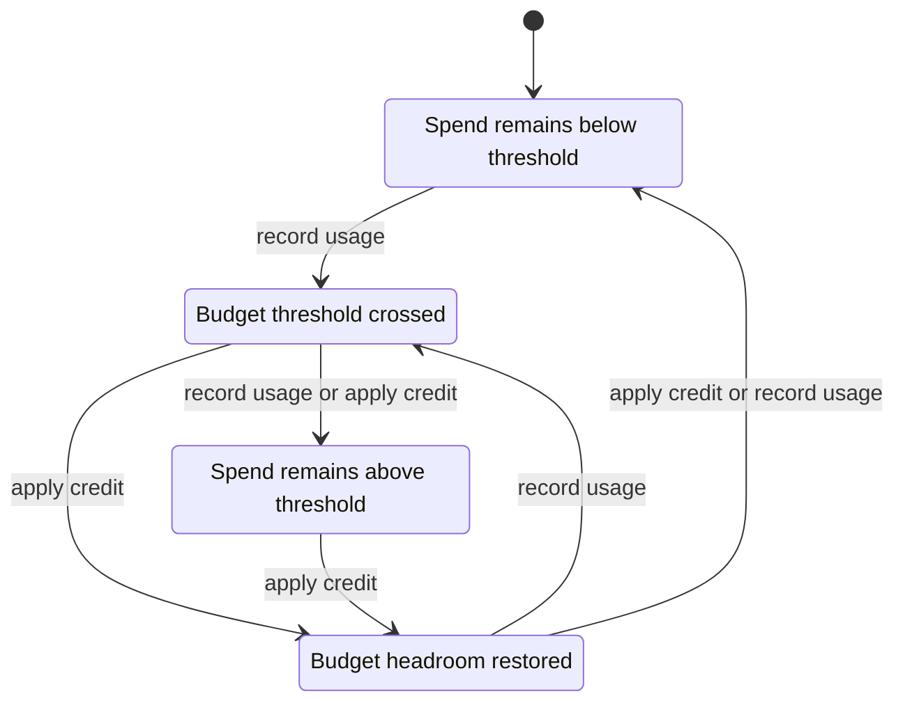

Zero USD budget or per-resolution cap means zero, never unlimited. Unlimited
preflight behavior requires `budgetUnlimited` or `spendCapUnlimited` explicitly.
The default billing plane retains successful estimates as in-memory holds, so
later requests cannot spend them again. It requires a stable request ID and has
no meter feed: confirmed-unused holds can be released, while successful holds
remain for the lifetime of the plane. Repeated resolutions require
reconciliation rather than receiving another receipt.
`createMeteredBillingPlane` rereads a live event reader on each authorization and
holds outstanding request identities atomically within that one plane. Consumable
snapshot iterators are rejected. A finalized usage fact may retire a hold only by
naming its reservation ID, and that identity cannot be authorized again. Observed
meter facts must remain an unchanged prefix on later reads. Costs and holds use
their serialized decimal values for exact comparisons. A repeated broker
resolution with an existing metered hold requires reconciliation instead of
issuing another receipt. Only a hold created by the current resolution is
released after placement fails. Custom billing planes should return
`reservationCreated` so the broker can distinguish new holds from replays.

This legacy preflight trusts its reader, estimates, and unused-funds
confirmation. Its holds and observation checkpoint are in memory, so restart
loses them; multiple instances do not coordinate. It cannot detect facts that
were already missing on the first read. It is not the durable financial authority
for funded cloud hosting.

The [metered billing skill](../../.agents/skills/verify-broker-metered-billing/SKILL.md)
checks the implementation against generated histories, a bounded TLA+ model,
and an exact-real proof. The following projection covers 48 model states and
hides 140 same-state steps, including replay refusals and evidence changes.

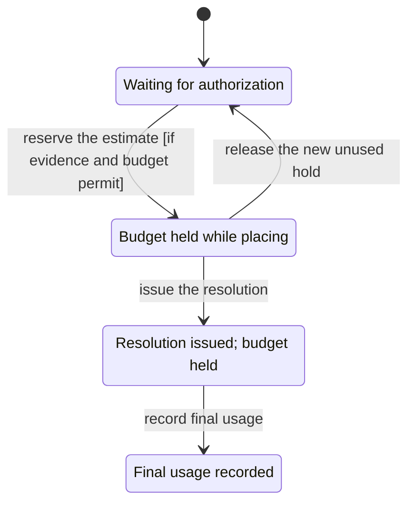

`authorizeBillingSpend` accepts a complete current `QuoteVector` only with an
`attestQuote` callback supplied by a trusted host. The callback must authenticate
the quote, bind it to the actual work and current pricing evidence, and return a
conservative `liabilityBoundUsd`. The bound must cover the quote's expected bill;
the helper compares that bound, not the expected bill, against the budget. The
helper rejects a quote changed during attestation. A quote hash detects changed
contents but does not authenticate its source. Callers using `quoteIncrementalUsd`
or `quoteIncrementalDecimal` must supply the complete quote and attestation.
Raw `spendEstimateUsd` requires explicit `trustEstimate: true` and remains a
trusted caller assertion. The helper does not create a hold; its caller must use
a billing authority for admission.

`createBroker` requires a `pricingAuthority` by default. For each request it
enumerates eligible combinations of definitions and regions, up to
`MAX_BROKER_QUOTE_PLANS` (128), and asks the host for a complete attested USD
quote for every plan. The immutable work, catalog, environment, policy and
station pins are bound to each quote. The broker rejects the search if it is
too large or any candidate's quote is missing, ineligible or untrusted. It
orders the statically affordable plans by their exact quoted total, then sends
the selected plan's conservative liability to both the policy gate and the
billing plane. Quote and attestation callbacks must be side-effect free and may
run many times per request; hosts should account for their latency.

The default billing plane accounts for existing holds. If it denies a candidate
for budget or cap reasons without creating a reservation, the broker can try
the next cheapest plan. A custom billing plane enables this fallback only by
returning `noReservationCreated: true` on a denial that created no reservation
or external effect. An ambiguous denial stops the search. Gate denials and
approval requirements also stop the search. The `broker.CandidateUnaffordable`
event records an attempted plan that was safely declined. The broker rechecks
the authority and evidence across policy and billing callbacks and requires
billing to confirm a new hold. Quote-backed receipts carry the quote hash,
work-binding digest and authorized amount; the optional receipt signature covers
these fields. The host must authenticate quote sources and bind each quote to
the work, current pricing evidence and a conservative provider liability.

Catalog entries still require a provider, distinct definition ID, SKU, unit and
nonnegative price in the pricing package's decimal syntax. Exponent notation
and leading-zero spellings accepted by the former floating-point parser need
migration. Different marginal units are allowed when comparing complete USD
quotes. `trustLegacyEstimates: true` explicitly restores trust in the caller's
estimate and marginal-price ordering, which requires matching units and cannot
establish the cheapest complete plan. Guest requests reject until consent and
claim evidence are integrated into admission.

The CLI's built-in local-host authority attests the local provider's zero service
fee only. It does not cover charges for the underlying machine or other services.
Registry-backed CLI composition needs a host-supplied pricing authority. The
default billing plane's holds are in memory; they are not shared or durable.
Delivery requires an unchanged receipt issued by the same broker instance. It
rechecks quoted evidence and the catalog and environment, then claims the
receipt before submitting it. A failed or uncertain submission cannot be
reissued by that instance without reconciliation. This process-local registry
is lost on restart; it does not authenticate the caller, provide cross-process
coordination, or verify that a remote receiver honors the quote at execution.

The [whole-quote routing skill](../../.agents/skills/verify-broker-whole-quote-routing/SKILL.md)
checks a two-plan abstraction of quote search and billing fallback. The following
views hide 144 and 16 same-label steps respectively; they assume complete,
truthful quotes and honest billing results.

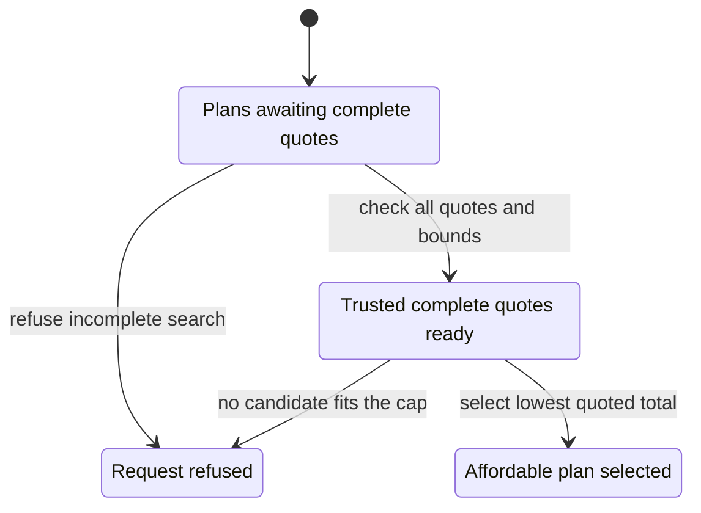

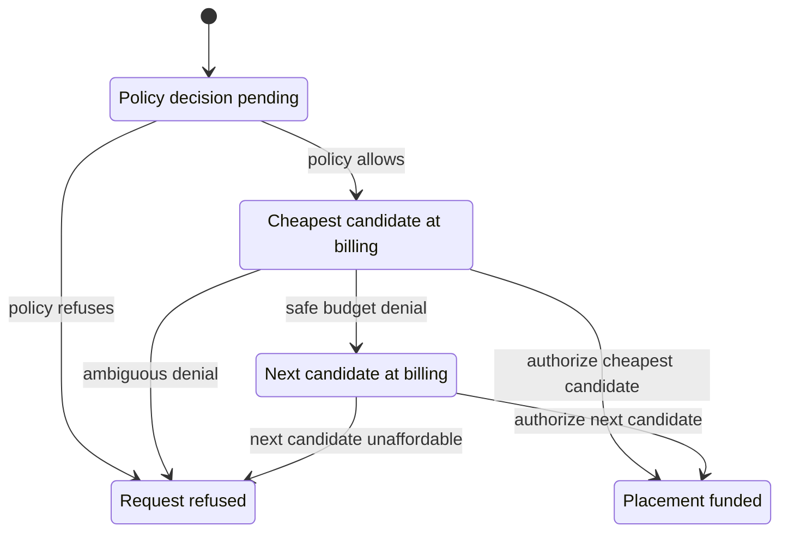

The [catalog ordering skill](../../.agents/skills/verify-broker-catalog-ordering/SKILL.md)
checks 256 abstract two-candidate states for legacy estimate ordering. This
view hides 128 same-label steps; it does not compare complete plan quotes or
establish currency completeness.

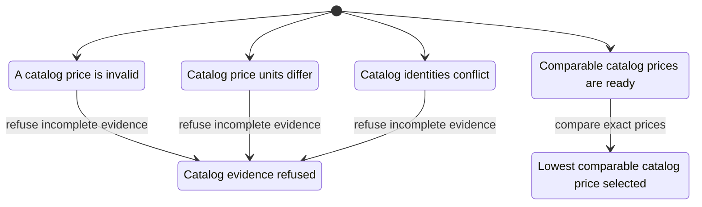

The [resolution signature skill](../../.agents/skills/verify-broker-resolution-signature/SKILL.md)
checks 256 abstract evidence states. This view hides 128 same-label steps and
assumes the host has enrolled the correct broker key.

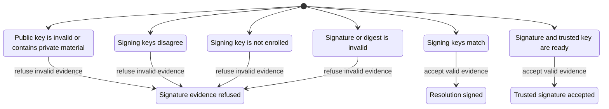

The [delivery claim skill](../../.agents/skills/verify-broker-delivery-claim/SKILL.md)
checks 23 delivery states and 12 resolution-identity states. This delivery view
hides 30 same-label steps and covers a single broker instance; it does not model
a restart or the remote receiver's execution.

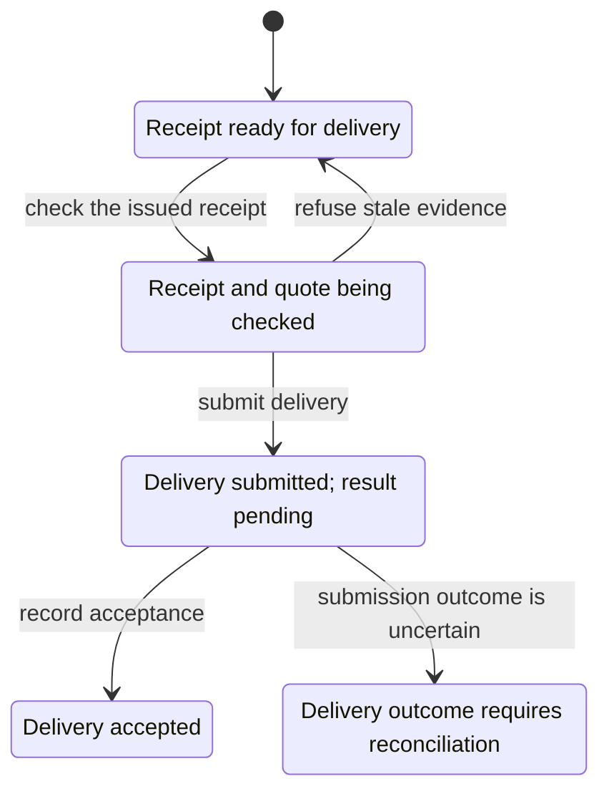

The [quote-backed admission skill](../../.agents/skills/verify-broker-quote-admission/SKILL.md)
checks 108 states. This view hides 140 same-label steps, including evidence
changes; it does not model delivery or guarantee freshness after the final check.

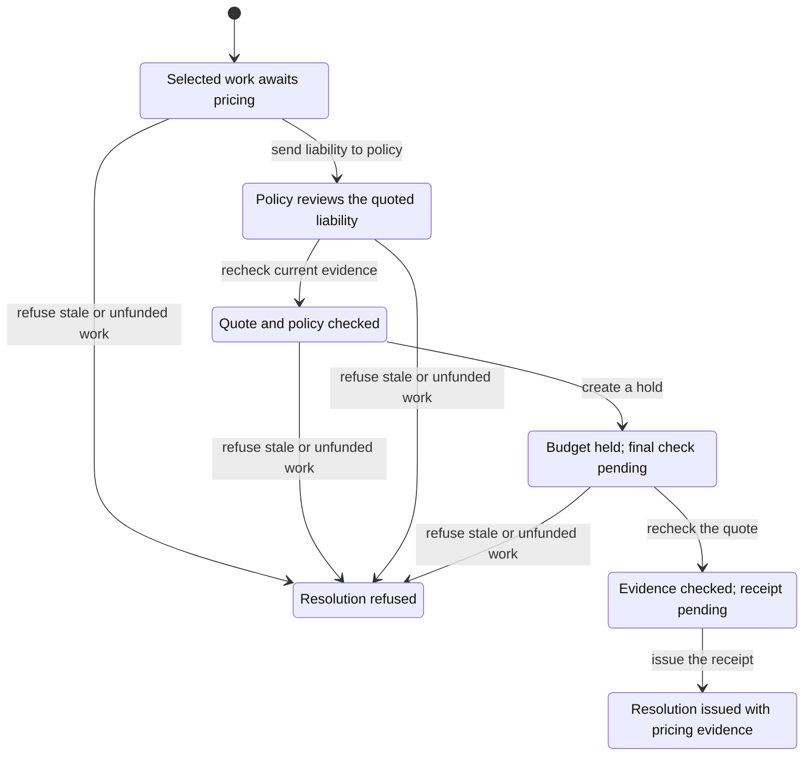

The [quote provenance skill](../../.agents/skills/verify-broker-quote-provenance/SKILL.md)
checks 64 evidence states and 162 liability states. This projection hides 32
same-label steps and treats the host attestation as a trusted predicate.

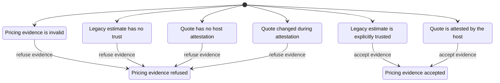

Broker request documents must supply `spendEstimateUsd` (or
`spend_estimate_usd`) explicitly, including for free work. Conflicting aliases
reject. Protobuf clients must set the optional scalar even when it is zero;
older encoders that omitted a zero scalar must migrate. For `hobo broker up`,
the built-in local-host catalog can supply its zero estimate; registry-backed
deployments require `--request` with an explicit estimate and a host pricing
authority. An explicit estimate is still a caller assertion and does not
establish quote provenance.

The [request-estimate skill](../../.agents/skills/verify-broker-request-estimate/SKILL.md)
checks those boundaries. Its model explores 14 states and hides seven
same-state steps in this projection.

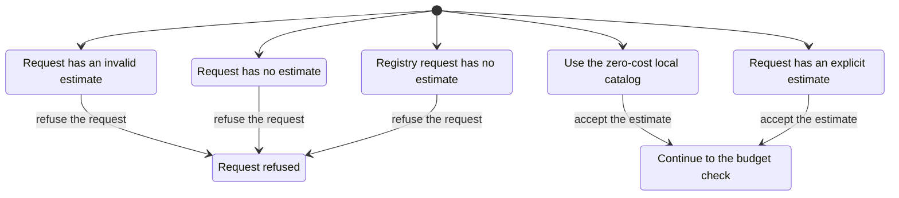

The [broker budget skill](../../.agents/skills/verify-broker-budget-authority/SKILL.md)
checks this authorization boundary alongside budget holds and settlement. Its
quote model explores 2,304 states; this constrained projection explores 96
states and hides 48 same-state transitions. Quote validity is abstracted and
the model assumes trusted evidence.

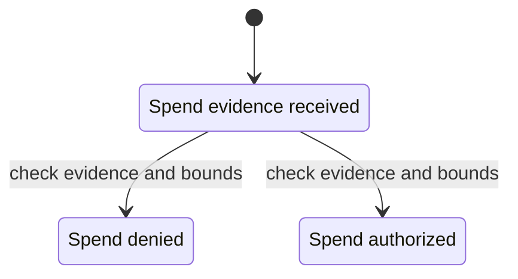

The **HoBo Broker**: the policy-governed authority that actually brokers
Bindle/Camp/Yard/Junction placements **across providers**, spins resources up
and down, and hands accepted work to delivery — based on the configured
policies the broker itself maintains. It is the runtime counterpart of the
[Meta-cloud Broker design](../../docs/design/hobo-broker.md); the Meta-cloud
Broker artifact vocabulary (Contract Manifest → Resolution Receipt /
Resolution Rejection) is preserved here as the receipt/rejection wire shapes.

This broker is **distinct** from the Identity token broker (ADR-0008) and the
connector runtime broker (HOBO-235): those broker *credentials*; this package
brokers *placements*. The connector registry below stores `credentialRef`
pointers into the token broker — never raw secrets.

## What it wraps

The broker is a wrapper around five planes, each behind a port so engines can
be swapped without touching the brokering pipeline:

| Plane | Port | Default engine | Alternate engine (shipped in this package) |
|---|---|---|---|
| Policy | `GatePlane` (OPA-shaped request/decision documents) | `@hobo/contracts` policy pack (imported and **run**, not reinvented) | **Rego** via `createOpaGatePlane` — OPA Data API decision at `hobo/broker/decision`, fail-closed (`policy-engine-unavailable`), pinned by `broker_policy_opa.pact.json` |
| Contracts | `GatePlane` (can-deploy compatibility) | `@hobo/contracts` Gatekeeper (PACT-style boundary semantics) | an external Pact broker verification feed (port-compatible) |
| Billing | `BillingPlane` | in-process budget holds, spend-cap and quota checks | `createMeteredBillingPlane` — folds `meter.UsageRecorded` facts into observed spend and authorizes against the metered remaining budget; `authorizeBillingSpend` checks a complete eligible pricing quote and a host-attested liability bound |
| Delivery | `DeliveryPlane` | `createDeliveryPlane` — in-process conductor only; agent/publisher policies fail closed with `delivery-plane-unwired` | `createReconcilerDeliveryPlane({ requestPromotion })` — every receipt is delivered through `@hobo/cd` (ADR-0182: D14), fail-closed, pinned by `broker_delivery_cd.pact.json`. GitOps rendering (Argo CD `Application`, Flux `Kustomization`) moved to `@hobo/cd-gitops` |
| Connectors | `ConnectorRegistry` | event-sourced registry of `github-app`, `pulumi`, `azure`, `vercel`, `cloudflare`, `custom` configs | an external connector catalog |

Beyond M0, this package also ships:

- **Receipt integrity** — optional Ed25519 detached signatures over canonical
  JSON (`signResolution`/`verifyResolution`, `broker.ResolutionSigned` facts).
  Verification requires `verifyResolution(receipt, signature, trustedPublicKeyPem)`
  with the expected broker's independently enrolled public key and checks the
  payload digest. Signing rejects private key material in the public key field;
  only a normalized public key is emitted. The signature's embedded key does not
  establish trust. Object keys sort by UTF-16 code units, independent of locale.
  Callers must map the enrolled key to the correct broker and scope.
  Signatures produced with the earlier locale-dependent key order may need
  reissuance if their canonical ordering differs.
- **The closed rejection matrix** (`REJECTION_MATRIX`) — every broker-owned
  rejection code pinned to its plane and an agent-actionable remediation,
  test-enforced against the pipeline.
- **Cedar** as the second external policy language (`createCedarGatePlane`,
  fail-closed, pinned by `broker_policy_cedar.pact.json`) beside Rego.
- **Broker Environments** (admin controls): `publishEnvironmentFact` /
  `approveEnvironmentFact` / `foldBrokerEnvironments`; resolutions against an
  unapproved environment or a stale pinned catalog snapshot reject
  (`environment-unapproved`, `catalog-snapshot-stale`), and eligibility is
  bounded to the environment's approved providers.
- **The hosted authority surface** — `createBrokerHttpHandler` / `serveBroker`
  expose resolve/scale/deliver/rejection-matrix over HTTP, and the resolve
  route is PROVIDER-verified against `broker_resolution.pact.json`
  (`contracts/provider/`). The `hobo broker` CLI verb (and its derived MCP
  tool) runs the same pipeline against the composed Yard's live registry.

Branding note: product surfaces call this component **the Conductor**; code
and technical docs keep **broker**.

Placement itself consumes any `BrokerCatalog` — a structural mirror of
`@hobo/cloud`'s `PlannerRegistry`, so the Yard's live provider catalog plugs
in directly.

## Command/event model

The broker is an **actor**: it consumes commands (`resolve`, `scale`,
`deliver`, connector `register`/`disable`), coordinates durable state through
the facts it emits, and never mutates a query read model directly. Event
families:

- `broker.Requested` → `broker.Resolved` (receipt) or `broker.Rejected`
  (structured per-plane reasons), with the Gatekeeper's `policy.Decided` /
  `gatekeeper.Decided` facts appended to the same stream for replay.
- `broker.ScaleRequested` — spin up/down/zero directives.
- `broker.DeliverySubmitted` — delivery-plane handoff. Body schema `hobo.broker.delivery-submitted/v2` (reconciler mode, publisher, promotion id); persisted v1 bodies (`engine: argo | in-proc`) are lifted by `upcastDeliverySubmitted` (golden corpus `test/fixtures/delivery-submitted/`).
- `connector.Registered` / `connector.Disabled` — connector registry facts.

Query surfaces are event-driven: `foldBrokerDecisions` and
`foldConnectorRegistry` are pure folds over the **event store** stream into
**materialized view** rows (each **projection** rebuilds from zero), and
`snapshotBrokerDecisions`/`restoreBrokerDecisions` persist a **snapshot** of
the current rows to a **read store** for cached current reads; replaying the
stream over a restored snapshot yields the same view.

## Parse, don't validate

Untrusted policy documents, brokering requests, connector configs, and scale
directives cross exactly one parser boundary (`parseBrokerPolicySet`,
`parseBrokerRequest`, `parseConnectorConfig`, `parseScaleDirective`). The
parsers apply the protobuf + CUE constraints from `data-models/broker.proto`
and `data-models/broker.cue` and return refined **parsed domain types**
(`src/types.ts`, including the branded `PolicyHash` derived type), so invalid
values are unrepresentable past the boundary — core functions never re-check
raw DTOs.

## Policy semantics

Placement policies are maintained per topology scope kind. The effective
policy for a request merges junction → yard → camp → bindle: narrower scopes
override choice-shaped fields (objective, allowed providers/regions, pins),
while restrictions **accumulate** — a junction broker admin's
`requireExplicitCamps` lockdown or denied-provider list can never be relaxed
by a narrower policy. Every receipt and rejection pins `policyHash` (the
content address of the whole policy set) and `catalogHash`, so a decision is
replayable against the exact policies and catalog that produced it.

## Boundary contract

The consumer-driven PACT contract for the resolve boundary lives in
[`contracts/pacts/broker_resolution.pact.json`](contracts/pacts/broker_resolution.pact.json),
exercised by `contracts/consumer/broker-resolution-boundary.test.ts`.

## Verification

```sh
pnpm --filter @hobo/broker test
pnpm --filter @hobo/broker test:contract:consumer
```

## Delivery policy (neutral, ADR-0182 D14)

`DeliveryPolicy` names how a Camp converges, never a GitOps engine, cluster or
namespace:

| Field | Meaning |
|---|---|
| `reconciler_mode` | `conductor` (in-process), `agent` (pull agent) or `publisher` (a `@hobo/cd-gitops` publisher). |
| `publisher` | `{ target: argo-cd \| flux, repository? }`, exactly in `publisher` mode. |
| `sync_mode`, `prune` | Unchanged. |
| `engine`, `gitops_repo`, `destination_namespace` | Deprecated wire fields. `engine: argo` maps to the `argo-cd` publisher (its `gitops_repo` becomes `publisher.repository`); `engine: in-proc` maps to `conductor`. `destination_namespace` is never read. |

`DeliveryPolicy.engine` / `DeliveryTicket.engine` survive only as a display
label (`in-proc`, `agent`, `publisher:<target>`) for existing readers.

## Runbook

| Symptom | Cause | Action |
|---|---|---|
| `delivery-plane-unwired` | The policy routes through an agent or publisher but the broker was built without the CD plane. | Compose `createReconcilerDeliveryPlane({ requestPromotion })` (the CD host does this), or set `reconciler_mode: conductor` for local runs. |
| `delivery-refused` | CD refused the promotion (window, lineage, gate, policy). | Inspect the reasons and reconcile the claimed attempt before authorizing another one. |
| `delivery-transport-failed` | The request or response failed in transit. | Reconcile with CD; the promotion may have been accepted before the response was lost. |
| `delivery-fact-unknown` on replay | A persisted `broker.DeliverySubmitted` body has a shape the upcaster does not know. | Add the shape and a golden corpus entry before replaying. |
| A legacy policy still says `engine: argo` | Pre-D14 configuration. | It keeps working through the `argo-cd` publisher; migrate to `reconciler_mode: publisher` + `publisher.target: argo-cd`. |

## Budget authority verification

The [budget-authority verification skill](../../.agents/skills/verify-broker-budget-authority/SKILL.md)
checks admission, held liabilities, replay, and receiver- and finance-signed
settlement. Generated histories exercise the TypeScript authority; the finite
TLA+ models and unbounded arithmetic abstraction state their assumptions and do
not prove the storage adapters, cryptography, or provider effects.

The following is a projection of the signed-settlement model, not a production
trace. TLC explored 129 states and 830 steps; the chart hides 723 steps that
remain within a displayed state.

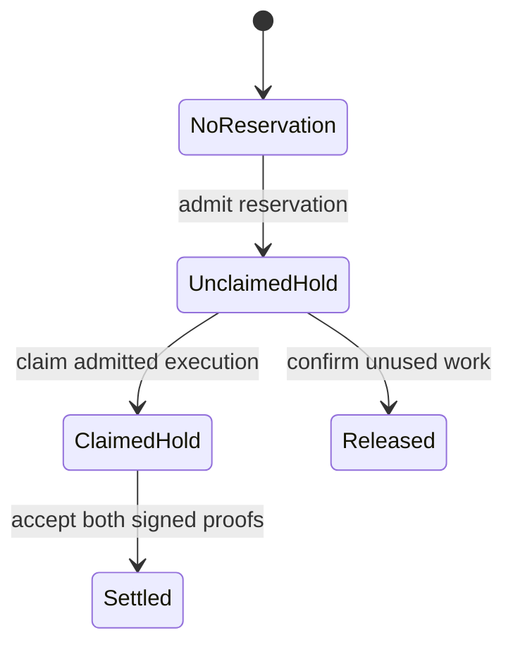
