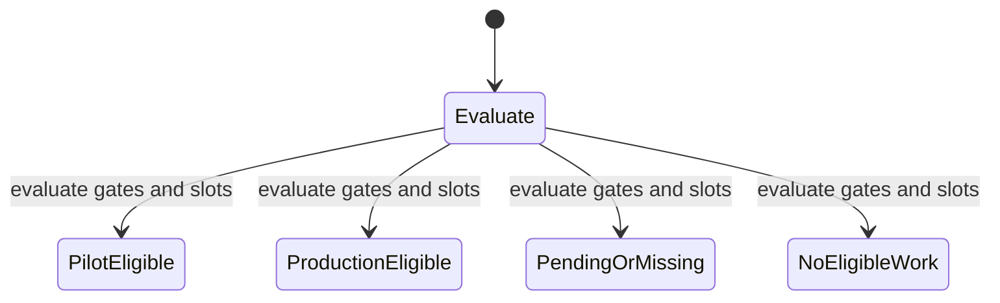

# @hobo/cd

HoBo.CD: the delivery sibling of `@hobo/ci`. It discovers or accepts immutable
**Freight** from any registry, Git host or CI, moves it through a pipeline graph
of Camps under policy, makes each Camp converge by **pull** through fenced
reconcilers on every platform, exposes it progressively, verifies it
deterministically (failing closed), and rolls it back as a Delta. Fleets are
targeted by deterministic Placement, fanned out under a failure budget, and
failed over only as a governed saga. Rails are delivered like software (INFORM,
then ENFORCE) and observed continuously as posture.

- Design: [`docs/design/continuous-delivery.md`](../../docs/design/continuous-delivery.md)
- Decisions D1–D26: [ADR-0182](../../docs/design/adr/01-architecture-core.md#adr-0182)
- Runbooks: [`docs/runbooks/cd/`](../../docs/runbooks/cd/index.md)
- Operator surface (`hobo deploy`, `hobo serve cd`, `hobo incident`): `packages/hobo/CD.md`

## Layout

Each subpath export is one module with its own `README.md` (architecture,
typed failures and a **Runbook** section; `konsistent` enforces the README).

| Subpath | Module | Owns |
|---|---|---|
| `@hobo/cd/freight` | `src/freight/` | Freight ledger, aliases, qualification, approval, retention (D2, D18) |
| `@hobo/cd/ingest` | `src/ingest/` | OIDC trusted publishing and attestation ingest (D3) |
| `@hobo/cd/sources` | `src/sources/` | Pull discovery: OCI, Git smart-HTTP, packages, HTTP index, HoBo CI, HoBo Rail (D3, I15) |
| `@hobo/cd/artifacts` | `src/artifacts/` | Content-addressed artifact store and blob retention (D18) |
| `@hobo/cd/provenance` | `src/provenance/` | in-toto/SLSA via `@hobo/registry`, Sigstore bundles (D3) |
| `@hobo/cd/sets` | `src/sets/` | Deployment Sets, Deltas, desired-state fold (D2, D5) |
| `@hobo/cd/pipelines` | `src/pipelines/` | Pipeline graph, availability, lineage (D4, I16) |
| `@hobo/cd/windows` | `src/windows/` | Change windows and overrides (D10, I17) |
| `@hobo/cd/promotion` | `src/promotion/` | Promotion saga, gate, previews, Trails sequencing, rollback (D4, D11, D12) |
| `@hobo/cd/reconcile` | `src/reconcile/` | Reconcilers, realizers, drift, retained fields (D5, D6, D22, I2–I5). `RESOLVER_*` and `realize-failed` observations export generic operator text; `redactRealizerConditionText` redacts provider material for release Freight callers. |
| `@hobo/cd/verification` | `src/verification/` | Verification engine and health sources (D9, I5) |
| `@hobo/cd/rollout` | `src/rollout/` | Capability lowering and the rollout orchestrator (D7, D8) |
| `@hobo/cd/feed` | `src/feed/` | Delivery feed for agents (D5) |
| `@hobo/cd/agent` | `src/agent/` | Reconciler enrollment over `@hobo/fleet` (a fleet DEVICE with role RECONCILER), double opt-in, agent transport (D5, D19, I24, L19) |
| `@hobo/cd/service` | `src/service/` | Service host, tick loop and `/v1/cd/` read API |
| `@hobo/cd/boundary` | `src/boundary/` | CDEvents, CloudEvents webhooks, the neutral-core scan (D17, I11) |
| `@hobo/cd/telemetry` | `src/telemetry/` | OTel CI/CD semantic conventions, DORA, alert rules (D17) |
| `@hobo/cd/authz` | `src/authz/` | `CdAction` authorization (D15, I10) |
| `@hobo/cd/inventory` | `src/inventory/` | Camp status, conditions, claims, taints, Camp sets (D19) |
| `@hobo/cd/placement` | `src/placement/` | Deterministic Placement and score snapshots (D20, I18, I19) |
| `@hobo/cd/fanout` | `src/fanout/` | Fan-out controller (D21, I20) |
| `@hobo/cd/failover` | `src/failover/` | Failover and rebalance sagas (D23, I21) |
| `@hobo/cd/posture` | `src/posture/` | Policy bindings, shadow decisions, posture service (D24, D25, I22, I23) |
| `@hobo/cd/compose` | `src/compose/` | Composition used by `@hobo/hobo` |
| `@hobo/cd/testing` | `src/testing/` | Reusable in-process doubles for CD boundaries |
| `@hobo/cd/domain` | `src/domain/` | `@alchemy.run/domain` `CdRelease` command/event aggregates, fail-closed promotion saga, materialized views and projections, snapshots, and read store API (`CdReleaseApi`) |
| `@hobo/cd/host` | `src/host/` | Portable runtime hosting for `CdRelease` over `Domain.InMemory`, `@hobo/storage-sqlite` event store, `@alchemy.run/domain/Rivet` Durable Objects, and RivetKit SQLite promotion gate actors |

`src/adapters/` is a flat folder of single-file adapters onto other HoBo
packages, each owned with the module that uses it: `planning`, `gatekeeper`,
`approval`, `trails`, `hooks` (promotion); `orchestrator`,
`hosting-transition` (reconcile); `harness`, `traffic` (rollout). Vendor and
platform types may appear only in `adapters/` and `verification/sources/`
(I11).

Frozen contract files (changed only with an ADR-0182 amendment):
`data-models/cd.proto`, `src/events.ts` (event names, streams, refusal codes,
`CD_DEFAULTS`), `src/ports.ts` and `src/index.ts`. Generated code is in
`src/_generated/`.

### Testing notification delivery

Use the recording CDEvents sink with the real notification port to exercise
CD's event construction without a webhook or external service:

```ts
import { createNotificationPort } from "@hobo/cd/boundary";
import { createRecordingCdEventSink } from "@hobo/cd/testing";

const sink = createRecordingCdEventSink();
const notifications = createNotificationPort({ channels: { ops: sink }, source: "/test" });
await notifications.notify(
  { channel: "ops", subject: "promotion", body: { state: "PROMOTED" } },
  { tenant: "example", principal: { kind: "service", id: "test" }, now: () => 0 },
);
await notifications.drain();
expect(sink.events[0]?.subject.content).toMatchObject({ channel: "ops" });
```

Each sink is isolated; `events` returns copies and `clear()` resets its history.
Pass a `delivery` result to exercise failure handling. This double does not
persist dead letters or simulate webhook transport, retries, or a notification
provider.

## Boundaries

`@hobo/cd` is a layer-3 package. It composes `@hobo/cloud`, `@hobo/contracts`,
`@hobo/identity`, `@hobo/registry`, `@hobo/stations`, `@hobo/policy`,
`@hobo/dispatcher`, `@hobo/events`, `@hobo/fleet`, `@hobo/trust` and `@hobo/core`, and imports
no `provider-*`, `iac-*`, `runtime-*`, `ci*`, `broker`, `cli`, `hobo` or
`resolver-components` package (I11). Adapter packages around it:
`@hobo/cd-gitops` (publisher), `@hobo/cd-kube-fleet` (Kubernetes fleet
transport and inventory), `@hobo/resolver-components` (WASM resolver host) and
`@hobo/storage-postgres` (multi-node journal).

## Runbook

Start with the symptom index in [`docs/runbooks/cd/`](../../docs/runbooks/cd/index.md).
Every refusal carries a `ReasonRecord` with `code` and `remediation`; the code
names the owning module, whose README has the detailed procedure.

- **A promotion is stuck.** `hobo deploy status` shows its state. `AWAITING_WINDOW`
  means a closed Change window (override with `hobo deploy window override`, a
  governed action); `lineage-unsatisfied` means upstream has not qualified or
  soaked; a pending approval needs `hobo deploy freight approve`.
- **A Camp does not converge.** `hobo deploy camp show <camp>` lists conditions
  and taints. `LEASED=false` or `REACHABLE=false` means no reconciler holds the
  Camp's lease: check the agent (`hobo deploy agent run` logs) or the conductor
  (`hobo serve cd` `/readyz`). The automatic taint `hobo.cd/member-inactive`
  (NO_PLACE) means the fleet member backing the Camp is suspended, revoked or
  missing: each Camp of a Yard with a fleet is backed by the member named after
  the Camp id's last segment in the fleet named after the Yard (a `DEVICE` when
  a reconciler serves it, else a `TARGET` the Station declares). Check it with
  `hobo fleet member list`; `hobo fleet member resume` lifts a suspension.
  Reachability still comes from the signal sources, except that a reconciler
  device the fleet sees as LOST makes its Camp `REACHABLE=false`
  (`fleet-member-lost`).
- **Rollback.** `hobo deploy rollback --camp <camp> --reason <text>`. A refusal
  past a completed Trails `contract` names the compensating `expand`.
- **Fan-out halted.** `hobo deploy fanout show <id>`, fix the cause, then
  `fanout resume` or `fanout rollback` (both governed).
- **Store.** SQLite for one node; more than one `hobo serve cd` replica needs
  `HOBO_CD_POSTGRES_URL` (PostgreSQL 16 or newer).

Fan-out catch-up still waits for all mandatory Camps before scheduling other
Camps. A mandatory failure stops new starts in both normal and catch-up modes;
already in-flight work may still finish. A slot absent from a scheduler input is
treated as pending when checking completion, as it is when selecting candidates.
The normal journal fold initializes a slot for every Camp. See the
[fan-out verification skill](../../.agents/skills/verify-cd-fanout/SKILL.md)
for the checked models, generated cases, and their limits.
The skill also executes four isolated implementation mutations, four TLA+
mutations, and three induction mutations so every stated guard must produce a
reproducible counterexample when removed.
Its maintained baseline records the exact reviewed commit used for those checks.

This projection shows the modeled scheduling decision, not an execution
trace. TLC explored 256 states and 256 steps; the chart hides 128 steps that
remain within a displayed state. Production is eligible only after the
mandatory pilot succeeds.


