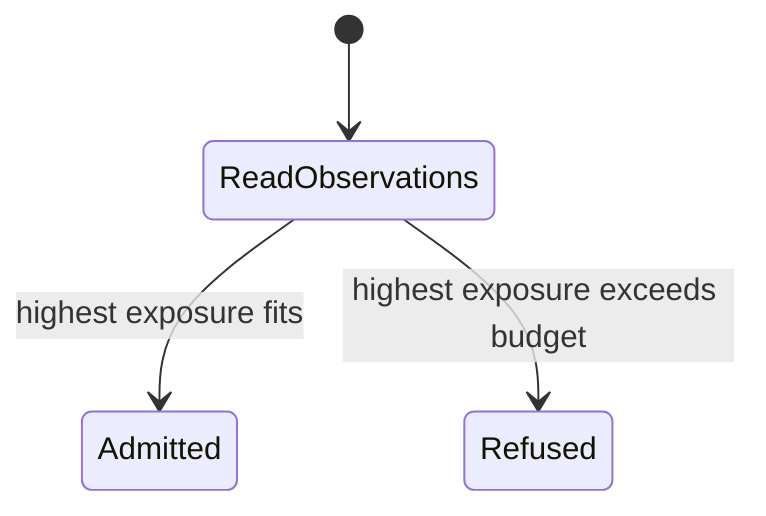
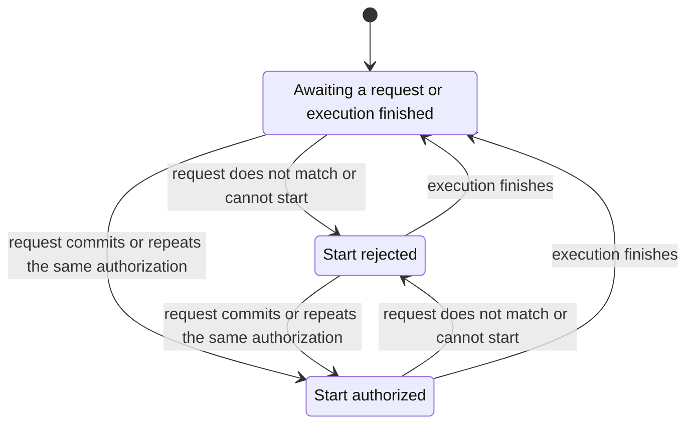

# HoBo.CI

HoBo CI is a sibling SDK family in the HoBo monorepo:

The product CLI exposes repository setup and run commands through `hobo ci`;
see [CLI setup and Vercel command parity](../hobo/CI.md). This package and the
Actions client package include public package metadata and MIT licenses so the
published CLI can resolve its CI dependencies. No registry publication follows
from changing that metadata.

| SDK | State |
| --- | --- |
| `@hobo/ci` | Portable pipelines, allocation routing and durable budget reservations |
| [`@hobo/ci-gh-actions`](../ci-gh-actions/README.md) | The relay (one core, with its Node service host for `hobo ci serve` and the container image), tenant API, repository installer and JIT-runner host |
| [`@hobo/ci-vercel`](../ci-vercel/README.md) | The Vercel host of that same relay, and local execution of Vercel CI-tagged Turbo checks |
| [`@hobo/ci-dagger`](../ci-dagger/README.md) | Native Dagger CI checks on local/self-hosted engines and portable SDK adapter |
| [`@hobo/ci-cf`](../ci-cf/README.md) | Implemented native Cloudflare CI adapter |
| [`@hobo/ci-ado`](../ci-ado/README.md) | Local command checks and self-hosted Azure Pipelines configuration |

`@hobo/ci/app` exports the SDK Bindles for the CI relay and its cache,
configuration and runner peers. The relay declares a project, an object-store
member, its API, queues and repair schedule in dependency order. A host places
each peer in its provider's Yard and connects it through a Junction; the Bindles
do not choose a provider or authorize a deployment. The repair schedule's
declared cadence publishes to the relay's repair queue, not a separate endpoint.

The legacy allocation and sandbox quote implementations live behind
`@hobo/pricing/legacy`. The original `src/accounting.ts` and
`src/sandbox-pricing.ts` imports remain as thin re-exports, preserving the CI
public API and existing reservation/settlement behavior.

A Sandbox offer requires a trusted current rate card for CPU, provisioned
memory, creation, network, proxy, bootstrap and any host charges. The quote reserves
resource usage for the maximum runtime using integer microdollars; optional
`SandboxAllowance` values represent verified remaining free CPU vCPU-ms,
memory MB-ms, egress bytes, creation count, proxy bytes and proxy sessions.
When an isolated proxy VM is required, the quote includes both VMs' CPU,
provisioned memory and network, two creations, a bounded number of metered
control-plane calls, and explicit bootstrap estimates. Both VMs must use the
same Vercel project, region and published rate card to share an allowance. The
plan's vCPU and session-duration limits are checked before reserving. The proxy's
public ingress, DNS, TLS and other platform overhead are not bounded by the
application quota. Each dimension is reserved across concurrent jobs and settled
against observed usage. An omitted allowance means zero, not an inferred provider free tier.
`observedAt` must describe the inclusive provider snapshot; a rate or allowance
change needs a newer timestamp. Network headroom and proxy rates are configured
estimates: Vercel's billed TLS, DNS, Function CPU, memory, request and transfer
charges are not completely measured by the payload proxy. The trusted publisher
must set nonzero per-resource rates and a separate nonzero `bootstrapFixedMicros`
estimate for fetching and uploading the 228 MB runner archive on every launch. Actual spend may exceed
the reservation. HoBo records overruns and blocks subsequent unaffordable work;
this estimate is not a hard billing cap or proof of the globally cheapest price.
A publisher must obtain and refresh provider-specific rates and free balances;
no live Vercel inventory or price verification is built into this package.

## Strict fleet starts

The SQLite and PostgreSQL fleet stores commit one start authorization per job
attempt. A retry for the same claim and runner returns the existing receipt only
while the assignment, credential, controller incarnation, offer, capacity group,
and execution profile remain eligible. Revoking an offer or worker prevents a
later retry from authorizing a start.

## Event cursor

Every lease and job change is appended to the partition's event journal inside
the transaction that makes it, so the journal is already the record of what
changed. `eventsSince({accountId, after, limit})` on `LeaseStore` and
`SqliteCiStore` reads it as a change feed: an account's
events after a journal position, oldest first, with the position to read after
next (`CiEventPage`, each event a `SequencedCiEvent`). Without `after` it
returns the account's newest events. `leaseEvents({accountId, leaseId, limit})`
reads one lease's newest events by the lease's id, through the lease index
(`events_lease_type`, which the statement names, so the read fails if the
index is missing and never walks the journal instead).
Both are projections over the journal, not a second bus.

- **Exact.** A read returns exactly the account's events, whatever other
  accounts have journalled. It goes through an index on the account each
  event names, so it touches the account's own rows and none of anybody
  else's: `events_account_seq (json_extract(body,'$.accountId'), seq)`. The
  statement names its index, as the lease read does: without it the read
  fails and never walks the journal, which would stop a single-threaded host
  for as long as the journal is long.
- **Order.** The position is the journal's own key (`seq`). A journal has one
  writer at a time, so `seq` order is commit order and a cursor never skips
  an event.
- **Scope.** An event belongs to the account it names, and the query selects
  by that name. A job event recorded before or apart from a lease
  (`ci.JobQueued`, `ci.JobExpired`, `ci.JobCompleted`,
  `ci.JobAssignmentCleared`) is written with the account whose connection
  holds the job's repository and installation at that moment (`jobAccountId`
  in `src/event-log.ts`), so it stays that account's however the connection
  moves later. Writing the owner costs admission no extra read: it comes
  from the configuration the transaction has already read.
  Job events journalled before this was recorded name no account and are in
  nobody's feed: nothing guesses an owner for them. `isJobEvent` tells them
  apart for a reader, such as the account API's snapshot, that lists lease
  events only. Partition events such as `ci.ConfigurationChanged` name no
  account and are never returned.
- **Bounds.** The only bound is the page: at most 500 events, and never more
  than `limit`. `more` is set when a cursor read filled its page and the
  account has events after it; `truncated` when a read of the newest events
  filled its page and the account has events older than it. Neither is ever
  set because of what another account wrote.
- **Cursor.** A page's `cursor` is the position of its last event. A read that
  finds nothing hands back the position it was given (zero for a read of the
  newest events). So a cursor is always a position of the account's own, and
  it does not move while only other accounts journal.

The index is on the expression, built once when the store first opens an
existing journal, and an event that names no account has no key in it.

**Observers.** `CiObserver` is a store as something that only watches reads
it: configuration, a lease, an account's leases, pending jobs, quarantined
deliveries, the journal's head and the two event reads. `SqliteCiStore`
satisfies it directly; the hosted relay's
[cache store](../ci-gh-actions/README.md#relay-cache-store) through
`observer()`.

The shared store contract (`packages/ci-gh-actions/test/ci-store-contract.test.ts`)
holds the store to this behaviour: exact pages and a cursor that stands still
while a neighbour journals. It reads the plan of both event reads and drops
the index to show the read fails without it.
`test/event-log.test.ts` covers the page arithmetic, ownership at write time
and a SQLite journal written before the index existed. The relay's MCP server is the consumer: see
[`@hobo/ci-gh-actions`](../ci-gh-actions/README.md#mcp-server).

## Lease stores

`SqliteCiStore` (`@hobo/ci/sqlite`) is the durable lease store: one file, one
writer, used by `hobo ci serve` and the box worker. The hosted relay keeps no
durable state ([ADR-0179](../../docs/design/adr/hosted-relay-stateless.md#adr-0179));
its store is the [cache store](../ci-gh-actions/README.md#relay-cache-store) in
`@hobo/ci-gh-actions`. The PostgreSQL store (`PostgresCiStore`), its schema and
migrations were removed in phase 7 of that design. The rules below hold for
both stores.

The signed webhook body is hashed independently of GitHub's unsigned delivery
ID and event headers. Exact byte-identical bodies for one installation received
within 24 hours are acknowledged as duplicates without creating another inbox
row, even if their delivery IDs differ. Such bodies represent the same signed
payload; different payload bytes remain distinct. At ingress, the event header
must agree with the authenticated body shape before this check. The first
accepted delivery retains its ID and fingerprint, including for an authenticated
but unconnected installation; a duplicate alias is not stored as a new ID.
Completed legacy snapshots whose raw payload was already erased cannot acquire
a body hash retroactively.

Admission is limited to 600 distinct bodies per installation per rolling minute
10,000 outstanding deliveries and 64 MiB of outstanding payloads per installation. A limit refusal does not
acknowledge an unrecorded delivery; GitHub delivery repair and monitoring must be
operational, and operators should review these ceilings against expected load.
These controls do not replace signature validation or GitHub-side access control.

A verified in-progress assignment records the exact repository, job and attempt
against its runner lease. It suppresses stale queued demand and cancels only an
unlaunched duplicate reservation. Launched or ambiguous hosts retain their
budget until reconciled. A job may be released for requeue only after a fresh
GitHub job read proves it is queued and the assignment owner still matches.

A sandbox byte quota can be bound to a verified account, lease, session and
configuration revision. Each successful reservation commits before forwarding;
ambiguous writes are not refunded. This primitive requires an authenticated
proxy and a trusted policy-derived ceiling before it can enforce an egress cap.
Verified sandbox charges can exceed reservations and are recorded as actual cost
with a `ci.BudgetOverrun` event; such a reservation is not a hard spending cap.

Sandbox offers do not use runner-minute free balances. A trusted, current provider
observation may instead supply remaining CPU, memory, network, creation and proxy
resource allowances. Admission subtracts held reservations and usage settled
since that observation. Each lease freezes its reserved quantities; settlement
records measured consumption no greater than those quantities, so a later job
cannot reuse the same credits. Missing allowance evidence counts as zero free
units. An observation is only as reliable as its publisher; this accounting
alone does not verify vendor entitlements or billed usage. Exact decimal
allocation helpers (`allocationQuote`, `divideDecimalAtMost`) are implemented in
`@hobo/pricing/legacy` and re-exported from this package for compatibility.
The package root also exports `allocationQuote`, the isolated-retirement
transition check (`isIsolatedRetirementTransition`) and the webhook envelope
parser (`parseWebhookEnvelope`, `isWebhookDeliveryId`), so a store outside this
package, such as the hosted relay's
[cache store](../ci-gh-actions/README.md#relay-cache-store), applies the same
rules as `SqliteCiStore`.

The GitHub Actions target keeps the original workflow and its logs, artifacts,
permissions, environments, dependencies and status checks. After one-time repository
connection, user workflows select `runs-on: hobo`.

Routing considers only enabled, acknowledged provider offers owned by this account.
It reserves the complete host timeout, including startup, under a durable transaction.
The default `min-cost` objective chooses the lowest complete projected paid cost.
Explicit `maximize-credits` first prefers offers consuming usable measured free
allocation, then minimizes their paid remainder. `@hobo/dispatcher` applies
deterministic tie-breaking. A partial free allowance can leave a paid remainder
that costs more than a fully paid alternative.
A job stays on its selected machine until it finishes.
Provider budgets and concurrency limits can cause another eligible provider to win.
If none qualifies, the job remains durably queued. Allocation must remain valid for
the entire reserved host duration, as must pricing evidence, for an offer to qualify.
Sandbox evidence also covers any extra reserved proxy VM duration.

Unknown balances are zero. Offers require an observation time, expiry/freshness
limit and evidence URL. Prices are account-supplied integer USD microdollars per
minute, including applicable platform fees; this package ships no vendor price
catalog or assumed marketing allowances. One microdollar is $0.000001. Each provider
account entitlement has one account/offer owner; there is no cross-tenant pooling.
The public router can also receive an account directly, without the configuration
parser. If multiple offers report the same provider account and any reports free
runner minutes or a sandbox allowance, those offers are ineligible: the router
cannot establish which allocation snapshot is authoritative. Other providers
remain eligible. This rule applies even when the duplicate reports agree; publish
a single current offer to restore that provider account's availability. Duplicate
cash-only reports use the greatest reported exposure.

`Offer.freeMinutes` is measured in **minutes on the selected runner SKU**, not
in the provider's shared base-unit minutes. Blacksmith's x64 free balance and
Depot's included balance are measured in 2-vCPU Linux equivalents, so a 4-vCPU
runner consumes two base minutes for each runner minute. Convert a freshly
measured balance before publishing the offer:

```ts
import { providerFreeRunnerMinutes } from '@hobo/ci';

const freeMinutes = providerFreeRunnerMinutes({
  provider: 'blacksmith',
  runsOn: 'blacksmith-4vcpu-ubuntu-2404',
  remainingBaseMinutes: 100,
}); // 50 runner minutes
```

The helper recognizes the documented x64 Linux Blacksmith and Depot labels only,
rejects unknown SKUs, and rounds fractional conversions down so it cannot grant
more allocation than observed. Its conversion rules are based on the [Blacksmith
runner documentation](https://docs.blacksmith.sh/blacksmith-runners/overview)
and [Depot runner types](https://depot.dev/docs/github-actions/runner-types).
It does not fetch, authenticate or independently verify vendor balances or prices;
the trusted observation publisher must do that and supply an evidence timestamp
and expiry. Pricing and entitlements may change. The single-offer-per-provider-
account rule prevents double-spending the shared entitlement, but means switching
SKUs requires replacing that offer after its active leases have settled.
Depot measures usage by the second; the host's whole-minute settlement is a
conservative estimate, not a replacement for a vendor invoice.

Usage snapshots are inclusive. `Account.spentMicros` must include all completed
usage through `Account.usageObservedAt`; each `Offer.spentMicros` and remaining
`freeMinutes` must include consumption through that offer's `observedAt`.
Publish the amount/balance and its watermark together. Routing adds only local
usage completed after the corresponding watermark and always holds outstanding
reservations. A late settlement uses its actual completion time. If the account
watermark is omitted, its spend is an external-only baseline and every local
settlement is added; do not combine that mode with an inclusive account total.

There is no automatic invoice ingestion or monthly budget rollover. Start a new
budget-period partition only after reconciling all active leases; retain the old
journal for audit.

Contracts are generated from `data-models/ci.proto`; CUE constraints and valid/invalid
fixtures are exercised by schema-tools. `parseConfiguration` is the configuration
boundary. Routing is pure over the account, persisted leases and injected time.
The relay owns the `ci.*` command/event lifecycle and SQLite projection (see its ADR).

Validation: `pnpm --filter @hobo/ci build`, `pnpm --filter @hobo/ci test`,
`pnpm codegen --filter packages/ci`, and
`pnpm codegen:check --filter packages/ci`.


## Local development machines

A local box is also a tier in runner routing: when the fleet is not taking
jobs, a run's jobs ask an enrolled local box (`hobo-local-host`) before they
ask GitHub-hosted runners. `selectFleetBackend` orders the fleet, ARC, the
local box, then GitHub-hosted; see "Runner routing" in
[RUNNER-QUEUE.md](RUNNER-QUEUE.md).

`selectFleetVerification` keeps that runner order and can select an opt-in
local signoff only after all enabled runner tiers are known unavailable. It
waits on unknown capacity when no runner is available, and always waits on
malformed or contradictory observations. This is a separate
verification path, not a `runs-on` label or an Actions job completion.
In the HoBo checkout, after verifying the live policy as described in the
[runbook](RUNNER-QUEUE.md#sign-off-without-an-actions-runner),
`pnpm ci:attest fleet --local-signoff --policy-current` can apply that choice
to a local run and publish its covered statuses with `gh-signoff`.
The coordinator confirms an unpinned fleet slip against recent pickup evidence
for its exact label; a failed queue read leaves availability unknown.

An account can offer its own development machine with `provider: "local"`,
`backend: "gh-actions"`, `runsOn: "hobo-local-host"`, and `concurrency: 1`.
The workstation has zero provider runner-minute price and zero free-minute
credits; its explicit `observedAt`, `validUntil`, HTTPS `sourceUrl`, and
`bridgeAcknowledged` evidence remain mandatory. Do not invent an allocation
balance to make an offline workstation eligible. Disable the offer when the
machine is unavailable and refresh its observation before expiry.

This uses the existing trusted-private-repository workflow bridge on Linux x64.
The persistent dev runner hosts the bridge on `hobo-local-host`; the bridge
claims a single-use ephemeral `hobo` runner for the reserved original job.
Giving the persistent runner the `hobo` label would bypass lease admission and
is unsupported. Public repositories, fork jobs and untrusted pull requests
retain the bridge's existing refusal. The developer machine is shared execution
with access to its files and Docker; it is not an isolated runner offer.

A local-only account can run with a zero monetary budget. Cloud offers still
follow the documented free-allocation-first ordering; enable only the local
offer in a dev policy when execution must stay on the workstation. One active
or uncertain lease occupies the workstation slot; additional jobs stay queued
until verified host completion and runner cleanup release it.

The existing protobuf Offer/Policy strings carry this provider without a wire
format change. CUE local-offer fixtures, `test/local-provider.test.ts`, and the
relay's local-provider bridge contract cover dependent constraints, budget-free
admission, queuing, OIDC/JIT attribution and cleanup. The connected `act` corpus
also executes the original workflow for a local-provider reservation; live
GitHub assignment remains separate evidence.

## Swap execution backends

`parsePipeline` constructs a deeply frozen command plan. `executePipeline` accepts
that exact plan and any `PipelineBackend`: `createActionsBackend({workspace})`,
`createDaggerBackend({sourceDirectory,image,connect?})`, or
`createCloudflareBackend({context,terminate,verifyShutdown?})`. Source workspaces
are bound by the host integration, rather than embedded host paths in pipeline
authoring. The shared subset includes sequential argv commands, relative cwd,
per-step environments, exact exit/stdout/stderr, tracked-file changes, bounded
binary file artifacts and acknowledged cancellation. The same fixture corpus
executes real local commands through every shipped adapter.

```ts
import { parsePipeline, executePipeline } from '@hobo/ci';
import { createActionsBackend } from '@hobo/ci-gh-actions';

const boundBackend = createActionsBackend({workspace: process.cwd()});
const pipeline = parsePipeline(JSON.stringify({
  id: crypto.randomUUID(), accountId: 'my-account', timeoutSeconds: 300,
  steps: [{id: 'test', argv: ['npm', 'test'], cwd: '.', env: {}}],
  artifactPaths: [],
}));
const result = await executePipeline(boundBackend, pipeline);
```

`HOBO_CI_EXECUTION_ID` is reserved metadata set to the logical execution ID on
all three backends. In Dagger it also prevents a new logical execution from using
a prior command's cached side effects. A pipeline ID is an idempotency key for
one logical run and source revision: use a run/attempt/revision-derived ID or a
UUID for a new execution, and reuse it only to replay that execution. Rebinding
a different source directory/revision while reusing an old ID does not request
a new run. Relative workspace paths are portable; host absolute paths and
provider-specific toolchain/environment defaults are not part of this contract.

`@hobo/ci/testing` provides `createScriptedPipelineBackend` for tests of the
same `PipelineBackend` interface. Supply a backend kind and optional handlers
for opening a session, running steps, producing artifact bytes, closing, and
observing final usage. The returned `port` can be passed to `executePipeline`
or `PipelineScheduler`; `calls` is a copied history of operation names and
identifiers, and `clear()` resets that history. Each factory call has its own
history. Its `mocked` fidelity is compatible with HoBo's test-harness
convention. A session aborts pending work and waits for it to settle before close
completes, so asynchronous handlers must respond to their abort signal.
Unscripted steps succeed with empty output; an unscripted artifact is missing.

The scripted backend executes no commands and contacts no provider. Its
results, artifact bytes, allocation behavior and usage observations are test
inputs; they do not establish provider compatibility, real cancellation,
durability or billing finality.

## Apply routing and budgets

The Node coordinator `PipelineScheduler` from `@hobo/ci/scheduler` uses
`LeaseStore` from `@hobo/ci/store`. The Actions relay uses the same ledger
(its SQLite store, `SqliteCiStore` from `@hobo/ci/sqlite`, wraps `LeaseStore`),
so its reservations and native
pipelines cannot spend the same balance.
Bind eligible account offer IDs to real, account-scoped backend contexts;
construct `new PipelineScheduler(store, account.id, bindings)` for that account.
The scheduler rejects another account even if its offer IDs are identical.
`Offer.backend` is `gh-actions` (the legacy empty default), `dagger`, or `cf`.
The scheduler excludes missing/incompatible backend bindings from selection while
retaining their payer measurements for all-of budget constraints. Ranking follows
the authored objective. Native reservations cover the bounded runtime rounded to a
minute plus account startup allowance, within the account maximum.

Admission, reservation, execution intent, completed results and replay commit
through the actor journal. A completed identical request returns the stored
result without another charge. A changed command plan with the same ID is
rejected. Only a definitive `BackendUnavailableError` before allocation permits
automatic fallback; unknown launch, interrupted execution or unconfirmed stop
retains an `uncertain` reservation. Ordinary command failure never retries
side effects on another provider. On process startup call `store.recover()`
with current ISO time before accepting commands.
Recovery cancels native reservations that never recorded launch intent so they
can be admitted against current policy; interrupted running leases remain uncertain.
The persisted queue deadline is exclusive: allocation is refused at or after that
instant, including after asynchronous provider preflight. A claimed financial hold
is retained until native final usage or valid unused-release evidence resolves it.

The root entrypoint and scheduler target Node. Cloudflare Workers import the
portable `@hobo/ci/execution` entrypoint, which has no Node ledger or Dispatcher
imports. Budget admission belongs to the authenticated control plane before
the Worker pipeline starts. Native adapters execute inside their explicitly
bound engine/workspace; the Node relay does not become a vendor runner.

Run `pnpm --filter @hobo/ci-gh-actions act:install --directory /tmp/hobo-ci-tools`
and `pnpm --filter @hobo/ci-gh-actions test:act --act /tmp/hobo-ci-tools/act`
for actual local workflow execution. See its `act/README.md` for evidence and
boundary details. The ordinary test lane includes the cross-backend command
corpus, budget policy regressions and the SDK protocol contracts.

## Runner order

A runner order is the preference a person writes down: an ordered list of
runner types (the HoBo fleet, connected machines, GitHub-hosted, and the
hosted providers Blacksmith, Depot, Namespace, WarpBuild, Ubicloud, Boat and
RunsOn), with an included-minutes limit on `github` and a monthly spend limit
on a provider. A request names the label the job would ask each type for, and
`decideRunnerRoute(order, request, facts)` walks the order and returns a
`RunnerRouteDecision`: the label to run on, the label to queue on when every
runner that fits is busy, or one sentence saying why nothing can take the
job. Every step passed over is recorded with its reason. GitHub-hosted routing
accepts only the known standard GitHub labels; an arbitrary label beginning
with `ubuntu-`, `windows-`, or `macos-` is not treated as GitHub-hosted.
Allocation routing above ranks published offers by cost; a runner order is
walked as written.

```ts
import { decideRunnerRoute, parseRunnerOrder } from "@hobo/ci";

const order = parseRunnerOrder(
  '{"steps":[{"key":"machine"},{"key":"github","minutesLimitPercent":80},{"key":"depot"}]}',
);
const decision = decideRunnerRoute(order, request, facts);
```

The model, the skip reasons, machine sharing, provider health and automatic
retries are in [RUNNER-ORDER.md](RUNNER-ORDER.md). The command family is
`runner.route.Requested` → `runner.route.Decided`; the decision record is the
event payload, so a projection of "where did this job run, and why" replays
from the journal without re-walking anything.

## CI insights

`@hobo/ci/insights` holds the reports that turn a repository's runs into
answers. They are pure functions over plain run, job and step values
(`InsightRun`, `InsightJob`, `InsightStep`); whoever reads GitHub or a relay
journal parses into those types first.

| Report | Answers |
| --- | --- |
| `ciSignals(runs)` | Where time or money went that did not have to: `no-concurrency`, `same-commit`, `short-jobs` (cost); `queue-waits`, `slowest-job`, `flaky-jobs`, `runner-failures` (speed); `docs-changes`, `wide-fanout` (complexity). A signal is `shown` once it covers 30 minutes and 1% of all job minutes |
| `runnerTimes`, `jobTimes`, `workflowTimes` | Per runner: jobs, share started, median wait, median and p90 run time, success rate. Per job: the same by runner, the fastest runner, and the speed-up against a baseline |
| `diagnoseFailure({ job, logTail, annotations })` | The first failed step, a log excerpt ending at the last error, a kind (`infra`, `config`, `lint`, `build`, `test`, `flaky`, `unclear`) and whether a re-run is likely to pass. Terminal controls and bidirectional overrides are stripped from quoted evidence. The pattern tables are exported; nothing is sent to a model |
| `checkPullRequestTitle(title)` | Whether a title is a Conventional Commits title, with the reason when it is not |

A re-run is only ever called likely to pass for a runner or network failure.
A failed test with a timing hint is `flaky` with the outlook left `unknown`.
`hobo ci signals` and `hobo ci diagnose` print these reports from GitHub's
own run history ([CLI](../hobo/CI.md#signals-and-diagnosis)).

Insight timestamps are epoch milliseconds. Wait and run durations are absent
when their required timestamps are missing and are clamped at zero when clocks
are out of order. A completed billed job is charged in whole minutes with a
one-minute minimum. Runner labels are trimmed and sorted without regard to case
before reports group them.

## Persistent platform policy

`LeaseStore.configure(configuration, expectedRevision, at)` commits generated
`ConfigurationState` and its audit event with compare-and-swap semantics. Active
leases prevent destructive provider or repository identity changes. Configuration
and generated control-operation records are replayed with the lease projections.
While leases are active, the same transaction rejects expanding a connection's
event or branch allowlists or enabling all pull requests. Narrowing these
allowlists remains available to revoke authority during in-flight checks.
The GitHub relay exposes account-scoped policy/repository APIs over this actor.

`Account.usageObservedAt` and `Offer.observedAt` are inclusive usage-snapshot
watermarks. Published spent amounts include all completed usage through the
watermark; free minutes are the remaining allocation then. Only later completed
local usage is added. `Lease.usageCompletedAt` separates actual completion from
late reconciliation, so refresh does not charge already-observed jobs twice.
Snapshots must be complete, fresh and from the account's trusted platform
publisher; this SDK does not invent vendor balances or invoice accuracy.

Connections permit public repositories only with explicit
`publicRepositoryAcknowledged` and the existing repository-wide trust contract.
No new demand may use a connection revoked while asynchronous validation awaited.
An `isolatedOnly` connection has no workflow bridge and reserves only isolated
runner offers, including for private pushes. It requires explicit
`acceptAllMatchingRepositoryJobs` and `publicRepositoryAcknowledged` consent,
and must have empty event and branch filters: every matching job may run.
Changing that isolation mode
requires draining active leases. The local workflow-bridge store leaves such
jobs queued rather than selecting a shared host. If isolation is required after a
runner was reserved, the relay cancels the unused lease and requeues
the demand. A shared financial hold remains in place until an independently
verified unused-evidence reference is supplied to `releaseUnusedSharedBudget`
after that cancellation is durable; an unknown or claimed effect cannot be
released merely because the local lease was cancelled.


Broker-to-CI routing contracts include `BudgetSignal` and `BudgetRoutingPolicy`.
The Station adapter changes offer eligibility through the account API and stores
per-threshold cycle/crossed maps on `Account`. The journal rejects discarded or
regressed watermarks and same-cycle state changes; replay preserves ordering.
Inclusive monetary snapshots remain independent of routing signal state.


## Author CI policy

`defineCiPolicy` constructs a frozen, generated desired-policy record without
performing network requests or embedding provider credentials. Connection refs
name Station-owned bindings; they are resolved and authorized by the host at
apply time. The policy cannot contain spent amounts, free balances, signal
watermarks or lease records. The parser accepts only the existing trusted Linux
x64 `hobo` pool, explicit runner labels, USD microdollar account caps and a
manual budget period; it rejects automatic rollover until that is implemented.
Empty threshold `allow` arrays mean pause when the threshold is active.

```ts
import { defineCiPolicy } from '@hobo/ci';

const policy = defineCiPolicy({
  accountId: 'acme', tenantId: 'acme',
  pool: { label: 'hobo', os: 'linux', architecture: 'x64' },
  providers: [
    { id: 'github', kind: 'github', connectionRef: 'github-ci', runsOn: 'ubuntu-24.04', enabled: true },
    { id: 'blacksmith', kind: 'blacksmith', connectionRef: 'blacksmith-ci', runsOn: 'blacksmith-2vcpu-ubuntu-2404', enabled: true },
    { id: 'isolated', kind: 'vercel', connectionRef: 'vercel-ci', runsOn: 'sandbox', enabled: true },
  ],
  budget: { scope: 'ci-account', currency: 'USD', limitMicros: 100_000_000, period: 'manual', timeZone: 'UTC' },
  routing: { strategy: 'lowest-total-incremental-cost', noEligibleProvider: 'queue', unknownAllocation: 'zero' },
  thresholds: [{ fraction: 1, allow: [] }],
});
```

Optional fleet overflow stays disabled in [`.hobo/ci.json`](../../.hobo/ci.json). Enable `github-hosted` (`ubuntu-24.04`) or `hostinger-arc` (kubernetes scale set, `runsOn: hobo-arc`) only when a full hobo fleet should spill. The default machine type is `ubuntu-24.04`. Policy and `#CiPolicyProvider` CUE both reject `ubuntu-latest` (invalid fixture `desired-policy-github-latest.json`). Bound overflow labels are not re-relayed to hobo, and ARC leases are not aborted as isolated hosts. See [RUNNER-QUEUE.md](./RUNNER-QUEUE.md).

Authoring does not itself create provider Connections or publish policy. A
managed host must authorize each Connection, store operator intent separately
from dynamic budget/health eligibility, and expose a server-side desired-policy
write boundary; `putPolicy(Account)` is a legacy full-state API and must not be
treated as a safe desired-only write. Policy contracts, CUE fixtures, the
`desired-policy` Pact and `test/policy.test.ts` cover authoring.
The `vercel` declaration must match a separately provisioned Sandbox offer; its
`runsOn` value identifies that offer and is not a GitHub runner label. Public
repository and pull request jobs currently require an isolated Sandbox offer.

## Azure Pipelines and shared workspace execution

[`@hobo/ci-ado`](../ci-ado/README.md) provides local command preflight and generates
Azure DevOps Services YAML for an explicitly named self-hosted Linux agent pool,
with native Pipeline Artifact publication and downstream download/hash verification.
It uses the same portable Pipeline
contract. Full Azure YAML execution remains with Microsoft's official agent.
Scheduler hosts can bind `createAdoBackend({ workspace })` as backend `ado` with
an authorized `provider: "azure-devops"` offer. Provider/backend pairing is checked
at the configuration boundary; desired policies accept `kind: "azure-devops"`.
The binding executes its host workspace directly and retains the scheduler's
durable lease/result replay. It does not install agents or queue remote pipelines.
Account prices and entitlements require authorized observations.

The Node-only `@hobo/ci/workspace-backend` entrypoint owns shared POSIX process,
path, cancellation and bounded-file artifact handling for Actions and ADO. It
inherits only host plumbing and explicit step environments. The Worker-safe
`@hobo/ci/execution` entrypoint remains free of Node process/filesystem imports.

## Relay mesh

`@hobo/ci/mesh` holds the claiming core for a relay with no central node. `rankNodes(job, nodes, now)`
orders the nodes a job fits (a free slot and enough free memory for that job) by weighted rendezvous hashing over how many copies of it each could start, scaled by the share of its recent jobs each node delivered (`./mesh/reliability.ts`: a decayed score that falls when a node drops jobs and recovers when it stops), and
`claimTurn(...)` tells one node whether to start a runner now or how long to wait for its turn. Both
are pure functions; the box worker in `@hobo/ci-gh-actions` calls them when `HOBO_CI_NATS_URL` is set.

- **Trust** (`./mesh/trust.ts`): a node's Ed25519 identity, the signature over a fixed encoding of
  its advertisement (node id and expiry included), and what a reader makes of it: `trusted` when the
  key is in the mesh's set, `unverified` when it is not or the node does not sign, `invalid` when the
  signature fails. `createTrustedMeshBoard` signs on the way out and assesses on the way in. `fitJob`
  never fits a job to an `invalid` node, and with `requireTrusted` only to trusted ones.
- **Reports** (`./mesh/report.ts`): `meshNodeReport` turns one advertisement into what a person or an
  agent is shown (state `live`, `unhealthy` or `lost` and since when, capacity, trust, reliability);
  `createMeshNodeTracker` keeps a node that stopped advertising on the list as `lost`; and
  `meshLabelStates` counts, per runner label, the nodes a reader ranks and their free slots.

A signature says which key wrote an advertisement, not what software the node runs. The design, its
failure table, the trust model's limits and the remaining increments are in
[CI Relay Mesh](../../docs/design/ci-relay-mesh.md).

## HoBo's own builds as Freight

HoBo delivers itself through HoBo: when HoBo CI builds `main`, each
deliverable leaves the run as Freight that a `HOBO_CI` Freight source in
[`@hobo/cd`](../cd/src/freight/README.md) reads (`src/freight.ts`).

| Deliverable (`HOBO_DELIVERABLES`) | Bindle | CI output path | Kind |
| --- | --- | --- | --- |
| `relay` | `hobo-ci-relay` | `relay/bundle` | `FUNCTION_BUNDLE` |
| `runnerImage` | `hobo-ci-runner-fleet` | `runner-fleet/image` (the OCI image manifest; its sha256 is the image digest) | `OCI_IMAGE` |
| `cli` | `hobo-cli` | `cli/tarball` | `PACKAGE` (npm) |
| `sdk` | `hobo-sdk` | `sdk/tarball` | `PACKAGE` (npm) |
| `site` | `hobo-site` | `site/bundle` | `STATIC_ASSETS` |

The relay and runner-fleet rows are the Bindles and paths `hoboCiDogfoodSources`
in `@hobo/cd` subscribes to. For each deliverable a build emits three CI
outputs (`ciFreightOutputs`):

- its bytes at the output path;
- `<path>.freight.json`, a `hobo.freight-manifest/v1` document. It is the same
  canonical document `@hobo/cd`'s `writeFreightManifest` writes, byte for
  byte (`test/fixtures/relay-freight-manifest.json` was written by
  `@hobo/cd`). `@hobo/ci` cannot import `@hobo/cd`: `@hobo/cd` depends on
  `@hobo/stations`, which depends on `@hobo/ci`, so the schema is the contract
  and not a shared module. `writeCiFreightManifest` refuses what the `@hobo/cd`
  parse boundary refuses, with the same codes (`freight-manifest-invalid`,
  `freight-secret-in-record`), and never redacts;
- `freight/provenance.intoto.json`, one in-toto Statement v1 with an SLSA
  provenance v1 predicate over every deliverable of the run. Each manifest
  references it by digest. It is unsigned, so the reference says
  `verified: false` and names no verifier: a source with `requireProvenance`
  refuses it until a sigstore or `hobo-jwt` signer signs it.

The declaration hash is sha256 over the deliverable's canonical declaration
(Bindle, output path, kind, ecosystem, media type), so a declaration change
with the same bytes is new Freight. Every build is bound to one commit; a
build without a 7-64 hex commit is refused.

A `@hobo/ci` pipeline exposes the outputs with `ciFreightPipelineArtifacts`:
they become `PipelineArtifact`s of a passing result, which the store journals
as `ci.PipelineResultObserved`, the event a `HOBO_CI` source's `CiEventReader`
reads. An output over the one MiB artifact limit is refused, not truncated.
The event only triggers: the source re-reads each output and checks its
sha256 before it records Freight (I15).

On GitHub Actions the outputs are files. After a green push to `main`, the
**Main full gate (finish)** job packs the SDK and the CLI and runs
`node packages/ci/dist/freight-cli.js --out <dir> --deliverable sdk=<tgz>
--deliverable cli=<tgz> ...` (`src/freight-cli.ts`), then uploads `<dir>` as
the `hobo-freight-<sha>` run artifact. `<dir>/ci-result.json` is the passing
`ci.PipelineResultObserved` lease shape (`ciFreightResult`). The job uses no
credential and records nothing in CD. Deliverables the workflow does not build
(relay bundle, runner image, site bundle) are printed as
`skipped <id>: not built by this run`; nothing is invented for them. Reading
GitHub run artifacts as a `CiEventReader` is not built yet: today a `HOBO_CI`
source reads the `@hobo/ci` store.

## GitHub Actions fabric (Hobo-Labs/HoBo)

Production workflows live under [`.github/workflows/hobo-ci.yml`](../../.github/workflows/hobo-ci.yml)
and [`.github/workflows/examples-e2e.yml`](../../.github/workflows/examples-e2e.yml).
They run on self-hosted **`hobo`** JIT runners and declare `merge_group` for
GitHub's native merge queue on `main`. Optional local signoff (`gh-signoff`,
Basecamp) does not replace the authoritative CI gate. Third-party actions pin
full commit SHAs (catalog: [`.github/action-pins.env`](../../.github/action-pins.env);
enforced by `pnpm run actions:lint`).
Changes to the relay host template or bootstrap account for its embedded
`relay-assets.ts` output only; unrelated generated files still need their own
source or generator change.
Every action a workflow or in-repo composite action runs, direct or
transitive, is also locked in
[`.github/workflows/actions.lock`](../../.github/workflows/actions.lock) by
`gh actions-lock` (`gh extension install github/gh-actions-lock`). Same-repo
actions use the self-repository `uses: $/.github/actions/<name>` form (runner
2.336.0+), so the lockfile covers what they call; `actions:lint` accepts
both forms, and the workflow tests under `scripts/test/` expect `$/`. Workflows keep full-SHA `uses:` pins, and the lockfile keys those
entries by the same SHA with the release tag recorded as `ref`, so a run is
pinned whether or not lockfile enforcement is on. The `actions-lock` workflow
runs `gh actions-lock --verify` on every pull request and merge group, as a
required status check on `main`; when it fails it uploads
the patch the tool would write as the `actions-lock-patch` artifact. [`.github/CODEOWNERS`](../../.github/CODEOWNERS) assigns the lockfile
an owner, so its changes need code-owner review when the `main` ruleset
requires it. Dependabot
([`.github/dependabot.yml`](../../.github/dependabot.yml)) proposes npm, Actions
and Docker version updates only after a 7-day cooldown and regenerates the
lockfile with each Actions bump. Secrets are scanned with Betterleaks (pinned
in `mise.toml`, config `.betterleaks.toml`): staged changes in the pre-commit
hook (`pnpm run secrets:staged`), history in the main gate.

One-time org transfer steps:

1. Re-register self-hosted **`hobo`** runners against **Hobo-Labs/HoBo** (runners tied to the old personal repo do not follow a transfer).
2. Enable the merge queue on `main` branch protection and require the HoBo CI check names. **Main full gate** runs after merge (push to `main`), not on `merge_group`; to make it a required queue check, add `merge_group` back to its `if:` first, or the queue waits for a check that never reports.
3. The workflows read `TURBO_TEAM` and `TURBO_TOKEN` (Vercel remote cache; fork PRs write read-only remotely) from a repository variable and secret when present. Agents never create them ([AGENTS.md](../../AGENTS.md#repository-rules-for-every-agent)); without them each runner keeps its local Turbo cache.

If CI runs stay **`queued`** with no runner name, see **[RUNNER-QUEUE.md](./RUNNER-QUEUE.md)** (relay webhook, isolated onboarding, Sandbox host, JIT label contract).

Probe the production relay (default `https://hobo-ci.vercel.app`):

```sh
node --import tsx scripts/ci/verify-relay-dispatch.mts
```

Native Dagger checks use [`.hobo/dagger.json`](../../.hobo/dagger.json); see [`@hobo/ci-dagger`](../ci-dagger/README.md). Manual runner acceptance: [`.github/workflows/hobo-ci-acceptance.yml`](../../.github/workflows/hobo-ci-acceptance.yml) (optional `dagger_acceptance` input).

`#Offer` guards every `backend` comparison behind `backend != _|_`: CUE 0.14 rejects references to an absent optional field, so unguarded `if backend == …` clauses broke `cue vet` for offers without a backend.

CI routing counts the largest reported exposure among offers for the same
provider account when applying both offer budgets and shared-policy limits.
The configuration parser rejects duplicate provider-account offers; this
check also protects direct calls to the public router with unvalidated data.
An unknown observation time cannot prove that completed local usage was
included, so that usage remains counted. See the
[CI budget verification skill](../../.agents/skills/verify-ci-budget-routing/SKILL.md)
for the model, generated tests, and assumptions.
The skill also runs weakened models, a weakened proof, and broken scratch
implementations, then restores and reruns the generated routing properties.
Bounded TLC models disable deadlock checking on intentional terminal stutter.
Provider snapshot aggregation ties broken on equal reports via the recorded order index.

The following projection of the provider-observation model is not a runtime
trace. TLC explored 36 states and 36 steps; the chart hides 18 steps that
remain within a displayed state.



## Strict fleet start-binding retries

The transactional fleet stores return a prior start receipt only for the same
claim, slot, credential, runner name, and execution profile while the claim is
still authorized or running. Terminal and uncertain claims cannot authorize a
new start. Eligibility is checked on the original authorization; a matching
lost-response retry is a receipt for that committed authorization.

The GitHub assignment lookup and hook endpoint are not yet wired into the
production controller, so these store guarantees alone do not make strict CI
runner starts available. See the [fleet operator guide](../../docs/design/fleet-enrollment-operator.md).

The [start-binding verification skill](../../.agents/skills/verify-ci-start-binding/SKILL.md)
checks the store boundary and records its assumptions. This projection of its
bounded model hides 824 same-label steps from 1,844 explored steps; a rejection
can be followed by a different valid request, and finishing can occur after a
rejected retry if an earlier request already authorized that job.



## Relay job seams

The records, frozen names and ports a relay job is answered through, and
`answerRelayJob`, the one function a relay node calls
are described in [RELAY-JOB.md](RELAY-JOB.md). In-memory fakes of
every port and their conformance functions are exported as
`@hobo/ci/runner-order/testing`.

## Route journal and activity

The route journal keeps every relay job a node was asked and every answer it
gave (`runner.route.Requested` and `runner.route.Decided`), so "where did this
job run, and why" can be read after the run (ADR-0183).
`SqliteRouteJournal`, exported as `@hobo/ci/runner-order/journal-sqlite`, is
the `RouteJournal` port on SQLite (ADR-0135):

- It takes the store's existing `DatabaseSync` handle as a constructor
  argument and adds one `route_journal` table, so the journal sits in the
  store's one partition with its one writer. It never begins a transaction of
  its own; each write is one statement.
- It is append-only. A redelivered event (the same account's same relay
  job's same event type, held in separate columns under one unique key) keeps
  the first entry.
- It keeps entries for 90 days (`ROUTE_JOURNAL_RETENTION_MS`), measured
  against a clock passed in as `nowMs`. Older entries are hidden from reads at
  once and deleted on the next write or `prune()`.
- It passes `routeJournalConformance` from `@hobo/ci/runner-order/testing`
  when given a clock near the conformance events, such as
  `{ nowMs: () => 10_000 }`; under the system clock those events are past
  retention and are dropped on record.

`activityFeed(events, filter)`, exported from `@hobo/ci`, reads journal
entries back as one entry per relay job: where it went (`runner`, `step`,
`machineId`), the outcome (`routed`, `waiting`, `none`, or `pending` when it
was asked and has no answer yet), one sentence saying why, and every step the
walk passed over in words, including steps the relay named that the order
leaves out. It is a pure projection, so a feed rebuilt from the stored journal
equals the one built from the same events as they happened. Like the journal,
it keeps a job's first answer when the answer is redelivered.

- Filters: `repository` (case ignored), `outcome`, `step` (the order step that
  took the job), `machineId` and `sinceMs`.
- Pages run newest first, 50 entries by default and at most 500. A page's
  `next` cursor is passed back as `after`; it holds its place when newer jobs
  arrive.
- `journalActivity(journal, accountId, filter)` reads one account's entries
  through the `RouteJournal` port, narrowed by repository only (a job asked
  before `sinceMs` and answered after it keeps its request time), and
  builds the page from at most `ACTIVITY_JOURNAL_READ_LIMIT` (20,000) of them.

## Machine registry

A connected machine is kept in a machine registry (ADR-0183). The rules are in
`src/runner-order/machine-registry.ts`; `@hobo/ci/runner-order/machine-registry-sqlite`
keeps them in the host's SQLite file (ADR-0135).

- A machine signs each advert with its mesh identity key (Ed25519), and the
  advert names that key. The key is pinned on first use (TOFU); it is not
  checked against the mesh's trusted-key set. An advert for the same id under
  another key, or from another account, is refused and gives a
  `machine.taken_over` event; it stays refused until the owner removes the
  machine. The SQLite store refuses such a move inside its own write.
- The advert's account and owner (GitHub user id and login) must be the ones
  the sender authenticated as, and a renewal keeps the owner the machine
  connected with; otherwise it is refused as `wrong_account` or `wrong_owner`.
- An advert not renewed for 90 seconds is offline, and the walk passes the
  machine over. An advert dated ahead of the reader's clock is kept at the
  reader's clock.
- Pause and sharing are the owner's settings. A renewal from the machine never
  undoes them. A paused machine takes no new job; its running jobs finish.
- `machineCandidates` turns adverts into the walk's `MachineCandidate` values.
  Whether each owner can read the job's repository is an argument, so a machine
  shared with `anyone` still serves only repositories its owner can read.

`hobo ci machine status|pause|resume|share|remove` acts on one account's
machines. By default that is the SQLite file a local node keeps under
`HOBO_HOME` (`ci/machines.sqlite`, or `HOBO_CI_MACHINE_REGISTRY`), account
`local` unless `--account` or `HOBO_CI_ACCOUNT_ID` names one. Each change is
safe to repeat, and `--json` gives the result and the machine event as data.

## Limit readers and provider health

A runner order's two limits and its provider-health rule need measurements
from outside the walk (ADR-0183,
[`docs/ci/runner-order.md`](../../docs/ci/runner-order.md)).
These readers supply them. Each answers "unmeasured" rather than throwing when
it cannot read, so a missing measurement never blocks a step.

- **Minutes.** `GithubMinutesReader` in `@hobo/ci-gh-actions` reads an owner's
  Actions usage this month from GitHub's billing usage API
  (`/organizations/{org}/settings/billing/usage`, then the `/users/` form) and
  sets it against the compute the owner's plan includes. GitHub lists included
  compute in dollars per plan, so both sides are counted in minutes of the
  standard Linux runner at $0.006 a minute: Free 2,000, Pro and Team 3,000,
  Enterprise 50,000 (read from GitHub's Actions billing page on 2026-11-17).
  The burn over the last two hours comes from the relay's own job facts
  (`githubBilledMinutes`), because the billing API reports by day. A refused
  read, an unknown plan or a reply in another shape is unmeasured; only a 404
  moves on to the `/users/` form. One reading is reused for five minutes.
  Used minutes come from each item's gross amount, which overcounts an owner
  with public-repository CI: GitHub does not charge that usage against the
  plan, but a usage item carries no repository visibility and the included
  allowance is reported as the same discount, so it cannot be subtracted
  here. Such an owner reads closer to its limit than it is.
  `contracts/github-billing-usage.pact.json` in `@hobo/ci-gh-actions` holds
  the plan and usage reads, the 404 fallback and the 403 refusal, and a
  consumer test drives the reader through each of them.
- **Spend.** `LedgerSpendReader` sums this calendar month (UTC) per hosted
  provider: settled leases first, at what the ledger charged; then each
  finished job no settled lease covers, at its label's list rate for the
  minutes it ran (`listPriceOfJob`). A label with no list rate adds nothing.
- **List prices.** `HOSTED_LIST_PRICES` in `src/fleet/models.ts` gives every
  routable hosted provider a per-minute rate for each size the runner-order
  catalog routes to, with the vendor page, the day it was read and how long it
  holds. RunsOn has none: it charges a yearly licence and AWS bills the
  machines to the owner, which the entry records as its reason. These rates
  price spend only; they do not take part in fleet balancing.
- **Provider health.** `SqliteProviderHealthStore`
  (`@hobo/ci/runner-order/provider-health-sqlite`) keeps one
  `ProviderHealthRecord` per runner type in a SQLite file, so a tripped type
  stays tripped across a restart. `feedProviderHealth` records a start when a
  runner took a job, or a miss when the job sat queued past ten minutes, for
  each hosted label the job asked for; each job counts once per label and
  outcome, so a redelivered webhook or a poller seeing the job again does not
  count twice. While a type is tripped, only the trial job's miss doubles the
  back-off: a miss of a job queued before the trial was let through was routed
  before the trip, so a burst of misses leaves the first back-off. A start or
  a miss older than the newest outcome or the trip is a late report (a poller
  backfill, a job list read newest first): it neither clears the record nor
  counts towards a trip, and the trip window runs from the earliest to the
  latest miss, whatever order they were reported in. Marking the outcome counted and writing the record are one
  SQLite transaction.
- **Command.** `hobo ci provider-health` lists the kept records with their
  state, misses and next trial; `hobo ci provider-health clear <provider>
  <label>` forgets one so the next job may use it. Listing reads the file
  read-only and never creates it. The file is `--db <path>`,
  else `HOBO_CI_PROVIDER_HEALTH_DB`, else
  `$HOBO_HOME/ci/serve/provider-health.sqlite`.

Wiring these into a relay's route facts is the relay answerer's work; until
then they are built and tested against the in-memory fakes and a stand-in
GitHub, not proven against a live account. Nothing in the relay calls them
yet, and no relay writes the provider-health file today. The wiring, in
`cli-serve-entry`'s `StoreRouteFacts`:

- open one `SqliteProviderHealthStore` at
  `$HOBO_HOME/ci/serve/provider-health.sqlite` (the path the command reads,
  or `HOBO_CI_PROVIDER_HEALTH_DB`), and let only that process write it.
  The command's listing opens the file read-only and creates nothing
  (`readProviderHealthRecords`); `clear` is the one sanctioned write from
  outside the relay, a single delete made through SQLite's own locking
  (busy timeout, WAL), so it never runs as a second writer alongside a
  transaction (ADR-0135);
- call `feedProviderHealth(store, jobFact, now)` from the `workflow_job`
  webhook handler and from the job poller, for every queued, started and
  completed job, and take `unhealthy` from `store.unhealthy(now)`;
- build `GithubMinutesReader` with the App's installation token, `plan`
  undefined (it is read), and `recentMinutes` summing `githubBilledMinutes`
  over the relay's finished job facts for the owner since the window start;
- build `LedgerSpendReader` from the ledger's settled leases and the same
  finished job facts.

## Alchemy Domain: `CiFleet` (`@hobo/ci/domain`)

`@hobo/ci/domain` models multi-tier CI runner balancing as an `@alchemy.run/domain` bounded context:

- **Aggregates**: `StationFleet` balances traffic across `local`, `hostinger`, `agent37`, and `github` runner tiers by role, lowest utilization ratio, lowest cost per minute, and deterministic tier priority while enforcing station and payer budget ceilings; `JobDispatch` enforces immutable start-binding (`StartBindingConflict`) and queue expiry.
- **Saga & External System**: `DispatchJob` executes multi-tier failover across tiers through the `RunnerBackend` `Domain.ExternalSystem` with compensation-safe slot release (`ReleaseBalancedSlot`) on provisioning or bind failures.
- **Views & API**: `FleetCapacityView`, `RoutingAuditView`, and `CiFleetApi` expose typed read models and in-process/hosted command dispatch.
- **Superseded persistence removed**: `PostgresStrictFleetStore` and its Testcontainers harness were removed from `fleet-v2` in favor of the `CiFleet` domain model.

