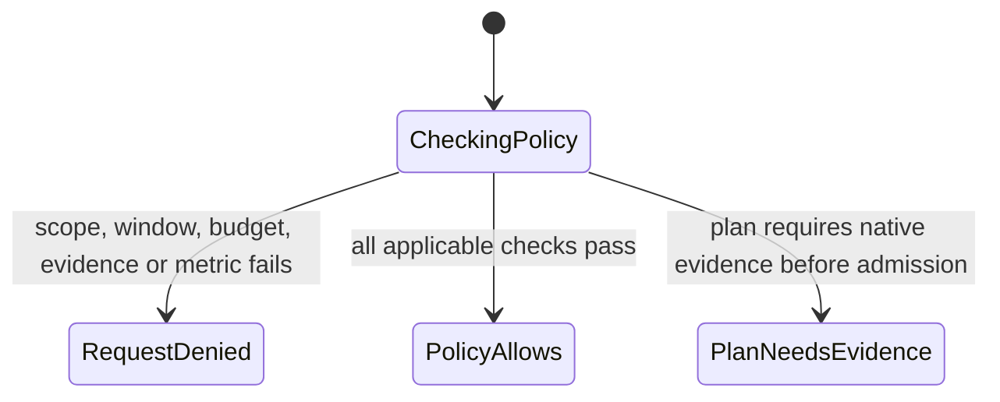

# @hobo/core

Shared kernel for HoBo production packages: the event envelope (`EventEnvelope`, with
CloudEvents conversion via `toCloudEvent`/`fromCloudEvent`), capability grants and
enforcement (`parseCapabilityGrant`, `evaluateCapabilityGrants`, `inferCapabilityUsage`),
the capability-manifest bundle parser, a minimal port container (`createContainer`), and
the typed **port contracts** other packages implement: `EventStore`, `Queue`, `Streamer`,
`VirtualClock`, `ComponentHostPort`, `WrpcLinkPort`, `BindingResolverPort`,
`TrainingEnginePort`, and `EphemeralStatePort` (short-lived TTL/CAS state with
lock and capped-ring helpers; bindings in `@hobo/kv-redis-compatible` and
`@hobo/provider-upstash`).
`TrafficRoutingPort` adds provider-neutral, tenant-scoped multi-backend routing
intent with explicit `full | partial | none` realization and capability notes.

The `@hobo/core/notification` entrypoint exports the asynchronous notification
contract. The asynchronous `NotificationPort` accepts a bounded, well-formed message and
caller-chosen attempt ID. `accepted` means the provider accepted a submission,
not that any recipient received it. `unknown` means it may have accepted the
submission; the port does not promise deduplication or safe retry. A rejection
describes only this attempt and does not settle an earlier unknown attempt.

The asynchronous `DurableMessaging` port exposes finite limits and makes committed, rejected, unknown, and expired outcomes explicit. Implementations live outside core; the accompanying finite-state tests exercise bounded scenarios and do not prove an implementation correct.

`DurableQueue` is the provider-neutral asynchronous byte-and-attribute queue
contract. Its limits parser accepts bounded provider limits and copies them
without invoking accessors or proxy traps. Zero delay or zero attributes are
explicit supported limits; the host must enforce the selected limits and scope
on each operation. Operation identities use the same expiry-bound format as
durable messaging. Unknown or expired outcomes require reconciliation. This
port declares no provider implementation. `delivery-exhausted` explicitly
reports a retained message that can no longer be redelivered automatically.
The local JSON `Queue` API does not implement the component queue contract.
The bounded `DurableQueue` model checks one host, one operation, two possible
payloads, and two lease generations without modeling host restarts. It checks dispatch, retained capacity, conflicts,
and stale-lease settlement, and reaches committed effects after unknown and
expired outcomes. Provider commit, receipt durability, the clock and lease
fencing are modeled as atomic trusted actions; the model is not a proof of an
implementation or of eventual completion.
The separate `AtomicQueueCas` model explores two callers, one operation ID,
two payloads and two attempts, including competing writes, lost responses,
replay and expiry. It assumes linearizable atomic storage and does not model
serialization, leases, host restarts or implementation correctness.
`QueueCompaction` separately checks two callers and two operation identities
through receipt expiry, atomic compaction and stale writes. It assumes atomic
revision checks and does not model snapshot serialization or prove a compactor.

`Messaging.ack` and `Messaging.nack` are asynchronous and must be awaited. Live
adapters report a transport failure or deadline as `MESSAGING_SETTLEMENT_UNKNOWN`:
the broker may have applied the operation. The adapter refuses another
settlement for that delivery while its outcome is unknown. This protection is
local to the adapter instance; the host must reconcile uncertain operations and
enforce any cross-process lease fencing required by its provider.
`MESSAGING_SETTLEMENT_COMMITTED` means settlement succeeded but local event
observation failed; callers must not retry that settlement.
The bounded `model/MessagingSettlement.tla` checks an abstraction of local
settlement and lease replacement; it does not prove the implementation or
provider behavior.

## Honest scope

Implemented: parsers, derived record constructors, error taxonomies, the port
type contracts, the deterministic-clock/queue/streamer value helpers, and the
public-API surface guard (`assertCoreApiSnapshot` against `CORE_API_SNAPSHOT`).
Deliberately not here: no port has a production backend in this package — the
`EventStore`, `Queue`, `Streamer`, and host ports are interfaces plus parse
helpers; implementations live in runtime/provider packages. No I/O, no network,
no persistence.

`createTrustedVault` keeps its own copies in buffers, refuses reads after expiry,
and clears them when the event loop handles the expiry, on explicit removal,
or at normal process exit. It does not serialize their values.
Its string inputs and revealed values may have other copies that JavaScript
cannot reliably erase; it does not guarantee complete memory zeroization.

### HONEST SCOPE — deployment phases and schema diff

`ports/phase.ts` (ADR-0158) ships **vocabulary, parse boundaries, and the
`assertCapabilityPhase` enforcement primitive only**. There is no handler
pipeline and no `ctx.bindings` here: nothing in this package intercepts a
capability access, so enforcement happens where a host calls
`assertCapabilityPhase` — a host that never calls it is never protected.

`ports/schema-diff.ts` (ADR-0160) owns the canonical schema IR and the
forward-only expand/backfill/contract differ. What it deliberately does **not**
do: it emits **no SQL** (`CANONICAL_SCHEMA_DIFF_ENGINE` has no `emitSql`; SQL
emission belongs to toolchain adapters such as `@hobo/adapter-drizzle`, which
fail closed when the toolchain is missing); it models **postgres only** and
refuses any other `dialect` rather than pretending to model it; it models
tables, columns and indexes, so foreign keys, check constraints, enums,
sequences, partitions, views, triggers, and column ordinal position are **not**
represented and a schema that relies on them is under-described rather than
mis-described; the type-widening lattice is a small documented set
(`smallint→integer→bigint→numeric`, `real→double precision`,
`char→varchar→text`, plus parameter growth like `varchar(32)→varchar(64)`) and
every conversion outside it is classified as a **narrowing** — conservative on
purpose, because calling an unknown conversion safe is how an expand phase
loses data. Redefining an index in place (same name, different columns or
uniqueness) yields both an `expand` add and a `contract` drop of that name; the
differ does not model index renames, so distinct names are expected.

## Data-store vocabulary, catalog records and self-hosting

`ports/data-store-offerings.ts` is the portable data-store vocabulary bound to
the generic offering resolver. Provider ids come in two grains: the original
engine-agnostic family ids (`aws-rds`, `gcp-cloudsql`, `azure-sql`) keep
parsing unchanged, and product ids (`aws-rds-postgres`, `aws-aurora-postgres`,
`azure-postgres-flexible`, `neon-postgres`, …) name one PostgreSQL product
each; `DATA_STORE_PROVIDER_FAMILIES` maps a product to the family it refines.
Offering ids cover topology (`replica.multi-region`, `write.multi-writer`,
`ha.failover`), logical replication by direction
(`replicate.logical-publish`, `replicate.logical-subscribe`) and connection
facts (`pool.transaction`, `auth.password`, `auth.identity-token`,
`tls.public-ca`).

`ports/data-store-catalog.ts` adds evidence: `parseDataStoreCatalogEntry`
refuses an asserted claim that names no dated vendor source, `unknown` is the
only unsourced realization, and `dataStoreProfileOf` derives the resolver
profile from the claims. `ports/self-hosted-data-store.ts` is the pure
`assessSelfHostedDataStore`, which reads a provider's declared compute feature
tokens and Yard profiles and returns `can` / `cannot` / `undetermined` with
reasons. A provider package can add cited, per-product **host forms**
(`parseRegisteredHostForm`) about products it already declares; the assessment
then lists every form, so one provider can show a form that qualifies beside
one that does not. Core holds no vendor facts; the PostgreSQL catalog built from these
is in `@hobo/cloud-providers`. See
[`docs/design/postgres-backend-catalog.md`](../../docs/design/postgres-backend-catalog.md).

## Durable lifecycle gate leases

`ports/durable-lifecycle-gate.ts` (`createDurableLifecycleGate`) runs every
transition under an `AsyncActorLease` on its `hosting-lifecycle-gate:` stream.
The gate supplies that lease's fence token when it writes a checkpoint
snapshot. A store used for protected streams must enforce the live token at
commit; accepting the option alone is not evidence of enforcement.
Two lease rules keep a participant from leaking:

- **A failed release never undoes a commit.** After the locked work (for
  example the `ParticipantStarted` append in `begin()`) has committed, an error
  from `lease.release()` is swallowed: the lease expires on its own, and
  `begin()` still returns the participant handle, so `finish()` can remove it
  and `seal()` can complete. If the work itself fails, that error is the one
  thrown.
- **Finish and retire wait out contention.** Supervisor transitions
  (`initialize`, `drain`, `seal`, `resumeDrain`, `stop`, `open`) give up on a
  busy lease after about 800ms. `finish()` and `retireParticipant()` back off
  exponentially (10ms doubling to 500ms) for about 60s, which covers a `stop()`
  holding the lease through a slow `verifyDrained`. Every call still throws
  once its budget runs out, and callers retry: `finish()` on a removed
  participant is a no-op, and a retried `retireParticipant()` that throws
  should be followed by a `status()` read to see whether the participant has
  already gone.

## Commands

```bash
pnpm --filter @hobo/core run build
pnpm --filter @hobo/core run typecheck
pnpm --filter @hobo/core run lint
pnpm --filter @hobo/core run test
pnpm --filter @hobo/core run test:contract:consumer
pnpm --filter @hobo/core run test:contract:provider
```

## Parse, don't validate

Untrusted input crosses named parser boundaries and becomes frozen derived types:
`parseEventEnvelope` → `EventEnvelope`, `parseCapabilityGrant` → `CapabilityGrant`,
`parseCapabilityManifestBundle` → `CapabilityManifestBundle`, plus branded ids like
`ResourceId`, `QueueName`, `TrajectoryId`, and `WireVersion` from their `parse*`
functions. Failures throw typed errors (`EnvelopeParseError`, `CapabilityParseError`,
`QueueParseError`, …) — parse, don't validate. Wire forms live in `data-models/*.proto`
with CUE constraints alongside.

The deployment-phase and schema-diff ports follow the same boundary:
`parseDeploymentPhase` / `parsePhaseScope` / `parsePhaseScopeFromEnv` →
`DeploymentPhase` and `PhaseScope` (an unknown `HOBO_PHASE` or `HOBO_DEV` value
is refused, never defaulted), and `parseSchemaIr` → a deeply frozen,
name-sorted `SchemaIr` whose derived types `diffSchemaIr` turns into a
`MigrationPlan` — a pure, deterministic, forward-only expand/backfill/contract
plan whose `digest` covers the engine id and version, so an engine upgrade is a
visible plan change. Refusals carry `SchemaIrParseError` /
`PhaseParseError` codes; a phase-scoped capability touched outside its phase
raises `PhaseViolationError` with `code: "PHASE_VIOLATION"`.

Traffic routing follows the same boundary: `parseRoutingPlan` produces a deeply
frozen `RoutingPlan` with branded plan/backend/Station identifiers, while
`TrafficRoutingParseError` rejects malformed plans before adapters see them.
`parseTrafficRoutingPlanRecord` and `toTrafficRoutingPlanRecord` reconcile the
generated protobuf record/JSON enums with that frozen domain view; protobuf's
absent scalar/list defaults normalize optional `degraded`/`notes` to `false`/`[]`.

## Position in the event architecture

`@hobo/core` defines the vocabulary of the event architecture — envelopes, principal
refs, and the `EventStore`/`Queue`/`Streamer` port contracts — but hosts no actor,
appends nothing to any event store, and maintains no projection or read store itself.
Commands, events, actors, and materialized views are owned by the packages that
implement or consume these ports; this package only guarantees their records parse.

The bounded WHATWG HTTP adapter treats `TransportResponse.body` as UTF-8 text.
It rejects malformed or truncated UTF-8, preserves an observed leading BOM, and
cancels a failed response before releasing its reader. This prevents text
normalization from making different served bytes appear to match an approved
artifact digest. Binary protocols need an explicit bytes/base64 boundary;
replacement characters are not a valid binary transport.

## Shared budget policy verification

The shared policy evaluator checks scope, funded windows, measured constraints,
and projected integer costs for CI and hosting. Strict admission requires a
native-bound label supplied by the caller; the caller must authenticate that
evidence. Omitted constraints mean none; an explicit non-array constraints
value, including `null`, is refused. The
[verification skill](../../.agents/skills/verify-shared-budget-policy/SKILL.md)
records generated implementation tests, the bounded state model, the
unbounded arithmetic obligations, and their assumptions.

Malformed evaluation contexts and measurement collections or records return a
refusal. Measurement keys, units and optional targets must satisfy the same
shape rules as policy constraints. This validates the supplied evidence's
shape; the caller remains responsible for authenticating its source.
Scope identifiers and metric targets reject unpaired Unicode surrogates so
protobuf encoding cannot silently change them. Target length is measured in
Unicode code points, matching the authored CUE contract.

The model's user-facing projection collapses internal checks into the following
flow. It hides 128 same-label transitions from 256 explored steps.



The bounded `QueueReclamation` model checks that completed-message reclamation
preserves live receipt references and never reuses a message identity. Reclamation
requires an unchanged store revision; the model abstracts payloads and storage.

The bounded `QueueRedrive` model checks one-effect replay, live-lease and
receipt fencing, and stale compare-and-swap. Mutations independently test the
lease, receipt and revision guards. It abstracts provider storage and
does not prove the queue implementation or external host authorization.

The bounded `QueueInspection` model checks disclosure against revocation and a
changed revision between reads. It assumes a truthful linearizable store and
does not prove the implementation, payload content or later authorization.

The bounded `QueueExport` model assumes a trusted host confirms a durable sink
receipt and checks that confirmation uses an unchanged queue revision. It does
not prove sink delivery, idempotency, the host or the implementation.

The bounded `QueuePagination` model checks ordered message-ID scans and requires
the caller to restart when the observed revision changes. It abstracts payloads
and does not prove the implementation or enforce caller behavior.

The bounded `QueueSnapshotTime` model checks that lease expiry during a paged
scan does not admit messages outside the original observation time. It abstracts
provider clocks and does not prove the implementation.

The bounded `model/NotificationSubmission.tla` explores authorization at dispatch
and disclosure, rejection before dispatch, and unknown outcomes before or after
provider commit. The model abstracts a single submission and a trusted transport;
it does not prove an implementation or guarantee message delivery.

The `@hobo/core/cryptography` port defines bounded asynchronous encryption and
decryption requests. Request bytes are copied before a provider can use them;
shared-memory views are rejected. A completed result carries owned result bytes,
a rejection occurred before dispatch, and an unknown result requires the caller
to account for a provider operation that may have occurred. A provider may
impose smaller input bounds and must disclose them. Signing and verification are
separate operations and are not implied by this port. An attempt ID is for
correlation; it does not deduplicate calls or guarantee that a retry is free.
